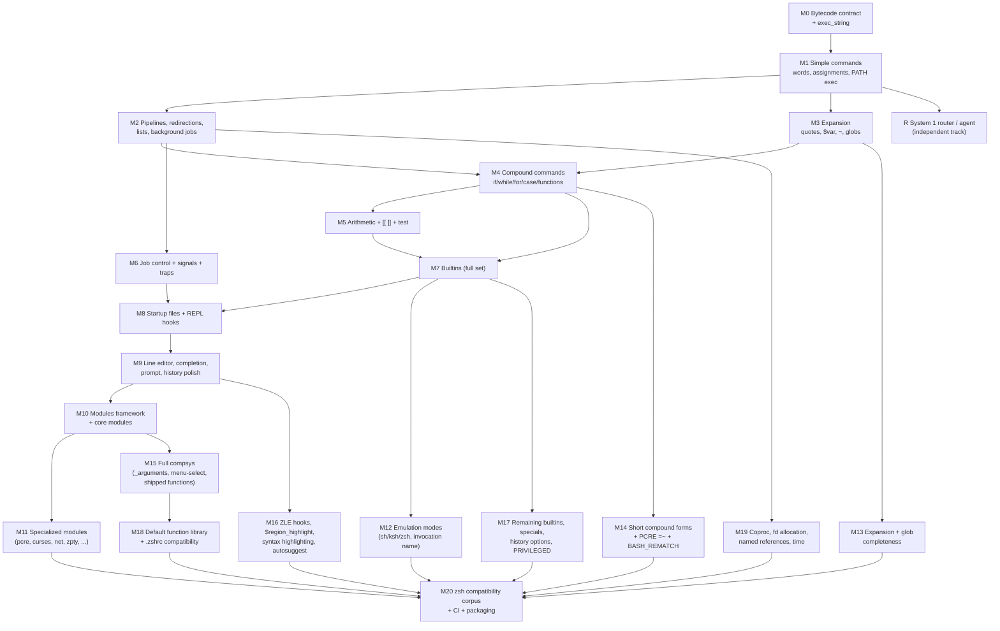

# jfsh — remaining work

Status as of 2026-11-18: M1 (simple commands), M2 (pipelines, redirections, lists,
background jobs), M3 (word expansion), M4 (compound commands and functions), M5
(arithmetic, `[[ ]]`, `test`), M6 (job control, signals, traps), M7 (builtins), M8
(startup files, invocation, the interactive loop's hooks) and M9 (line editor,
completion, prompt, history) are done, along with the part of M0 they needed.
**M10 Phase 1** (modules framework, `zmodload` rewrite, zsh/datetime,
zsh/mathfunc) is done (merged, PR #18). **M10 Phase 2a** (zsh/parameter,
zsh/zutil) is done (merged, PR #19). **M10 Phase 2b** (zsh/system,
zsh/files) is done (merged, PR #20). **M10 Phase 2c** (zsh/stat,
zsh/pcre) is done (merged, PR #21). **M10 polish**
(`$module_path` default, `zmodload -F` toggles, `[[ -pcre-match ]]` /
`[[ -regex-match ]]` cond wiring, `zsh/regex` + `zsh/example` modules)
is done on branch `jfsh-m10-polish`. **M10 is now feature-complete.**

**Goal: full zsh feature compatibility.** M10–M20 extend the plan to cover every
remaining component of zsh (every module zsh ships, every builtin, every option,
every special parameter, the full compsys completion system, ZLE hooks and
highlighting, emulation modes, PCRE/`BASH_REMATCH`, coprocesses and named
references, zsh's shipped function library, and `.zshrc` compatibility). M20
runs the upstream `zsh/Test` suite plus a hand-curated corpus as the final pass
criterion. Every milestone from M10 on is a cumulative step toward "a `.zshrc`
that works under `zsh -f` works under `jfsh -f`, with the same output".

jfsh builds on macOS and Linux and has gtest coverage for the pieces that work. It runs
**simple commands**, pipelines and background jobs joined by `;`, newlines, `&&`, `||` and
`!`, with redirections, here-documents, `NAME=value` and `NAME=(…)` assignments, and the
full word expansion pipeline (parameters, command and arithmetic substitution, splitting,
braces, tilde, globbing), and compound commands: `if`, `while`/`until`, `for` (all three
forms), `case`, `select`, `repeat`, subshells, brace groups, `always` blocks, `(( ))` and
shell functions with `local`, and conditions: `[[ … ]]`, `test`/`[` and integer and
floating-point arithmetic. Commands that span lines work in scripts, on stdin and at the
prompt (with `PS2`). Interactively it has job control (Ctrl-Z, `fg`, `bg`, `jobs`, job
notices, Ctrl-C that ends the command line but not the shell), and `trap`, `kill` and
`wait` work in every shell. The builtins are real (M7): options (`set`, `setopt`,
`emulate`), sourcing, aliases, the directory stack, `print`/`printf`, history,
`whence` and friends; only the ones that need modules (`zmodload`, `zpty`) say `not
implemented`. It reads zsh-style startup files (`.jfshenv`, `.jfshrc`, …), takes zsh's
command-line options, and runs `precmd`/`preexec`/`periodic`/`zshexit` hooks, `sched`
events and mail checks (M8). The line editor has zsh's emacs and vi keymaps,
`bindkey`, `zle` user widgets and `vared`; Tab completes commands, files, parameters and
users, and `compdef` functions; prompts have zsh's escapes; `!` history expansion works
anywhere in a line, and the history file is zsh's format (M9). The System 1 router and
the LLM agent layer work end to end.

This file has two parts:

1. **[Missing components](#part-1--missing-components)**: what each subsystem must do,
   in the order it has to be built.
2. **[Bugs](#part-2--bugs-in-the-current-implementation)**: defects in code that
   already exists. Items marked **confirmed** were reproduced with a runtime probe (most
   under ASan); the rest come from code reading.

Code-level `TODO(area/topic)` comments in the sources carry implementation notes; this
file names them in brackets so the two stay linked.

---

## Build order

Milestones M0–M4 are the minimum for jfsh to be usable as a shell; M0–M9 are the
daily-driver subset already in main. Milestones M10–M20 bring jfsh to full zsh
feature compatibility, culminating in M20's upstream-test corpus. The router/agent
track (R) can proceed in parallel at any time.

---

## Part 1 — Missing components

### M0. Bytecode contract and `exec_string`

**Done** (with M1): the prefix layout for lists, sublists, pipelines, simple commands and
assignments is written down in `include/jfsh/core/wordcode.h`, with skip lengths on
`WC_LIST` and `WC_SUBLIST` so un-taken branches are jumped over; the parser and executor
follow it (bug B1). `StringInputSource`/`FileInputSource` are public in
`include/jfsh/lexer/input.h`. `Parser::parse_string` and `Executor::exec_string` work,
parse errors print `jfsh:LINE: parse error near `X'` with status 1, and leftover tokens
are an error (B9). `disassemble()` (`src/parser/text.cpp`) backs `tests/parser_test.cpp`.

**Remaining**
- Each construct that lands later adds its layout to the comment in `wordcode.h`, its
  own `disassemble()` formatting, and parser tests asserting the exact bytecode, as
  redirections (M2), compound commands (M4) and `[[ ]]` (M5) did.
- The source-text decompiler for `functions`/`which` [text/decompile] is still to do.

### M1. Simple commands

**Done.** Implemented in `src/exec/executor.cpp` (`exec_simple`, `apply_assigns`,
`run_external`, `find_command`), with tests in `tests/exec_test.cpp`:
- Words go through quote removal (the only M3 step so far), then dispatch to a builtin
  or an external command.
- Leading `NAME=value` / `NAME+=value` / `NAME[sub]=value` words (unquoted identifier
  before the `=`) are assignments. As in zsh's addvars, the command's words and
  redirection targets are expanded first, then each assignment is expanded and made
  before the next, so `a=1 b=$a` sees `a`:
  - with no command they set shell parameters through `ParamTable::set_scalar` /
    `set_array`, which update the existing parameter wherever it lives, keep its
    attributes, refuse readonly parameters, and create new ones as globals. On an
    integer or float the value is arithmetic (`i+=1` adds); `a+=x` on an array appends
    an element;
  - in front of a command they go into a scope of its own, as a copy of the outer
    parameter (type and attributes kept, readonly refused), which is popped after it.
    Before an external command they are made in the child, after its redirections,
    and exported; arrays are not exported. Before a function they are exported to
    what it runs. Before a builtin they last only while it runs; following zsh rather
    than POSIX, they persist after a **special** builtin only when `POSIX_BUILTINS` is
    set. A readonly name or failed expansion ends the command line, except before an
    external command, where only that command fails (status 1). The prefix scope is
    marked as such, so `local`/`typeset` of a new name declares below it; typeset's
    `name=value` arguments are expanded after the prefix assignments. `a[i]=x` in
    front of a builtin or function changes the array itself, as in zsh. In front of
    `exec` with redirections the assignments are temporary; alone, or with only
    redirections, they stay.
- External commands: the `$PATH` search reads the shell's own `PATH` parameter, or the
  one assigned in front of the command. An empty component (and `PATH=` alone) means
  the current directory, where the name is run as it is; a directory or non-executable
  entry of that name gives "permission denied". The shell looks the name up (and
  hashes it) in its own `PATH` even when a `PATH=` prefix sends the child elsewhere.
  Results from absolute directories are added to the hash while `HASH_CMDS` is set;
  entries (also `hash name=path`) are used either way. The hash is dropped on any
  assignment to `PATH`, including `export`/`typeset` ones. `command -p` searches only
  the default path.
  The command runs with `execve` and an environment from `ParamTable::make_envp()`. A
  file with no `#!` line and no NUL in its first bytes runs under `/bin/sh` (also as a
  pipeline stage, background job, or under `exec`); a missing `#!` interpreter is
  "bad interpreter". Messages are zsh's `<strerror>: name`; statuses: 127 for not
  found and other errors, 126 for EACCES/ENOEXEC, `128+sig` for signalled.
- `$?` (`ExecContext::last_exit`) is updated after every pipeline, and `exit` stops the
  program.
- `xtrace` prints the prompt-expanded `PS4` (initially zsh's `+%N:%i> `, nothing when
  unset) plus the expanded command, quoted as zsh does (`'…'`, or `$'…'` with control
  characters), **before** running it, to the stderr from before its redirections.
  Assignments show their values: `+a=1 +:` before a builtin or function, `+a=1 cmd`
  before an external one.

**Review fixes** (branch jfsh-m1-review): left-to-right assignments, expanded after
the words; `a+=x` on an array appends; `PATH=… cmd` searches the new `PATH`; prefix
assignments keep the parameter's type and attributes and don't export arrays; a
readonly prefix before a builtin or function ends the line; one exec helper
(`exec_program`) for the forked, `EF_NOFORK` and `exec` paths with zsh's `/bin/sh`
fallback, messages and 126/127 statuses; `find_command` goes through `command_hash()`,
`path_dirs()` is the one `$PATH` splitter (also for `.` and `whence`), an empty `PATH`
searches `.`, a directory on `$PATH` is 126; the hash is dropped on any `PATH`
assignment (`ParamTable::path_generation`); xtrace quoting, `PS4` default and placement
as zsh's. Round 2: temporary assignments before `exec` redirections, `command -p`
failing when the default path lacks the name, `export`/`typeset PATH=` dropping the
hash, no trace line for a redirection-only command, parent-side hashing with a `PATH=`
prefix, `hash` entries used under `NO_HASH_CMDS`, prefix assignments before typeset's
arguments (prefix scopes, `ParamTable::push_scope(true)`), subscripted prefixes
persisting, typeset arguments traced as assignments. Round 3: the typeset variants
(typeset, local, declare, integer, float, private) count as POSIX-special, so their
prefix assignments stay under `POSIX_BUILTINS`; a failed typeset-argument expansion ends
the line; one scope guard for every prefix scope of a builtin or function; `typeset -p`
in a function prints `-g` for a parameter from outside it (a prefix copy keeps the
original's level); tests for locals and private parameters under a prefix scope.
Round 4: `command` takes the POSIX-special status away again (prefix assignments before
`command typeset`/`export` don't stay under `POSIX_BUILTINS`; `builtin` keeps it);
typeset's arguments are expanded after the command's redirections and prefix
assignments, in the builtin branch, so `typeset y=${zz?boom} 2>/dev/null` is silent; an
unset prefix copy is "no such variable" to `typeset -p`; the module is now
`zsh/param/private`, as in zsh (`zsh/private` stays as an alias).

**Left to other milestones**
- `typeset name` on an existing parameter doesn't print it, so `x=1 typeset x` shows
  nothing (zsh prints `x=1`); a typeset listing gap, not a prefix one.
- `$path` is not tied to `$PATH`, so `path=(…)` doesn't change the search: see the M17
  `typeset -T` item.
- zsh runs a `#!` script whose interpreter is itself a script by hand; jfsh reports
  "exec format error".
- `read`, `for` and `${x=v}` still store text into an integer or float parameter.

### M2. Pipelines, redirections, lists, background

**Done.** Implemented in the M2 PR, reworked by the review below:
- Pipelines `a | b | c` and `|&` (`WC_PIPE` encodes `n` plus a per-connector stderr
  bitmask). As in zsh every stage but the last forks; the last runs in the shell with
  its stdin from the last pipe, so `echo x | read v`, `… | while read l` and `echo |
  f` change the shell, and `echo y | exit 4` exits it. An external command or a
  subshell there forks into the pipeline's process group and job (`EF_PIPELAST`,
  `Executor::fork_command`/`wait_command`). The forked stages are always a job, so
  their statuses survive the SIGCHLD reaper; `$pipestatus` has every stage, and
  `PIPEFAIL` takes the rightmost failure. `! pipeline` comes out of `WC_SUBLIST_NOT`.
- `&` forks a child that re-enters `exec_sublist`; a lone pipeline (`a | b &`)
  instead forks each stage from the shell into one `JOB_ASYNC` job, `$!` is the last
  stage and an interactive shell prints `[N] pid pid…`, as zsh does.
- The redirection set (`Parser::par_redir`, `Executor::apply_redirects`): `<`, `>`,
  `>>`, `<>`, `<<`, `<<-`, `<<<`, `>&N`, `<&N`, `>&-`, `<&-`, `&>`, `&>>`, `>& file`
  (`&>`), `>>& file` (`&>>`), and the forms that ignore NO_CLOBBER, `>|`, `>!`,
  `>>|`, `>>!`, `&>|`, `&>!`, `&>>|`, `>&|`, `>&!` (the lexer spells `!` as `|`);
  the fd prefix is one digit, as in zsh (`2>`, `0<`; `12>f` is the word 12).
  `N>&file` writes the file to N and 2. A `>&$x` target that is a number dups, `-`
  closes, anything else is a file; `<&word` is "file number expected", which ends the
  command line.
- Redirections are made in order. Files open as zsh's `clobber_open`: under
  NO_CLOBBER `>` refuses an existing regular file (`file exists: f`) but opens a
  device or fifo (`>/dev/null`), and an empty one with CLOBBER_EMPTY; `>>` creates
  nothing unless CLOBBER or APPEND_CREATE. `>&N` refuses the shell's own fds above 9
  (they are close-on-exec), as zsh does (`N: bad file descriptor`). Errors read as
  zsh's, after `jfsh: ` (`no such file or directory: f`); a target that expands to
  nothing fails the command, not the line.
- `MULTIOS`: the second output redirection to an fd turns it into a pipe to a tee
  that writes to what the fd went to before and to the new target; it is forked once
  the redirections are done, or before another redirection reads the fd (`>a 2>&1
  >b`), and `SavedFds::restore` waits for it, so the next command reads whole files.
  A pipeline stage's pipe is its first stdout redirection and `|&` a trailing `2>&1`
  (`EF_STAGEOUT`/`EF_STAGEERR`), so `echo y >c | cat` writes to both and `{ … }
  2>/dev/null |& cat` sees the errors; `>&2` targets take part too.
- A command of nothing but redirections runs `$NULLCMD` (`cat`), or `$READNULLCMD`
  (`more`) for a lone `<file`; `:` under SH_NULLCMD; "redirection with no command"
  (ending the line) under CSH_NULLCMD, with an empty `$NULLCMD` or after `builtin`,
  `command`, `noglob`, `-`, `nocorrect`. `NULLCMD`, `READNULLCMD` and `TMPPREFIX`
  start as in zsh.
- Here-documents: `par_redir` registers the delimiter with `Lexer::register_heredoc`
  (the lexer reads the body at the end of the line, B62) after quote removal on it
  (`'a"b'`, `E\\OF`); any quoting makes the body literal; `<<-` strips leading tabs.
  The body is written straight into a pipe; one longer than the pipe holds is fed by a
  forked writer.
- Process substitution `<(cmd)`, `>(cmd)`, `=(cmd)`: the lexer keeps the command (read
  as `$(…)` is, past quotes and nested substitutions) in its word, alone or with other
  text (`--f=<(cmd)`, `<(cmd)x`); the Expander's `Scan` runs it in place
  (`Executor::procsubst`) when it is unquoted at the word's top level (`=(…)` only at
  its start), in command words, assignments and typeset arguments, `for`/`foreach`
  lists, arrays, the `case` subject and a `<<<` target; quoted text and parameter
  values never are. It gives `/dev/fd/N` (N ≥ 10) or a `$TMPPREFIX…` file; the fd is
  closed and the file removed once the command (`exec_cmd`/`exec_simple`) is done,
  after the pipeline for a forked last stage. Without job control `<(…)` and `=(…)`
  read /dev/null. `< <(cmd)` and `> >(cmd)` are redirections joined to the pipe;
  `< =(cmd)` reads the file.
- Pipes, here-document and tee pipes are moved to fds ≥ 10, so pipelines work with
  the shell's own fd 0 or 1 closed.
- `EF_NOFORK`: `run_external` honours the flag by `execve`-ing in place.
- SIGCHLD is handled with a self-pipe on fds ≥ 10 (`pipe2` with `O_CLOEXEC|O_NONBLOCK`
  where it exists, `pipe` and `fcntl` on macOS); the handler writes one byte, and the
  executor reaps between commands (B22).
- Bug B4 fix: `JobTable::alloc` never returns `id=0` (slot 0 reserved).

**Review fixes** (branch jfsh-m2-review): `<&-` closes fd 0 (it closed stdout);
process substitution decided by the parser, not by expanded text; the MULTIOS tee
waited for; NO_CLOBBER for each MULTIOS target, for devices (`>/dev/null`) and for
`>>` without APPEND_CREATE; one-digit fd prefixes, and `>&N` refusing the shell's own
fds; the last pipeline stage in the shell; the pipe and `>&N` taking part in MULTIOS,
and `|&` after the stage's redirections; redirections in order, a failed one reported
once; the clobber spellings and `>& file`; pipelines with fd 0 or 1 closed; `$!` of a
background pipeline is its last stage; an empty target fails only the command;
`$NULLCMD`/`$READNULLCMD` and SH_NULLCMD as `:`; zsh's redirection messages; quote
removal on here-doc delimiters; here-documents without a fork; `$TMPPREFIX`; `<(…)`
reading /dev/null; `functions` prints `<&-` and leaves out default fds. Tests in
`tests/exec_test.cpp` (M2 section), `tests/interactive_test.cpp`
(`LastPipelineStageRunsInTheShell`) and `tests/lexer_test.cpp` (`ClobberSpellings`);
the NULLCMD tests in `tests/emulate_test.cpp` now expect zsh's behaviour.
Round 2: Ctrl-Z on a pipeline whose last stage the shell runs prints "job can't be
suspended" and continues the stopped stages (`Executor::continue_pipeline_stages`, also
while `read` blocks, through the signal self-pipe), as zsh; `&|` and `&!` run a list
in the background without a job (`WC_LIST_DISOWN`); a process substitution inside a
word (`--f=<(cmd)`, `<(cmd)x`), in an assignment or typeset argument (`x=<(cmd)`), a
`for`/`foreach` list or an array (`a=(<(cmd))`) runs in place through the Expander
(only unquoted, at the word's top level), its fd lasting until the command is done;
`functions` prints `3< <(cmd)` / `> >(cmd)`; `exit` in the last stage doesn't wait
for the others; `>&N` refuses only fds the shell recorded as its own (by fd and
inode), so a user's close-on-exec fd above 9 works; `jobs` lists a pipeline a line a
stage when their states differ, and `wait %N` gives the last stage's status, as zsh.
Round 3: a process substitution's command ends at its matching `)` past quotes and
nested substitutions (`<(echo ")")`, `a<(echo ')')b`), in the lexer (`slurp_nested`)
and the Expander (`find_close`); `read` handles signals while it blocks, so a trap
runs at once (and, since round 5, ends a `-t` read as zsh does); `case <(cmd) in`, `<<<
<(cmd)` and `< =(cmd)` (a real file, printed as written) work; an `EF_NOFORK`
external with an `=(…)` file forks so the file is removed after it.
Round 4: `read` polls only with a timeout, or for the self-pipe while it is the last
stage of a pipeline under job control (and never for a regular file); otherwise a
trapped signal's EINTR has it handle the signals and go on, in subshells too, so
`while read` without a trap is back at the base speed; at the end of input with nothing read it
empties its names (an array gets one empty element), as zsh; an `open` that a signal
interrupts (a fifo waiting for its other end) is retried after handling the signals;
`$'…\'…'` inside `$(…)`/`<(…)` no longer ends it; an unfinished `<(…`/`>(…`/`=(…`
is a parse error, and interactively asks for more input.
Round 5: a signal-interrupted fifo `open` is retried only for an untrapped signal (a
job ending); a trapped one, Ctrl-C or an exit fails the redirection quietly, so Ctrl-C
gets the prompt back from `exec 3<fifo`; with a signal trap set, `read` polls the
self-pipe (race-free, and CHLD traps run too) and a trap ends a `-t` read as a
timeout, as zsh; Ctrl-C ends `read` with 130; `read -k` at the end of input sets what
it got (status 1) and `read -q` sets `n` (status 2); `echo`/`print`/`printf` report a
write error with its own errno (`write error: broken pipe`), writing straight to the
fd so nothing stays buffered.
Round 6: when `read` watches the self-pipe (a signal trap is set, or the last stage
under job control) it asks FIONREAD how many bytes are waiting and reads those without
polling, so `trap … INT; cat big | while read` costs 0.8-0.9 s for 200000 lines (zsh
1.05 s, no trap 0.7 s) instead of 1.85 s; output a builtin left in stdio for a fd that
fails to take it (`type echo >&-`) is dropped when the redirections are undone
(`SavedFds::restore`), not written to the restored stdout; tests for the write errors.

**Left to other milestones**
- Errors carry no line number (`jfsh: …` where zsh says `zsh:4: …`), as everywhere
  in jfsh.
- With MULTIOS, zsh concatenates several input redirections to one fd (`cat <a <b`,
  `>o <a <a`); jfsh lets the last one win.
- Under NO_MULTIOS zsh doesn't glob a redirection target (non-interactive) and writes
  to `*.t` literally; jfsh globs and reports "ambiguous redirect".
- Job control with the last stage in the shell: a foreground command run there joins
  the pipeline's process group; when it is suspended it becomes a job of its own
  beside the pipeline's (zsh makes them one job). A builtin other than `read` that
  blocks there (`… | cat`-like builtins) notices a stopped stage only when it
  returns. A pipeline's forked stages are also a (foreground) job without job
  control, in the table only while the pipeline runs.
- Two process substitutions next to each other (`<(a)<(b)`) are two words; zsh makes
  them one.
- Comments, here-documents and `case` patterns inside `<(…)` or `$(…)`
  (`<(echo a # x )⏎…)`, `<(cat <<E⏎a ) b⏎E⏎)`, `<(case x in x) echo y;; esac)`): the
  lexer counts parentheses (past quotes and substitutions) instead of parsing the
  command, so a `)` there ends it early (M3's command-substitution lexing). An
  unfinished `<(…` inside a word (`--f=<(cmd`) is text, not a parse error.
- With a signal trap set, or under job control in the last stage of a pipeline,
  `read` checks FIONREAD (and polls when nothing is waiting) once per `read`, so such
  a `while read` loop is about 15-25% slower than without (still faster than zsh).
- `echo x >&-` (also `print`, `printf`) is silent with status 0 in zsh; jfsh reports
  `write error: bad file descriptor` with status 1.
- With SIGPIPE ignored when the shell starts, zsh's `( … )` pipeline stage still dies
  of SIGPIPE (`(sleep .3; echo b) | true` gives `$pipestatus` `141 0`); jfsh's keeps
  it ignored, reports `write error: broken pipe` and gives `1 0` (signal setup in
  subshells, M6).
- With MULTIOS, `cat < =(echo a) <<< b` reads both in zsh; jfsh reads the last one
  (the input-concatenation item above).
- A MULTIOS tee forked for an external command is the command's child, not the
  shell's, so the shell doesn't wait for it (zsh doesn't either).
- The `wait` builtin's `%jobid`, `-n`, `-f` came with M6. `$(<file)` and `{fd}>file`
  belong to other milestones.
- `wait $!` after `cmd1 && cmd2 &` and `! cmd &` differ from zsh (zsh reports the pid
  as not a child, and ignores the `!`).

### M3. Word expansion [exec/expand], [subst/*]

**Done.** The expander is `src/exec/subst.cpp` (`Expander`, documented in
`include/jfsh/exec/subst.h`); `Executor::expand_command` runs it over a simple command's
assignments, words and redirection targets. Tests: `tests/subst_test.cpp`.
- **Lexer (bug B8 fixed):** `$(…)`, `${…}`, `$((…))`, `$[…]`, backquotes and `$'…'` stay
  in one word, nested to any depth and with quotes tracked inside them. `{`/`}` are
  reserved only as words of their own, so `a{b,c}`, `{1..3}` and `{}` are words; `(…)`
  inside a word (`*.(c|h)`, `*(.)`, `name=(…)`) and `<lo-hi>` stay in the word.
- **Here-documents:** the lexer now reads bodies when it reaches the end of the line
  (`Lexer::take_heredocs`), so the rest of the line and the following lines still parse
  (they used to be swallowed, bug B62). Bodies are expanded unless the delimiter was quoted
  (new `literal` bit in `WC_REDIR`).
- **Quotes:** `'…'`, `"…"` (with `\$ \` \" \\ \newline`), `$'…'` C escapes, `\`.
- **Parameters:** `$name`, `${name}`, `$1`…`${10}`, `$#`, `$@`, `$*`, `$argv`, `$?`, `$$`,
  `$!`, `$-`, `$0`, `$PPID`, `$RANDOM`; `$name[sub]` without braces; `$#name`, `$=name`,
  `$~name`. Positional parameters live in `ExecContext::positional`/`arg0`, set from
  `jfsh script args…` and `jfsh -c cmd name args…`.
  - Operators: `- := = ::= ? + ` (with and without `:`), `# ## % %%`, `/ // /# /% :/`,
    `:offset:length`, the modifiers `:h :t :r :e :u :l :q :Q :a :A` (chainable), `${#x}`,
    `${+x}`, `${=x}`/`${==x}`, `${~x}`.
  - Subscripts `[i]`, `[i,j]`, negative indices, `[@]`, `[*]`, scalar character
    ranges, associative-array keys; nested `${${x#a}%b}` and `${(f)"$(cmd)"}`.
  - Flags `U L C j:…: s:…: f F q qq q- Q k v o O i n u @ P t z p`.
  - Unset parameters expand to nothing, or fail under `NO_UNSET`.
- **Command substitution:** `$(…)` and `` `…` `` fork, capture stdout, strip trailing
  newlines and set `$?` (so `x=$(false)` returns 1).
- **Arithmetic:** `$((…))` and `$[…]` through a new integer evaluator
  (`include/jfsh/builtins/math.h`) with zsh's operator precedence, assignments, `++`/`--`,
  `0x`, `0b` and `base#n` literals and recursive evaluation of names. `let` uses it.
- **Splitting:** unquoted arrays become separate words with empty elements removed; command
  substitutions split on `$IFS`; scalars only with `SH_WORD_SPLIT` or `${=x}`; `"$@"` and
  `"${a[@]}"` keep elements apart; empty unquoted words disappear.
- **Brace expansion:** `{a,b}`, nested, `{1..5}`, `{5..1}`, `{01..10..2}`, `{a..e}`,
  `BRACE_CCL` `{abc}`, `IGNORE_BRACES`. Braces from quotes or expansions are literal.
- **Tilde and equals:** `~`, `~/x`, `~user`, `~+`, `~-`; after `=` and `:` in assignments,
  and in arguments under `MAGIC_EQUAL_SUBST`. `=cmd` expands to the command's path (`EQUALS`).
- **Globbing (bug B30 fixed):** see "Glob" below. Characters that came from quotes or
  expansions are literal unless `GLOB_SUBST` or `${~x}`.
- Redirection targets are expanded like words; several results (`> {a,b}`) become several
  redirections that MULTIOS fans out. `<<<` and `>&$fd` targets stay one word.

**Left**
- `${^x}`/`RC_EXPAND_PARAM`, `${x:#pat}`, subscript flags `[(r)pat]`/`[(i)pat]`, padding
  flags `(l:n:)`/`(r:n:)`, `(%)`, `(e)`, `(D)`, `(V)`, `(c)`/`(w)`, the `:s/x/y/` modifier
  and `KSH_ARRAYS` indexing [subst/param].
- A failed `${x?}` should make a non-interactive shell exit; jfsh only fails the
  command [subst/errexit].
- In `${x:-word}`, unquoted pattern characters in `word` should still glob.
- Floating-point arithmetic and `OCTAL_ZEROES` landed with M5.
- `NO_GLOB` (`set -f`) has no option slot yet; `CSH_NULL_GLOB` is not honoured.
- History expansion still happens in the REPL before parsing (`HistoryManager::expand`).

### M4. Compound commands and functions [parser/*], [exec/*]

**Done.** Bytecode layouts are in `include/jfsh/core/wordcode.h`: each compound header
carries a type and a skip length, bodies are nested `list* WC_END` programs, and two
opcodes were added, `WC_CURSH` and `WC_WORDS`. The parser is in `src/parser/parser.cpp`,
the executor in `src/exec/executor.cpp`. Tests: `tests/parser_test.cpp` (exact bytecode)
and `tests/compound_test.cpp` (behaviour, with zsh's output as the expected value).
- `if`/`elif`/`else`, `while`/`until`, `for name… in words`, `for name (words)`,
  `for name` (over `"$@"`), `for ((init; cond; step))`, `case` with `;;`, `;&` and `;|`,
  `select` (menu and `PS3` on stderr, `$REPLY`), `repeat N`, `{ … } always { … }`, and
  `(( expr ))` as a command (status 2 on an arithmetic error). Loop bodies may be
  `do … done`, `{ … }` or a single sublist (`for x (a b) echo $x`, `repeat 3 cmd`).
- Several names per `for` (`for k v in …`). The value list goes through full expansion;
  `case` patterns use `Expander::pattern`, so characters from quotes or `$v` are literal.
- `break N` and `continue N` (bug B18): `ExecContext::break_level` counts the loops left
  to unwind and `continuing` marks a `continue`; `loop_depth` gives the "not in while,
  until, select, or repeat loop" error. As in zsh, `break` in a function leaves the
  caller's loop.
- Subshells `( … )` fork; brace groups `{ … }` run in the current shell (bug B11). `))`
  is now two tokens, so `(a; (b))` closes both; `(( … ))` is read raw by
  `Lexer::read_arith`.
- Redirections after any compound command (`while …; done < f`, `{ … } 2>&1 | x`) are
  moved in front of it in the bytecode and applied around it in-process.
- Functions: `name () body`, `name1 name2 () body`, `function name [()] body`, with a
  `{ … }` or single-command body, and anonymous `() { … } args`. `ExecContext::functions`
  maps names to a `ProgRef` copied out of the defining program, so bodies outlive it.
  Functions are looked up before builtins. Each call scopes `$1…`/`$#`/`$@`, sets `$0`
  under `FUNCTION_ARGZERO`, pushes a parameter scope, and honours `return N`,
  `LOCAL_OPTIONS`, `LOCAL_TRAPS` and `FUNCNEST` (default 700, as in zsh). Assignments in
  front of a function call are exported to what it runs. `return` outside a function ends
  the script or `-c` string, as in zsh.
- `typeset`, `local`, `declare`, `integer`, `float`, `export` and `readonly` are parsed
  as zsh's reserved-word typeset (`WC_TYPESET`), so `local x=$(cmd)` isn't split and
  `local a=(1 2)` makes an array. The builtins handle `-a -A -i -F/-E -g -l -u -r -x` and
  `+` to turn attributes off. A new local is set but empty. Known difference: it keeps
  the export attribute of the parameter it hides, so `export y=1; g() { local y=5;
  printenv y; }` prints 5, where zsh's local is not exported. A builtin with no prefix assignments no longer gets its
  own parameter scope, so `local` lands in the function's scope.
- `read [-rA] [name…]` (needed by `while read` loops): IFS splitting, with the rest of the
  line in the last name, `$REPLY` with no name, backslash handling without `-r`, and
  status 1 at end of input.
- Keywords only act as keywords in command position (bug B7): wherever the parser
  expects words (`for … in` lists, `case` patterns and subjects, `repeat` counts,
  anonymous function arguments), it takes a reserved word as a word.
- Multi-line input (bug B31, and the continuation item of M8): `is_incomplete()`
  (`include/jfsh/parser/parser.h`) reports input cut off inside a construct, quote or
  here-document. stdin mode collects lines until a command is complete, and the prompt
  reads more lines after `PS2` (`Editor::read_line(true)`). The editor now switches raw
  mode with `TCSADRAIN`, so pasted multi-line input isn't discarded.

**Left**
- zsh's other short forms: `if [[ x ]] { … }`, `while cond { … }`, `foreach … end`,
  `for x in a b; cmd` [parser/short].
- Redirections written after a function definition (`f() { … } > log`) should become part
  of the function; they are a parse error.
- `EF_NOFORK` for a subshell that is already a forked pipeline stage [exec/subsh].
- The function call depth is bounded by the C++ stack: a Debug build reaches the default
  `FUNCNEST=700` with about 2× headroom but crashes somewhere between 1500 and 3000; under
  ASan, 700 already overflows.

### M5. Arithmetic, `[[ ]]`, `test`

**Done.** Arithmetic is `src/builtins/math.cpp` (`math_eval`, documented in
`include/jfsh/builtins/math.h`); the conditions shared by `[[ ]]` and `test` are
`src/builtins/cond.cpp` (`include/jfsh/builtins/cond.h`), which also holds the `test`
builtin; `[[ ]]` is parsed by `Parser::par_cond` and run by `Executor::exec_cond`. Tests:
`tests/math_test.cpp`, `tests/cond_test.cpp` (expected values from zsh 5.9), and bytecode
and lexer tests in `tests/parser_test.cpp` and `tests/lexer_test.cpp`.
- **Arithmetic** (`$(( ))`, `(( ))`, `let`, `for (( ))`, `[[ -eq ]]`, subscripts,
  `typeset -i/-F/-E`): values are 64-bit integers or doubles (`MathNum`). Float literals
  (`1.5`, `1.`, `.5`, `1e3`), `Inf`/`NaN`, float parameters, and an integer `**` a
  negative exponent give floats; mixed operands promote; comparisons and bitwise operators
  give integers. `$(( ))` prints floats as zsh does (`10.`, `0.30000000000000004`,
  `1e+20`). Integers wrap on overflow; integer division by zero is an error, float
  division gives `Inf`.
- The evaluator is now precedence climbing over two tables: zsh's default (shifts and
  bitwise operators bind tighter than `**`, `*` and `+`, which the old evaluator had
  backwards) and C's under `C_PRECEDENCES`. All assignment operators, including `^^=`;
  `&&`, `||`, `&&=`, `||=` and `?:` don't evaluate the un-taken side.
- Literals: `0x`, `0b`, `base#digits`, `_` between digits, `0` octal under
  `OCTAL_ZEROES`; `FORCE_FLOAT` makes integer constants floats. `name[i]` reads and
  assigns array elements (negative indexes, growing the array) and `name[key]`
  associative-array elements.
- Assigning to a new name gives it the value's type (`(( n = 5 ))` is an integer,
  `(( g = 2.5 ))` a float); an existing integer or float keeps its type, and a scalar stays
  a scalar. `name=value` and `name+=value` on an integer or float parameter are evaluated
  arithmetically. Float parameters print as `typeset -F` (`2.5000000000`) or, with the new
  `PM_EFLOAT`, as `typeset -E` (`2.500000000e+00`); `Param::scalar()` renders integer and
  float values.
- Errors match zsh's messages (`operator expected at `…'`, `lvalue required`,
  `invalid base`, `math recursion limit exceeded`) and set status 1, or 2 for `(( ))`.
- **`[[ … ]]`:** `[[` is a command word that switches the lexer to `LEX_COND`, where `<`
  and `>` are words and `((` is two `(`. Bytecode is a `WC_COND` tree (`wordcode.h`):
  `!`, `&&`, `||` and `( )` with zsh's precedence, newlines allowed between parts.
  Operands are expanded without splitting or globbing. The right side of `=`, `==`, `!=`
  is a pattern read raw by `Lexer::read_cond_pattern`, so `(a|b)*` stays one operand;
  quoted parts and parameter values are literal unless `${~x}`. `=~` is a POSIX extended
  regex that sets `$MATCH`, `$MBEGIN`, `$MEND`, `$match`, `$mbegin`, `$mend` (character
  offsets, -1 for a group that took no part). `<`/`>` compare strings; `-eq` … `-ge`
  compare arithmetic expressions (`[[ n+1 -gt 2.5 ]]`).
- Unary tests `-a -b -c -d -e -f -g -h -k -n -o -p -r -s -t -u -v -w -x -z -L -O -G -S -N`
  and `-nt -ot -ef` (false unless both files exist). Status 2 and a message for an unknown
  condition, 3 for `-o` with no such option, as in zsh.
- **`test` / `[`** (bug B19 for these two): POSIX's rules for up to four arguments (so
  `test = = =` and `test ! = !` compare strings), then `!`, `-a`, `-o` and `( )` by
  precedence. Integers must be decimal (`integer expression expected`, status 2), and `[`
  needs its `]`.
- `OptionState::find` matches exact names before stripping `no` and reports the negation
  (bug B15), so `[[ -o nomatch ]]` and `[[ -o nonomatch ]]` both work.
- A `!` that isn't a word of its own (`!=`, `!x`) is now part of a word; it used to split
  `test a != b` into `a ! = b`. `${~x}` and `GLOB_SUBST` now make a value active in `case`
  and `[[ = ]]` patterns, as they already did in arguments.

**Left**
- The zsh/mathfunc functions (`sqrt`, `int`, …) [math/mathfunc], which need `zmodload`;
  output bases `$(( [#16] x ))` and `C_BASES` [math/output]; `##x` character codes.
- `REMATCH_PCRE` and `BASH_REMATCH` for `=~`, and module conditions (`-pcre-match`, …).
  zsh calls a lone `[[ -n ]]` an unknown condition; jfsh tests the string `-n`.
- `test` accepts `<` and `>` (POSIX 2024) and `test -o option`, where zsh errors.
- xtrace doesn't print `[[ … ]]` or `(( … ))` commands yet.

### M6. Job control, signals, traps [signals/*], [builtin/bg|fg|jobs|wait|disown|kill]

**Done.** Signals and traps are `src/core/signals.cpp` (`include/jfsh/core/signals.h`),
the job table `src/core/jobs.cpp`, foreground waits and fg/bg `src/exec/jobctl.cpp`
(declared at the end of `include/jfsh/exec/executor.h`), the builtins
`src/builtins/jobctl.cpp`, and the one-line job text `pipeline_text`/`sublist_text` in
`src/parser/text.cpp`. Tests: `tests/jobs_test.cpp` (in-process) and
`tests/interactive_test.cpp`, which drives the `jfsh` binary through a pty; expected
output is from zsh 5.9 (`zsh -f -c`, `zsh -f -i`).
- **Signals:** one handler for every signal the shell catches sets a bit in a lock-free
  atomic pending set and writes a byte to the self-pipe (B22). The executor acts on them
  between commands (`Executor::handle_signals`): it reaps children, runs traps, turns an
  untrapped Ctrl-C into "abort the command line" and SIGHUP into an exit, and follows
  SIGWINCH into `$COLUMNS`/`$LINES`. Dispositions come from the trap table plus job
  control (`SignalManager::install`); signals ignored when the shell started stay ignored.
- **Interactive setup:** the shell takes `/dev/tty`, waits to be in the foreground,
  puts itself in its own process group, takes the terminal and saves its modes. It
  catches SIGINT, SIGHUP and SIGWINCH, catches and drops SIGQUIT, SIGTERM and SIGTSTP
  (caught rather than ignored so a child forked a moment ago still gets them), and
  ignores SIGTTIN and SIGTTOU (B23). Without a terminal job control stays off and
  `fg`/`bg` say `no job control in this shell.`
- **Children:** `Executor::fork_child` blocks every signal across `fork`; the child joins
  the job's process group, takes the terminal if it's in the foreground, resets
  dispositions and traps (`SignalManager::child_reset`: ignored signals stay ignored,
  `( … )` keeps ZERR and DEBUG), forgets the parent's jobs, then unblocks. Command and
  process substitution and here-doc writers reset too. A background job without job
  control ignores SIGINT and SIGQUIT; with it and BG_NICE it runs at nice 5. A lone
  background pipeline and every pipeline stage `exec` their command instead of forking
  again, so `$!` and `kill %1` reach the command itself.
- **Foreground jobs** (only under job control; otherwise the old pid waits): each
  pipeline, external command and `( … )` is a job; `wait_foreground_job` gives it the
  terminal, waits with WUNTRACED and takes the terminal back (B14). A stopped job keeps
  its terminal modes for `fg`, becomes the current job and prints
  `jfsh: suspended  cmd` (status 128 + signal); a stop inside a loop also ends the
  command line. A job killed by Ctrl-C ends the whole command line, as in zsh; one killed
  by another signal prints `jfsh: killed     cmd` (not for SIGPIPE).
- **Job table:** ids start at 1, `%+`/`%-` follow zsh (a job that stops becomes
  current; removing a job promotes the previous one; B41), statuses say `running`,
  `done`, `exit 1`, `terminated`, `suspended (tty input)`, `segmentation fault (core
  dumped)` …, padded as zsh does. `jobs -l` puts each process of a pipeline on its own
  line. Finished background jobs are reported before the prompt and, with NOTIFY (now on
  by default, as BG_NICE is), right away while a line is being typed. Exit statuses of
  finished background processes are kept for `wait $!`.
- **Job specs:** `%N`, `%%`, `%+`, `%`, `%-`, `%string`, `%?string`, with zsh's messages
  (`%3: no such job`, `job not found: x`, `no current job`).
- **Builtins:** `jobs [-lprs]`, `fg`, `bg` (`job already in background`), `wait [pid|job
  …]` (127 and `pid N is not a child of this shell`; a trapped signal ends it with 128 +
  the signal), `disown` (warns about a suspended job), `kill [-s SIG|-n N|-SIG] pid|job`
  (a stopped job also gets SIGCONT) and `kill -l [sig|status …]` (B19 for these).
- **Traps:** `trap`, `trap cmd SIG…`, `trap '' SIG`, `trap - SIG`, `trap SIG…`, `trap -`,
  signal numbers, `0` for EXIT, `--`, `undefined signal: X`; the listing is zsh's
  (`trap -- 'echo hi' INT`, in signal order). Traps run between commands, and right
  after a builtin that raised the signal, with `$?` preserved (B16). `TRAPINT() { … }`
  functions get the signal number as `$1`; one that returns non-zero aborts the command
  line; `trap` and `TRAPxxx` replace each other. EXIT runs when the shell exits (all
  of `-c`, scripts, stdin and the REPL), when a `( … )` subshell that set it exits, and
  at the end of a function that set it. DEBUG runs before each command, ZERR after a
  failing one; neither runs inside another trap. LOCAL_TRAPS is decided when the
  function returns, and only the traps the function changed are put back.
- **ZERR, ERR_EXIT, ERR_RETURN** are the executor's (B33): set off by a failing simple
  command, function call, pipeline, `( … )`, `[[ ]]` or `(( ))` (not by `{ }`, if,
  loops or case, whose failing command already did), except in if/while/until
  conditions, `!`, and all but the last pipeline of a `&&`/`||` chain. ZERR and
  ERR_EXIT act once per failure and are off anywhere under such a context; ERR_RETURN
  minds only the command's own place (so a function called from a condition still
  returns) and acts at every level.
- **Exit:** CHECK_JOBS warns `you have suspended jobs.` (or, with
  CHECK_RUNNING_JOBS, `running jobs`) once; exiting again, or after `jobs`, goes ahead.
  With HUP, jobs left behind get SIGHUP (and SIGCONT if stopped):
  `jfsh: warning: N jobs SIGHUPed`.
- **Line editor:** Ctrl-C drops the line, or at PS2 the whole command (B24); EOF or a
  hung-up terminal ends the read instead of spinning (B29); the editor polls the signal
  self-pipe so traps run and job notices print while it waits, then redraws.

**Left**
- zsh turns the rest of a loop whose command was suspended into a suspended job of its
  own; jfsh ends the command line instead.
- A CHLD trap runs for the stages of a foreground pipeline (`trap … CHLD; (sleep
  0.3; echo a) | cat`); zsh's doesn't.
- TRAPS_ASYNC, POSIX_TRAPS, POSIX_JOBS, AUTO_CONTINUE and AUTO_RESUME are not
  implemented; neither are `suspend`, `time` (JOB_TIMED) or `$ZSH_SUBSHELL`.
- A non-interactive shell keeps finished background jobs in its table until `jobs` or
  `wait` reports them.
- Job text shows a here-document as `<<EOF` whatever its delimiter.
- The editor doesn't re-layout on SIGWINCH yet: `$COLUMNS`/`$LINES` are updated, but
  the editor doesn't use them (B26, B27).

### M7. Builtins [builtin/*]

**Done.** The builtins are in `src/builtins/` by group: `vars.cpp` (typeset and its
variants, unset), `setopt.cpp` (set, setopt, unsetopt, emulate, shift), `dirs.cpp`,
`print.cpp` (echo, print, printf), `read.cpp`, `eval.cpp` (`.`, source, eval, exit,
return, autoload, functions), `lookup.cpp` (whence, which, type, command -v, builtin,
hash, rehash, alias, unalias), `limits.cpp` (ulimit, umask, times), `hist.cpp` (fc,
history, r), with shared helpers (option parsing, zsh-style quoting) in `util.cpp`. The
ones that call the executor are compiled into `jfsh_exec`. Tests: `tests/builtins_test.cpp`;
expected output is from zsh 5.9 (`zsh -f -c`, `zsh -f -i`).
- **Options:** the option table is regenerated from zsh 5.9 itself: every option zsh
  has (185), with each emulation's defaults, which ones a plain `emulate` resets and
  which are special. Single letters follow zsh (`set -e`, `$-` = `569X…`) or, with
  SH_OPTION_LETTERS, ksh. `set` handles `-o`/`+o` (both listings), `--`, `-`, `-s`,
  `-A`/`+A` and lists parameters; `setopt`/`unsetopt` take names with `no`, `_` and any
  case, `-m` patterns and letters, and list what differs from the defaults (all options
  under KSH_OPTION_PRINT). Invocation options (`interactive`, `shinstdin`, …) can't be
  changed. `emulate [-LR] mode [-c cmd]`. ERR_EXIT, ERR_RETURN, NO_UNSET, XTRACE and the
  rest are now reachable from scripts.
- **Errors abort:** an expansion error (`${x?}`, NO_UNSET, `$((1/0))`) or an assignment
  to a readonly parameter ends the command line, so a non-interactive shell exits, as
  zsh's errflag does.
- **Variables:** `typeset -p`/`-m`/`+`, the bare listings (`typeset -i`, `export`,
  `export -p`, `readonly -p`), `-f`, `-U`, with `-u`/`-l`/`-U` kept in force by later
  assignments; `float` is `typeset -E` as in zsh. `unset [-fmv]`, `name[i]`/`name[key]`,
  locals that stay local when unset, `unset -f TRAPxxx` removing the trap.
- **Sourcing:** `.` searches `$PATH`, `source` the current directory first; arguments
  become the positional parameters meanwhile, `$0` is the file, `return` ends the file,
  127 when it isn't found. Scripts and sourced files are parsed a line at a time
  (`Parser::parse_line`), so aliases defined on one line apply on the next; `-c` and
  `eval` parse the whole text first, as zsh does.
- **Precommand modifiers** are handled by `exec_simple`: `builtin`, `command [-pvV]`
  (bypasses functions and builtins), `exec [-cl] [-a name]` (replaces the shell;
  alone, keeps its redirections), `noglob`, `-`, `nocorrect`.
- **Aliases** (`include/jfsh/core/alias_table.h`): regular, global (`-g`) and suffix
  (`-s`) aliases expanded by the parser in command position (after assignments, and
  after an alias whose text ends in a blank), global ones anywhere; the alias text is
  pushed onto the lexer's input (`LexInput`) and each token remembers the aliases it came
  from, so `alias ls='ls -l'` and `a=b b=a` don't recurse. Reserved words can be aliased.
  `alias` lists (`-L`, `-m`, `-g`, `-s`), `unalias [-ams]`.
- **Directories:** `cd`/`chdir` with `-`, `±N`, `old new`, CDPATH, CDABLE_VARS, `-L`/`-P`
  (logical `$PWD` by default), CHASE_LINKS/CHASE_DOTS, errors as zsh words them, and the
  `chpwd` function; `pushd`/`popd` (`±N`, PUSHD_MINUS, PUSHD_SILENT, PUSHD_TO_HOME,
  PUSHD_IGNORE_DUPS, AUTO_PUSHD), `dirs [-clpv]`, `$dirstack`, `~N`/`~+N`/`~-N`, `pwd
  [-rLP]`. Like zsh, they print the stack or new directory only when interactive (B20).
- **Output:** `echo` interprets escapes unless `-E` or BSD_ECHO; `print` has `-r -R -n
  -l -N -c -C -a -o -O -i -m -u -v -f -x -X -D -P -s`; `printf` has every conversion
  (`%b %q %c %s %d %i %o %u %x %X %e %f %g %a`), flags, `*` widths, `%N$`, arithmetic
  arguments, `'c` character codes, `\c`, reuse of the format and `-v`.
- **read:** `-r -A -k N -q -s -d delim -t secs -u fd -e -E` and `name?prompt`; `$REPLY`
  is trimmed like any other name, as in zsh.
- **Lookup:** `whence [-vcwpafmsS]`, `type`, `which`, `command -v/-V` with zsh's wording,
  `hash [-dfLmrv] [name[=path]]` and `rehash` on the executor's command hash.
- **Functions:** `functions [-mu+]` and `whence -f`/`which` print definitions as zsh does
  (`function_text` in `src/parser/text.cpp`, the multi-line decompiler); `trap` lists
  TRAPxxx functions; `autoload [-U] name|/path/name` loads zsh-style (the file is the
  body) or ksh-style (the file defines the function) from `$fpath` on first call.
- **History:** `fc -l [-nrdfiD]`, `fc -s`/`-e -`/`r` with `old=new`, `fc -e editor`,
  `fc -W/-R/-A`; `history` is `fc -l`. Event numbers, `-N` offsets and prefixes.
- **Limits:** `ulimit [-HSa] -tfdscmunlvxiqerN [value]` with zsh's labels, `umask [-S]`
  octal or symbolic, `times` from `getrusage`.
- **Control:** `exit`/`return` take arithmetic expressions and reject extra arguments.
- **Stubs** that need later milestones print `jfsh: NAME: not implemented` and return 1:
  `bindkey`, `zle`, `vared` (M9), `zpty` (now registered, B21),
  `compinit`; `zmodload` alone lists nothing.

**Left**
- `typeset -T`, `-Z`/`-L`/`-R` padding, `-h`, `-t`; `emulate -l`; `autoload -X`;
  `read -z -c -l -n -p`; `print -z` and `-p`; `fc -p/-P`; `hash -d` (named directories,
  no table yet).
- `. ./fifo` / `source` of a fifo is refused ("no such file or directory"); zsh reads
  it.
- A command that runs in a forked pipeline stage hashes its path in the child, so
  HASH_CMDS doesn't remember it in the shell.
- zsh errors in special builtins (`set -o nosuch`, `unset readonly`) exit a
  non-interactive shell; jfsh's only return 1.
- Messages name the shell as `jfsh:` and leave out zsh's line numbers and `(eval)`.
- `f() {}` is parsed as a function whose body runs a command `{}`.
- `< <(cmd)` (process substitution as a redirection target) is a parse error.
- zsh's default aliases `run-help` and `which-command` are not defined.

### M8. Startup, REPL loop, invocation [loop/*]

**Done.** Invocation is parsed in `src/exec/invocation.cpp` (`parse_invocation`), the
startup files, hooks, `sched` events and mail checks are in `src/exec/loop.cpp`
(`include/jfsh/exec/loop.h`), the special parameters in `src/exec/context.cpp`, and
`src/main.cpp` strings them together. Tests: `tests/startup_test.cpp` (in-process, plus
the `jfsh` binary run with arguments) and the M8 cases in `tests/interactive_test.cpp`.
- **Invocation:** zsh's rules: letter clusters (`-xe`, `+x`, `-xc cmd`), `-o name`/`+o
  name`/`-oname`, `--name`/`--no-name` for any option, `-c` taking the first argument
  after the options (later ones are `$0` and the positional parameters), `script
  args…`, `-s args…`, `-i`, `-l`/`--login` (or a `$0` starting with `-`), `-f`
  (NO_RCS), `-d` (NO_GLOBAL_RCS), `--` and `-`. `--help`, `--version`. Errors are
  zsh's and exit 1: `bad option: -q`, `no such option: x`, `string expected after
  -c`/`-o`; an unknown `--router` or `--provider` value is an error too (B32). A
  script that can't be opened: `can't open input file: x`, 127.
- **Startup files**, in zsh's order: `SYSCONFDIR/jfshenv` (always), `$ZDOTDIR/.jfshenv`,
  then for a login shell `jfsh_profile`/`.jfsh_profile`, for an interactive one
  `jfshrc`/`.jfshrc`, for a login shell `jfsh_login`/`.jfsh_login`; a login shell reads
  `.jfsh_logout` then `SYSCONFDIR/jfsh_logout` on exit. RCS and GLOBAL_RCS are checked
  before each file, `$ZDOTDIR` (default `$HOME`) is re-read before each, `exit` in a
  file ends the shell. `SYSCONFDIR` is the CMake cache variable `JFSH_SYSCONFDIR`
  (default `/etc`).
  - **Decision on `.zshrc`:** not read by default, since a real `.zshrc` usually needs
    ZLE, `compinit` and modules jfsh doesn't have yet. `--zsh-compat-rc` reads the
    user's `.zshenv`, `.zprofile`, `.zshrc`, `.zlogin` and `.zlogout` right after the
    matching jfsh file (not `/etc/zsh*`).
- **Exit**, as zsh's `zexit`: the history is saved (when `HISTFILE` is set and
  `SAVEHIST` isn't 0), a login shell reads its logout files, then the EXIT trap runs,
  then the `zshexit` hook.
- **The interactive loop**, each iteration: traps and job reaping, job notices,
  `precmd` (and `precmd_functions`), `periodic` when `$PERIOD` seconds have passed,
  due `sched` events, mail (`$mailpath`, `$MAILPATH` or `$MAIL`, every `$MAILCHECK`
  seconds, default 60; `file?message` with `$_` set to the file); the prompt from
  `$PS1` as it is now (B38); the line is added to the history **before** it runs, so
  `$HISTCMD` is its number, `fc`/`history`/`r` leave it out, and `r`/`fc -s` replace it
  with the command they run; `preexec` (and `preexec_functions`) with the line as `$1`,
  `$2` and `$3`; then the line. Hooks keep `$?` and `$pipestatus`. History settings
  (`HISTFILE`, `HISTSIZE`, `SAVEHIST`) are read after the startup files.
- **`sched`** (`src/builtins/sched.cpp`): `sched [-o] [+]hh:mm[:ss]|[+]secs cmd…`,
  `sched` lists in zsh's format, `sched -N` removes.
- **Special parameters** (getters and setters in `ParamHandlers`, which `ParamTable` now
  calls on every lookup and assignment, so expansion, arithmetic, `typeset` and the
  environment all see them): `$SECONDS` (assignable), `$RANDOM` (assigning seeds it),
  `$LINENO` (lines of the script, `-c` string, sourced file or `eval` text; in a
  function, counted from the line its definition starts on), `$HISTCMD`, `$status`,
  `$pipestatus`, `$PPID` (fixed at startup, readonly), `$EPOCHSECONDS`,
  `$EPOCHREALTIME`. `$SHLVL` is incremented and `$PWD`/`$OLDPWD` set and exported at
  startup. Each command's first word now records the line the command starts on (the
  parser emits a command's words after the lexer has read past the end of its line).
- **Scripts** were already run a command at a time (`Parser::parse_line`), so a syntax
  error at the end no longer stops the lines before it from running.

**Left**
- `sched` events only run before a prompt; zsh also runs them while the line editor
  waits for input. `sched -o` is accepted but there is no line to clear.
- Mail: maildir directories and `MAIL_WARNING` aren't handled; the message is expanded
  for parameters but not prompt escapes.
- `preexec`'s `$2` should be a size-limited single-line version of the command (zsh
  elides function bodies); it is the whole line.
- Some zsh specials are still missing: `$TTYIDLE`, `$UID`/`$EUID`/`$GID`/`$EGID`
  (assignable in zsh), `$USERNAME`, `$ZSH_SUBSHELL`, `$funcstack`, `$funcfiletrace`.
  `local SECONDS` doesn't make a local copy of a special; `unset` drops the special
  meaning for good, as in zsh.
- `$LINENO` in a one-line function (`f() { echo $LINENO; }`) is 1; not checked against
  zsh. `$pipestatus` after a function call is that call's status, not the last
  pipeline inside it; also not checked against zsh.
- `PRIVILEGED` doesn't skip the user's startup files.
- An error in a startup file of a non-interactive shell ends the shell, as one in a
  script does; zsh only abandons that file.
- zsh couldn't be run on this machine while M8 was written (it isn't installed, and
  running a downloaded copy was blocked), so the expected outputs come from zsh's
  documentation and source rather than from running it, except `$LINENO` in a function
  and `$SHLVL`.

### M9. Line editor (ZLE), completion, prompt, history

**Done.** Expected behaviour comes from zsh 5.9 (`zsh -f`, `zsh -f -i`), which could be
run on the machine M9 was written on: default keymaps and `bindkey` listings, `print -P`
output, bang expansions and xtrace lines were compared with it.
- **Keymaps and widgets** (`src/editor/keymap.cpp`, `include/jfsh/editor/zle.h`): keys
  are looked up in data-driven keymaps (`emacs`, `viins`, `vicmd`, `visual`, `viopp`,
  `isearch`, `command`, `.safe`; `main` is another name for emacs or viins) holding
  zsh's default bindings, plus Home/End/Delete, Shift-Tab and Ctrl-X Ctrl-E. A
  sequence that is a prefix of a longer binding waits `$KEYTIMEOUT`; unbound escape
  sequences are swallowed, not inserted. `main` is viins when `$VISUAL`/`$EDITOR`
  mentions vi, as in zsh. Keymaps live in the `Zle` object (one per shell, on
  `ExecContext::zle`), so a .jfshrc can set them up before the first prompt.
- **Emacs widgets** (`src/editor/editor.cpp`): movement by character, word (zsh's
  `forward-word`, with `$WORDCHARS`) and line; deleting and killing with a kill ring
  (kills in a row join, `yank`/`yank-pop`); transpose and case; mark and region;
  undo/redo (typing is one step); numeric arguments (`Alt-digits`, `neg-argument`,
  `universal-argument`); `quoted-insert`; overwrite mode; bracketed paste; history
  (`up/down-line-or-history`, `history-search-*`, `history-beginning-search-*`,
  incremental search with `^R`/`^S`/`^G`/backspace, `insert-last-word`,
  `copy-prev-word`, `infer-next-history`); `push-line`/`get-line`, `accept-and-hold`,
  `accept-line-and-down-history`; `expand-history`/`magic-space`;
  `edit-command-line` (`$VISUAL`/`$EDITOR`); `execute-named-cmd`; `run-help` and
  `which-command`; `clear-screen`. Ctrl-D on an empty line is EOF (IGNORE_EOF says
  "use 'exit' to exit").
- **Vi mode** (`src/editor/vi.cpp`): insert/normal/visual (`v`, `V`)/replace (`R`);
  motions `h l w W b B e E ge gE 0 ^ $ | f F t T ; , %`, history `k j + - G / ? n N`;
  operators `d c y gu gU g~ > <` with a motion, doubled for lines, or a text object
  (`iw aw iW aW i" a" i' a' i( a( i[ a[ i{ a{ i< a<`); `x X D C S s Y p P r ~ J o O i a
  I A`; counts on both the operator and the motion (`2d3w`); registers `"a`–`"z`
  (`"A` appends, `"_` discards); marks `m` `` ` `` `'`; `u` and `^R`; `.` repeats the
  last change, an insert included. Leaving insert mode steps back a character, and the
  cursor stays on the line's last character in vicmd.
- **UTF-8** (`src/core/utf8.cpp`, B25): the cursor moves by character (a base
  character and its combining marks are one), widths come from `wcwidth()` with a
  built-in table for characters the locale doesn't know. `main` sets `LC_CTYPE` from
  the environment.
- **Rendering** (`src/editor/refresh.cpp`, B26, B27): the prompt is expanded once per
  line; each refresh draws prompt and buffer again from the prompt's first row,
  breaking rows itself (so it always knows where the cursor is): multi-line prompts and
  buffers, wrapped lines, wide characters, control characters as `^X`, the region in
  standout, `RPROMPT`/`RPS1` on the last prompt row when the line fits
  (TRANSIENT_RPROMPT drops it on accept), messages and completion lists below the
  line. The width is read on every refresh, so SIGWINCH means drawing again.
  PROMPT_CR/PROMPT_SP mark output that didn't end in a newline with
  `$PROMPT_EOL_MARK`, as zsh does. A job notice or trap output while typing clears the
  line first and draws it again below (`Editor::trash`).
- **`bindkey`** (`src/builtins/zle.cpp`): `-e -v -a -M -l -L -N -A -D -d -r -s -R -p`,
  listing in zsh's format (ranges like `" "-"~" self-insert`, `bindkey -L` commands),
  zsh's key notation (`^X`, `\e`, `\M-x`, `\C-x`, `\NNN`, `\xNN`).
- **`zle`**: `-N` (user widgets, which may replace builtin ones; `.name` is always the
  builtin), `-D`, `-A`, `-l [-L] [-a]`, `-M`, `-U`, `-K`, `-R`, `-I`, and `zle widget`
  from inside a widget. A user widget's function sees `$BUFFER`, `$CURSOR`, `$LBUFFER`,
  `$RBUFFER`, `$PREBUFFER`, `$WIDGET`, `$LASTWIDGET`, `$KEYS`, `$KEYMAP`, `$NUMERIC`,
  `$HISTNO`, `$MARK`, `$CUTBUFFER`, `$BUFFERLINES`, `$REGION_ACTIVE` as special
  parameters bound to the editor, so assigning them edits the line at once.
- **`vared [-p prompt] [-r rprompt] [-c] [-a|-A] [-h] [-M keymap] name`**.
- **Completion** (`src/editor/completion.cpp`, B28, B52): the word at the cursor is
  found by a small tokenizer (quotes, backslashes, separators, redirections, `$(`,
  precommand modifiers, assignments). Contexts: `$name` and `${name` → parameters (with
  the closing `}`); `~user` → users; command position → builtins, functions, aliases,
  reserved words and `$PATH` executables (executable only, each name once, sorted,
  cached per directory mtime), or files when the word has a `/`; after `cd`, `pushd`,
  `rmdir` → directories; otherwise files, with `/` after directories, LIST_TYPES
  markers in lists, and quoting (backslashes, or inside an open `'`/`"`, closed on a
  unique match). Tab inserts the longest common prefix; a Tab that adds nothing lists
  (AUTO_LIST, LIST_AMBIGUOUS, LIST_ROWS_FIRST, columns, `$LISTMAX` with "do you wish to
  see all N possibilities"); the next one starts menu completion (AUTO_MENU,
  MENU_COMPLETE, Shift-Tab goes back). COMPLETE_IN_WORD is honoured.
  `compdef fn cmd…` / `compdef -d` hand a command's arguments to a shell function,
  which sees `$words`, `$CURRENT`, `$PREFIX` and adds matches with `compadd [-S suf] [-P
  pre] [-d disp] [-a] [-U] -- words`, or `_files [-/] [-g pat]`, `_directories` and
  `_command_names`. `compinit` is accepted and does nothing.
- **Prompt** (`src/prompt/prompt.cpp`, B34–B37, B61): numeric arguments (`%2~`,
  `%-1/`, `%3c`, `%2m`); `%~` replaces `$HOME` (from the shell's parameters) only at a
  component boundary; `%B %b %U %u %S %s %E`, `%F{…}`/`%K{…}` with names, 0–255 and
  `#rrggbb`, `%f %k` (with zsh's re-emission of colours after `%B`/`%b`); `%? %j %L %h
  %! %i %I %N %x %e %y %l %n %m %M %# %v %d %/ %c %. %C`; `%D{fmt}` (with zsh's `%f %K
  %L`), `%D %T %t %@ %* %w %W`; `%(x.true.false)` with every test zsh has; truncation
  `%N<…<`, `%N>…>`, `%N[…]`, ended by `%<<` or the enclosing group; `%{…%}`; unknown
  escapes expand to nothing. PROMPT_SUBST (parameter, command and arithmetic
  expansion first; quotes kept), PROMPT_BANG and PROMPT_PERCENT. Zero-width parts are
  marked so the editor knows the prompt's width. `print -P`, PS3 and PS4 use the same
  expander; PS4 now defaults to zsh's `+%N:%i> ` (and an assignment's trace ends in a
  space, as zsh's does).
- **History** (`src/history/history.cpp`): bang expansion anywhere in the line: `!!`,
  `!N`, `!-N`, `!str`, `!?str?`, `!#`, `!{…}`, `^old^new^`, word designators (`:0 ^ $ * %
  x-y -y x* x-`, the colon optional before `^ $ * %`), modifiers (`:h :t :r :e :s :gs :&
  :g& :q :x :u :l :a :A :p`), `$histchars`; nothing expands inside single quotes,
  after a backslash, or before a blank, `=` or `(`. The interactive loop prints an
  expanded line before running it; HIST_VERIFY puts it back in the editor; `:p` only
  prints it. Errors are zsh's (`no such event: N`, `event not found: str`, `no such
  word in event`, `substitution failed`, `illegal modifier: z`).
- **History file**: reads and writes zsh's format: EXTENDED_HISTORY lines (`: start:
  elapsed;cmd`), multi-line entries as `\` continuations, and zsh's metafied bytes.
  APPEND_HISTORY appends only entries not yet in the file (B5) and then cuts the file
  back to `$SAVEHIST`; without it the file is rewritten (HIST_SAVE_NO_DUPS honoured).
  `fcntl` locks while reading and writing. INC_APPEND_HISTORY writes each line as it is
  entered, INC_APPEND_HISTORY_TIME after it ran (with its time), SHARE_HISTORY also
  reads what other shells wrote before each prompt. `fc -W` rewrites, `fc -A` appends.
- **History options**, read from the options and `$HISTSIZE` (default 1000),
  `$SAVEHIST` (default `$HISTSIZE`), `$HISTFILE` before each prompt: HIST_IGNORE_SPACE,
  HIST_IGNORE_DUPS, HIST_IGNORE_ALL_DUPS (drops the older copy, B58), HIST_NO_STORE
  (drops `history`/`fc -l` lines, B40), HIST_REDUCE_BLANKS, HIST_FIND_NO_DUPS (in the
  editor's searches), HIST_VERIFY, BANG_HIST.
- Without a terminal (`jfsh -i < file`) the prompt goes to stderr and the line is read
  unbuffered (B54).
- Tests: `tests/editor_test.cpp` drives an `Editor` through a pty in process and feeds
  its output to a small terminal emulator, so the tests check the screen and cursor;
  `tests/prompt_test.cpp`; bang expansion and history-file cases in
  `tests/history_test.cpp`; Tab, `^R`, bang expansion and .jfshrc bindings end to end in
  `tests/interactive_test.cpp`; history file and prompts without a terminal in
  `tests/startup_test.cpp`.

**Left**
- Syntax highlighting and autosuggestions (optional in the plan) aren't done.
- Completion: no `_arguments`/`_describe`-style specs, no option or `--long` completion,
  no reading of zsh's own completion functions, no menu selection (`menuselect`
  keymap, arrow keys in the list), no named directories (`hash -d`) or `cdpath`; a
  compdef function's `compadd` options beyond `-S -P -d -a -U` are accepted and
  ignored. `expand-word`, `list-expand` and `spell-word` only beep, so Tab doesn't
  expand globs or `$vars` in place.
- `zle -F` (fd handlers) and `zle -T` say `not implemented`; `zle-line-init`,
  `zle-line-finish` and `zle-keymap-select` hooks aren't called; `$zle_highlight` and
  `$region_highlight` are ignored; `vared -i/-f` (init/finish widgets) are accepted and
  ignored; vared can't be used inside a widget.
- Vi: no `:` ex commands beyond `execute-named-cmd`; `.` repeats with the original
  count only; `aa`/`ia` (shell words) are treated as blank-delimited words.
- Rendering redraws everything on every key: fine for normal lines, slow for a buffer
  of thousands of characters over a slow link. After SIGWINCH, a terminal that reflows
  the old lines can leave stale rows above a multi-row prompt. `%G` is ignored.
- `sched -o` still has no line to clear (the events don't run while the editor waits).
- History: HIST_EXPIRE_DUPS_FIRST, HIST_LEX_WORDS, HIST_SAVE_BY_COPY (the file is
  rewritten in place, under the lock), HIST_NO_FUNCTIONS and CSH_JUNKIE_HISTORY aren't
  honoured; `fc -p`/`-P` (history stacks) aren't implemented; HIST_IGNORE_SPACE drops
  the line at once instead of keeping it until the next one.
- `%_` (parser state) is always empty, so PS2's default `%_> ` is `> `.

### M10. Modules framework and core modules [modules/*]

Builds the module subsystem that every other zsh module, most of the compsys
completion code (M15), and the shipped function library (M18) depend on. Fixes
bug B53 (`ModuleManager` never instantiated).

**Phase 1 — done** (branch `jfsh-m10-modules`): the framework is wired in and
two core modules ship. `ExecContext::modules` owns a `ModuleManager`;
`main.cpp` registers compiled-in modules at startup and auto-loads
`zsh/datetime` and `zsh/mathfunc`. `zmodload` is a real builtin with
`-L/-l/-i/-u/-A/-R/-a/-e/-F`, listing in zsh's sourceable form, aliases
(`zmodload -A new=zsh/x`), autoload marking, and zsh-worded errors. The
arithmetic evaluator takes an optional `const MathFuncRegistry*` and resolves
bare `name(args…)` through it (fed by `ctx.modules.math_funcs()`); every
`math_eval` / `arith_eval` call site passes it. Executor's builtin lookup
checks `ctx.modules.find_builtin()` after the core `Builtins` table, so
module-contributed builtins (`strftime`) run through the same dispatch.

New files: `include/jfsh/modules/{module,datetime,mathfunc}.h`,
`src/modules/{datetime,mathfunc}.cpp`, `tests/modules_test.cpp`.
Shipped module contents:
- `zsh/datetime`: `strftime [-rs] fmt [epochtime]` builtin (forward and
  reverse through `strptime`); records `$EPOCHSECONDS`/`$EPOCHREALTIME`/
  `$epochtime` in its feature list (the specials themselves are still
  installed by `install_special_params`, M8).
- `zsh/mathfunc`: 37 math functions resolvable from `$((…))`, `(( ))` and
  `let`: `abs acos acosh asin asinh atan atan2 cbrt ceil cos cosh erf erfc
  exp expm1 fabs float floor gamma hypot int lgamma log log10 log1p log2
  logb pow rand48 rint signgam sin sinh sqrt tan tanh` (plus `j0 j1 y0 y1`
  on glibc).

Tests: 27 cases in `tests/modules_test.cpp` covering zmodload list / load /
unload / alias / autoload / `-e` / bad flags, and per-module math function
arity, truncation, promotion, unknown-function errors, and strftime
formatting. `tests/shell_fixture.h` registers and auto-loads the shipped
modules so the in-process `Shell` matches the real binary.

**Phase 2a — done** (branch `jfsh-m10-phase2-parameter-zutil`):
`zsh/parameter` and `zsh/zutil` ship.
- `zsh/parameter` installs 19 live-view specials through a new
  `ParamHandlers::get_hash`/`set_hash` channel: `$parameters`, `$commands`,
  `$functions`, `$dis_functions`, `$aliases`, `$galiases`, `$saliases`,
  `$dis_aliases`, `$dis_galiases`, `$dis_saliases`, `$builtins`,
  `$dis_builtins`, `$modules`, `$options`, `$widgets`, `$reswords`,
  `$dis_reswords`, `$patchars`, `$dis_patchars`.  Each is PM_READONLY and
  recomputed on every lookup, so compsys sees the current state of the
  function / alias / module / option tables.  `refresh()` gained a
  thread-local reentrancy guard so a getter that walks `ParamTable` doesn't
  recurse through itself.
- `zsh/zutil` ships `zstyle` (set / list / `-L` / `-d` / `-s` / `-b` /
  `-a` / `-t` / `-T` / `-m` / `-e`, pattern contexts resolved through
  `CompiledPattern`), `zparseopts` (`-D -E -K -F -M -A -a` plus
  `name[+][:[:]][=target]` specs), `is-at-least` (numeric-aware version
  comparison, falls back to `$ZSH_VERSION`), and `zformat -f var fmt
  args…` (`%key`, `%NNkey`, `%-NNkey`, `%%`, missing key → empty).
- `main.cpp` and `tests/shell_fixture.h` register and auto-load all four
  Phase-1/2a modules so compsys-style code works without a user
  `zmodload`.
- 31 new tests (62 total in `tests/modules_test.cpp`) cover every surface.

**Phase 2b — done** (branch `jfsh-m10-phase2b-system-files`): `zsh/system`
and `zsh/files` ship.
- **`zsh/system`** (auto-loaded): `syserror [-e var] [-p prefix] errno`
  (accepts a numeric errno or a name like `EACCES`); `sysopen -o
  read|write|readwrite|append|create|excl|truncate|nonblock|noctty|
  sync|cloexec -u var file` plus `-r`/`-w`/`-a` shortcuts; `sysread
  [-c cnt] [-i fd] [-o fd] [-s size] [-t timeout] [name]` with
  `select()`-based timeout (exit 1 on timeout, 2 on `-t 0` would-block,
  zsh's convention); `syswrite [-c cnt] [-o fd] data`; `sysseek [-u fd]
  [-w start|end|current] offset`; `zsystem flock [-t secs] [-f var]
  [-r] file` (polls with `LOCK_NB` under a timeout), `zsystem unflock
  fd`, `zsystem supports feature`; `$errnos` associative array covering
  ~80 POSIX+GNU errno names.
- **`zsh/files`** (registered but NOT auto-loaded, so user keeps GNU
  coreutils' extended flags by default; opt in with `zmodload zsh/files`):
  `chmod MODE file…`, `chown OWNER[:GROUP] file…`, `chgrp GROUP file…`
  (names or numeric ids, `-` sentinel to leave unchanged), `ln [-fs]
  src dst`, `mkdir [-p] [-m MODE] dir…`, `mv src… dst` (dst can be a
  directory), `rm [-rRfv] file…`, `rmdir dir…`, `sync`.  Errors follow
  zsh's `jfsh: NAME: strerror: path` format.
- `main.cpp` registers both, auto-loads only `zsh/system`.  Test fixture
  mirrors that.
- 22 new tests (84 total in `tests/modules_test.cpp`) cover every
  surface: errno lookup, pipe-based sysread timing, fd round-trips with
  sysopen/sysseek, flock acquire/release, mkdir/rm/mv/ln/chmod against
  a `TempDir`, dispatch from `${builtins[…]}` showing module ownership.

**Phase 2c — done** (branch `jfsh-m10-phase2c-stat-pcre`): `zsh/stat` and
`zsh/pcre` ship, closing out M10's core-module set.
- **`zsh/stat`** (registered but NOT auto-loaded so GNU coreutils `stat`
  stays the default; opt in with `zmodload zsh/stat`): `zstat [-glLnoNrstT]
  [-H hash | -A arr] [+element] file…` with the 15 zsh elements
  (`device inode mode nlink uid gid rdev size atime mtime ctime blksize
  blocks link type`).  Flags implemented: `-l` list elements, `-L` don't
  follow symlinks, `-o` octal mode, `-r` raw numeric, `-s` symbolic
  (uid→name, gid→name, mode→-rwxr-xr-x, type→"regular"/"directory"/…),
  `-t` / `-T` timestamp-as-integer.  Also registers `stat` as an alias
  of `zstat`.
- **`zsh/pcre`** (registered but NOT auto-loaded; requires `libpcre2-dev`
  at build time, else the builtins register but return "not built in"):
  `pcre_compile [-aimsx] pattern` (PCRE2_ANCHORED / CASELESS / MULTILINE
  / DOTALL / EXTENDED), `pcre_study` (no-op; PCRE2 JITs on demand),
  `pcre_match [-v var] [-a arr] [-n offset] string` setting `$PCRE_MATCH`
  (whole match) and `$pcre_match` (array of captured groups, 1-based).
  State is a single compiled pattern per shell (matches zsh's module-
  local heap approach).  CMake's `cmake/Dependencies.cmake` adds a
  `jfsh_dep_pcre2` INTERFACE target via `pkg_check_modules(libpcre2-8)`.
- `main.cpp` registers both; test fixture mirrors that; `ModuleManager::
  list_all()` now preserves autoload marks on registered builtin modules
  so `zmodload -L` prints `zmodload -a zsh/pcre` after `zmodload -a`
  regardless of whether the module is also compiled in.
- 20 new tests (104 total in `tests/modules_test.cpp`) cover zstat
  elements (array / hash / stdout, octal mode, symlink follow vs `-L`,
  directory type), pcre compile / match / captures / case-insensitive /
  bad pattern / no-match-returns-1, and the `pcre_match` without compile
  error wording.

**M10 polish — done** (branch `jfsh-m10-polish`).  The last framework
items landed together, closing M10:
- `$module_path` default seeded from the `JFSH_MODULE_DIR` CMake cache
  variable (defaults to `${CMAKE_INSTALL_PREFIX}/lib/jfsh`; empty disables
  the dlopen search).
- `zmodload -F NAME +feat / -feat` filter: a module-local `uset<str>` of
  disabled feature names drops matching `BuiltinDef`, `MathFuncDef` and
  `CondDef` entries at load/re-load time.  `-F` with no toggle is a no-op.
- `[[ … -pcre-match … ]]` and `[[ … -regex-match … ]]` wired through the
  executor's cond dispatch.  New `ModuleFeatures.conds` + `CondDef` +
  `ModuleManager::find_cond()`.  `cond_is_binary()` accepts any
  `-[a-z0-9-]+-[a-z0-9]+` string so third-party modules register new
  conditions without touching the parser.  Both shipped matchers set
  `$MATCH` and `$match` the way `=~` does.
- `zsh/regex` (new, registered but not auto-loaded): POSIX ERE bindings
  via `<regex.h>`, contributes only `[[ -regex-match ]]`.
- `zsh/example` (new, registered but not auto-loaded): minimal reference
  module exercising every `ModuleFeatures` contribution type (builtin,
  math function, binary condition, feature names).  Used by the `-F`
  tests and documented in the header as a template for third-party
  module authors.

**Still open** (moved to follow-up work; not blocking M10 "done"):
- Module-contributed parameters flowing entirely through `ParamHandlers`
  instead of `install_special_params` (M8 overlap) — a refactor, not a
  feature gap.
- A loadable `.so` example (today the module ABI runs through compiled-in
  `RegisterFn` callbacks; the `dlopen` path exists but has no in-tree
  test target).  Lands with the M11 external-module work.

**Framework**
- Wire `ModuleManager` into `Shell`/`Executor`; own it on `ExecContext`. Expose
  `$module_path` (default `/usr/lib/zsh/$ZSH_VERSION`, plus jfsh's own module
  dir, configurable via `JFSH_MODULE_DIR` CMake cache). Walk it to resolve
  `zsh/x` → `$module_path/zsh/x.so` / `.bundle` / `.dylib`.
- `zmodload [-abcdeFiIlLmpuUR] [-A|-R alias=name] [name [params…]]`: load,
  unload, list (`-L` in sourceable form), features (`-F`, `-l -F`), aliases
  (`-A`, `-R`), autoload builtins (`-a`, `-ab`, `-ac`, `-ap`), parameters
  (`-p`), conditions (`-c`), math functions (`-f`), unload with `-u`. Match
  zsh's error wording (`failed to load module: x`, `no such feature: y`).
- Module ABI: a C API — `boot_<module>`, `cleanup_<module>`, `features_<module>`,
  `enables_<module>`, `finish_<module>`. Built-in modules link into the binary
  and register through the same table as loaded ones, so a jfsh built without
  `dlopen` support still has every shipped module available. Loaded builtins
  are visible to `whence`, `which`, `builtin`, `hash`, `type`, `command -v`.
- Decision recorded in code: shipped modules are compiled in by default; the
  `dlopen` path is for third-party modules only. A CMake option
  `JFSH_MODULES_STATIC=ON|OFF` picks.
- `autoload` finds module-provided functions through `$fpath` once
  `zsh/parameter` (below) exposes it.

**Core modules** (each compiled in; each also loadable at runtime)
- `zsh/datetime`: `strftime [-rs] fmt [epochtime]`, `$EPOCHSECONDS`,
  `$EPOCHREALTIME`, `$epochtime` array. Wire the existing specials through
  the module's parameter table so `unset` drops them as zsh does.
- `zsh/mathfunc`: `sqrt sin cos tan asin acos atan atan2 exp log log10 pow
  abs int float ceil floor rint logb erf erfc gamma lgamma j0 j1 y0 y1 hypot
  cosh sinh tanh asinh acosh atanh cbrt expm1 log1p` as math-function
  names via a `MathEvaluator::register_function` hook. Also `rand48`.
- `zsh/parameter`: expose shell state as live associative-array / array
  parameters. Each of these must read through to the live table: `$parameters`,
  `$commands`, `$functions`, `$dis_functions`, `$aliases`, `$dis_aliases`,
  `$galiases`, `$dis_galiases`, `$saliases`, `$dis_saliases`, `$builtins`,
  `$dis_builtins`, `$reswords`, `$dis_reswords`, `$patchars`, `$dis_patchars`,
  `$options`, `$modules`, `$widgets`, `$jobdirs`, `$jobstates`, `$jobtexts`,
  `$nameddirs`, `$userdirs`, `$history`, `$historywords`, `$funcstack`,
  `$funcfiletrace`, `$funcsourcetrace`, `$functrace`. Needed by compsys
  (`_arguments`, `_describe` scan these).
- `zsh/zutil`: `zstyle [-eLs delim name param|…]` with pattern contexts;
  `zformat -f var spec args…` and `zformat -a var sep key=val…`;
  `zregexparse [-c] [-d] [-A arr] [-M arr] subject regex`;
  `zparseopts [-D] [-K] [-M] [-E] [-F] [-A arr] [-a arr] spec…` with
  `name+=` / `name:` / `name:-` / `name::` forms; `zcompile [-UMcma]`
  bytecode cache (writes `.zwc`, read by `autoload`); the `is-at-least`
  comparison builtin. Needed by compsys and every non-trivial zsh script.
- `zsh/system`: `syserror [-e var] [-p prefix] errno`, `sysopen -o flags
  -u fd file`, `sysread [-c count] [-i fd] [-o fd] [-s size] [-t secs]
  [name]`, `sysseek [-u fd] [-w start|end|current] offset`, `syswrite
  [-c count] [-o fd] data`, `zsystem flock [-t secs] [-f fd] [-r] file`,
  `zsystem supports feature`, `$errnos` associative array.
- `zsh/files`: builtin `chmod`, `chown`, `chgrp`, `ln`, `mkdir`, `mv`, `rm`,
  `rmdir`, `sync`. Register through the module so they override the externals
  only when enabled, as zsh does.
- `zsh/stat` (alias `zstat`): `zstat [-glLnoNrstT] [+element] [-A arr | -H
  hash] file…` with every stat field; a format string with zsh's placeholders.
- `zsh/pcre`: `pcre_compile [-aimsx] pattern`, `pcre_study`,
  `pcre_match [-v var] [-a arr] [-n offset] string`, `$PCRE_MATCH`,
  `$pcre_match`; `[[ string -pcre-match pattern ]]` condition (wired into
  `[[ ]]` in M14). Uses PCRE2.

**Tests**
- `tests/modules_test.cpp`: `zmodload` listing, loading, unloading, aliases,
  autoload, `-F`, dependencies, and failure wording.
- One test file per core module (`tests/modules/datetime_test.cpp`,
  `mathfunc_test.cpp`, `parameter_test.cpp`, `zutil_test.cpp`, `system_test.cpp`,
  `files_test.cpp`, `stat_test.cpp`, `pcre_test.cpp`) with expected output from
  `zsh -f -c` captured once zsh is installable on the test host (today it is
  not; the sanitizer/clang/g++ test matrix still applies).

### M11. Specialized modules [modules/*]

The modules that round out zsh's feature set but aren't required by the core
runtime. Each lands with its own tests; group ordering is suggested, not
required.

**Phase 11a — done** (branch `jfsh-m11a-small-modules`): four small
POSIX-only modules, each registered but not auto-loaded.
- `zsh/langinfo`: `$langinfo` associative array over `nl_langinfo(3)`,
  ~55 standard items (`CODESET`, `D_FMT`, `T_FMT`, `AM_STR`, `DAY_1`…
  `DAY_7`, `ABDAY_*`, `MON_*`, `ABMON_*`, `ERA_*`, `RADIXCHAR`, `YESEXPR`,
  `NOEXPR`, `CRNCYSTR`, `ALT_DIGITS`).  Getter re-queries `nl_langinfo`
  on every lookup so `setlocale()` changes are live.
- `zsh/zselect`: `zselect [-A arr] [-t centisec] [-r fd…] [-w fd…] [-e fd…]`
  wrapping `pselect(2)`; the following-fd convention switches among read
  / write / except sets with `-r` / `-w` / `-e`.  With `-A`, ready fds
  land as `r:N` / `w:N` / `e:N` array entries; without, they go to stdout.
  Returns 1 on timeout, 2 on EINTR.
- `zsh/net/socket`: `zsocket -l path` (listen), `zsocket path` (connect),
  `zsocket -a listenfd` (accept), `zsocket -d fd` (close), all for
  AF_UNIX streams; stores the resulting fd in `$REPLY`.  `zsh/socket` is
  registered as an alias (zsh's historical name).
- `zsh/zleparameter`: live `$widgets` (name → `"builtin"` / `"user:FUN"`
  / `"alias:TARGET"`) and `$keymaps` (sorted array) off the shell's
  `Zle` object, so compsys and ZLE theme functions can introspect.
  Supersedes `zsh/parameter`'s stub `$widgets` when loaded.

15 new tests (134 total in `tests/modules_test.cpp`).

**Phase 11b — done** (branch `jfsh-m11b-remaining-modules`): every
remaining module, each registered but not auto-loaded (`zmodload NAME`).
- Networking: `zsh/net/tcp` (`ztcp` connect / `-l` listen / `-a [-t]`
  accept / `-c [-f]` close / `-d fd` / `-L` list, IPv4 and IPv6 through
  getaddrinfo); `zsh/zftp` (named sessions; open, login/user, params, cd,
  cdup, dir, ls, get, getat, put, putat, append, appendat, delete, mkdir,
  rmdir, rename, remote, local, type/ascii/binary, mode S, quote, site,
  close/quit, test, session, rmsession; passive data connections; ASCII
  CRLF conversion; `$ZFTP_*` parameters, `$ZFTP_VERBOSE`, `$ZFTP_TMOUT`).
  `zsh/socket` stays the alias of `zsh/net/socket` from Phase 11a.
- Terminal: `zsh/terminfo` (`echoti` with tparm arguments, `$terminfo`)
  and `zsh/termcap` (`echotc` with tgoto arguments, `$termcap`) over
  (n)curses, sharing one `term_setup()`; `zsh/curses` (`zcurses` init,
  end, addwin, delwin, refresh, touch, move, clear, position, char,
  string, border, attr, bg, scroll, input, timeout, mouse (accepted),
  querychar, resize; `$ZCURSES_COLORS`, `$ZCURSES_COLOR_PAIRS`,
  `$zcurses_windows`, `$zcurses_attrs`, `$zcurses_colors`; newterm() so a
  bad terminal is an error, not an exit); `zsh/nearcolor` (a
  `truecolor_mapper` hook in prompt.cpp maps `#rrggbb` to the nearest of
  256 colours, or 16 when `$TERM` / terminfo has fewer).
- Data: `zsh/mapfile` (`$mapfile` read / write / `+=` / unset per key,
  keys = regular files in `$PWD`); `zsh/db/gdbm` (`ztie -d db/gdbm -f
  file [-r]`, `zuntie [-u]`, `zgdbmpath`; GDBM when found, else the
  system ndbm, else stubs); `zsh/param/private` (`private`, PM_PRIVATE; `zsh/private` is an alias).
  (`zsh/regex` was done in M10 polish.)
- Process and ZLE: `zsh/zpty` (replaces the core "not implemented"
  stub: `-e`, `-b`, `-d`, `-w [-n]`, `-r [-mt] [param [pattern]]`, `-t`,
  `-L`; the command runs in a forked copy of the shell under forkpty);
  `zsh/zprof` (calls, total / self time, caller→callee arcs, `-c`);
  `zsh/attr` (zgetattr / zsetattr / zdelattr / zlistattr, `-h`, macOS
  and Linux xattr APIs); `zsh/cap` (cap / getcap / setcap with libcap on
  Linux, "not supported" elsewhere); `zsh/deltochar` (delete-to-char,
  zap-to-char, with numeric and negative arguments); `zsh/compctl`
  (full flag syntax parsed; -f -/ -c -v -a -A -B -F -o -u -e -b -k -g -K
  -P -S -X complete through the completion engine; `-L`, `+ cmd`; `-x`
  and `+` alternatives say `unsupported option`); `zsh/clone` (`clone
  tty`); `zsh/watch` (`$watch` with all / notme / user@host%line
  patterns, `$WATCHFMT` escapes incl. `%(a.x.y)`, `$LOGCHECK`, `log`,
  utmpx); `zsh/newuser` (`zsh-newuser-install [-f]`: quit / blank rc /
  starter `.jfshrc` with one of four prompts; main() runs it for an
  interactive shell with none of the user startup files).

Core support that came with them:
- Subscripted assignment `name[sub]=value`, `+=`, `name[i]=(…)` slices,
  a character of a scalar; the lexer keeps blanks inside the subscript
  (`h[a b]=1`).  (Was the TODO(exec/assign) in executor.cpp.)
- `ParamHandlers::get_elem / set_elem / unset_elem` so `${h[k]}`,
  `h[k]=v` and `unset 'h[k]'` touch one key of a special association;
  `ParamTable::lookup_raw`, `ParamTable::unset_element`.
- `PM_PRIVATE` in ParamTable lookups; `private` parses as a typeset
  command.
- `ExecContext::hooks` (function entry/exit, before-prompt) and
  `ModuleFeatures::on_unload`; `Zle::module_widgets`; module builtins are
  now seen by `whence`, `builtin`, `$builtins` (Executor::is_builtin /
  call_builtin / builtin_names).

36 new tests in `tests/modules_m11_test.cpp` (plus `Editor.DeltocharWidgets`
in `editor_test.cpp`), 615 in all.

**Left (non-blocking follow-ups):**
- zftp: active-mode (PORT/EPRT) data connections and block mode (`mode B`)
  aren't implemented; `$ZFTP_PREFS` is not read.
- zcurses: mouse events are accepted but never reported; `input` doesn't
  fill the mouse parameter.
- nearcolor measures distance with a weighted RGB metric, not zsh's
  CIELab; a few near-ties pick a different neighbour.
- zsh/cap has only been compiled against libcap on Linux, not exercised
  by tests (the macOS dev host has no capabilities).
- `zmodload -a` autoload marks still don't load a module on first use of
  its builtin (ModuleManager::autoload_for_builtin is not consulted by
  the executor), so e.g. `zpty` needs an explicit `zmodload zsh/zpty`.
- Prefix assignments with a subscript in front of a command
  (`h[k]=v cmd`) and `typeset h[k]=v` are not handled.

### M12. Emulation modes [core/options], [exec/invocation]

Already in place: zsh's full option table (M7) with each emulation's defaults.

**Phase 12c — done** (branch `jfsh-m12c-posix-traps-nullcmd`):
- `POSIX_TRAPS`: the function-return path now treats the option as "also
  restore the trap frame" alongside `LOCAL_TRAPS`, so a `trap … SIG` set
  inside a function goes out of scope when the function returns —
  matching POSIX and zsh's `POSIX_TRAPS` semantics.  The existing M6
  trap-frame plumbing (`push_trap_frame` / `pop_trap_frame(restore)`)
  carries it with a one-line change at the call site.
- `SH_NULLCMD` / `CSH_NULLCMD`: a command made of nothing but
  redirections (`> f`, `< f`) reports "redirection with no command"
  when either option is on.  (The M2 review made this zsh's: SH_NULLCMD
  runs `:`, CSH_NULLCMD is the error, and by default `$NULLCMD` runs.)
  Automatic under `emulate sh` and `emulate ksh` (both set `SH_NULLCMD`).
- 7 new tests in `tests/emulate_test.cpp` cover the zsh default (trap
  survives function return; redirect-only command is accepted), the
  POSIX_TRAPS path, the LOCAL_TRAPS path (as a consistency check), and
  the SH_NULLCMD / CSH_NULLCMD / emulate-ksh refusals plus the revert
  via `emulate zsh`.

**Phase 12b — done** (branch `jfsh-m12b-ksh-arrays`):
- `KSH_ARRAYS`: 0-based array subscripts in parameter expansion
  (`${a[0]}` → first, `${a[-1]}` → last) and in the arithmetic evaluator
  (`$((a[i]))`, `(( a[i] = v ))` through `array_slot()`).  `${a[@]}`,
  `${a[*]}` and `${#a}` continue to mean "all elements" / "array length"
  regardless of mode.  `emulate ksh` turns the option on by default; the
  state follows the option, so a script can `setopt ksharrays`
  mid-execution and the next subscript picks it up.
- `KSH_ZERO_SUBSCRIPT`: under zsh mode, `$a[0]` reads `$a[1]` instead of
  being empty, matching zsh's `KSH_ZERO_SUBSCRIPT` semantics.  Also
  wired through `array_slot()` so expansion and arithmetic agree.
- Both options flow through a shared `MathOptions` (`ksh_arrays`,
  `ksh_zero_subscript`) so `math_options(opts)` populates them once and
  every caller sees the same indexing — no risk of expansion and
  `(( ))` disagreeing on where an element sits.
- 14 new tests cover zsh-vs-ksh indexing (positive / negative / zero /
  out-of-range), ksh slices, `${#a}` under ksh, `${a[@]}` under ksh,
  arithmetic indexing + assignment, zsh-mode `KSH_ZERO_SUBSCRIPT`, and
  the round-trip `emulate ksh → emulate zsh`.

**Phase 12a — done** (branch `jfsh-m12-emulation`):
- `emulate [-LR] [zsh|sh|ksh|csh|bash] [-c cmd]` — mode switch with the
  right options reset; `emulate -R` fully resets non-special options;
  `-L` sets `LOCAL_OPTIONS`/`LOCAL_TRAPS`/`LOCAL_PATTERNS` so the
  function-return path restores them (that path was already there from
  M7 and now covers the `emulate` case too); `-c cmd` runs the command
  under the new mode and puts options back.
- `emulate -l` — print `emulate -R MODE` followed by `setopt`/`unsetopt`
  lines for every non-special option that differs from the mode's default,
  so the output is a sourceable restoration script.  `emulate -l MODE`
  prints the delta `MODE` would apply to the current state.
- Invocation-name detection in `parse_invocation()` — argv[0]'s basename
  (minus a login `-` prefix, with `/`-stripping) is matched against
  `sh`/`bash`/`rbash`/`ash`/`dash` → `SH`, `ksh`/`ksh93`/`mksh`/`pdksh`
  → `KSH`, `csh`/`tcsh` → `CSH`.  `main.cpp` calls
  `opts.apply_emulation(..., full=true)` before reading rc files, so
  `SH_WORD_SPLIT`, `BSD_ECHO`, `SH_OPTION_LETTERS`, `POSIX_BUILTINS` and
  the rest are the emulation's defaults by the time `.jfshrc` runs.
- Option code paths already wired through (just verified under the new
  emulations): `SH_WORD_SPLIT` (scalar-param split on `$IFS`),
  `BSD_ECHO` (`echo` literal unless `-e`), `SH_OPTION_LETTERS` (ksh's
  letters for `$-`/`set -X`), `POSIX_BUILTINS` (special-builtin dispatch
  path), `GLOB_SUBST` interplay.
- 24 new tests in `tests/emulate_test.cpp` cover the builtin (switch,
  `-R`, `-l`, `-l MODE`, `-c`, unknown-mode), the per-option effects
  (SHWORDSPLIT off under zsh / on under sh/ksh, BSD_ECHO literal
  default), special-option exemption, LOCAL_OPTIONS on function return,
  and the invocation-name path (the real binary copied under
  `sh`/`ksh`/`csh`/`bash`/`jfsh` basenames via `/tmp/<mktemp>/NAME`).

**Remaining**
- `emulate [-LR] sh|ksh|zsh [-c cmd]`: switch the option set, special-parameter
  semantics, keyword rules and reserved words for the duration of the script,
  the function (`-L`) or the `-c` command. On function return under `-L`,
  restore the option set the function saw.
- `emulate -l`: list in a sourceable form the options that differ from the
  emulation's defaults.
- Invocation-name behavior: when `argv[0]` is `sh`, `ksh`, `csh` or starts with
  `-` followed by any of those (login shell), pick the matching emulation at
  startup, read the right rc files (`/etc/profile`, `~/.profile`, `$ENV`, …),
  and skip zsh's.
- Every option below gets its code path wired through, not just the flag:
  `POSIX_BUILTINS`, `POSIX_IDENTIFIERS`, `POSIX_STRINGS`, `POSIX_ALIASES`,
  `POSIX_CD`, `POSIX_JOBS`, `POSIX_TRAPS`, `KSH_ARRAYS` (0-based indexing,
  `$a` means `$a[0]`, `${a[*]}` needed for all elements), `KSH_AUTOLOAD`,
  `KSH_GLOB` (M13), `KSH_OPTION_PRINT`, `KSH_TYPESET`, `KSH_ZERO_SUBSCRIPT`,
  `SH_FILE_EXPANSION`, `SH_GLOB`, `SH_NULLCMD`, `SH_OPTION_LETTERS`,
  `SH_WORD_SPLIT`, `BSD_ECHO`, `BASH_REMATCH` (M14), `TRAPS_ASYNC`,
  `CSH_JUNKIE_HISTORY`/`LOOPS`/`QUOTES`, `CSH_NULL_GLOB`, `CSH_NULLCMD`.
- `sh` and `ksh` entry: set emulation + option set + rc-file paths + prompt
  defaults (`$` for `sh`) up front, before reading the rc files.

**Tests**
- `tests/emulate_test.cpp`: under each emulation, `[[ -o option ]]` reports the
  right defaults; `KSH_ARRAYS` indexing switches base; `SH_WORD_SPLIT` splits
  scalars; `POSIX_BUILTINS` keeps assignments after special builtins;
  `POSIX_TRAPS` resets EXIT between functions; `sh -c` reads `/etc/profile`.

### M13. Expansion and glob completeness [exec/expand], [glob/*]

**Phase 13a — done** (branch `jfsh-m13a-expansion`): the parameter-flag
and element-filter / modifier gaps that compsys and shipped functions
depend on.
- **`${x:#pat}` / `${(M)x:#pat}`** — array filter: drops elements that
  match the pattern (scalar becomes empty on match); `(M)` inverts to
  keep matches instead.  Pattern operand read with `dq=false` so glob
  characters stay active inside a `"..."` substitution.
- **`(V)` flag** — visible representation: `\t` / `\n` / `\r` / `\\`
  and `\xNN` for every other control byte; empty element renders as
  `''` so it survives splitting.
- **`(#)` flag** — arithmetic-evaluate each element through
  `math_eval()` with the shell's math function registry; a non-numeric
  element folds to `0`, as in zsh.
- **`(c)` flag** — character length per element (`${#x}` per array
  element).
- **`(w)` flag** — word count per element (IFS-split).
- **`(D)` flag** — abbreviate home-relative paths: `/home/user/x` →
  `~/x`.  Named directories (`hash -d`) stay M17.
- **`(M)` flag** — now parsed as a ParamFlag so `${(M)x:#pat}` works.
- **`:s/pat/repl/` / `:gs/pat/repl/` / `:&`** modifier: history-style
  substitution chained after the existing `:h :t :r :e :u :l :q :Q :a
  :A` modifiers.  Any delimiter (`/`, `|`, `:`, …); `:&` repeats the
  last `:s` pattern/replacement.
- **No-op path unjoined under dq**: `"${(flag)x}"` on an array no
  longer pre-joins before the element-wise flags run; the final
  dq-join still collapses the result at the end.
- 27 new tests in `tests/subst_m13_test.cpp` cover filter / (V) / (#) /
  (c) / (w) / (D) / :s / :gs / :& and their interplay with `:t`.

**Phase 13b — done** (branch `jfsh-m13b-expansion`): the rest of the
expansion list, leaving globbing for the next phases.
- **`${^x}` / `${^^x}` / `RC_EXPAND_PARAM`** — the word around an array
  is copied once per element (after `${=x}` splitting), two `^` arrays
  in one word make the cartesian product, an empty array removes the
  word, and `"${^a[@]}"` distributes inside double quotes too (a plain
  `"${^a}"` still joins, as in zsh).  `${^^x}` turns the option off.
- **Subscript flags** `[(r)pat]` `[(R)pat]` `[(i)pat]` `[(I)pat]`, with
  `(e)` exact matching, `(n:N:)` Nth match and `(b:N:)` begin-at; on a
  scalar they search character positions; on an association `(r)`/`(R)`
  search values, `(i)`/`(I)` keys, and `(k)`/`(K)` use the keys as
  patterns; `(w)` / `(s:sep:)` index words of a scalar.  Unquoted
  parameter values in the subscript are pattern text (`${a[(r)$p]}`),
  quoted ones literal.  `(i)` honours `KSH_ARRAYS`.
- **Padding** `(l:n::fill::once:)` / `(r:n::fill::once:)`: width is
  arithmetic, any delimiter (including `<…>` pairs), truncation keeps
  the rightmost (l) or leftmost (r) characters, multi-character fill
  aligned as zsh does, both flags together centre the word.  Applied
  after double-quoted joining.
- **`(%)`** prompt-escape expansion through `Executor::expand_prompt`;
  **`(e)`** re-expands parameters, command and arithmetic substitutions
  in the value, leaving quotes alone.
- **`:c`** (command path) and **`:P`** (physical path) modifiers.  `:x`
  and `:G` are history-only in zsh (it reports "unrecognized modifier"
  in `${…}`), so they stay out.
- **`${x:-word}` globbing**: the operand's words keep their quoting, so
  `${x:-*.md}` globs while `${x:-$y}` and `${x:-"*.md"}` do not.  Also
  for `:+` and `:=`.
- **Failed `${x?}`** already ended a non-interactive shell (subshells
  only end themselves); the stale TODO is gone and tests pin it.
- 37 new tests in `tests/subst_m13b_test.cpp`.

**Expansion** (left after 13b)
- Subscript flags on the left of an assignment: `a[(i)x]=y`, `h[(r)v]=…`.
- `(g)`, `(S)`, `(B)`/`(E)`/`(N)` match-position flags; named directories
  for `(D)` and `(%)`'s `%~` (M17).

**Glob**
- Globbing flags `(#i)` (case-insensitive subpattern), `(#l)` (letter-case-
  insensitive), `(#I)` (case-sensitive scope), `(#b)` (named backreferences
  → `$match`), `(#B)` (no backref), `(#m)` (sets `$MATCH`), `(#M)` (no
  `$MATCH`), `(#a1)` / `(#a2)` approximate matching (Damerau–Levenshtein,
  bounded).
- `KSH_GLOB`: `?(…)`, `*(…)`, `+(…)`, `@(…)`, `!(…)`.
- Qualifier modifiers: add `(e:expr:)` (file passes a shell expression),
  `(+function)` (file passes a function test), size `(L[+-]n[kmp])`, age
  `(m[Mwhms][+-]n)`, link count `(l[+-]n)`, owner `(u:name:)`, group
  `(g:group:)`, `(U)` user-owned, `(G)` group-owned, `(f:perm:)` permission
  mask, `(d:dev:)` device, `(k:nlinks:)`, `(:modifier:)` (apply history
  modifier to each result).
- `CSH_NULL_GLOB`: unmatched patterns empty only if **every** pattern on the
  command line is unmatched.
- `NO_GLOB` option slot (`set -f`).

**Tests**
- Extend `tests/subst_test.cpp` and `tests/glob_test.cpp`; add
  `tests/glob_quals_test.cpp` with every qualifier under temp-file setups
  checked against `zsh -f -c`.

### M14. Compound short forms, PCRE `=~`, `BASH_REMATCH` [parser/short], [builtins/cond]

**Done** (branch `jfsh-m14-short-forms`):
- `if cond { … } elif cond { … } else { … }` with no `fi`, mixed with
  the long form (`if a; then b; elif c { d }`), and the single-command
  form `if [[ … ]] cmd`.  As in zsh, `{` right after a command word is an
  argument (`echo {` prints `{`), so `if true {` and `while false {` stay
  parse errors while `if [[ … ]] {` / `until (( … )) {` work; `}` always
  closes.  The loop short forms (`while`/`until`/`for`/`for ((;;))`/
  `select`/`repeat` with `{ }` or one command, `for x in a b; cmd`)
  already parsed and are now under test.
- `foreach name… (words) … end` and `foreach name… in words; … end`;
  `foreach` and `end` are reserved words (`end` alone is a parse error,
  as in zsh).
- `f() { … } > log` / `function f { … } 2>&1`: the redirections become
  part of the body (`{ … } > log` as its one command) and apply on every
  call; `functions f` prints them after the closing brace.
- `f() {}` and `function g {}` define functions with an empty body.
- `< <(cmd)`, `> >(cmd)` and `2> >(cmd)`: a process substitution as a
  redirection target joins the fd to the pipe.  (Since the M2 review
  `< =(cmd)` reads the file.)
- `( … )` that is a pipeline stage or a lone background job runs in that
  already-forked child (EF_NOFORK) instead of forking again; its EXIT
  trap still runs.
- `[[ s =~ re ]]` under `REMATCH_PCRE` loads `zsh/pcre` and matches with
  PCRE2 (a bad pattern is a false test); `-pcre-match` now sets
  `$MBEGIN`/`$MEND`/`$mbegin`/`$mend` too.  Without the option it stays a
  POSIX ERE.
- `BASH_REMATCH`: a match fills `$BASH_REMATCH` (whole match, then the
  groups) and leaves `$MATCH`/`$match`/`$MBEGIN`… as they were; a failed
  match leaves `$BASH_REMATCH` alone.
- `[[ -n ]]` (an unquoted `-word` alone) is "unknown condition: -n",
  status 2, and ends a non-interactive shell like zsh; `[[ $x ]]` with
  `x=-n` and `[[ "-n" ]]` remain string tests.  An expansion error inside
  `[[ ]]` now also ends the command line.
- xtrace prints `[[ … ]]` with the evaluated part of the condition
  (operands expanded and quoted, short-circuited branches left out) and
  `(( … ))` with its substitutions done.
- `test` / `[` with `<` / `>` and `test -o option` were already in place
  (zsh 5.9 itself rejects them; jfsh keeps the POSIX 2024 behaviour).
- `-pcre-match` / `-regex-match` were already wired through the module
  condition table.
- 13 new tests in `tests/compound_test.cpp`, 9 in `tests/cond_test.cpp`.

**Left**
- xtrace of `=~` prints `lhs =~ rhs`; zsh prints its internal
  `-regex-match` / `-pcre-match` form.

**Short compound forms**
- `if [[ … ]] { … }` / `if cond { … }` with `{ } else { } elif cond { }`.
- `while cond { … }`, `until cond { … }`, `for name (words) { … }`,
  `for ((;;)) { … }`, `select name (words) { … }`, `repeat N { … }`.
- `foreach name (words); body; end`.
- `for x in a b; cmd` (no `do … done`; single command after `;`).
- Redirections on a function definition (`f() { … } > log`) become part of
  the function body (M4 left item).
- `f() {}` parses as a function with an empty body (today it parses as "run
  the command `{}`"; M7 left item).
- `< <(cmd)` (process substitution as a redirection target) parses (M7 left
  item).
- `EF_NOFORK` for a `( … )` subshell that is already a forked pipeline stage
  (M4 left item).

**Regex**
- `[[ s =~ p ]]` under `REMATCH_PCRE`: compile `p` with PCRE2 (through
  `zsh/pcre` from M10); fall back to POSIX ERE without the option.
- `BASH_REMATCH` option: write `$BASH_REMATCH` array with full-match at
  index 0 (for ksh/bash emulations).
- `[[ -pcre-match ]]` and `[[ -regex-match ]]` conditions wired in from
  M10/M11.
- `[[ -n ]]` alone becomes an unknown condition (zsh's wording), not a
  string test (M5 left item).
- `test` / `[` accepts `<` and `>` (POSIX 2024) and `test -o option`
  (M5 left item).
- xtrace prints `[[ … ]]` and `(( … ))` commands (M5 left item).

**Tests**
- `tests/compound_test.cpp`: every short form under `zsh -f -c`.
- `tests/cond_test.cpp`: PCRE under feature flag; `BASH_REMATCH`.

### M15. Full completion system (compsys) [completion/*]

Replaces the hand-rolled context code (M9) with the full compsys framework.

**Core framework** (`src/completion/compsys.cpp`, headers under
`include/jfsh/completion/`)
- `_main_complete` dispatcher: propose a set of `_tag`s, then fill them with
  `_complete` / `_approximate` / `_correct` / `_expand` / `_history` /
  `_oldlist` / `_prefix` / `_match` / `_ignored` / `_menu` / `_user_expand`.
- `compstate` associative array: `context`, `nmatches`, `unambiguous`,
  `exact_string`, `list`, `insert`, `old_insert`, `old_list`, `last_prompt`,
  `pattern_insert`, `pattern_match`, `ignored`, `restore`, `to_end`,
  `vared`, `redirect`, `parameter`.
- Live editable `$words`, `$CURRENT`, `$PREFIX`, `$SUFFIX`, `$IPREFIX`,
  `$ISUFFIX`, `$QIPREFIX`, `$QISUFFIX`.
- `compadd` with every option (`-S`, `-s`, `-r`, `-R func`, `-q`, `-Q`,
  `-X`, `-x`, `-J`, `-V`, `-O`, `-M matcher`, `-W`, `-F ignore`, `-n`,
  `-U`, `-l`, `-o`, `-E`, `-k`, `-K`, `-a`, `-d`, `-i`, `-p`, `-P`, `-f`,
  `-A`).
- `compdescribe`, `compfiles`, `compgroups`, `compquote`, `comptags`,
  `comptry`, `compvalues`.
- `_arguments [-s] [-A pattern] [-C] [-R] [-O arr] [-M spec] [-w] [-W]
  specs…`: option specs (`-opt[desc]`, `--long=VALUE[desc]:action`,
  `*::rest::action`), action syntax (`(a b c)`, `(( a\:desc b\:desc ))`,
  `->state`, `->state=cond`, `{compl-code}`, `*`, `(-)`).
- `_describe`, `_values`, `_wanted`, `_requested`, `_alternative`,
  `_message`, `_tags`, `_prefix`, `_suffix`, `_complete`, `_default`,
  `_normal`, `_files`, `_directories`, `_hosts`, `_users`, `_groups`,
  `_commands`, `_parameters`, `_options`, `_cd`, `_path_files`.
- `_approximate` / `_correct` using M13's `(#a1)`.

**Menu selection** (`zsh/complist`)
- `menu-select` ZLE widget: a key at the list opens a selection navigator;
  arrow keys and vi keys move, Enter inserts; completion is replaced as the
  highlight moves.
- `menuselect` keymap with zsh's defaults (accept, cancel, accept-and-infer-
  next-history, down/up-line-or-history, left/right, forward/backward-word,
  undo, history-incremental-search-forward).
- `$MENUSELECT`, `$LIST_PACKED`, `$LIST_ROWS_FIRST`.
- `LIST_COLORS` and `list-colors` zstyle for colored listings.

**Named directories and cdpath in completion**
- `hash -d name=path` (M17 ties this into the builtin), `~name` and `%~`
  display, `_cdpath` walking `$cdpath`.

**Shipped function library** (`share/jfsh/functions/Completion/`)
- Install zsh's shipped completion functions under `JFSH_FUNCTIONS_DIR`
  (CMake cache, default `share/jfsh/functions`), autoload them on
  `compinit`. Start with Base (`_main_complete`, `_arguments`,
  `_description`, `_tags`, `_message`, `_alternative`, …), Unix
  (`_cd`, `_ls`, `_rm`, `_mv`, `_cp`, `_ssh`, `_scp`, `_rsync`, `_grep`,
  `_find`, `_tar`, `_make`, `_sudo`, `_git`), and iteratively ship the
  rest; publish `completion-compat.md` listing what is supported.
- `compinit [-D] [-u] [-U] [-d dump] [-i] [-C]`: build `.zcompdump` of
  autoload definitions with zsh's security check (fpath directory
  ownership, 022 umask, insecure directory warning).

**Tests**
- `tests/completion_test.cpp`: `_arguments` dispatch, `_describe` display,
  `compstate` feedback, menu selection in a pty.
- The M20 compat corpus runs the function-library tests zsh ships.

### M16. ZLE polish and highlighting [editor/*]

**Hooks and parameters**
- User-widget hooks: `zle-line-init`, `zle-line-finish`, `zle-keymap-select`,
  `zle-isearch-exit`, `zle-isearch-update`, `zle-history-line-set`,
  `zle-finish`. Each gets the right environment (`$KEYMAP`, `$OLDKEYMAP`,
  `$BUFFER`, …) on entry.
- `$zle_highlight` array (default `(isearch region special suffix paste)`
  plus `default:none`); `$region_highlight` array of entries
  `start end spec [memo:tag]` with spec `fg=…,bg=…,bold,standout,underline,
  blink,reverse`. Redraw groups per entry; keep per-key state.
- `zle -F fd [handler]`: install fd handlers invoked between keystrokes
  (needed by `zftp` async and by async completion).
- `zle -T tc widget`: tie a terminal cap to a widget.

**Widgets and keymaps**
- `menuselect` keymap (from M15) and `expand-word`, `list-expand`,
  `spell-word` fully implemented (M9 only beeps).
- Vi `:` ex commands: `:w`, `:q`, `:wq`, `:q!`, `:s/.../.../`, `:set opt`,
  `:map`.
- Vi `.` repeat with its own count (not just the recorded one); `aa`/`ia`
  shell-word text objects using the completion-side tokenizer.

**Rendering**
- SIGWINCH redraw of multi-row prompts fully reflowed, not just updated
  (M9 left item).
- Dirty-line tracking in `src/editor/refresh.cpp`: redraw only the differences
  for very long buffers, so a 50 k-character line stays usable over a slow
  link (M9 left item).
- `%G` prompt escape honoured.
- `sched -o` clears the editor line and runs events while the editor is
  waiting for input (M8/M9 left item).

**Syntax highlighting and autosuggestions**
- Optional, built-in: tokenize the buffer as the user types, drive colors
  through `$region_highlight` (so themeable via `.zshrc`). Fast path:
  incremental re-tokenization on insert/delete around the cursor.
- Autosuggestions (a la `zsh-autosuggestions`): dim-text suggestion after
  the cursor drawn from history or completion; accept with `forward-char`
  / End; configurable through `$ZSH_AUTOSUGGEST_STRATEGY`.

**`vared` extras**
- `vared -i init-widget -f finish-widget`.
- `vared` inside a ZLE widget: push/pop the editor state.

**Tests**
- `tests/editor_test.cpp`: hooks fire with the right parameters;
  `$region_highlight` colors a region; syntax highlight stays correct across
  edits; autosuggest doesn't leak past Enter.

### M17. Remaining builtins, specials, history options, PRIVILEGED

**Builtins**
- `typeset -T NAME SCALAR[=val] [sep]`: tied scalar/array pair
  (`PATH`/`path`), separator, two-way updates. Until then `path=(…)` doesn't reach
  the M1 command search, and `PATH=` gives an empty `$path`.
- `typeset -Z N`, `-L N`, `-R N` padding; `-h` hidden from listing;
  `-t` tagged (per-param tracing).
- `typeset -n ref=name`: nameref semantics (M19 implements the lookup; this
  milestone wires the flag through the typeset builtin).
- `emulate -l` listing (M12 adds the full behavior; this is the output
  format).
- `autoload -X` (mark as "file is a function body, parse as body on first
  call"; current `-U` is already there).
- `read -z` (one `NUL`-terminated record), `-c`, `-l`, `-n`, `-p`
  (co-process input from M19).
- `print -z` (push to the editor buffer), `-p` (co-process output).
- `fc -p [file [histsize [savehist]]]`, `fc -P`: history stack.
- `hash -d name=path`: named directories. Builtin lists `-d` entries in
  zsh's format; fills `$nameddirs`.
- `suspend [-f]`.
- `time pipeline` and `time` with no pipeline; `$TIMEFMT`; `JOB_TIMED` flag
  on jobs; `$REPORTTIME` threshold.
- Special-builtin errors (`set -o nosuch`, `unset readonly`) exit a
  non-interactive shell under `POSIX_BUILTINS` (M7 left item).
- A forked pipeline stage's `HASH_CMDS` hit flows back to the parent through
  the self-pipe, so a path hashed inside a `|` is visible after (M7 left
  item).
- zsh's default aliases (`run-help`, `which-command`) and functions added by
  `zsh -f` are defined (M7 left item; the function bodies are M18's problem).
- Error messages name the shell as `zsh:` under emulation; add zsh's line
  numbers and `(eval)` where it uses them (M7 left item).

**Specials**
- `$TTYIDLE` (seconds since last keystroke).
- `$UID`, `$EUID`, `$GID`, `$EGID`: readable; assignable through
  setuid/setgid.
- `$USERNAME`: readable; assignable through setuid.
- `$ZSH_SUBSHELL` auto-incremented on fork.
- `$funcstack`, `$funcfiletrace`, `$funcsourcetrace`, `$functrace`,
  `$ZSH_EVAL_CONTEXT`, `$ZSH_SCRIPT`, `$ZSH_ARGZERO`, `$HISTCHARS` (already
  have `$histchars`).
- `local SECONDS` makes a local copy of the special and preserves live-
  update semantics (M8 left item).
- `unset` on a special drops its special meaning for good; next assignment
  is a plain scalar (M8 left item).
- `$LINENO` in a one-line function (`f() { echo $LINENO; }`) is 1; check
  against zsh (M8 left item).
- `$pipestatus` after a function call is the function body's last pipeline
  (M8 left item).

**History options**
- `HIST_EXPIRE_DUPS_FIRST`: when trimming to `$SAVEHIST`, drop duplicates
  before unique lines.
- `HIST_LEX_WORDS`: lex-based word splitting for `fc` / `!$`.
- `HIST_SAVE_BY_COPY`: write to a temp file and rename under the lock.
- `HIST_NO_FUNCTIONS`: don't save a function-definition line.
- `CSH_JUNKIE_HISTORY`: `!x` is `!?x?`, not `!x*`.
- `HIST_IGNORE_SPACE` keeps the line until the next prompt so `!!` still
  finds it (M9 left item).

**PRIVILEGED mode**
- Under `-p` / `PRIVILEGED`, do not read the user's rc files; use
  `/etc/zshenv.privileged` if present, else `/etc/zshenv`.
- Drop `IFS` back to the default at startup and after assignment.

**Tests**
- `tests/builtins_test.cpp`, `tests/vars_test.cpp`, `tests/history_test.cpp`,
  `tests/privileged_test.cpp`. Expected outputs from `zsh -f -c`.

### M18. Default function library and `.zshrc` compatibility [share/*]

- Install `share/jfsh/functions/` (CMake cache `JFSH_FUNCTIONS_DIR`) with a
  subset of zsh's shipped function library: `Base/`, `Completion/`, `Misc/`,
  `Prompts/`, `VCS_Info/`, `Zle/`, `Zftp/`, `Zutil/`, `Chpwd/`, `MIME/`.
- Default aliases `run-help`, `which-command`, `history` (`fc -l 1`) and
  whatever else `zsh -f` sets up (M7 left item).
- `run-help` function dispatching to `man` or format-specific handlers;
  `run-help-git`, `run-help-sudo`, `run-help-svn`.
- `promptinit`, `prompt -l`, `prompt theme [args]` and a handful of bundled
  themes (`adam1`, `clint`, `fade`, `walters`, `redhat`, `bart`).
- `vcs_info` with git support at minimum (`hg`, `svn` optional):
  `zstyle ':vcs_info:*' …` keys, `$vcs_info_msg_N_`.
- `add-zsh-hook`, `add-zle-hook-widget` (compose the hook arrays
  `precmd_functions`, `preexec_functions`, …).
- `.zshrc` compatibility: the current `--zsh-compat-rc` opt-in becomes the
  default once M10–M16 are landed, with `--no-zsh-compat-rc` to turn it
  off. Read `/etc/zsh/zshenv`, `/etc/zsh/zprofile`, `/etc/zsh/zshrc`,
  `/etc/zsh/zlogin`, `/etc/zsh/zlogout` alongside the `jfsh*` ones.
- A shipped `jfsh/zsh-compat-check` shell script scans a `.zshrc` for
  constructs jfsh doesn't yet support and prints a summary.

**Tests**
- `tests/compat_rc_test.cpp`: a corpus of real-world `.zshrc` lines
  (oh-my-zsh, prezto, starship, powerlevel10k) parse and set the expected
  state.
- `tests/prompt_themes_test.cpp`: every bundled theme renders without errors.
- Manual-run suite: start jfsh under a fresh user with oh-my-zsh's default
  `.zshrc`; the prompt renders, Tab works, `git` completion works.

### M19. Coprocesses, fd allocation, named references, async traps [exec/*]

- `coproc cmd`: fork the command into a subshell with its stdin/stdout
  connected to shell-accessible fds; set `$COPROC` to the fd pair and
  `$!` to the pid. Multiple concurrent coprocs allowed (one named per fd
  pair).
- `print -p`, `read -p`: coproc I/O (M17 adds the flags; this milestone
  wires them to the coproc fds).
- `cmd |& cmd` (stderr merge) stays as-is, separate from `coproc`.
- Fd allocation `{var}>file`, `{var}<file`, `{var}>&-`, `{var}<&fd`:
  parser allocates a shell-reserved fd ≥ 10 and stores it in `$var`; close
  on last use unless the user explicitly closes it.
- `typeset -n ref=name`: nameref semantics; assignment to `$ref` writes
  through to `name`; scope-aware lookup for `$name` resolution.
- `anonymous () { … } args`: `$0 = (anon)`, correct scoping, arguments
  through full expansion; `always` block after `return`.
- `( )` subshell honours `EF_NOFORK` when it is already a forked pipeline
  stage, so `cmd | ( body )` doesn't double-fork (M4 left item).
- Background pipeline reports each stage's pid in `jobs -l` (M6 left item).
- Suspended command's remaining pipeline becomes its own suspended job
  (M6 left item).
- `TRAPS_ASYNC`, `POSIX_TRAPS`, `POSIX_JOBS`, `AUTO_CONTINUE`, `AUTO_RESUME`.
- `time pipeline` with `$TIMEFMT`; `$REPORTTIME` threshold emits the time
  report when a pipeline runs longer than N seconds (M17 adds the builtin;
  this milestone adds the per-pipeline timing hook in the executor).

**Tests**
- `tests/coproc_test.cpp`, `tests/fdalloc_test.cpp`, `tests/nameref_test.cpp`,
  `tests/async_trap_test.cpp`.

### M20. zsh compatibility corpus, CI, packaging

The final pass criterion: jfsh runs the upstream zsh test suite, plus a hand-
curated real-world corpus, and ships as a drop-in `/bin/zsh` for interactive
use.

**Corpus**
- `tests/compat/` zsh scripts: each runnable under `zsh -f` and `jfsh -f`,
  with outputs diffed in CI. Grows per milestone.
- Import zsh's own `Test/` suite: `A*.ztst` (basic), `B*` (builtins),
  `C*` (compat), `D*` (prompts/ZLE), `E*` (modules), `V*` (variables),
  `Y*` (completion). Write a `.ztst` parser/runner (`tests/ztst_runner.cpp`);
  mark unsupported cases `SKIP`; grow the pass set per milestone. A green
  run is the "full zsh compatibility" line.
- Real-world corpus: oh-my-zsh, prezto, starship and powerlevel10k `.zshrc`s
  parse and start a prompt.

**CI**
- Matrix: g++-15, clang-21, Apple clang; Debug + Release + ASan+UBSan + LSan;
  on every PR.
- Benchmark harness: compare jfsh and zsh on startup time, prompt latency,
  a 50 k-line history read, and a 1 MB pipeline. Thresholds in CI: jfsh
  within 20% of zsh on each.
- Warn-free under `-Wall -Wextra -Wpedantic -Werror`; B56's
  `-Wno-unused-parameter` comes off.

**Packaging**
- `make install` lays out `bin/jfsh`, `share/jfsh/functions/*`,
  `lib/jfsh/modules/*.so`, `share/man/man1/jfsh.1` (generated from
  `jfsh --help` and the per-builtin `--help` strings), `share/doc/jfsh/`.
- Debian, RPM and Homebrew formulas once the compat corpus is green.
- `update-shells` integration: install adds `/usr/local/bin/jfsh` to
  `/etc/shells`.

**Pass criteria**
- `zsh/Test` A, B, C, D, E, V, Y run at ≥ 95% pass rate.
- A fresh user's `.zshrc` from `oh-my-zsh` or `prezto` starts a prompt in
  under 500 ms on reference hardware.
- Running `jfsh` with no flags against the same `.zshrc` as `zsh` shows the
  same prompt, the same completion for a dozen common commands, and the
  same output for the compat corpus.

### R. System 1 router and LLM agent (jfsh-specific track)

**Routing**
- **Ordering:** route **after** a cheap local check, so lines that obviously run are not
  sent to a model:
  - the first word is a builtin, function, alias or `PATH` executable;
  - or the line contains shell syntax (pipes, redirections, assignments).
  The Python side already has a "known-command cascade"; mirror it.
- **Heuristic router:** stop shelling out to `zsh -n` through `system()` (bug B42). Once
  jfsh's own parser works, use `Parser` in syntax-check mode.
- **Recovery and failure handling:**
  - a manual override: a prefix to force each verdict (e.g. `,question` → agent and
    `\cmd` → run, or a configurable key binding);
  - "did you mean to ask the agent?" recovery when a RUN-routed line fails with exit 127;
  - backoff or a circuit breaker when jeff-server or JEV is down (bug B43).
- **Builtins:** `jfsh-router [on|off|status|threshold N|backend jeff|jev|heuristic]` and
  an `explain` mode that prints the verdict and confidence for a line without running it.

**Agent**
- **Streaming:** finish streaming for Anthropic (SSE) and Ollama (NDJSON)
  [anthropic/stream], [ollama/stream]. `parse_sse_chunk` and `parse_ndjson_chunk` are
  implemented and tested; only the curl write-callback plumbing is left. Copy the OpenAI
  backend's `StreamState`/`LineSplitter` pattern.
- **Shell context:** give the agent `$PWD`, the last command, its exit status and
  (opt-in) its last N lines of output, plus `uname`, `$SHELL` and the history tail.
- **Proposing commands:** the agent may answer with a command. Show it highlighted and
  ask `Run? [y/N/e(dit)]`; on edit, push it into the editor buffer. Never run commands
  without confirmation. Record an agent-run command in history as the command itself.
- **Builtins:**
  - `agent reset` (clear the conversation), `agent model NAME` and `agent provider NAME`;
  - `agent history`;
  - reading provider config from `~/.config/jfsh/agent.toml` as well as the environment.
- **Requests:** send the configured `temperature`, `top_p` and `seed` (bug B47) and the
  OpenRouter attribution headers (bug B48).
- **Timeouts:** use a connect timeout plus an inactivity timeout for streams instead of
  a 30-second total timeout (bug B46).
- **Ctrl-C** while streaming aborts the request (`CURLOPT_XFERINFOFUNCTION` checking a
  flag) and keeps the shell alive.
- Call `curl_global_init` once at startup.

### Testing

- Parser tests that assert bytecode for every construct: `tests/parser_test.cpp` covers
  what M1 parses; extend it as constructs land.
- Executor tests that run scripts through `exec_string` and capture stdout/stderr/exit
  status: `tests/exec_test.cpp` has the in-process helper (`Shell::run`, fds 1 and 2
  redirected to temp files); extend it per milestone.
- A zsh compatibility corpus: `tests/compat/*.zsh` scripts run under both `zsh` and
  `jfsh`, with their outputs compared. Generate expected outputs from zsh in CI.
- Interactive tests: drive the editor through a pty (`forkpty`) and assert on screen
  output. Since M9, `tests/editor_test.cpp` does this in process (an `Editor` on a pty
  plus a small terminal emulator) and `tests/interactive_test.cpp` with the binary.
- The two former `DISABLED_` tests (`GlobPatternMatch.BracketExpressions`,
  `Lexer.SubstitutionsStayOneWord`) are enabled since M3.
- `tests/compound_test.cpp` covers M4 end to end, and `tests/cond_test.cpp` and
  `tests/math_test.cpp` cover M5; their expected outputs were checked against zsh 5.9
  (`zsh -f`).
- `tests/jobs_test.cpp` covers M6 in-process; `tests/interactive_test.cpp` runs the
  `jfsh` binary in a pty (`forkpty`) and drives Ctrl-Z, Ctrl-C, `fg`/`bg`, job notices,
  traps at the prompt and the exit checks with keystrokes. Expected output is zsh 5.9's
  (`zsh -f -i`). That is the start of the "interactive tests" item above.
- The suite passed under ASan + UBSan + LeakSanitizer on Linux when M6 landed (scratch
  build with `-fsanitize=address,undefined`, clang 20).
- `tests/shell_fixture.h` holds the in-process `Shell`/`TempDir` helpers shared by
  `exec_test.cpp`, `subst_test.cpp` and `compound_test.cpp`.
- Run the suite under ASan/UBSan in CI. jfsh's Debug build has no sanitizer flags yet,
  although the top-level build does. (The suite passed under ASan + UBSan + LeakSanitizer
  when M1 landed, using a scratch build with `-fsanitize=address,undefined`.)
- When M9 landed the whole suite (448 tests) passed under ASan + UBSan on macOS (Apple
  clang, Debug, scratch build). Homebrew's clang 23 couldn't build it on that machine
  (its libc++ headers don't find the SDK's), and g++ has no ASan on macOS.
- On macOS under ASan + UBSan (checked when M5 landed), every test passes except
  `Subst.ProcessSubstitutionIsLeftToTheExecutor`, and that one only in a full run: alone,
  or with any single other test left out, it passes, and it passes in the plain Debug
  build. When it fails, the shell's forked children die with SIGKILL before they run
  (`cat` exits 137, `<(…)` and `$(…)` produce nothing), with no sanitizer report. It is not
  an fd leak, zombies, the working directory or ASan's quarantine size; the cause is still
  unknown.

---

## Part 2 — Bugs in the current implementation

Severity:
- **Critical:** breaks basic use, or will as soon as the code is wired up.
- **High:** wrong results or a crash in a reachable path.
- **Medium:** incorrect but survivable.
- **Low:** cosmetic or a latent issue.

### Critical

| ID | Location | Bug | Evidence |
|---|---|---|---|
| B4 | `src/core/jobs.cpp:18` | On an empty table, `find_free_slot()` returns `mTable.size()` (0), so the first job gets id 0. Id 0 means "free slot", so that job is invisible to `get()`, `for_each()`, notifications and `reap()`. | **confirmed**: first `alloc` → id 0, `get(0)` = missing |

### High

| ID | Location | Bug | Evidence |
|---|---|---|---|
| B10 | `src/lexer/lexer.cpp:192` | Fd-number prefixes are not part of the redirection: `2>&1` lexes as word `2`, redir `>&`, word `1`, so `2` becomes a command argument. | code reading |
| B13 | `src/core/params.cpp:83` | Shell assignments now go through `set_scalar`, which updates the right scope and enforces readonly. The lower-level `assign()` still writes into the innermost scope, ignores `PM_READONLY`, and with `flags` 0 makes the parameter `PM_SCALAR` even for an integer or array value; `typeset`/`local`/`export` (M7) must not use it for plain updates. | code reading |
| B44 | `src/main.cpp:134`, `src/agent/provider.cpp:30` | `ProviderConfig::from_env()` picks the default model **before** `--provider` is applied, so `--provider anthropic` with no `--llm-model` sends `llama3` to Anthropic. An unknown `JFSH_PROVIDER` leaves the kind at its default silently. | code reading |

### Medium

| ID | Location | Bug | Evidence |
|---|---|---|---|
| B42 | `src/router/router.cpp:20` | `HeuristicRouter` runs `system("zsh -n -c …")` for **every** line, which costs a fork plus exec of `/bin/sh` and `zsh`. If zsh isn't installed, `system` returns 127 and **every line is routed to the LLM**. `zsh -n` also accepts most natural language (`what is ls`), so only lines that happen to be invalid syntax, such as an unbalanced apostrophe in `what's ls`, reach the agent. | code reading |
| B43 | `src/router/jeff.cpp:83`, `src/router/jev.cpp:111` | When the service is down, each line waits for the full timeout (1 s for jeff, 10 s for JEV), prints a warning and falls back. There's no backoff, so the shell becomes unusable. JEV also sends `Authorization: Bearer ` with an empty key. | code reading |
| B45 | `src/agent/provider.cpp:35`, `include/jfsh/agent/provider.h:43` | The default Anthropic model `claude-opus-4-7` (in `from_env()` and the `default_anthropic` default argument) is outdated; it should probably be `claude-opus-5-5`. | code reading |
| B46 | `include/jfsh/agent/provider.h:37` | `timeout_ms = 30000` is applied as `CURLOPT_TIMEOUT_MS`, a **total** transfer limit, so any streamed answer longer than 30 s is cut off. | code reading |
| B47 | `include/jfsh/agent/provider.h:25` | `temperature`, `top_p` and `seed` in `ModelParams` are never sent to any provider. | code reading |
| B48 | `include/jfsh/agent/openrouter.h:24` | The `HTTP-Referer`/`X-Title` headers the header comment promises are never sent. `OpenAIBackend::http_post` supports `extra_headers` (`src/agent/openai.cpp:92`), but `OpenRouterBackend` never passes any, and `chat_stream` makes its own curl request (`openai.cpp:187`) with no way to add headers, so both paths need it. | code reading |
| B59 | `src/lexer/lexer.cpp:126`, `:192` | Redirection lexing is incomplete. `read_token` routes `&>` to `read_redir('&')`, but it has already consumed the `>`, so `&>file` lexes as a bare `&` redirection and `&>>` as `&>` followed by `>`. `>&-`/`<&-` lex as `>&` plus a word `-`, and `>>\|` is split. Conversely, any `<`/`>` followed by `<`, `>`, `\|`, `&` or `-` is kept as one token, so invalid pairs like `<-`, `><` and `>-` are accepted. | code reading |

### Low

| ID | Location | Bug |
|---|---|---|
| B49 | `src/agent/agent.cpp` | The non-streaming path of `Agent::handle` prints a newline even when the request failed. |
| B51 | `include/jfsh/core/param.h:63` | It uses `std::unique_ptr` without `#include <memory>` and only compiles through `types.h`. |
| B53 | `src/modules/module.cpp` | `ModuleManager` is never instantiated. Its `resolve_path` maps `zsh/x` → `zsh_x.so` but has no default search path, so `zmodload` can't work even once implemented. |
| B56 | `cmake/CompilerOptions.cmake` | Release builds use `-march=native`, so binaries only run on CPUs like the build machine's. simdjson already dispatches at runtime. `-Wno-unused-parameter` is still on "for the stub phase". |
| B57 | `src/main.cpp` | `curl_global_init` is never called, and the HTTP code relies on `curl_easy_init`'s implicit, non-thread-safe init. |

### Fixed

| ID | Fixed by |
|---|---|
| B5 | M9: with APPEND_HISTORY only the entries not yet in `HISTFILE` are appended. |
| B25 | M9: the editor moves by UTF-8 character and measures widths with `wcwidth()` (`src/core/utf8.cpp`). |
| B26 | M9: the prompt is expanded once per line; each refresh redraws from the prompt's first row, wrapping rows itself. |
| B27 | M9: the terminal width is read on every refresh, and the editor redraws after a SIGWINCH. |
| B28 | M9: completion replaces the word at the cursor, found by a shell-aware tokenizer; the engine is wired in. |
| B34 | M9: numeric prompt arguments (`%1~`, `%2d`, `%-1/`, `%3c`, `%2m`). |
| B35 | M9: `%F{…}`/`%K{…}` take names, 0–255 and `#rrggbb`; `%B %U %S` work; unknown escapes expand to nothing. |
| B36 | M9: `%~` replaces `$HOME` only at a component boundary. |
| B37 | M9: `%h`/`%!` are the history number (`$HISTCMD`). |
| B39 | M9: the history file's EXTENDED_HISTORY lines and `\`-continued multi-line entries are read; `sync()` reads only what is new. |
| B40 | M9: HIST_NO_STORE drops `history`/`fc -l` lines and no longer skips the duplicate checks. |
| B52 | M9: command completion lists executables only, each once, sorted; file completion hides dotfiles unless asked and adds `/` to directories. |
| B54 | M9: without a terminal the prompt goes to stderr. |
| B55 | M9: re-checked on macOS: no duplicate-library warnings once `jfsh_tests` stopped naming `jfsh_history` (which `jfsh_exec` brings). |
| B58 | M9: HIST_IGNORE_ALL_DUPS drops the older copy and keeps the new one. |
| B61 | M9: the prompt reads `$HOME` and `$PWD` from the shell's parameters. |
| B6 | M7: `HistoryManager::lookup(0)` finds nothing instead of reading past the end. |
| B32 | M8: `parse_invocation` rejects unknown options, `-c`/`-o` with no argument, and unknown `--router`/`--provider` values. |
| B38 | M8: the interactive loop reloads `PS1`/`PROMPT` and friends before every prompt. |
| B19 | M7: every builtin is real, or prints `not implemented` and returns 1. |
| B20 | M7: `cd` reports errors as zsh does and keeps `$PWD`/`$OLDPWD`. |
| B21 | M7: `zpty` is registered (as `not implemented`). |
| B50 | M7: the option table is generated from zsh 5.9; `Options.TableIsInIndexOrder` checks every row sits at its index. |
| B63 | M7: the signal self-pipe sat on fds 3/4, so `exec 3<file` closed its read end and the next SIGCHLD killed the shell with SIGPIPE; it now lives on fds ≥ 10. |
| B64 | M7: a redirection whose new fd landed on the target number itself (`3<<<x` with fd 3 closed) closed it again; it is moved off first. |
| B65 | M7: a reserved word as a redirection target (`< in`) and `cmd & ;` were parse errors. |
| B1 | M0/M1: parser and executor share the prefix layout documented in `wordcode.h`. |
| B2 | M0: `exec_string` lexes, parses and executes. |
| B3 | `StringInputSource`/`FileInputSource::unget(-1)` are no-ops; regression test `Lexer.TrailingOperatorAtEofTerminates`. |
| B4 | M2: `JobTable::find_free_slot` reserves slot 0 so the first `alloc` returns id 1. |
| B9 | `Parser::parse` fails on leftover tokens and on an empty error message. |
| B10 | M2: the lexer bakes the one-digit fd prefix into the `TK_REDIR` token (`2>`, `0<`, `2>&1`); `12>f` is the word 12 and `>f`, as in zsh. |
| B11 | M4: `{ … }` is a brace group run in the current shell; function definitions are `name ()` / `function name`. |
| B12 | External commands use `execve` with `make_envp()`, which now emits each name once with its innermost value. |
| B22 | M2/M6: one handler for every caught signal sets a bit in a lock-free atomic pending set and writes a byte to the self-pipe; the executor drains it, reaps and runs traps between commands (`Executor::handle_signals`). |
| B14 | M6: foreground jobs under job control are waited for with `WUNTRACED`; a stopped one is recorded as a job and the shell takes the terminal back. |
| B16 | M6: setting a trap installs the handler (`SignalManager::install`), and traps run between commands; SIGKILL/SIGSTOP are recorded but not installed. |
| B17 | M6: `SignalManager::kill_job` refuses `pgid <= 1`; jobs without a process group of their own are signalled pid by pid. |
| B23 | M6: an interactive shell has its own process group and the terminal, and catches or ignores the job-control signals, so Ctrl-C stops the command (and the command line), not jfsh. |
| B24 | M6: Ctrl-C in the line editor drops the line (at PS2, the whole command). |
| B29 | M6: the editor ends the read on EOF, a read error or a hung-up terminal instead of looping. |
| B33 | M6: ERR_EXIT is applied by the executor, with zsh's exemptions; the REPL no longer exits on every failed line. |
| B41 | M6: removing a job promotes the previous one, killed processes give `Signalled`, `exit_status` honours PIPEFAIL, and changed jobs are reported whatever their flags. |
| B8 | M3: the lexer keeps `$(…)`, `${…}`, `$((…))`, backquotes, `$'…'`, brace expansions, `(…)` glob groups, `<lo-hi>` and `name=(…)` inside one word. |
| B30 | M3: `CompiledPattern` implements `[…]`, escapes and groups; `glob_expand` walks every `/`-separated segment. |
| B62 | M3: `Lexer::read_heredoc` threw away the rest of the line after `<<EOF`, newline included, so `cat <<EOF \| x` lost `\| x` and the command after the body became extra arguments. Bodies are now read when the lexer reaches the newline. |
| B60 | M2: `par_redir` consumes the target word and emits `WC_REDIR + WC_STRING`, so redirections no longer turn their target into an argument. |
| B7 | M4: wherever the parser expects words (`for … in` lists, `case` patterns and subjects, `repeat` counts, anonymous function arguments, command arguments), it takes a reserved word as a word, so keywords only act in command position. |
| B18 | M4: `break N` / `continue N` unwind N loops through `ExecContext::break_level` and `continuing`; `loop_depth` reports a `break` outside any loop. |
| B15 | M5: `OptionState::find` tries the exact name first and only then strips `no`, reporting the negation through an out-parameter. |
| B31 | M4: stdin mode gathers lines until `is_incomplete()` says the command is whole, so constructs that span lines work and a line longer than the 4096-byte buffer is no longer split into two commands. |
