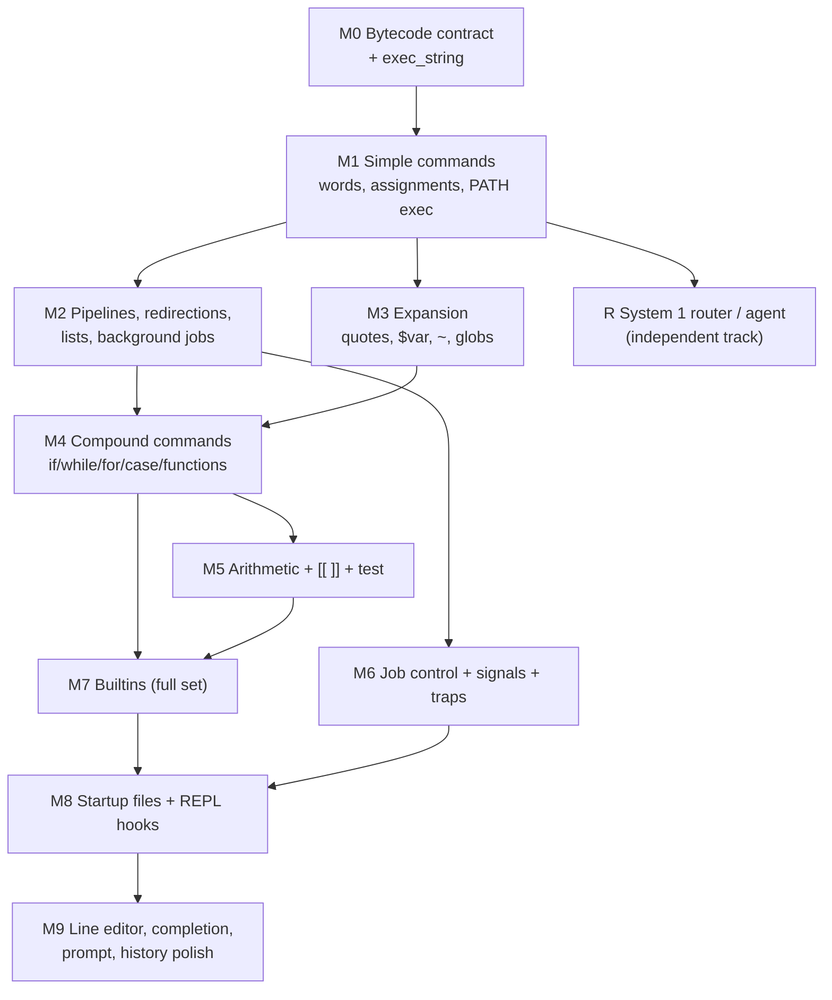

# jfsh — remaining work

Status as of 2026-11-10 (after `gtest-unit-tests`, commit `e58a779`); bug list re-verified
against the code on 2026-11-11.

jfsh builds on macOS and Linux and has gtest coverage for the pieces that work. **It cannot run a
single shell command yet**: `jfsh -c 'echo hi'` prints nothing and exits 0. The System 1
router and the LLM agent layer work end to end; the shell language underneath them is
scaffolding.

This file has two parts:

1. **[Missing components](#part-1--missing-components)**: what each subsystem must do,
   in the order it has to be built.
2. **[Bugs](#part-2--bugs-in-the-current-implementation)**: defects in code that
   already exists. Items marked **confirmed** were reproduced with a runtime probe (most
   under ASan); the rest come from code reading.

Code-level `TODO(area/topic)` comments in the sources carry implementation notes; this
file names them in brackets so the two stay linked.

---

## Build order

Milestones M0–M4 are the minimum for jfsh to be usable as a shell. The router/agent track
(R) can proceed in parallel at any time.

---

## Part 1 — Missing components

### M0. Bytecode contract and `exec_string`

The parser and executor disagree about the WordCode layout, so wiring `exec_string` alone
would still execute nothing (see bug [B1](#critical)).

**Requirements**
- Write down the WordCode layout for every opcode in `include/jfsh/core/wordcode.hh`
  (prefix vs postfix, operand counts, how branch offsets are encoded) and make the parser
  and executor both follow it. Prefix with explicit lengths (as zsh does) is recommended,
  because it lets the executor skip un-taken branches without decoding them.
- `WC_SIMPLE` must carry its words: the executor reads `arg_count` `WC_STRING` operands
  and passes them to `exec_simple`.
- Lists: each list element is introduced by `WC_LIST` with `ASYNC`/`END` flags; sublists by
  `WC_SUBLIST` with `AND`/`OR`/`NOT`; pipelines by `WC_PIPE` with a segment count.
- Move `StringInputSource` / `FileInputSource` from `lexer/input.cpp` into
  `lexer/lexer.hh` (or a new `lexer/input.hh`) so the executor, `eval`, `source`,
  prompt substitution and tests can use them.
- Implement `Parser::parse_string` and `Executor::exec_string`
  (`StringInputSource` → `Lexer` → `Parser` → `exec`), with parse errors reported as
  `jfsh: parse error near 'X'` and exit status 1.
- `Parser::parse` must fail on leftover tokens instead of silently stopping (bug B9).
- Add a WordCode disassembler (also needed for `functions`/`which`, [text/decompile]) and
  use it in parser unit tests.

**Done when** `jfsh -c 'true; false; echo $?'`-style programs run once M1–M3 land, and
parser tests assert exact bytecode for each construct.

### M1. Simple commands

**Requirements**
- Collect the command's words, expand them (M3), then dispatch in zsh order: alias
  (when `ALIASES` is set and the word is unquoted), function, builtin, external.
- Leading `NAME=value` words are assignments [parser/assign], [exec/assign]:
  - with no command, they set shell parameters;
  - before an external command they only go into that child's environment;
  - before a special builtin they persist, as in POSIX.
- External commands: search `PATH` (honouring a command hash table, [builtin/hash]),
  `execve` with an environment built from `ParamTable::make_envp()` rather than the
  process `environ`, so `export` actually reaches children (bug B12). Exit 127 for
  not found, 126 for not executable, `128+sig` for signalled.
- `$?` is updated after every command.
- `xtrace` (`set -x`) prints `PS4` plus the expanded command **before** running it.

### M2. Pipelines, redirections, lists, background

**Requirements**
- Pipelines `a | b | c` and `|&` (stderr too): create pipes, fork each stage, put all
  stages in one process group, wait for all of them. The exit status is the last
  stage's, or the rightmost failure when `PIPEFAIL` is set. `! pipeline` negates it.
- `&&`, `||` short-circuit; `;` and newline sequence; `&` runs the sublist as a background
  job, sets `$!` and prints `[N] pid` in interactive shells.
- Redirections [parser/redir], [exec/redirects]:
  - `<`, `>`, `>>`, `>|`, `<>`, `<<`, `<<-`, `<<<`, `>&N`, `<&N`, `>&-`, `&>`, `&>>`;
  - optional fd prefix (`2>`, `3<`), which the lexer currently drops (bug B10);
  - here-documents: bodies are read after the current line, expanded unless the
    delimiter is quoted, with tabs stripped for `<<-`;
  - `NOCLOBBER`: `>` on an existing file fails unless `>|` is used;
  - fds are saved and restored around builtins and functions, which run in-process;
  - zsh `MULTIOS` (`> a > b` tees) is a later nice-to-have.
- Process substitution `<(cmd)`, `>(cmd)` via `/dev/fd/N`, and `=(cmd)` via a temp file
  [subst/cmd].
- `EF_NOFORK`: exec the last command of a subshell or `-c` string directly.

### M3. Word expansion [exec/expand], [subst/*]

Order, per zsh: history (interactive only, before parsing) → alias → process substitution →
parameter / command / arithmetic substitution (left to right) → word splitting → brace
expansion → filename generation (globbing) → quote removal.

**Requirements**
- **Lexer support first** (bug B8): `$(...)`, `${...}`, `$((...))` and backquotes must
  stay part of one word, nested to any depth, and quotes must be tracked inside them.
- Quotes: `'…'` literal; `"…"` allows `$` and `` ` ``; `$'…'` C escapes; `\` escapes.
  Quote removal is the last step.
- Parameters [subst/param]: `$name`, `${name}`, `$1…$9`, `${10}`, `$#`, `$@`, `$*`, `$?`,
  `$$`, `$!`, `$-`, `$0`. Also:
  - the `${…}` operators: `:-`, `:=`, `:?`, `:+`, `#`, `##`, `%`, `%%`, `/`, `//`, `#name`;
  - subscripts `[i]`, `[i,j]`, `[@]`, `[*]`, and associative-array keys;
  - the zsh flags `${(U)x}`, `(L)`, `(j:,:)`, `(s:,:)`, `(f)`, `(q)`, `(Q)`, `(k)`, `(v)`,
    `(o)`, `(O)`.
- Unset parameters expand to empty, or fail with `NOUNSET`.
- Command substitution [subst/cmd]: fork, capture stdout through a pipe, strip trailing
  newlines, set `$?`.
- Arithmetic substitution `$((expr))` → M5 evaluator [subst/arith].
- Tilde [subst/tilde]: `~`, `~user`, `~+`, `~-`, and after `=`/`:` in assignments.
- Word splitting [subst/wordsplit]: zsh does **not** split unquoted parameter expansions
  unless `SH_WORD_SPLIT` is set; command substitutions are split on `IFS`.
- Brace expansion `{a,b}`, `{1..5}`, `{a..e}`, `{01..10..2}` (needs lexer fix B8).
- Globbing [subst/glob], [glob/*]:
  - `*`, `?`, `[...]` (missing today, bug B30), `[!...]`/`[^...]`, `**/` [glob/recurse];
  - `EXTENDED_GLOB` operators `^`, `~`, `#`, `##`, `(a|b)` [glob/extglob];
  - qualifiers `(.)`, `(/)`, `(@)`, `(om)`, `(N)`, `(D)` [glob/quals];
  - the options `NULL_GLOB`, `NOMATCH` (default error "no matches found"), `GLOB_DOTS`,
    `CASE_GLOB`, `NUMERIC_GLOB_SORT` [glob/numeric] and `MARK_DIRS` [glob/mark].

### M4. Compound commands and functions [parser/*], [exec/*]

**Requirements**
- `if/elif/else/fi`, `while`/`until` loops, `for name in words`, `for name (words)`,
  `for ((init; cond; step))`, `case … esac` with `;;`, `;&`, `;|`, and `select`
  (menu on stderr, `PS3`, `$REPLY`).
- zsh `repeat N`, `{ … } always { … }`, and short forms (`if [[ x ]] { … }`) can come
  later.
- `break N` and `continue N` across nested loops (bug B18: the levels are `bool`).
- Subshells `( … )` fork and isolate state; brace groups `{ …; }` run in the current shell
  (they are currently parsed as function definitions, bug B11).
- Functions [parser/funcdef], [exec/funcdef]:
  - both `name () { … }` and `function name { … }` forms;
  - a function table that holds a `ProgRef`;
  - `$1…`/`$#`/`$@` scoped per call;
  - `return N`;
  - `local`/`typeset` scope through `ParamTable::push_scope`;
  - `LOCAL_TRAPS` / `LOCAL_OPTIONS`;
  - recursion limit (`FUNCNEST`);
  - anonymous functions `() { … } args`.
- Keywords are only recognized in command position (bug B7).

### M5. Arithmetic, `[[ ]]`, `test`

**Arithmetic** [math/*], used by `(( ))`, `$(( ))`, `let`, array subscripts and
`for (( ))`:
- 64-bit integer and double arithmetic (`FORCE_FLOAT`, float literals) with C operator
  precedence: `,`, assignment ops (`= += -= *= /= %= <<= >>= &= ^= |= **=`), `?:`,
  `|| && | ^ &`, comparisons, shifts, `+ - * / %`, `**`, unary `! ~ + -`, and pre/post
  `++`/`--`.
- Bare variable names, with unset or empty values reading as 0; bases `16#ff`, `0x`,
  `0b`, `0` octal (with `OCTAL_ZEROES`); `_` digit separators.
- Errors: division by zero, bad syntax → status 1 plus a message, not a crash.

**Conditional expressions** [cond/*], [parser/cond], [exec/cond], [builtin/test]:
- `[[ … ]]` needs its own lexer state: no word splitting or globbing of operands,
  `&&`/`||`/`!`/`( )`, pattern match on the right of `==`/`!=`, `=~` regex with
  `$MATCH`/`$match`, and `<`/`>` string comparison.
- Unary tests `-a -b -c -d -e -f -g -h -k -n -o -p -r -s -t -u -w -x -z -L -O -G -S -N`;
  binary tests `-nt -ot -ef -eq -ne -lt -le -gt -ge`.
- `test` / `[`: POSIX argument-count rules, `-a`/`-o` with their lower precedence, and
  `[` requires a closing `]`.

### M6. Job control, signals, traps [signals/*], [builtin/bg|fg|jobs|wait|disown|kill]

**Requirements**
- **Interactive shell setup:**
  - put jfsh in its own process group and take the terminal with `tcsetpgrp`;
  - ignore `SIGINT`, `SIGQUIT`, `SIGTSTP`, `SIGTTIN`, `SIGTTOU` in the shell itself;
  - restore default dispositions in children before `exec`.
  - Today Ctrl-C during a foreground command also kills jfsh (bug B23).
- **Foreground jobs:**
  - give the job the terminal; wait with `WUNTRACED`;
  - on stop, record it as a stopped job, print `[N]  + suspended  cmd`, and take the
    terminal back;
  - save and restore terminal modes per job.
- **SIGCHLD:**
  - async-signal-safe flagging (bug B22);
  - reap with `waitpid(-1, …, WNOHANG|WUNTRACED|WCONTINUED)` in the main loop;
  - update `JobTable`, and print `[N]  + done  cmd` before the next prompt, or
    immediately with `NOTIFY`.
- **`%` job specs:** `%N`, `%%`, `%+`, `%-`, `%string`, `%?string`.
- **Builtins:**
  - `fg`, `bg` (`SIGCONT`), `jobs [-l -p -r -s]`, `wait [pid|%job]` (sets `$?`), `disown`;
  - `kill [-s SIG|-SIG] pid|%job`, plus `kill -l`.
- **On exit:** warn about stopped jobs; send `SIGHUP` to jobs on exit unless `NOHUP` is
  set or the job is disowned.
- **Traps:**
  - `trap 'cmd' SIG…`, `trap - SIG`, `trap '' SIG`, and `trap` with no args to list them;
  - handlers queue the command, and the REPL runs it between commands;
  - pseudo-signals: `EXIT` (also on function exit when set inside a function), `ZERR`
    (after a failing command; `ERR_EXIT` runs it before exiting) and `DEBUG`;
  - zsh `TRAPINT()`-style trap functions.
- `SIGWINCH` updates `$COLUMNS`/`$LINES` and tells the editor to re-layout.

### M7. Builtins [builtin/*]

Every stub currently returns 0, which is actively harmful: `[ -f /nonexistent ]` succeeds
(bug B19). Until a builtin is implemented it should print
`jfsh: NAME: not implemented` and return 1.

| Group | Builtins | Key requirements |
|---|---|---|
| Sourcing / eval | `.`, `source`, `eval`, `exec` | `.` searches `PATH` for a bare name; positional args are scoped to the sourced file; `exec` with no command applies redirections permanently; `exec cmd` replaces the process |
| Variables | `export`, `readonly`, `typeset`/`declare`/`local`/`integer`/`float`, `unset` | `-a -A -i -F -E -r -x -g -l -u -U -p` flags; `unset -f` / `-v`; readonly enforcement in `ParamTable::assign` |
| Options | `set`, `setopt`, `unsetopt`, `emulate` | `set -e -u -x -o name +o`; `set -- args` sets positionals; `setopt` with no args lists non-default options; `no` prefix negates (bug B15) |
| Positionals | `shift [N]` | errors when N exceeds `$#` |
| Directories | `cd`, `pushd`, `popd`, `dirs`, `pwd` | `cd -`, `CDPATH`, update `PWD`/`OLDPWD`, `AUTO_PUSHD`, `PUSHD_SILENT`, `cd old new` substitution, `-L`/`-P`, and errors on stderr (bug B20) |
| Output | `echo`, `print`, `printf` | `echo -n -e -E`, plus `BSD_ECHO`; `print -n -r -l -u N -P -z`; full `printf` with `%s %d %x %f %b %q` and argument reuse |
| Input | `read` | `-r -A -k N -q -s -t T -u fd -p prompt`; IFS splitting, with the remainder in the last variable |
| History | `fc`, `history`, `r` | `fc -l`, `-n`, `-r`, `-e editor`, `-s old=new`; `history` = `fc -l`; `r` = `fc -e -` |
| Aliases | `alias`, `unalias` | regular, global (`-g`) and suffix (`-s`) aliases, and alias expansion in the lexer (alias text re-lexed, recursion guard) |
| Lookup | `whence`, `which`, `type`, `command`, `builtin`, `hash`, `rehash` | `-v -c -p -a`; `command -v`; `builtin name` bypasses functions; a command hash table that a `PATH` change invalidates |
| Limits | `ulimit`, `umask`, `times` | real `getrlimit`/`setrlimit`; `umask -S`; `times` from `getrusage` (it currently prints zeros) |
| Arithmetic | `let` | → M5 |
| Functions | `functions`, `autoload` | print definitions via the decompiler; `autoload -U` lazy-loads from `$fpath` |
| zsh extras | `zmodload`, `bindkey`, `vared`, `zle`, `sched`, `zpty`, `compinit` | `bindkey` and `zle` need M9; `zpty` is defined but **not registered** (bug B21); `sched` needs the REPL hook |
| Control | `break`, `continue`, `return`, `exit` | N levels; `exit` validates numeric args and runs the EXIT trap; `return` outside a function behaves like `exit` in a sourced file |

### M8. Startup, REPL loop, invocation [loop/*]

**Requirements**
- **Startup files**, in zsh order: `/etc/zshenv`-equivalent, `$ZDOTDIR/.jfshenv` (always),
  `.jfsh_profile` (login), `.jfshrc` (interactive), `.jfsh_login` (login); `.jfsh_logout`
  on exit.
  - Decide whether to also read the user's real `.zshrc`; a flag such as
    `--zsh-compat-rc` would make that opt-in.
- **Invocation:**
  - `-c CMD [arg0 [args…]]` sets `$0` and the positional parameters; `script args…` does
    the same;
  - `-i`, `-s`, `-l`/`--login`, `-o option`, `+o option`, `--`;
  - unknown options are an error, not silently ignored (bug B32).
- **Script and stdin mode:** parse incrementally from a `FileInputSource`, a complete
  command at a time. Today stdin mode runs each physical line separately, so multi-line
  constructs and lines over 4095 bytes break (bug B31).
- **Each REPL iteration**, in this order:
  1. drain pending signals and traps;
  2. reap jobs and print notifications;
  3. run `precmd`, then `periodic` if `$PERIOD` has elapsed;
  4. check `sched` events and mail (`MAIL`, `MAILPATH`);
  5. reload `PS1` and render the prompt;
  6. read a line, then add it to history;
  7. run `preexec`, then execute;
  8. after execution, set `$?` and run the `ZERR` trap on failure.
- **Continuation:** lines that end inside an open construct (quote, `if` without `fi`,
  trailing `|`/`&&`, `\` at end of line) prompt with `PS2` and keep reading.
- **`ERR_EXIT`** should be applied by the executor with zsh's exemptions (conditions,
  `&&`/`||` lists, negated pipelines). The REPL hard-coding it in `main.cpp` is wrong
  (bug B33).
- **Special parameters:** `$$`, `$PPID`, `$SHLVL` (incremented), `$PWD`, `$OLDPWD`,
  `$RANDOM`, `$SECONDS`, `$EPOCHSECONDS`, `$LINENO`, `$HISTCMD`, `$status`,
  `$pipestatus`. They use `ParamHandlers`; nothing sets those yet.

### M9. Line editor (ZLE), completion, prompt, history

**Line editor** [refresh/*], [vi/*]:
- Make the keymap data-driven: `bindkey` → `Keymap` → named widgets. Today
  `bind_key`, `register_widget` and both `install_*_bindings` are empty and keys are
  hard-coded in `read_line`.
- Emacs widgets:
  - Ctrl-B/F/A/E and Alt-B/F for movement;
  - Ctrl-D (delete-char-or-list), Ctrl-H/DEL, Ctrl-W, Alt-D, Ctrl-K, Ctrl-U, Ctrl-Y (yank);
  - Ctrl-T, Ctrl-L (clear-screen), Ctrl-R/Ctrl-S (incremental history search), Alt-.
    (insert-last-word), Ctrl-X Ctrl-E (edit in `$EDITOR`);
  - Ctrl-C aborts the line (bug B24);
  - Home, End and Delete keys.
- Vi mode: insert/normal/visual/replace, motions, operators, text objects, registers,
  counts, undo/redo, and history `k`/`j`, all per [vi/*].
- **UTF-8:** the cursor moves by code point and width comes from `wcwidth`, so wide and
  combining characters work (bug B25).
- **Rendering:** multi-line buffers and wrapped prompts, `RPROMPT`, re-layout on
  `SIGWINCH` (bugs B26, B27); bracketed paste; `zle -N` user widgets; `vared`.
- **Syntax highlighting** of commands and strings, and an **autosuggestion** from
  history, are both optional.

**Completion** [refresh/completion], [builtin/compinit]:
- Wire `CompletionEngine` into `main.cpp`, which currently installs a completer that
  returns nothing.
- Complete the word at the cursor, not the whole line (bug B28).
- Contexts: command position → builtins, functions, aliases and `PATH` executables
  (deduplicated and executable-only); after `$` → parameters; `~` → users; otherwise
  files, with `/` added to directories and quoting of special characters.
- Insert the longest common prefix; on a second Tab, list candidates in columns, with a
  menu-select option.
- `compdef` / `_arguments`-style per-command specs; reading zsh completion functions is
  a stretch goal.

**Prompt** [prompt/subst]:
- Numeric arguments (`%1~`, `%2d`): the default prompt currently renders as
  `user@host 1~ %` (bug B34).
- Escapes:
  - text and colour: `%B %b %U %u %S %s`, `%F{color}`, `%K{color}`, `%f %k`, 256-colour
    and `#rrggbb` (bug B35);
  - values: `%?`, `%j`, `%L`, `%h`/`%!` (real history number, bug B37), `%y`/`%l`, `%d`;
  - date formats `%D{fmt}`, `%t`, `%@`;
  - conditionals `%(x.true.false)`, truncation `%<…<` and `%>…>`;
  - `%{…%}`, so zero-width sequences are excluded from the width.
- `PROMPT_SUBST`: expand parameters, commands and arithmetic in the prompt before the
  percent escapes.
- Re-read `PS1` and friends every time a prompt is shown (bug B38).

**History** [hist/expand]:
- **Bang expansion anywhere in the line**, not only at the start: `!!`, `!N`, `!-N`,
  `!str`, `!?str?`, `!#`, `^old^new`, word designators and modifiers, `HIST_VERIFY`, and
  no expansion inside single quotes.
- **History file:**
  - read zsh `EXTENDED_HISTORY` lines (`: ts:elapsed;cmd`) and multi-line entries,
    stored with `\` continuations;
  - write only new entries when appending (bug B5 makes the file double every session);
  - respect `SAVEHIST`;
  - use `fcntl` locking;
  - support `SHARE_HISTORY` / `INC_APPEND_HISTORY`.
- **Remaining options:** `HIST_IGNORE_SPACE`, `HIST_NO_STORE`, `HIST_REDUCE_BLANKS`,
  `HIST_SAVE_NO_DUPS`, `HIST_FIND_NO_DUPS`, and `HISTSIZE`/`HISTFILE` read from
  parameters (`main.cpp` hard-codes 1000).

### Glob, modules, misc

- **Glob:** see M3. `glob_expand` must also handle a `/` inside a pattern segment
  (`src/*/x.cpp`), which currently only splits on the last `/`.
- **Modules:**
  - `ModuleManager` is never instantiated;
  - `zmodload` needs search paths (`$module_path`);
  - modules must register builtins with the executor's table, and loaded builtins must
    be visible to it;
  - decide whether binary modules are worth supporting at all, or whether built-in
    "modules" (e.g. `zsh/datetime`, `zsh/mathfunc`) should be compiled in.
- **Emulation:** `emulate sh|ksh|zsh` via `OptionState::apply_emulation`, and `sh`/`ksh`
  behaviour when invoked as `sh`.

### R. System 1 router and LLM agent (jfsh-specific track)

**Routing**
- **Ordering:** route **after** a cheap local check, so lines that obviously run are not
  sent to a model:
  - the first word is a builtin, function, alias or `PATH` executable;
  - or the line contains shell syntax (pipes, redirections, assignments).
  The Python side already has a "known-command cascade"; mirror it.
- **Heuristic router:** stop shelling out to `zsh -n` through `system()` (bug B42). Once
  jfsh's own parser works, use `Parser` in syntax-check mode.
- **Recovery and failure handling:**
  - a manual override: a prefix to force each verdict (e.g. `,question` → agent and
    `\cmd` → run, or a configurable key binding);
  - "did you mean to ask the agent?" recovery when a RUN-routed line fails with exit 127;
  - backoff or a circuit breaker when jeff-server or JEV is down (bug B43).
- **Builtins:** `jfsh-router [on|off|status|threshold N|backend jeff|jev|heuristic]` and
  an `explain` mode that prints the verdict and confidence for a line without running it.

**Agent**
- **Streaming:** finish streaming for Anthropic (SSE) and Ollama (NDJSON)
  [anthropic/stream], [ollama/stream]. `parse_sse_chunk` and `parse_ndjson_chunk` are
  implemented and tested; only the curl write-callback plumbing is left. Copy the OpenAI
  backend's `StreamState`/`LineSplitter` pattern.
- **Shell context:** give the agent `$PWD`, the last command, its exit status and
  (opt-in) its last N lines of output, plus `uname`, `$SHELL` and the history tail.
- **Proposing commands:** the agent may answer with a command. Show it highlighted and
  ask `Run? [y/N/e(dit)]`; on edit, push it into the editor buffer. Never run commands
  without confirmation. Record an agent-run command in history as the command itself.
- **Builtins:**
  - `agent reset` (clear the conversation), `agent model NAME` and `agent provider NAME`;
  - `agent history`;
  - reading provider config from `~/.config/jfsh/agent.toml` as well as the environment.
- **Requests:** send the configured `temperature`, `top_p` and `seed` (bug B47) and the
  OpenRouter attribution headers (bug B48).
- **Timeouts:** use a connect timeout plus an inactivity timeout for streams instead of
  a 30-second total timeout (bug B46).
- **Ctrl-C** while streaming aborts the request (`CURLOPT_XFERINFOFUNCTION` checking a
  flag) and keeps the shell alive.
- Call `curl_global_init` once at startup.

### Testing

- Parser tests that assert bytecode or decompiled text for every construct.
- Executor tests that run scripts through `exec_string` and capture stdout/stderr/exit
  status, via a test helper that runs jfsh in-process with redirected fds or as a
  subprocess.
- A zsh compatibility corpus: `tests/compat/*.zsh` scripts run under both `zsh` and
  `jfsh`, with their outputs compared. Generate expected outputs from zsh in CI.
- Interactive tests: drive the editor through a pty (`forkpty`) and assert on screen
  output.
- Enable the two `DISABLED_` tests (`GlobPatternMatch.DISABLED_BracketExpressions`,
  `Lexer.DISABLED_SubstitutionsStayOneWord`) as their features land.
- Run the suite under ASan/UBSan in CI. jfsh's Debug build has no sanitizer flags yet,
  although the top-level build does.

---

## Part 2 — Bugs in the current implementation

Severity:
- **Critical:** breaks basic use, or will as soon as the code is wired up.
- **High:** wrong results or a crash in a reachable path.
- **Medium:** incorrect but survivable.
- **Low:** cosmetic or a latent issue.

### Critical

| ID | Location | Bug | Evidence |
|---|---|---|---|
| B1 | `src/parser/parser.cpp:156`, `:85`, `:111` vs `src/exec/executor.cpp:95` | Parser and executor disagree on the bytecode layout. The parser emits **postfix** code: `WC_STRING…` then `WC_SIMPLE`, a list body then `WC_LIST`, a pipeline then `WC_SUBLIST_NOT`. The executor decodes **prefix** code and calls `exec_simple({}, {}, …)` with no words. Even with `exec_string` wired up, nothing would run. | code reading |
| B2 | `src/exec/executor.cpp:29` | `exec_string` is a no-op that returns 0, so `-c`, scripts, stdin and interactive input all do nothing and report success. | **confirmed**: `jfsh -c false; echo $?` → 0 |
| B3 | `src/lexer/input.cpp:19` | `StringInputSource::unget(-1)` at EOF rewinds the position. Input ending in `;`, `&` or `|` then produces that token forever. This is latent until M0 wires the class up, and then every `cmd;` hangs. | **confirmed**: lexing `echo a;` yields `[;]` endlessly |
| B4 | `src/core/jobs.cpp:18` | On an empty table, `find_free_slot()` returns `mTable.size()` (0), so the first job gets id 0. Id 0 means "free slot", so that job is invisible to `get()`, `for_each()`, notifications and `reap()`. | **confirmed**: first `alloc` → id 0, `get(0)` = missing |
| B5 | `src/history/history.cpp:122` | `save()` in append mode, the default, writes **all** entries, including those just loaded from the file, so `HISTFILE` doubles every session (1 → 3 → 7 → 15 …). | **confirmed**: 3 sessions × 1 command = 7 lines |
| B6 | `src/history/history.cpp:91` | `lookup(0)` computes `idx = size()` and reads one past the end. | **confirmed**: ASan heap-buffer-overflow |

### High

| ID | Location | Bug | Evidence |
|---|---|---|---|
| B7 | `src/lexer/lexer.cpp:185` | Reserved words are recognized in every position, so `echo done`, `git log --until …` and `ls in` produce keyword tokens. They must only be keywords in command position. | code reading |
| B8 | `src/lexer/lexer.cpp:167` | `(`, `)`, `{` and `}` always end a word, so `$(cmd)`, `${var}`, `$((1+2))`, `a{b,c}` and `f(x)`-style globs are split into several tokens. | **confirmed** by `Lexer.DISABLED_SubstitutionsStayOneWord` |
| B9 | `src/parser/parser.cpp:10` | `parse()` never checks that it reached `TK_EOF`. On an unexpected token (e.g. `)` or a stray `fi`) it stops and returns success with the rest of the input dropped. Also, when `par_list()` fails with an empty error message, the partial program is returned as success. | code reading |
| B10 | `src/lexer/lexer.cpp:192` | Fd-number prefixes are not part of the redirection: `2>&1` lexes as word `2`, redir `>&`, word `1`, so `2` becomes a command argument. | code reading |
| B11 | `src/parser/parser.cpp:127` | `TK_LBRACE` dispatches to `par_funcdef`, so a brace group `{ a; b; }` would be parsed as a function definition. | code reading |
| B12 | `src/exec/executor.cpp:209`, `src/core/params.cpp:111` | External commands use `execvp` with the process `environ`, not `ParamTable::make_envp()`, so `export`/assignments can never reach children. `make_envp()` also emits a variable once per scope it appears in, and the outer value comes first. | **confirmed**: `X` appears twice in `envp` |
| B13 | `src/core/params.cpp:83` | `assign()` always writes into the innermost scope, so assigning a global from inside a function creates a shadowing local and the global never changes. `readonly` is not enforced. When `flags` is 0 the parameter becomes `PM_SCALAR` even if the value is an integer or array. | **confirmed**: global `X` unchanged after an inner-scope assign |
| B14 | `src/exec/executor.cpp:214` | `do_exec` ignores `waitpid`'s return value: on `EINTR`/`ECHILD` the status stays 0 and the command "succeeds". Stopped children (Ctrl-Z) are not handled, because there is no `WUNTRACED` and the shell blocks. | code reading |
| B15 | `src/core/options.cpp:225` | `OptionState::find` strips a leading `no` **before** matching, so the real options `nomatch` and `notify` can never be found. The negation it detects is thrown away, so `noextendedglob` resolves to `extendedglob` and the caller can't tell. | **confirmed**: `find("nomatch")` = not found; `find("noextendedglob")` = `extendedglob` |
| B16 | `src/core/signals.cpp:69` | `trap 'cmd' SIG` (`TrapAction::Command`) installs no handler at all, so command traps never fire. `set_trap` also calls `std::signal` on `SIGKILL`/`SIGSTOP` and ignores the failure. | code reading |
| B17 | `src/core/signals.cpp:149` | `kill_job(pgid)` with the default `Job::pgid == -1` calls `kill(1, sig)`, which signals **init**; with pgid 0 it signals jfsh's own process group. It must reject `pgid <= 1`. | code reading |
| B18 | `include/jfsh/exec/executor.hh:40` | `break_level` and `cont_level` are `bool`, so `break 2` / `continue 3` can't be represented. `builtin_break` and `builtin_continue` ignore N (`src/builtins/builtins.cpp:103`). | code reading |
| B19 | `src/builtins/builtins.cpp:340` (and ~45 others) | Unimplemented builtins return 0. `test`/`[` always succeed (`[ -f /missing ] && rm …` takes the true branch), and `kill`, `wait`, `export`, `read` and `cd`-stack builtins all report success while doing nothing. | code reading |
| B20 | `src/builtins/builtins.cpp:185` | `cd` returns `chdir()`'s `-1` directly as the exit status (255) with no error message, and never updates `PWD`/`OLDPWD`. | code reading |
| B21 | `src/builtins/builtins.cpp:436`, `:11` | `builtin_zpty` is defined and declared in `builtins.hh` but never registered in `BuiltinTable::register_all()`. | code reading |
| B22 | `src/core/signals.cpp:119`, `include/jfsh/core/signals.hh:68` | The SIGCHLD handler does a read-modify-write on plain `uint64_t` fields (`PendingSignals::mark`), which is not async-signal-safe. Use `volatile std::sig_atomic_t` flags or `std::atomic<uint64_t>` with lock-free ops, and install with `sigaction` + `SA_RESTART`. `dispatch_pending()` is only called from `SignalManager::unblock()`, and nothing calls `block()`/`unblock()`, so even the flag is never acted on. | code reading |
| B23 | `src/core/signals.cpp:119` (`SignalManager::init`) | Interactive mode is ignored: no process groups, no `tcsetpgrp`, `SIGINT`/`SIGTSTP`/`SIGTTOU` keep their default dispositions. While a foreground command runs (raw mode off), Ctrl-C reaches jfsh too and **kills the shell**. | code reading |
| B24 | `src/editor/editor.cpp:50` | Raw mode clears `ISIG` but `read_line` has no case for Ctrl-C (`\x03`) or Ctrl-Z, so Ctrl-C at the prompt does nothing instead of discarding the line. | code reading |
| B29 | `src/editor/editor.cpp:132` | `read_key_sequence` returns `{}` when `read()` returns 0 (EOF/hangup) or -1. The caller loops forever, so a closed terminal leaves jfsh spinning at 100% CPU. | code reading |
| B44 | `src/main.cpp:134`, `src/agent/provider.cpp:30` | `ProviderConfig::from_env()` picks the default model **before** `--provider` is applied, so `--provider anthropic` with no `--llm-model` sends `llama3` to Anthropic. An unknown `JFSH_PROVIDER` leaves the kind at its default silently. | code reading |
| B60 | `src/parser/parser.cpp:213`, `:145` | `par_redir` consumes only the redirection operator, so its target is picked up by `par_simple` as an ordinary argument: `echo hi > f` parses as `echo hi f` and would print `hi f` to stdout instead of writing `f`. | code reading |

### Medium

| ID | Location | Bug | Evidence |
|---|---|---|---|
| B25 | `src/editor/editor.cpp:96` | The cursor and backspace work on bytes, so editing any multi-byte UTF-8 character corrupts the line. `PromptRenderer::visual_width` (`src/prompt/prompt.cpp:143`) counts bytes too. | code reading |
| B26 | `src/editor/editor.cpp:146` | `refresh_display` rewrites the whole prompt with a single `\r`, so prompts containing newlines are reprinted on every keystroke and lines wider than the terminal break. It also recomputes the prompt (`getpwuid`, `gethostname`, `getcwd`) on every key. | code reading |
| B27 | `src/editor/editor.cpp` | No `SIGWINCH` handling; `Editor::terminal_width()` exists but is never called. | code reading |
| B28 | `src/editor/editor.cpp:115` | Tab completion inserts `candidates[0].substr(mBuf.cursor)`, using the **line** cursor as an offset into a **word** candidate. That only works when the word starts at column 0. `main.cpp:184` installs a completer that returns nothing anyway. | code reading |
| B30 | `src/glob/glob.cpp:29` | `pattern_match` doesn't implement `[...]` although its comment says it does, so `file[0-9]` never matches. It also ignores `\` escapes, and `glob_expand` only splits the pattern at the last `/`, so `src/*/x.cpp` fails. | **confirmed** by `GlobPatternMatch.DISABLED_BracketExpressions` |
| B31 | `src/main.cpp:235` | stdin mode runs each physical line separately: multi-line constructs can't work, and a line longer than 4095 bytes is split by `fgets` into **two commands**. | code reading |
| B32 | `src/main.cpp:84` | Unknown options are ignored silently, as is `-c` with no argument (`main.cpp:58`), a second script argument and everything after the script (the positional parameters). `--router` with an unknown value silently means heuristic, and `--provider` with an unknown value silently means Ollama (`main.cpp:143`). | code reading |
| B33 | `src/main.cpp:220`, `:223` | `xtrace` output is printed **after** the command runs, without `PS4`. `errexit` is applied by the REPL to every interactive line (so one failed command exits the interactive shell), with none of zsh's exemptions. | code reading |
| B34 | `src/prompt/prompt.cpp:128` | Numeric prompt arguments aren't parsed: the default `PS1` `%n@%m %1~ %# ` renders as `user@host 1~ % `. | **confirmed** |
| B35 | `src/prompt/prompt.cpp:123`, `:128` | `%F{color}` always emits "default colour" and ignores the colour. Unsupported escapes fall into `default:` and print the letter, so `%B…%b` renders as `B…b`. | **confirmed**: `%Bx%b` → `Bxb` |
| B36 | `src/prompt/prompt.cpp:79` | `%~` uses a bare prefix compare: with `HOME=/Users/a` and cwd `/Users/ab`, it renders `~b`. | code reading |
| B37 | `src/prompt/prompt.cpp:93` | `%h` and `%!` always render `0`. | code reading |
| B38 | `src/prompt/prompt.cpp:10` | `PS1`/`PROMPT` are read once, in the constructor; later assignments never take effect. | code reading |
| B39 | `src/history/history.cpp:104` | `load()` treats every line as one command: zsh `EXTENDED_HISTORY` lines keep their `: ts:0;` prefix, and multi-line commands come back as several entries. `sync()` (`:131`) just calls `load()` and duplicates everything. | code reading |
| B40 | `src/history/history.cpp:15` | `should_suppress` returns early when `no_store` is set, which skips the `ignore_dups`/`ignore_all` checks. `no_store` is supposed to drop `history`/`fc -l` lines themselves. | code reading |
| B41 | `src/core/jobs.cpp:106`, `:68`, `:9` | `reap()` frees slots without updating `mCurrent`/`mPrevious`, so `%+` can point to a dead job. Killed processes set `JobStatus::Done`, never `Signalled`. `Job::exit_status` ignores `PIPEFAIL`. `notify_changes` only prints for `JOB_NOTIFY`, which nothing sets. | code reading |
| B42 | `src/router/router.cpp:20` | `HeuristicRouter` runs `system("zsh -n -c …")` for **every** line, which costs a fork plus exec of `/bin/sh` and `zsh`. If zsh isn't installed, `system` returns 127 and **every line is routed to the LLM**. `zsh -n` also accepts most natural language (`what is ls`), so only lines that happen to be invalid syntax, such as an unbalanced apostrophe in `what's ls`, reach the agent. | code reading |
| B43 | `src/router/jeff.cpp:83`, `src/router/jev.cpp:111` | When the service is down, each line waits for the full timeout (1 s for jeff, 10 s for JEV), prints a warning and falls back. There's no backoff, so the shell becomes unusable. JEV also sends `Authorization: Bearer ` with an empty key. | code reading |
| B45 | `src/agent/provider.cpp:35`, `include/jfsh/agent/provider.hh:43` | The default Anthropic model `claude-opus-4-7` (in `from_env()` and the `default_anthropic` default argument) is outdated; it should probably be `claude-opus-5-5`. | code reading |
| B46 | `include/jfsh/agent/provider.hh:37` | `timeout_ms = 30000` is applied as `CURLOPT_TIMEOUT_MS`, a **total** transfer limit, so any streamed answer longer than 30 s is cut off. | code reading |
| B47 | `include/jfsh/agent/provider.hh:25` | `temperature`, `top_p` and `seed` in `ModelParams` are never sent to any provider. | code reading |
| B48 | `include/jfsh/agent/openrouter.hh:24` | The `HTTP-Referer`/`X-Title` headers the header comment promises are never sent. `OpenAIBackend::http_post` supports `extra_headers` (`src/agent/openai.cpp:92`), but `OpenRouterBackend` never passes any, and `chat_stream` makes its own curl request (`openai.cpp:187`) with no way to add headers, so both paths need it. | code reading |
| B58 | `src/history/history.cpp:20`, `:51` | `HIST_IGNORE_ALL_DUPS` is inverted: `should_suppress` drops the **new** command when it duplicates any older entry, so the old entry stays where it was. zsh removes the older entry and appends the new one. The erase loop in `add()` that was meant to do this is dead code, since `should_suppress` has already returned. | code reading |
| B59 | `src/lexer/lexer.cpp:192` | `read_redir` only starts on `<`/`>` and only looks at one following character: `&>` and `&>>` lex as `&` then a redirection, `>&-`/`<&-` lex as `>&` plus a word `-`, and `>>|` is split. Conversely, any `<`/`>` followed by `<`, `>`, `\|`, `&` or `-` is kept as one token, so invalid pairs like `<-`, `><` and `>-` are accepted. | code reading |

### Low

| ID | Location | Bug |
|---|---|---|
| B49 | `src/agent/agent.cpp` | The non-streaming path of `Agent::handle` prints a newline even when the request failed. |
| B50 | `src/core/options.cpp` | `kOptionInfo` is indexed by `info.index`, but nothing checks that the table order matches `OptIndex` or that it is complete. A `static_assert` or startup check would catch a missing row, which would otherwise zero-initialize and crash `find()` on a null name. |
| B51 | `include/jfsh/core/param.hh:63` | It uses `std::unique_ptr` without `#include <memory>` and only compiles through `types.hh`. |
| B52 | `src/editor/completion.cpp:83` | `complete_commands` doesn't check the executable bit, deduplicate across `PATH` or sort. It also lists `.` and `..`. `complete_files` lists dotfiles when the prefix is empty, and adds no `/` to directories. |
| B53 | `src/modules/module.cpp` | `ModuleManager` is never instantiated. Its `resolve_path` maps `zsh/x` → `zsh_x.so` but has no default search path, so `zmodload` can't work even once implemented. |
| B54 | `src/editor/editor.cpp` (`read_line`, non-tty path) | It prints `PS1` even when stdin is not a terminal, which pollutes the output of `jfsh -i < file`. |
| B55 | `CMakeLists.txt` | Possibly macOS only: Apple's linker was reported to warn `ld: warning: ignoring duplicate libraries` for `jfsh_core`, `jfsh_lexer` and `jfsh_parser`. Not reproducible on Linux: `CMakeLists.txt` lists no library twice, the library graph has no cycles, and the generated link line has each `.a` once. Re-check on macOS before fixing; if it persists, it is CMake's static-library ordering, not a duplicate in our files. |
| B56 | `cmake/CompilerOptions.cmake` | Release builds use `-march=native`, so binaries only run on CPUs like the build machine's. simdjson already dispatches at runtime. `-Wno-unused-parameter` is still on "for the stub phase". |
| B57 | `src/main.cpp` | `curl_global_init` is never called, and the HTTP code relies on `curl_easy_init`'s implicit, non-thread-safe init. |
| B61 | `src/prompt/prompt.cpp:78` | `%~` (and the B36 prefix check) reads `HOME` with `getenv`, not from the shell's `ParamTable`, so changing `HOME` inside jfsh won't affect the prompt. |
