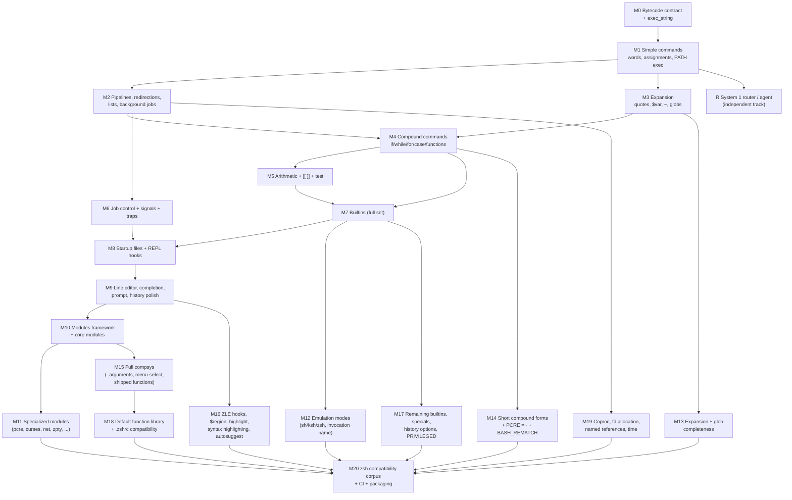
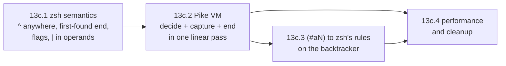

# jfsh — remaining work

Status as of 2026-11-18: M1 (simple commands), M2 (pipelines, redirections, lists,
background jobs), M3 (word expansion), M4 (compound commands and functions), M5
(arithmetic, `[[ ]]`, `test`), M6 (job control, signals, traps), M7 (builtins), M8
(startup files, invocation, the interactive loop's hooks) and M9 (line editor,
completion, prompt, history) are done, along with the part of M0 they needed.
**M10 Phase 1** (modules framework, `zmodload` rewrite, zsh/datetime,
zsh/mathfunc) is done (merged, PR #18). **M10 Phase 2a** (zsh/parameter,
zsh/zutil) is done (merged, PR #19). **M10 Phase 2b** (zsh/system,
zsh/files) is done (merged, PR #20). **M10 Phase 2c** (zsh/stat,
zsh/pcre) is done (merged, PR #21). **M10 polish**
(`$module_path` default, `zmodload -F` toggles, `[[ -pcre-match ]]` /
`[[ -regex-match ]]` cond wiring, `zsh/regex` + `zsh/example` modules)
is done on branch `jfsh-m10-polish`. **M10 is now feature-complete.**

**Goal: full zsh feature compatibility.** M10–M20 extend the plan to cover every
remaining component of zsh (every module zsh ships, every builtin, every option,
every special parameter, the full compsys completion system, ZLE hooks and
highlighting, emulation modes, PCRE/`BASH_REMATCH`, coprocesses and named
references, zsh's shipped function library, and `.zshrc` compatibility). M20
runs the upstream `zsh/Test` suite plus a hand-curated corpus as the final pass
criterion. Every milestone from M10 on is a cumulative step toward "a `.zshrc`
that works under `zsh -f` works under `jfsh -f`, with the same output".

jfsh builds on macOS and Linux and has gtest coverage for the pieces that work. It runs
**simple commands**, pipelines and background jobs joined by `;`, newlines, `&&`, `||` and
`!`, with redirections, here-documents, `NAME=value` and `NAME=(…)` assignments, and the
full word expansion pipeline (parameters, command and arithmetic substitution, splitting,
braces, tilde, globbing), and compound commands: `if`, `while`/`until`, `for` (all three
forms), `case`, `select`, `repeat`, subshells, brace groups, `always` blocks, `(( ))` and
shell functions with `local`, and conditions: `[[ … ]]`, `test`/`[` and integer and
floating-point arithmetic. Commands that span lines work in scripts, on stdin and at the
prompt (with `PS2`). Interactively it has job control (Ctrl-Z, `fg`, `bg`, `jobs`, job
notices, Ctrl-C that ends the command line but not the shell), and `trap`, `kill` and
`wait` work in every shell. The builtins are real (M7): options (`set`, `setopt`,
`emulate`), sourcing, aliases, the directory stack, `print`/`printf`, history,
`whence` and friends; only the ones that need modules (`zmodload`, `zpty`) say `not
implemented`. It reads zsh-style startup files (`.jfshenv`, `.jfshrc`, …), takes zsh's
command-line options, and runs `precmd`/`preexec`/`periodic`/`zshexit` hooks, `sched`
events and mail checks (M8). The line editor has zsh's emacs and vi keymaps,
`bindkey`, `zle` user widgets and `vared`; Tab completes commands, files, parameters and
users, and `compdef` functions; prompts have zsh's escapes; `!` history expansion works
anywhere in a line, and the history file is zsh's format (M9). The System 1 router and
the LLM agent layer work end to end.

This file has two parts:

1. **[Missing components](#part-1--missing-components)**: what each subsystem must do,
   in the order it has to be built.
2. **[Bugs](#part-2--bugs-in-the-current-implementation)**: defects in code that
   already exists. Items marked **confirmed** were reproduced with a runtime probe (most
   under ASan); the rest come from code reading.

Code-level `TODO(area/topic)` comments in the sources carry implementation notes; this
file names them in brackets so the two stay linked.

---

## Build order

Milestones M0–M4 are the minimum for jfsh to be usable as a shell; M0–M9 are the
daily-driver subset already in main. Milestones M10–M20 bring jfsh to full zsh
feature compatibility, culminating in M20's upstream-test corpus. The router/agent
track (R) can proceed in parallel at any time.

---

## Part 1 — Missing components

### M0. Bytecode contract and `exec_string`

**Done** (with M1): the prefix layout for lists, sublists, pipelines, simple commands and
assignments is written down in `include/jfsh/core/wordcode.h`, with skip lengths on
`WC_LIST` and `WC_SUBLIST` so un-taken branches are jumped over; the parser and executor
follow it (bug B1). `StringInputSource`/`FileInputSource` are public in
`include/jfsh/lexer/input.h`. `Parser::parse_string` and `Executor::exec_string` work,
parse errors print `jfsh:LINE: parse error near `X'` with status 1, and leftover tokens
are an error (B9). `disassemble()` (`src/parser/text.cpp`) backs `tests/parser_test.cpp`.

**Remaining**
- Each construct that lands later adds its layout to the comment in `wordcode.h`, its
  own `disassemble()` formatting, and parser tests asserting the exact bytecode, as
  redirections (M2), compound commands (M4) and `[[ ]]` (M5) did.
- The source-text decompiler for `functions`/`which` [text/decompile] is still to do.

### M1. Simple commands

**Done.** Implemented in `src/exec/executor.cpp` (`exec_simple`, `apply_assigns`,
`run_external`, `find_command`), with tests in `tests/exec_test.cpp`:
- Words go through quote removal (the only M3 step so far), then dispatch to a builtin
  or an external command.
- Leading `NAME=value` / `NAME+=value` / `NAME[sub]=value` words (unquoted identifier
  before the `=`) are assignments. As in zsh's addvars, the command's words and
  redirection targets are expanded first, then each assignment is expanded and made
  before the next, so `a=1 b=$a` sees `a`:
  - with no command they set shell parameters through `ParamTable::set_scalar` /
    `set_array`, which update the existing parameter wherever it lives, keep its
    attributes, refuse readonly parameters, and create new ones as globals. On an
    integer or float the value is arithmetic (`i+=1` adds); `a+=x` on an array appends
    an element;
  - in front of a command they go into a scope of its own, as a copy of the outer
    parameter (type and attributes kept, readonly refused), which is popped after it.
    Before an external command they are made in the child, after its redirections,
    and exported; arrays are not exported. Before a function they are exported to
    what it runs. Before a builtin they last only while it runs; following zsh rather
    than POSIX, they persist after a **special** builtin only when `POSIX_BUILTINS` is
    set. A readonly name or failed expansion ends the command line, except before an
    external command, where only that command fails (status 1). The prefix scope is
    marked as such, so `local`/`typeset` of a new name declares below it; typeset's
    `name=value` arguments are expanded after the prefix assignments. `a[i]=x` in
    front of a builtin or function changes the array itself, as in zsh. In front of
    `exec` with redirections the assignments are temporary; alone, or with only
    redirections, they stay.
- External commands: the `$PATH` search reads the shell's own `PATH` parameter, or the
  one assigned in front of the command. An empty component (and `PATH=` alone) means
  the current directory, where the name is run as it is; a directory or non-executable
  entry of that name gives "permission denied". The shell looks the name up (and
  hashes it) in its own `PATH` even when a `PATH=` prefix sends the child elsewhere.
  Results from absolute directories are added to the hash while `HASH_CMDS` is set;
  entries (also `hash name=path`) are used either way. The hash is dropped on any
  assignment to `PATH`, including `export`/`typeset` ones. `command -p` searches only
  the default path.
  The command runs with `execve` and an environment from `ParamTable::make_envp()`. A
  file with no `#!` line and no NUL in its first bytes runs under `/bin/sh` (also as a
  pipeline stage, background job, or under `exec`); a missing `#!` interpreter is
  "bad interpreter". Messages are zsh's `<strerror>: name`; statuses: 127 for not
  found and other errors, 126 for EACCES/ENOEXEC, `128+sig` for signalled.
- `$?` (`ExecContext::last_exit`) is updated after every pipeline, and `exit` stops the
  program.
- `xtrace` prints the prompt-expanded `PS4` (initially zsh's `+%N:%i> `, nothing when
  unset) plus the expanded command, quoted as zsh does (`'…'`, or `$'…'` with control
  characters), **before** running it, to the stderr from before its redirections.
  Assignments show their values: `+a=1 +:` before a builtin or function, `+a=1 cmd`
  before an external one.

**Review fixes** (branch jfsh-m1-review): left-to-right assignments, expanded after
the words; `a+=x` on an array appends; `PATH=… cmd` searches the new `PATH`; prefix
assignments keep the parameter's type and attributes and don't export arrays; a
readonly prefix before a builtin or function ends the line; one exec helper
(`exec_program`) for the forked, `EF_NOFORK` and `exec` paths with zsh's `/bin/sh`
fallback, messages and 126/127 statuses; `find_command` goes through `command_hash()`,
`path_dirs()` is the one `$PATH` splitter (also for `.` and `whence`), an empty `PATH`
searches `.`, a directory on `$PATH` is 126; the hash is dropped on any `PATH`
assignment (`ParamTable::path_generation`); xtrace quoting, `PS4` default and placement
as zsh's. Round 2: temporary assignments before `exec` redirections, `command -p`
failing when the default path lacks the name, `export`/`typeset PATH=` dropping the
hash, no trace line for a redirection-only command, parent-side hashing with a `PATH=`
prefix, `hash` entries used under `NO_HASH_CMDS`, prefix assignments before typeset's
arguments (prefix scopes, `ParamTable::push_scope(true)`), subscripted prefixes
persisting, typeset arguments traced as assignments. Round 3: the typeset variants
(typeset, local, declare, integer, float, private) count as POSIX-special, so their
prefix assignments stay under `POSIX_BUILTINS`; a failed typeset-argument expansion ends
the line; one scope guard for every prefix scope of a builtin or function; `typeset -p`
in a function prints `-g` for a parameter from outside it (a prefix copy keeps the
original's level); tests for locals and private parameters under a prefix scope.
Round 4: `command` takes the POSIX-special status away again (prefix assignments before
`command typeset`/`export` don't stay under `POSIX_BUILTINS`; `builtin` keeps it);
typeset's arguments are expanded after the command's redirections and prefix
assignments, in the builtin branch, so `typeset y=${zz?boom} 2>/dev/null` is silent; an
unset prefix copy is "no such variable" to `typeset -p`; the module is now
`zsh/param/private`, as in zsh (`zsh/private` stays as an alias).

**Left to other milestones**
- `typeset name` on an existing parameter doesn't print it, so `x=1 typeset x` shows
  nothing (zsh prints `x=1`); a typeset listing gap, not a prefix one.
- zsh runs a `#!` script whose interpreter is itself a script by hand; jfsh reports
  "exec format error".
- `read`, `for` and `${x=v}` still store text into an integer or float parameter.

### M2. Pipelines, redirections, lists, background

**Done.** Implemented in the M2 PR, reworked by the review below:
- Pipelines `a | b | c` and `|&` (`WC_PIPE` encodes `n` plus a per-connector stderr
  bitmask). As in zsh every stage but the last forks; the last runs in the shell with
  its stdin from the last pipe, so `echo x | read v`, `… | while read l` and `echo |
  f` change the shell, and `echo y | exit 4` exits it. An external command or a
  subshell there forks into the pipeline's process group and job (`EF_PIPELAST`,
  `Executor::fork_command`/`wait_command`). The forked stages are always a job, so
  their statuses survive the SIGCHLD reaper; `$pipestatus` has every stage, and
  `PIPEFAIL` takes the rightmost failure. `! pipeline` comes out of `WC_SUBLIST_NOT`.
- `&` forks a child that re-enters `exec_sublist`; a lone pipeline (`a | b &`)
  instead forks each stage from the shell into one `JOB_ASYNC` job, `$!` is the last
  stage and an interactive shell prints `[N] pid pid…`, as zsh does.
- The redirection set (`Parser::par_redir`, `Executor::apply_redirects`): `<`, `>`,
  `>>`, `<>`, `<<`, `<<-`, `<<<`, `>&N`, `<&N`, `>&-`, `<&-`, `&>`, `&>>`, `>& file`
  (`&>`), `>>& file` (`&>>`), and the forms that ignore NO_CLOBBER, `>|`, `>!`,
  `>>|`, `>>!`, `&>|`, `&>!`, `&>>|`, `>&|`, `>&!` (the lexer spells `!` as `|`);
  the fd prefix is one digit, as in zsh (`2>`, `0<`; `12>f` is the word 12).
  `N>&file` writes the file to N and 2. A `>&$x` target that is a number dups, `-`
  closes, anything else is a file; `<&word` is "file number expected", which ends the
  command line.
- Redirections are made in order. Files open as zsh's `clobber_open`: under
  NO_CLOBBER `>` refuses an existing regular file (`file exists: f`) but opens a
  device or fifo (`>/dev/null`), and an empty one with CLOBBER_EMPTY; `>>` creates
  nothing unless CLOBBER or APPEND_CREATE. `>&N` refuses the shell's own fds above 9
  (they are close-on-exec), as zsh does (`N: bad file descriptor`). Errors read as
  zsh's, after `jfsh: ` (`no such file or directory: f`); a target that expands to
  nothing fails the command, not the line.
- `MULTIOS`: the second output redirection to an fd turns it into a pipe to a tee
  that writes to what the fd went to before and to the new target; it is forked once
  the redirections are done, or before another redirection reads the fd (`>a 2>&1
  >b`), and `SavedFds::restore` waits for it, so the next command reads whole files.
  A pipeline stage's pipe is its first stdout redirection and `|&` a trailing `2>&1`
  (`EF_STAGEOUT`/`EF_STAGEERR`), so `echo y >c | cat` writes to both and `{ … }
  2>/dev/null |& cat` sees the errors; `>&2` targets take part too.
- A command of nothing but redirections runs `$NULLCMD` (`cat`), or `$READNULLCMD`
  (`more`) for a lone `<file`; `:` under SH_NULLCMD; "redirection with no command"
  (ending the line) under CSH_NULLCMD, with an empty `$NULLCMD` or after `builtin`,
  `command`, `noglob`, `-`, `nocorrect`. `NULLCMD`, `READNULLCMD` and `TMPPREFIX`
  start as in zsh.
- Here-documents: `par_redir` registers the delimiter with `Lexer::register_heredoc`
  (the lexer reads the body at the end of the line, B62) after quote removal on it
  (`'a"b'`, `E\\OF`); any quoting makes the body literal; `<<-` strips leading tabs.
  The body is written straight into a pipe; one longer than the pipe holds is fed by a
  forked writer.
- Process substitution `<(cmd)`, `>(cmd)`, `=(cmd)`: the lexer keeps the command (read
  as `$(…)` is, past quotes and nested substitutions) in its word, alone or with other
  text (`--f=<(cmd)`, `<(cmd)x`); the Expander's `Scan` runs it in place
  (`Executor::procsubst`) when it is unquoted at the word's top level (`=(…)` only at
  its start), in command words, assignments and typeset arguments, `for`/`foreach`
  lists, arrays, the `case` subject and a `<<<` target; quoted text and parameter
  values never are. It gives `/dev/fd/N` (N ≥ 10) or a `$TMPPREFIX…` file; the fd is
  closed and the file removed once the command (`exec_cmd`/`exec_simple`) is done,
  after the pipeline for a forked last stage. Without job control `<(…)` and `=(…)`
  read /dev/null. `< <(cmd)` and `> >(cmd)` are redirections joined to the pipe;
  `< =(cmd)` reads the file.
- Pipes, here-document and tee pipes are moved to fds ≥ 10, so pipelines work with
  the shell's own fd 0 or 1 closed.
- `EF_NOFORK`: `run_external` honours the flag by `execve`-ing in place.
- SIGCHLD is handled with a self-pipe on fds ≥ 10 (`pipe2` with `O_CLOEXEC|O_NONBLOCK`
  where it exists, `pipe` and `fcntl` on macOS); the handler writes one byte, and the
  executor reaps between commands (B22).
- Bug B4 fix: `JobTable::alloc` never returns `id=0` (slot 0 reserved).

**Review fixes** (branch jfsh-m2-review): `<&-` closes fd 0 (it closed stdout);
process substitution decided by the parser, not by expanded text; the MULTIOS tee
waited for; NO_CLOBBER for each MULTIOS target, for devices (`>/dev/null`) and for
`>>` without APPEND_CREATE; one-digit fd prefixes, and `>&N` refusing the shell's own
fds; the last pipeline stage in the shell; the pipe and `>&N` taking part in MULTIOS,
and `|&` after the stage's redirections; redirections in order, a failed one reported
once; the clobber spellings and `>& file`; pipelines with fd 0 or 1 closed; `$!` of a
background pipeline is its last stage; an empty target fails only the command;
`$NULLCMD`/`$READNULLCMD` and SH_NULLCMD as `:`; zsh's redirection messages; quote
removal on here-doc delimiters; here-documents without a fork; `$TMPPREFIX`; `<(…)`
reading /dev/null; `functions` prints `<&-` and leaves out default fds. Tests in
`tests/exec_test.cpp` (M2 section), `tests/interactive_test.cpp`
(`LastPipelineStageRunsInTheShell`) and `tests/lexer_test.cpp` (`ClobberSpellings`);
the NULLCMD tests in `tests/emulate_test.cpp` now expect zsh's behaviour.
Round 2: Ctrl-Z on a pipeline whose last stage the shell runs prints "job can't be
suspended" and continues the stopped stages (`Executor::continue_pipeline_stages`, also
while `read` blocks, through the signal self-pipe), as zsh; `&|` and `&!` run a list
in the background without a job (`WC_LIST_DISOWN`); a process substitution inside a
word (`--f=<(cmd)`, `<(cmd)x`), in an assignment or typeset argument (`x=<(cmd)`), a
`for`/`foreach` list or an array (`a=(<(cmd))`) runs in place through the Expander
(only unquoted, at the word's top level), its fd lasting until the command is done;
`functions` prints `3< <(cmd)` / `> >(cmd)`; `exit` in the last stage doesn't wait
for the others; `>&N` refuses only fds the shell recorded as its own (by fd and
inode), so a user's close-on-exec fd above 9 works; `jobs` lists a pipeline a line a
stage when their states differ, and `wait %N` gives the last stage's status, as zsh.
Round 3: a process substitution's command ends at its matching `)` past quotes and
nested substitutions (`<(echo ")")`, `a<(echo ')')b`), in the lexer (`slurp_nested`)
and the Expander (`find_close`); `read` handles signals while it blocks, so a trap
runs at once (and, since round 5, ends a `-t` read as zsh does); `case <(cmd) in`, `<<<
<(cmd)` and `< =(cmd)` (a real file, printed as written) work; an `EF_NOFORK`
external with an `=(…)` file forks so the file is removed after it.
Round 4: `read` polls only with a timeout, or for the self-pipe while it is the last
stage of a pipeline under job control (and never for a regular file); otherwise a
trapped signal's EINTR has it handle the signals and go on, in subshells too, so
`while read` without a trap is back at the base speed; at the end of input with nothing read it
empties its names (an array gets one empty element), as zsh; an `open` that a signal
interrupts (a fifo waiting for its other end) is retried after handling the signals;
`$'…\'…'` inside `$(…)`/`<(…)` no longer ends it; an unfinished `<(…`/`>(…`/`=(…`
is a parse error, and interactively asks for more input.
Round 5: a signal-interrupted fifo `open` is retried only for an untrapped signal (a
job ending); a trapped one, Ctrl-C or an exit fails the redirection quietly, so Ctrl-C
gets the prompt back from `exec 3<fifo`; with a signal trap set, `read` polls the
self-pipe (race-free, and CHLD traps run too) and a trap ends a `-t` read as a
timeout, as zsh; Ctrl-C ends `read` with 130; `read -k` at the end of input sets what
it got (status 1) and `read -q` sets `n` (status 2); `echo`/`print`/`printf` report a
write error with its own errno (`write error: broken pipe`), writing straight to the
fd so nothing stays buffered.
Round 6: when `read` watches the self-pipe (a signal trap is set, or the last stage
under job control) it asks FIONREAD how many bytes are waiting and reads those without
polling, so `trap … INT; cat big | while read` costs 0.8-0.9 s for 200000 lines (zsh
1.05 s, no trap 0.7 s) instead of 1.85 s; output a builtin left in stdio for a fd that
fails to take it (`type echo >&-`) is dropped when the redirections are undone
(`SavedFds::restore`), not written to the restored stdout; tests for the write errors.

**Left to other milestones**
- Errors carry no line number (`jfsh: …` where zsh says `zsh:4: …`), as everywhere
  in jfsh.
- With MULTIOS, zsh concatenates several input redirections to one fd (`cat <a <b`,
  `>o <a <a`); jfsh lets the last one win.
- Under NO_MULTIOS zsh doesn't glob a redirection target (non-interactive) and writes
  to `*.t` literally; jfsh globs and reports "ambiguous redirect".
- Job control with the last stage in the shell: a foreground command run there joins
  the pipeline's process group; when it is suspended it becomes a job of its own
  beside the pipeline's (zsh makes them one job). A builtin other than `read` that
  blocks there (`… | cat`-like builtins) notices a stopped stage only when it
  returns. A pipeline's forked stages are also a (foreground) job without job
  control, in the table only while the pipeline runs.
- Two process substitutions next to each other (`<(a)<(b)`) are two words; zsh makes
  them one.
- Comments, here-documents and `case` patterns inside `<(…)` or `$(…)`
  (`<(echo a # x )⏎…)`, `<(cat <<E⏎a ) b⏎E⏎)`, `<(case x in x) echo y;; esac)`): the
  lexer counts parentheses (past quotes and substitutions) instead of parsing the
  command, so a `)` there ends it early (M3's command-substitution lexing). An
  unfinished `<(…` inside a word (`--f=<(cmd`) is text, not a parse error.
- With a signal trap set, or under job control in the last stage of a pipeline,
  `read` checks FIONREAD (and polls when nothing is waiting) once per `read`, so such
  a `while read` loop is about 15-25% slower than without (still faster than zsh).
- `echo x >&-` (also `print`, `printf`) is silent with status 0 in zsh; jfsh reports
  `write error: bad file descriptor` with status 1.
- With SIGPIPE ignored when the shell starts, zsh's `( … )` pipeline stage still dies
  of SIGPIPE (`(sleep .3; echo b) | true` gives `$pipestatus` `141 0`); jfsh's keeps
  it ignored, reports `write error: broken pipe` and gives `1 0` (signal setup in
  subshells, M6).
- With MULTIOS, `cat < =(echo a) <<< b` reads both in zsh; jfsh reads the last one
  (the input-concatenation item above).
- A MULTIOS tee forked for an external command is the command's child, not the
  shell's, so the shell doesn't wait for it (zsh doesn't either).
- The `wait` builtin's `%jobid`, `-n`, `-f` came with M6. `$(<file)` and `{fd}>file`
  belong to other milestones.
- `wait $!` after `cmd1 && cmd2 &` and `! cmd &` differ from zsh (zsh reports the pid
  as not a child, and ignores the `!`).

### M3. Word expansion [exec/expand], [subst/*]

**Done.** The expander is `src/exec/subst.cpp` (`Expander`, documented in
`include/jfsh/exec/subst.h`); `Executor::expand_command` runs it over a simple command's
assignments, words and redirection targets. Tests: `tests/subst_test.cpp` (the
`SubstReview` tests cover the review below), `tests/subst_m13_test.cpp`,
`tests/subst_m13b_test.cpp`, `tests/glob_test.cpp` and `tests/math_test.cpp`.
- **Lexer (bug B8 fixed):** `$(…)`, `${…}`, `$((…))`, `$[…]`, backquotes and `$'…'` stay
  in one word, nested to any depth and with quotes tracked inside them. `{`/`}` are
  reserved only as words of their own, so `a{b,c}`, `{1..3}` and `{}` are words; `(…)`
  inside a word (`*.(c|h)`, `*(.)`, `name=(…)`) and `<lo-hi>` stay in the word.
- **Here-documents:** the lexer reads bodies when it reaches the end of the line
  (`Lexer::take_heredocs`), so the rest of the line and the following lines still parse
  (bug B62). Bodies are expanded unless the delimiter was quoted (`literal` bit in
  `WC_REDIR`); an expansion error in a body or a here-string fails only the command.
- **Quotes:** `'…'`, `"…"` (with `\$ \` \" \\ \newline`), `$'…'` C escapes with zsh's
  `\C-x`, `\M-x` and `\M-\C-x`, `\`.
- **Parameters:** `$name`, `${name}`, `$1`…`$10…` (all digits unless `KSH_ARRAYS`), `$#`,
  `$@`, `$*`, `$argv`, `$?`, `$$`, `$!`, `$-`, `$0`, `$PPID`, `$RANDOM`; `$name[sub]`
  without braces; `$#name`, `$=name`, `$~name`; `${:-word}` and `${(flags):-word}` with
  no name. Under `KSH_ARRAYS` an array named without a subscript is its first element.
  - Operators: `- := = ::= ? + ` (with and without `:`), `# ## % %%`, `/ // /# /% :/`,
    `:offset:length` (saturating, with zsh's `substring expression` error); the
    pattern of `# % /` is never double-quoted text, though in double quotes the
    replacement is; `${y//#…}`/`${y//%…}` anchors after `//`; the
    modifiers `:h :t` (with counts, ignoring trailing slashes) `:r :e :u :l :q :Q :a :A`
    (chainable), `${#x}`, `${+x}`, `${=x}`/`${==x}`, `${~x}`.
  - Subscripts `[i]`, `[i,j]`, negative indices, `[@]`, `[*]`, scalar character
    ranges, associative-array keys, read in place without copying the array; nested
    `${${x#a}%b}`, `${(f)"$(cmd)"}` (quotes inside the command included); `(P)` on a
    nested value or a value with a subscript (`x='a[2]'`), whose subscript never runs a
    command.
  - Flags `U L C j:…: s:…: f F q qq qqq qqqq q- q+ Q k v o O i n u @ P t z p`: `(s)`,
    `(f)`, `(z)` and `${=x}` keep words apart in double quotes; `(i)`/`(n)` sort on
    their own, `(n)` in zsh's natural order and `(o)` by the locale's collation; `(z)`
    takes an array assignment apart; `(t)` knows zsh's special parameters.
  - `NO_UNSET` fails for unset positional parameters, missing elements and keys
    (`a[5]: parameter not set`) and names in arithmetic.
- **Command substitution:** `$(…)` and `` `…` `` fork, capture stdout, strip trailing
  newlines and set `$?` (so `x=$(false)` returns 1).
- **Arithmetic:** `$((…))` and `$[…]` through the evaluator in
  `include/jfsh/builtins/math.h`; double quotes in the expression are removed and a
  single quote is "illegal character"; `##c` and `#name` give character codes; a
  literal past INT64_MAX is truncated with zsh's warning; recursion (parentheses,
  unary operators, the right side of `**`, `=` and `?:` chains) fails with zsh's
  "stack overflow" when the thread's stack runs low (`stack_low()` in
  `include/jfsh/core/stack.h`), about 4300 levels of parentheses with an 8 MB stack.
- **Splitting:** spacesplit as zsh does it: two non-whitespace IFS separators in a row,
  or one at either end, leave an empty word (`IFS=:; $=x`, `$(…)`, SH_WORD_SPLIT); unquoted
  arrays become separate words, empty elements going away unless glued to text;
  scalar contexts join arrays with the first character of `$IFS`.
- **Brace expansion:** `{a,b}`, nested, `{1..5}`, `{5..1}`, `{01..10..2}`, negative steps
  reversing, `{a..e}` (stepped character ranges stay literal), `BRACE_CCL` `{abc}` and
  `{a-d}`, `IGNORE_BRACES`. Only braces and commas written unquoted in the script are
  active; the text of a sequence may come from an expansion (`{1..$n}`). Which braces
  expand is decided by a port of zsh's hasbraces() (so `{{{a,b}` stays literal) and
  the expansion by its xpandbraces() (`{1..3..}` gives `1..3..`, `{+1..3}` stays); the
  groups of a word expand as one product, left to right, so a run of groups is
  linear; only real nesting recurses, and nesting past the stack stays literal.
- **Tilde and equals:** `~`, `~/x`, `~user`, `~+`, `~-`; after `=` and `:` in assignments,
  and in arguments under `MAGIC_EQUAL_SUBST`. `=cmd` expands to the command's path
  (`EQUALS`). Only the `~` or `=` must be unquoted: `~"root"`, `=$x`.
- **Globbing (bug B30 fixed):** see M13. The matcher (`src/glob/glob.cpp`) runs over a set
  of positions, so long subjects and patterns use no stack and `${x//p/r}`, `${x#p}` are
  linear for simple patterns; `?` and `[…]` take a UTF-8 character under MULTIBYTE;
  results sort by the locale's collation (`collate`); a final `**/` lists directories
  recursively; an unclosed `[` is "bad pattern" (the word itself under
  NO_BAD_PATTERN); a pattern whose groups nest deeper than the stack holds is matched
  as literal text as a whole. Characters that came from quotes or
  expansions are literal unless `GLOB_SUBST` or `${~x}`.
- **Multibyte:** under MULTIBYTE in a UTF-8 locale `${#x}`, `${x:o:l}`, `${x[i]}`,
  `(s::)`, `(l)`/`(r)` padding, `(c)`, `(U)`/`(L)`/`(C)` and `:u`/`:l` count and map
  characters (`Chars` in subst.cpp).
- Redirection targets are expanded like words; several results (`> {a,b}`) become several
  redirections that MULTIOS fans out. Without MULTIOS a target is one literal word
  (`> a*` writes `a*`). `<<<` and `>&$fd` targets stay one word.

**Review fixes** (branch jfsh-m3-review): splitting flags and `${=x}` inside double
quotes keep their words (with zsh's empty-piece rules, `(@)`, and arrays joined before
splitting), and an inner `(@)` no longer stops the outer level joining; `ifs_split`
follows zsh's spacesplit (empty fields after non-whitespace separators, in `$=x`,
`$(…)` and SH_WORD_SPLIT); `${a:off:len}` saturates (it threw `length_error`); stepped
character ranges stay literal (an int64 step hung); arithmetic nesting is bounded; the
pattern matcher is a position-set simulation instead of per-character continuation
recursion (200000-character subjects crashed, `${x//a/b}` on 30 KB took 10 s);
`$[…]` stays one word in the lexer; `${:-word}`; quotes inside `$(…)` inside `${"…"}`;
`(P)` on nested values and subscripted names; `$10`; NO_UNSET for positionals,
elements, keys and arithmetic, with the subscript in the message, and `${y:?}` saying
"parameter not set"; `(q)` and `:q` round-trip through eval (`''`, `$'\n'`), plus
`(qqq)`, `(qqqq)`, `(q+)`; brace expansion from script text only, sequence elements
literal, empty brace words kept, BRACE_CCL ranges, `{x..y..-n}` reversed, linear pair
search; double quotes in `$((…))`; multibyte characters in lengths, offsets,
subscripts, patterns, padding and case mapping; `Param::array_ref`/`hash_ref` so
`${a[i]}`, `${h[k]}`, `$((a[i]))` and element assignment no longer copy the container
(2000 lookups in a 20000-key hash: 11 s → 0.05 s); collation for globs and `(o)`,
`collate` with zsh's numeric rule for `(n)` and NUMERIC_GLOB_SORT, `LC_COLLATE` set at
startup; `**/` and `***/` as the last segment; `:h`/`:t` trailing slashes and counts;
IFS-joined scalars; here-document and here-string errors not fatal; `##c`, `#name`,
truncated literals; offset and subscript range errors as zsh's; `(i)`/`(n)` sorting;
`\C-`/`\M-` escapes; `=$x`, `="ls"`, `=a/b` not found, `~"root"`, `~` with HOME unset
empty, `~-` without OLDPWD; the dq null test on arrays; nested `${…}` bounded at 1000;
`(t)` for zsh's specials; `${(k)h[a]}`; `(z)` on array assignments; `${x///X}`; KSH_ARRAYS
`$a`; NO_MULTIOS targets; `[]`, `[!]` and unclosed `[` as zsh. Round 3: the pattern of
`# ## % %% / // /# /%` is read without the double-quote state of the substitution, so
`"${x#*/}"`, `y="${x#*/}"`, here-documents, `$((…))` and `[[ "${x%.*}" … ]]` match
again (the operand's own quotes still quote; the replacement is read as double-quoted
text in double quotes); the arithmetic limit counts every recursive level, so `**`,
`=`, `+=` and `?:` chains give "stack overflow" instead of crashing; NO_BAD_PATTERN
keeps an unclosed `[`; consecutive brace groups expand as one product with one pair
scan (9000 groups: 1.6 s → 0.01 s) and only nesting counts toward the depth limit;
`$((` nesting is bounded through the Expander's depth count (it also counts nested
scalar expansions, so `"${"${…}"}"` stops near 500 levels), the lexer's nested slurping
at 10000 and pattern groups at 1000; KSH_ARRAYS first element for `(P)`; `:#` joins
the array first in double quotes; `${y//#/Q}`; G4/E2/D2 style fixes in the matcher,
`Chars` and the tests. The old `Subst13.Filter*` tests expected the unjoined dq
filter and now hold zsh's values. Round 4: in a double-quoted `${…}` operand or
replacement `\}` drops its backslash and a `"…"` inside is a nested double-quoted
region where it stays (`Scan::brace_dq`), as zsh; a single quote there quotes only
when closed, and neither the Expander's `find_close` nor the lexer looks for the
closing `}` inside one (`"${y:-'}'}"` gives `''}`); an unquoted replacement takes
`~`; brace expansion is a re-implementation of hasbraces()/xpandbraces() (a 2500-word
fuzz against zsh: 432 differences before, 1 after); the depth limits of
`${…}`, arithmetic, braces, pattern groups and the lexer are a stack-headroom check
instead of level counts, so the depths that worked before (1100 nested `${…}`, 600
`"${"${…}"}"`, 1000 parentheses) work again, deeper ones fail with an error; a pattern
nested past the stack is literal as a whole. Round 5: the flag group of `${(…)…}` ends
where zsh's flag parser says, skipping the delimited arguments of (j) (s) (l) (r)
(`"${(s:':)x}"`, `${(s:):)x}`); in a word that stays one word (an assignment, a
here-string, a pattern) the outermost `${…}` does not apply (s), (f) or `=`
(`y="${(s:,:)x}"` keeps `a,b`), as zsh, while (z) and the operands of `:-`, `:+` and
`=` still split (round 6); the stack margin is min(512 KB, a quarter of the stack), so a
`ulimit -s 512` shell still expands; the lexer passes a stack-low failure up;
running out of stack in `find_close` says "substitutions nested too deeply"; nested
brace expansion works on index ranges of one field and moves the words of a group
that is the whole range (9000 nested levels: 3.0 s → 0.53 s, as zsh), and a `}` that
zsh's lexer would not count as a brace (more `}` than `{` before it) is plain text,
which removes the last brace-fuzz differences (15000 words of the reviewer's fuzz and
2500 of ours: none left outside lexer errors); `${x:?word}` prints the word as written,
as zsh 5.9 (no expansion, so no command runs); the depth tests run on a 1 MB thread
(`test::on_stack`) and assert the errors, and `SmallStackStillExpands` runs ordinary
expansions on 256 KB. Round 6: the operands of `:-`, `:+`, `=`, `:=` are scanned
as words (zsh's multsub), so a nested (s)/(f) or `$a` splits there and the words are
joined with IFS's first character (`y=${z:-${(s:,:)x}}` gives `a b`; empty elements
drop); replacement and pattern operands stay unsplit; (z) splits in one-word contexts
too; a nested `${=x}` (or SH_WORD_SPLIT on a nested `${x}`) splits before the outer
level's subscripts and flags; `${x::=word}` works (the `::=` form was parsed wrongly
and failed as "bad substitution"); flags (A), (AA), (0) and (Z:opts:) (C, c and n
as completed in round 7);
a subscript index stops at its first top-level comma (`i=2,3; ${a[$i]}` is `${a[2]}`);
the `?` message shows control characters as zerr() does (`\t`, `^X`);
`test::on_stack` reports a failed thread and rethrows exceptions. Round 7 (regressions
only): a split operand (`${=t:+…}`, SH_WORD_SPLIT) splits at unquoted IFS characters
only, its expansions having been split when it was scanned, and each piece keeps its
quoting and pattern characters (`${t:+a\ b}` is one word, `${t+a*}` globs, braces in it
expand); one-word contexts reach nested operands (`no_shwordsplit` is inherited); the
`=` operators assign, and go on with, the words joined as one string unless (A) is
given; (Z:opts:) finds comments in a pre-pass (a `#` starting a word runs to the
newline, quotes in it included; c keeps it as one word, C drops it), n makes newlines
blanks, unknown letters are "error in flags" and empty options split nothing; (AA)
of an empty operand is an empty association; the range end of a subscript and an
assigned element's index also stop at a top-level comma; one `split_on()` helper. Round 8
(regressions only): `${^z:=…}` (and RC_EXPAND_PARAM) keeps the product when its scalar
result splits, as do `x${^=v}y` and `x${^v}y` under SH_WORD_SPLIT; when the result of an
assigning operator is to be split (`${=z:=…}`, or SH_WORD_SPLIT where words are made)
the operand is assigned with no `${=…}`, SH_WORD_SPLIT, (s) or (f) splitting at its own
top level (zsh's PREFORK_SINGLE; one level deeper they apply: `${=z:=${(s:,:)v}}` with
v=`a,b c` assigns `a,b c`, `${=z:=${${(s:,:)v}}}` assigns `a b c`), and (A) splits its
words then; the `${^…}` product of a split scalar keeps the empty pieces of leading and
trailing blanks (`v=' a '; x${^=v}y` gives `[xy][xay][xy]`); in double quotes `${=…}` no longer splits an operand's value, as in
the base, since zsh splits only the unquoted text there;
a quoted empty string in a split operand stays a word (`Field::qmarks`); (Z:c:)/(Z:C:)
find comments only at top-level word starts, after an unescaped blank, skipping
substitutions and backquotes; a comma written in an element-assignment subscript is
left to the arithmetic again (`a[2,]=X` is an error), only an expanded one is cut.
Tests: the `SubstReview`
tests in `tests/subst_test.cpp`, `GlobPatternMatch.LongSubjectsAndPatterns`,
`RepeatsAndGroups`, `PrefixMatchesWithOperators`, `MultibyteCharacters` and
`GlobCollate.NumericRunsAndTies` in `tests/glob_test.cpp`, and `Math.CharacterCodes`,
`LiteralsPastTheIntegerRangeAreTruncated`, `DeepNestingFailsInsteadOfCrashing`,
`NoUnsetNames` in `tests/math_test.cpp`. Updated tests that encoded the old behaviour:
`Subst.Flags`, `Subst.NestedSubstitutions`, `Subst.WordSplitting`,
`Subst.IfsWithNonWhitespaceSeparators`, `Subst.PositionalParameters` and
`Emulate.KshArraysLengthStillArraySize` (now `KshArraysNameAloneIsFirstElement`).

**Left**
- `CSH_NULL_GLOB` is not honoured (zsh: "no match" only when every pattern fails).
- Locale: jfsh sets `LC_CTYPE` and `LC_COLLATE` once at startup; assigning `LANG` or
  `LC_*` in the shell does not call setlocale again as zsh does. MULTIBYTE patterns in
  builtins without the shell's options (`print -m`, `zstyle`, …) follow the locale only.
- Multibyte: `(V)`, `(q)` of invalid bytes inside an otherwise valid string and
  `${x/pat/repl}` on a match ending inside a character are byte-based; `(l)`/`(r)` pad by
  characters, not display columns, as zsh does for most text.
- Arithmetic: `[#16]` output bases and `C_BASES`; literals longer than 19 digits are
  truncated at a different digit than zsh's.
- Nesting stops where the stack runs low (512 KB left, or a quarter of a smaller stack), so how deep `${…}`, `$((…))`,
  parentheses, braces and pattern groups go depends on `ulimit -s` and the build
  (zsh goes deeper: 30000 parentheses); the very deep cases are slow, as each level
  rescans the rest of the word or subject: 50000 nested `$((` take 7 s to fail, and a
  10000-level pattern group from a value (`${#v//$~v/q}`) takes 6.7 s where zsh takes
  0.5 s (the matcher walks every nesting level from every start position).
- In double quotes an operand that makes several words keeps them apart in zsh:
  `"${x:-$@}"`, `"${x:+$@}"`, `"${x:-${a[@]}}"`, `"${x:-$a[@]}"`, `"${x:-${(@)a}}"`,
  `"${v+${(s:,:)c}}"` (`[1][2]`) and `"${x:-a$@b}"` (`[ap][q rb]`); jfsh joins them.
- In a word that stays one word zsh brace- and tilde-expands an operand (multsub
  runs prefork): `y=${t:+{1,2}}` gives `1 2`, `y=${t:+x{1,2}}` `x1 x2`,
  `${z::=x{1,2}}` assigns `x1 x2`, and `y=${x:-~}`, `y=${x:-~/a}` expand the tilde.
- zsh quirks not copied: in double quotes zsh ends an operand at its first `}`
  (`"${z:+{1,2}}"` gives `}`, jfsh an empty word), and it expands a here-string after
  forking, so `cat <<< ${z=Q}` (and a here-document's `${u:=…}`) leaves the
  parameter unset where jfsh sets it.
- Slice assignment `a[2,3]=X` is not supported: zsh replaces the slice, jfsh assigns
  the element the comma expression gives (`a[3]`); `a+=([2,3]=x)` gives "no matches
  found", and subscript flags in assignments (`a[(i)3]=X`, `s[(i)c]=X`) are "bad math
  expression"; `a[2]=()` is a parse error.
- Quoted operand words still split under SH_WORD_SPLIT or `=`: `x${^z:-"$@"}y` with
  SH_WORD_SPLIT gives zsh `[xx yy][xzy]`, jfsh `[xxy][xyy][xzy]` (also `"${a[@]}"`).
- `${1::=…}` and `${@::=…}`: zsh assigns the positionals (or says "not an identifier:
  @"); jfsh says "can't set 1".
- (z): `a (b c) d` gives zsh `[a][(b c)][d]` where jfsh splits the parentheses, and a
  backslash-newline is not removed (zsh `[ab]`); zsh's lexer reads a comment inside
  `$(…)` or `<(…)` to the end of the line, so `(Z:c:)` of `a $(x # y) d` gives zsh
  `[a][$(x # y) d]`, jfsh `[a][$(x # y)][d]`.
- Unquoted `${(f)$(printf 'a b\nc')}` gives zsh `[a b c]`, jfsh `[a b][c]`.
- Under RC_EXPAND_PARAM with SH_WORD_SPLIT (or
  `${=z:-a b}`), `x${z:-a b}y` gives zsh `[xay][xby]`, jfsh `[xa][by]`.
- In double quotes `${=…}` does not split an operand's value: zsh splits its unquoted
  text (`"${=t:+a b}"` gives `[a][b]`) but not what came from an expansion.
- Brace sequence steps are int64; zsh truncates them to an int, so
  `{1..10..4294967298}` steps by 2 and `{0..9223372036854775807..4611686018427387904}`
  stays literal there.
- `typeset -a y=${(s:,:)x}` is accepted where zsh reports "inconsistent type for
  assignment".
- Parameter flags not implemented: (a) (b) (I:n:) (m) (W) (X) (~) (R) (_:…:) and the
  (S)/(B)/(E)/(N) match positions; `${a[(2,3)]}` takes `(2,3)` as subscript flags where
  zsh evaluates it as arithmetic.
- `setopt [no]braceexpand` is unknown: jfsh has no option aliases (zsh's BRACE_EXPAND is
  NO_IGNORE_BRACES).
- The lexer accepts an unterminated `$(`, `"` or nesting cut off by the stack at the
  end of the input and leaves the text as it is, where zsh reports a parse error.
- A word ending in an unmatched `}` (`print a}`, `{a,b\}`) is a parse error in zsh
  and accepted by jfsh; under IGNORE_BRACES zsh accepts `print -r -- }` where jfsh
  gives a parse error.
- An unmatched `"` inside `${…}` gives "bad substitution" where zsh says `unmatched "`.
- `(q+)`/`(q-)` follow zsh for the cases tested (control characters, quotes, `~`, `=`
  at the start), not every corner of zsh's quotestring.
- `(t)` decorates only parameters that exist in jfsh (jfsh has no `$IFS`, `$path`,
  `$fpath`, … parameters until M17).
- Brace expansion still materializes every word of a large sequence as a `Field`
  (`echo {1..2000000}`: 343 MB against zsh's 123 MB, 487 MB before).
- `${(q)x:-""}` prints `''` where zsh prints nothing (zsh's operand null marker).
- Pre-existing, found while testing: a readonly array element assignment reports
  "read-only variable" twice; `a[-5]=x` on a 2-element array is "invalid subscript
  range" where zsh prepends; `path[3]=…` does not update `$PATH` (M17 tied arrays);
  `print -3` takes `-3` as an option.
- History expansion still happens in the REPL before parsing (`HistoryManager::expand`).

### M4. Compound commands and functions [parser/*], [exec/*]

**Done.** Bytecode layouts are in `include/jfsh/core/wordcode.h`: each compound header
carries a type and a skip length, bodies are nested `list* WC_END` programs, and two
opcodes were added, `WC_CURSH` and `WC_WORDS`. The parser is in `src/parser/parser.cpp`,
the executor in `src/exec/executor.cpp`. Tests: `tests/parser_test.cpp` (exact bytecode)
and `tests/compound_test.cpp` (behaviour, with zsh's output as the expected value).
- `if`/`elif`/`else`, `while`/`until`, `for name… in words`, `for name (words)`,
  `for name` (over `"$@"`), `for ((init; cond; step))`, `case` with `;;`, `;&` and `;|`,
  `select` (menu and `PS3` on stderr, `$REPLY`), `repeat N`, `{ … } always { … }`, and
  `(( expr ))` as a command (status 2 on an arithmetic error). Loop bodies may be
  `do … done`, `{ … }` or a single sublist (`for x (a b) echo $x`, `repeat 3 cmd`).
- Several names per `for` (`for k v in …`). The value list goes through full expansion;
  `case` patterns use `Expander::pattern`, so characters from quotes or `$v` are literal.
- `break N` and `continue N` (bug B18): `ExecContext::break_level` counts the loops left
  to unwind and `continuing` marks a `continue`; `loop_depth` gives the "not in while,
  until, select, or repeat loop" error. As in zsh, `break` in a function leaves the
  caller's loop.
- Subshells `( … )` fork; brace groups `{ … }` run in the current shell (bug B11). `))`
  is now two tokens, so `(a; (b))` closes both; `(( … ))` is read raw by
  `Lexer::read_arith`.
- Redirections after any compound command (`while …; done < f`, `{ … } 2>&1 | x`) are
  moved in front of it in the bytecode and applied around it in-process.
- Functions: `name () body`, `name1 name2 () body`, `function name [()] body`, with a
  `{ … }` or single-command body, and anonymous `() { … } args`. `ExecContext::functions`
  maps names to a `ProgRef` copied out of the defining program, so bodies outlive it.
  Functions are looked up before builtins. Each call scopes `$1…`/`$#`/`$@`, sets `$0`
  under `FUNCTION_ARGZERO`, pushes a parameter scope, and honours `return N`,
  `LOCAL_OPTIONS`, `LOCAL_TRAPS` and `FUNCNEST` (default 700, as in zsh). Assignments in
  front of a function call are exported to what it runs. `return` outside a function ends
  the script or `-c` string, as in zsh.
- `typeset`, `local`, `declare`, `integer`, `float`, `export` and `readonly` are parsed
  as zsh's reserved-word typeset (`WC_TYPESET`), so `local x=$(cmd)` isn't split and
  `local a=(1 2)` makes an array. The builtins handle `-a -A -i -F/-E -g -l -u -r -x` and
  `+` to turn attributes off. A new local is set but empty, and not exported (unless
  `-x`), whatever it hides. A builtin with no prefix assignments no longer gets its
  own parameter scope, so `local` lands in the function's scope.
- `read [-rA] [name…]` (needed by `while read` loops): IFS splitting, with the rest of the
  line in the last name, `$REPLY` with no name, backslash handling without `-r`, and
  status 1 at end of input.
- Keywords only act as keywords in command position (bug B7): wherever the parser
  expects words (`for … in` lists, `case` patterns and subjects, `repeat` counts,
  anonymous function arguments), it takes a reserved word as a word.
- Multi-line input (bug B31, and the continuation item of M8): `is_incomplete()`
  (`include/jfsh/parser/parser.h`) reports input cut off inside a construct, quote or
  here-document. stdin mode collects lines until a command is complete, and the prompt
  reads more lines after `PS2` (`Editor::read_line(true)`). The editor now switches raw
  mode with `TCSADRAIN`, so pasted multi-line input isn't discarded.

**Review fixes** (branch jfsh-m4-review): `always` follows zsh's exectry: an error in
the `{ … }` (`$((1/0))`, a fatal builtin error) is held in the new specials
`$TRY_BLOCK_ERROR` / `$TRY_BLOCK_INTERRUPT` (integers, -1 outside an always block)
while the always block runs, with the error flag cleared, and comes back unless the
block set `TRY_BLOCK_ERROR=0`; an error in the always block itself is dropped; the
status is the first block's even for a `return` in the always block; `exit` outside a
function, ERR_EXIT and `${x?}` in a shell that isn't interactive leave at once
(`ExecContext::exit_now`) without running it. Errors zsh calls with zerr end the
command line (`aborting`): `break`/`continue` outside a loop or with a bad count, the
FUNCNEST limit (now evaluated arithmetically, `FUNCNEST=abc` is 0), arithmetic errors in
`for ((…))` and `repeat`, expansion errors in `for … in`, `select` and `case`, typeset
names (`not an identifier: 1`, `not valid in this context`, `a[1]: can't create local
array elements`, after the other names are done) and failed assignments in for, select
and read. Those three assign through `Executor::assign_var` (as `name=value`: `typeset
-i n; for n in 1+1` gives 2, `for 1 in a b` sets `$1`); `typeset a[1]=x` sets the
element. `typeset -i N`/`-F N`/`-E N` take a base or a number of digits, attached or
the next word (`Param::base`; `16#FF`, `typeset -i16`, `1.50`, `1.23e+03`; "invalid
base"). `.`/`source` run with no enclosing loops, and an error ends just the file
(status 126). Locals are not exported. `readonly` in a function is local (`typeset -r`,
`-gr` under POSIX_BUILTINS). Function names are expanded as words (`'if'() …`,
`$n() …`, `f*()` → no matches). `! f` with f a function, eval or sourced file that ran
commands is not exempt from ERR_EXIT and ZERR (zsh 5.9's behaviour). for/select/foreach
names must be identifiers or numbers (parse error otherwise), `for in in a b` works,
select takes one name and reads its reply as atoi does. `( )` is an empty subshell and
`()` an anonymous function (`LexToken::inout`), `{}` in command position an empty group,
and separators may come before a function body (`f(); echo hi`). A parse error at the
end of the input names the last token, as zsh's (`near `then'`, `near `\n'` in a
script). `[[ ]]` allows newlines around an operator and before a pattern. stdin mode
joins a backslash-newline and an unclosed `name=(` with the next line
(`is_incomplete`); `<<-` handles an end line without a newline. The condition parser is
an operator-precedence loop with no recursion and lays chains out to the right; the
executor walks the right side in a loop, and a left-nested chain too deep for the stack
fails with "condition nested too deeply" (40000 `||`s: crash → 0.04 s; 30000 nested
`( … )` and 20000 `!`s: crash → 0.01 s). Trailing redirections are moved in front of
their command in one pass at the end of parsing (6000 nested `{ … } 2>&1`: 0.30 s →
0.04 s), and `case` keeps its compiled patterns by text and options (50000 passes of a
10-arm case: 0.20 s → 0.08 s). An unclosed `[` is a bad pattern in `case`, `[[ ]]` and
`${x#…}` (globbing still lets a lone `[` be a word). `functions`/`whence -f` text reads
back the same: `[[ ]]` parenthesised as zsh's text.c does, here-documents with their
own delimiter as written (the string is `delimiter NUL body`, `split_heredoc`), `|&` as
`2>&1 |` (also in job text), case alternatives as `a | b` or, written as a group,
`(a|b)` (`WC_CASE_GROUPED`); the one-line and multi-line texts share `Reader` for words,
redirections, patterns and conditions, and a job's here-document shows as `<<<'body'`.
Tests: `CompoundM4Review.*` in `tests/compound_test.cpp`, and
`Parser.ErrorAtTheEndNamesTheLastToken`, `CondChainsGroupToTheRight`,
`LoopNamesAreIdentifiers` and new `IncompleteInputAsksForMore` cases in
`tests/parser_test.cpp`. Round 2: an error in a trap (a command trap, a TRAPxxx
function, a function's EXIT trap) ends just the trap again, as zsh's (a regression of
round 1's fatal errors; a trap function failing other than by an error still counts as
an interrupt); a function's EXIT trap also runs on an `exit` in it; an `exit` that has
unwound the functions to the top level skips the `always` blocks there (`exit_now`); a
sourced file's runtime error under ERR_EXIT exits with 1, and its parse error gives the
caller 126; `functions` quotes a name that needs it (`'a b' () {`); an exported integer
is passed on in its base (`16#FF`); `typeset -F 1.5` / `-i 1x` say "bad precision
value" / "bad base value" without ending the line; a local of a special integer
(`local TRY_BLOCK_ERROR=3`) sets it through its setter; `exec_case` uses the cached
pattern by reference. Tests: `CompoundM4Review2.*`. Round 3: a function's EXIT trap
run by `exit` sees `$?` 0; the "an error ends just the trap" logic of `run_trap` and of
that EXIT-trap path is one RAII helper (`TrapErrorScope`); `$LINENO` and `$HISTCMD`
are read-only, also as locals (zsh's other read-only specials may be made local); a
`local -i` of a special integer (`$OPTIND`) is set through its setter. Tests:
`CompoundM4Review3.LocalSpecials`.

**Left**
- Fixed in the review: deeply nested `[[ ( ( … ) ) ]]` crashed the condition parser
  (found in the M3 review); the parser no longer recurses. The short forms, function
  redirections and `EF_NOFORK` items that were here were done in M14.
- zsh's job and process text for a multi-process job lists each process on its own line
  (`sleep 1 2>&1 |` / `cat`); jfsh prints the pipeline on one line.
- `$TRY_BLOCK_INTERRUPT` is set for Ctrl-C and failed signal traps only (`interrupt`);
  `typeset -p TRY_BLOCK_ERROR` says `-i`, zsh `-i10`.
- `x=$(case a in a) echo c;; esac)`: the lexer's `$(…)` scan ends at the pattern's `)`
  (a parse error); zsh parses the command substitution.
- `$é` and other multibyte parameter names don't expand (for-loop names accept them).
- `-c 'x=(a⏎'` (an array assignment the input ends in) is accepted silently with status
  0; zsh reports a parse error. jfsh's parse doesn't fail on input the lexer marks
  incomplete (as for an unclosed `"`, see M3's Left list); doing so is a wider change.
- `$functions[f]` (zsh/parameter) holds the whole `f () { … }` text; zsh's holds only
  the body.
- Job texts lack zsh's `; }` and `do;` details as well as its per-process lines.
- MULTIOS with a function defined with a redirection, in a pipeline (`f() { … } >
  /dev/stdout; f | cat`), prints once; zsh prints twice.
- Fixed in the M5 review: an error inside `eval` ended the caller too.
- `typeset -F2 -i8` and `-iF 3` combinations, and `-Z`/`-L`/`-R` padding, are not
  zsh's yet [builtin/typeset].
- The function call depth is bounded by the C++ stack: a Debug build reaches the default
  `FUNCNEST=700` with about 2× headroom but crashes somewhere between 1500 and 3000; under
  ASan, 700 already overflows.

### M5. Arithmetic, `[[ ]]`, `test`

**Done.** Arithmetic is `src/builtins/math.cpp` (`math_eval`, documented in
`include/jfsh/builtins/math.h`); the conditions shared by `[[ ]]` and `test` are
`src/builtins/cond.cpp` (`include/jfsh/builtins/cond.h`), which also holds the `test`
builtin; `[[ ]]` is parsed by `Parser::par_cond` and run by `Executor::exec_cond`. Tests:
`tests/math_test.cpp`, `tests/cond_test.cpp` (expected values from zsh 5.9), and bytecode
and lexer tests in `tests/parser_test.cpp` and `tests/lexer_test.cpp`.
- **Arithmetic** (`$(( ))`, `(( ))`, `let`, `for (( ))`, `[[ -eq ]]`, subscripts,
  `typeset -i/-F/-E`): values are 64-bit integers or doubles (`MathNum`). Float literals
  (`1.5`, `1.`, `.5`, `1e3`), `Inf`/`NaN`, float parameters, and an integer `**` a
  negative exponent give floats; mixed operands promote; comparisons and bitwise operators
  give integers. `$(( ))` prints floats as zsh does (`10.`, `0.30000000000000004`,
  `1e+20`). Integers wrap on overflow; integer division by zero is an error, float
  division gives `Inf`.
- The evaluator works over two precedence tables: zsh's default (shifts and
  bitwise operators bind tighter than `**`, `*` and `+`, which the old evaluator had
  backwards) and C's under `C_PRECEDENCES`. All assignment operators (`^^=`, as in zsh,
  computes without assigning); `&&`, `||`, `&&=`, `||=` and `?:` don't evaluate the
  un-taken side. Since the review it is a port of zsh's math.c (see Review fixes).
- Literals: `0x`, `0b`, `base#digits`, `_` between digits, `0` octal under
  `OCTAL_ZEROES`; `FORCE_FLOAT` makes integer constants floats. `name[i]` reads and
  assigns array elements (negative indexes, growing the array) and `name[key]`
  associative-array elements.
- Assigning to a new name gives it the value's type (`(( n = 5 ))` is an integer,
  `(( g = 2.5 ))` a float); an existing integer or float keeps its type, and a scalar stays
  a scalar. `name=value` and `name+=value` on an integer or float parameter are evaluated
  arithmetically. Float parameters print as `typeset -F` (`2.5000000000`) or, with the new
  `PM_EFLOAT`, as `typeset -E` (`2.500000000e+00`); `Param::scalar()` renders integer and
  float values.
- Errors match zsh's messages (`operator expected at `…'`, `lvalue required`,
  `invalid base`, `math recursion limit exceeded`) and set status 1, or 2 for `(( ))`.
- **`[[ … ]]`:** `[[` is a command word that switches the lexer to `LEX_COND`, where `<`
  and `>` are words and `((` is two `(`. Bytecode is a `WC_COND` tree (`wordcode.h`):
  `!`, `&&`, `||` and `( )` with zsh's precedence, newlines allowed between parts.
  Operands are expanded without splitting or globbing. The right side of `=`, `==`, `!=`
  is a pattern read raw by `Lexer::read_cond_pattern`, so `(a|b)*` stays one operand;
  quoted parts and parameter values are literal unless `${~x}`. `=~` is a POSIX extended
  regex that sets `$MATCH`, `$MBEGIN`, `$MEND`, `$match`, `$mbegin`, `$mend` (character
  offsets, -1 for a group that took no part). `<`/`>` compare strings; `-eq` … `-ge`
  compare arithmetic expressions (`[[ n+1 -gt 2.5 ]]`).
- Unary tests `-a -b -c -d -e -f -g -h -k -n -o -p -r -s -t -u -v -w -x -z -L -O -G -S -N`
  and `-nt -ot -ef` (false unless both files exist). Status 2 and a message for an unknown
  condition, 3 for `-o` with no such option, as in zsh.
- **`test` / `[`** (bug B19 for these two): POSIX's rules for up to four arguments (so
  `test = = =` and `test ! = !` compare strings), then `!`, `-a`, `-o` and `( )` by
  precedence. Integers must be decimal (`integer expression expected`, status 2), and `[`
  needs its `]`. Since the review `test` is zsh's bin_test (see Review fixes).
- `OptionState::find` matches exact names before stripping `no` and reports the negation
  (bug B15), so `[[ -o nomatch ]]` and `[[ -o nonomatch ]]` both work.
- A `!` that isn't a word of its own (`!=`, `!x`) is now part of a word; it used to split
  `test a != b` into `a ! = b`. `${~x}` and `GLOB_SUBST` now make a value active in `case`
  and `[[ = ]]` patterns, as they already did in arguments.

**Review fixes** (branch jfsh-m5-review): `src/builtins/math.cpp` is now a port of
zsh 5.9's math.c: its lexer (zzlex, lexconstant), checkunary, mathparse and op, with
zsh's token, precedence and type tables. mathparse's recursion is a loop over a heap
stack of frames, so nesting is no longer bounded by the C++ stack (200000 nested
`(`, `!` or `- ` evaluate, where zsh 5.9 crashes and jfsh used to stop at about 8000
parentheses with "stack overflow"); zsh's own limits are kept: 100 pending values
("stack overflow", e.g. 100 `2**`) and 256 nested evaluations of parameter values,
subscripts and arguments ("math recursion limit exceeded", was 64). What this fixed:
the middle of `?:` is a conditional, not an assignment (`1 ? x = 5 : 6` is "':'
expected"); `(x)` and assignment results stay lvalues (`(x) = 3`, `(x += 1)++`);
`^^=` computes without assigning, as zsh's type table says; `&&`, `||`, `^^` and `!`
take floats as integers (`0.5 && 1` is 0); in an un-taken branch nothing is looked up
or called (`0 && nosuch(1)`, `0 && zz` under NO_UNSET, `0 && a` with a=b b=a);
`name[sub]` is resolved once for a read and the write after it (`a[i++] += 7` steps i
once), picks characters of a scalar (`s[2]`, `(( s[1] = 9 ))`), takes ranges
(`a[2,3] = 9`), doesn't evaluate the subscript of an unset name, and `a[(r)pat] = v`
assigns the found element; literals follow zstrtol (`0#0x10`, `010#1`, `16# ff`,
zsh's truncation check and warning, which shows the rest of the expression); `.`,
`1.5.3` are "bad floating point constant"; zsh's messages: "illegal character: @",
"operand/operator expected at `…'" cut to 10 characters with `...`, "unexpected
')'", "':' without '?'", "imaginary power", "unknown function: f", "wrong number of
arguments: sqrt(1,2)", and `3 -- 2` names the `2` first; `$` is $$, `?` in operand
position $?, `#` alone $#, `"` is ignored, `ARGC`/`argv` read the shell's
(`MathOptions::shell`, `math_options(ctx)`); multibyte letters are name characters;
zsh's lastbase: an integer with no base takes the base of the constants assigned to it
(`typeset -i x=16#ff` is `16#FF`, `(( n = 0x10 ))` gives `typeset -i16`). `let` with
no arguments says "not enough arguments", and an error is reported without `let:` and
gives status 1. Element assignment (`a[-4]=5` inserts in front, `a[-9,2]=x`, scalars
by character, KSH_ARRAYS and KSH_ZERO_SUBSCRIPT, which assignments ignored) is one
helper, `ParamTable::set_slice`, for arithmetic and `name[sub]=value`; zsh/mathfunc's
`atan` takes two arguments. `[[ ]]`: words are read as zsh's par_cond_2 /
par_cond_double / triple / multi (`[[ x = ]]` "parse error: condition expected: x",
`[[ x = y z ]]` "condition expected: x", `[[ -n x -a -n y ]]` an unknown condition
`-n`, `[[ -foo ]]` a string test, newlines between any words); a status of 2 (unknown
condition, an unloaded `-pcre-match`, a bad pattern) ends the command line, as zsh's
execcond; `-eq` operands are expanded words (`[[ 3 -eq '1 + 2' ]]`) and an arithmetic
error ends the line with the failed side as 0; `-v a[2]`, `-v h[k]`, `-v 1`; `-t`
takes an arithmetic expression; `-o e` is an option letter, and under POSIX_BUILTINS
an unknown option is false. `test` / `[` is zsh's bin_test: its testlex tokens and
par_cond_2's argument counting (`test x y z` "condition expected: y", `test '(' x`
"argument expected", `test x ')'` and `test -a x` "too many arguments", `test x -a`
false, `[ -t ]` is `[ -t 1 ]`, integers by zstrtol: `test 1 -eq ''` is false, `' 1 '`
an error), parsed before anything runs and evaluated without recursion on `-a`/`-o`
chains. Performance: `$(( ))` text with nothing to expand skips the expander,
`Expander::scalar` returns plain words as they are, the evaluator's stacks are reused
from a per-thread pool, `ParamTable::lookup_raw` builds its key once, and `[[ = ]]`
patterns share `case`'s compiled-pattern cache (`Executor::cached_pattern`). 100000
`(( i++ ))`: 0.07 s → 0.05 s (zsh 0.04); `[[ $i == *5* ]]` ×100000: 0.18 → 0.09
(zsh 0.06); `[[ $i -gt 50000 && -n $i ]]` ×100000: 0.13 → 0.09 (zsh 0.06); a
200000-term `$(( 1+1+… ))` ×20: 0.13 → 0.08 (zsh 0.07); `s=$(( s + i * 2 % 7 ))`
×100000: 0.16 → 0.12 (zsh 0.08). A `$(` nested past the stack is an error instead of
literal text. Tests: `MathM5Review.*` in `tests/math_test.cpp`, `CondM5Review.*` and
`TestM5Review.*` in `tests/cond_test.cpp`. Round 2: `set_slice` keeps indexes in 32
bits as zsh's int does (`a[9223372036854775807]=x` sets the last element,
`a[1000000000000]=x` inserts in front; was an abort or a hang) and refuses to grow an
array past 2^28 elements, a failed allocation being an error too; a range may start
at 0 (`a[0,2]=x`); `+=` on a subscript adds a word to the last element and inserts an
array after it (`a[2,3]+=x` is `1 2 3x`, `a[2]+=(x y)` `1 2 x y 3`, `s[2,3]+=X`
`helXlo`); scalar elements are found by walking the UTF-8 text (`code_point_offset`)
instead of splitting it into one string per character (2000 `$(( s[i] ))` on a
20000-character `s`: 0.19 s → 0.02, `s[i]=y`: 0.29 → 0.03); an integer or float
parameter's subscript assigns the whole value and keeps the type (`integer i=123;
i[2]=9` is `typeset -i i=9`; `i[1]+=3` is "attempt to add to slice of a numeric
variable"); KSH_ARRAYS indexes wrap instead of overflowing (INT64_MAX is an invalid
subscript, as in zsh); `[[ -eq ]]` operands evaluate flagged subscripts
(`Expander::eval_math`) and compare operator by operator (`cond_numeric`: NaN is
unequal to everything); an error inside `eval` ends just the eval, which returns its
status (`${x?}`, zsh's hard error, still ends the line: `ExecContext::hard_error`), and
a loop an error ended has status 1; `[[ - ]]` is "condition expected: -" and `[[ x !
]]` a parse error at the `!`; the evaluator's pooled vectors are let go above 4096
entries; `TestNode` holds one index vector. Tests: `MathM5Review2.*`,
`CondM5Review2.*`. Round 3: in arithmetic too a subscript on an integer or float is
the whole value (`integer i=123; (( i[2] += 9 ))` is 132; the subscript is still
evaluated once), and an array value on a number's or a scalar's subscript is "attempt
to assign array value to non-array"; scalar subscripts count bytes under
NO_MULTIBYTE (`set_slice`'s `multibyte`, `MathOptions::multibyte`); a scalar is read
in place and its length counted only for a negative index (2000 `s[i]=y` on a
20000-character `é` string: 0.18 s → 0.01, zsh 0.01); arithmetic reads wrap
subscripts to 32 bits as writes do (`$(( a[4294967297] ))` is a[1]); the loop
statuses follow zsh's execwhile: an error in `while`'s condition keeps the last
body's status, `until`'s gives 1, `select` keeps 2; a failed allocation in
`set_slice` puts the array back. `test::Utf8Ctype` moved to `tests/shell_fixture.h`.
Tests: `MathM5Review3.*`, `CondM5Review3.*` (with an interactive session for
`${x?}` in eval). Round 4: `name[@]` / `name[*]` on a set scalar or number is the
whole parameter, in arithmetic and in assignments, keeping the type (`integer i=123;
(( i[*] = 5 ))`, `i[@]+=7` is 130, `s[@]=5`); on an array or an unset name it takes
the words (`a[*]+=y` appends); a subscript is taken as flags only when the
parentheses hold zsh's flag letters (`is_subscript_flags`), so `a[(1+1)]`,
`a[(i+1)*1]` and `a[(t=3),3]` are arithmetic, in `$(( ))` and in `a[(1+1)]=9`; an
illegal character is shown as zsh's nicechar does (`^A`, `^?`, `\M-…`); math.cpp and
cond.cpp carry zsh's copyright and licence, as the parts derived from zsh 5.9's
math.c, bin_test, par_cond_2 and evalcond. Tests: `MathM5Review4.*`. Round 5:
`h[@]` / `h[*]` on an associative array reads its values (in key order, as `$h`)
and an arithmetic assignment to it leaves the array as it is, as in zsh, where it
had become a bad key/value list; `h[@]=v` and `h[*]+=v` are "attempt to set slice of
associative array" instead of a key `@`; a subscript flag the expander rejects
(`a[(e)2]`) is an error in `$(( ))` instead of 0 (`MathOptions::flagged_element`
returns a Result); a byte above 0x7f shows as zsh 5.9 does for 0x80–0x82 (`\M-A`
for 0x81, no `^`); parser.cpp carries zsh's licence for `par_cond_primary`. Tests:
`MathM5Review5.*` and a `\M-` case in `MathM5Review4.IllegalCharactersShownAsZshDoes`.
Round 6: an arithmetic write through flags on an associative array leaves it as it
is and gives the operator's value (`(( h[(r)2]++ ))` is 2; it was a bad key/value
list or an invalid subscript, and on main a junk key `(r)2`); a whole array or
association in arithmetic follows zsh's setnparam: `=` replaces an ordinary one with a
number (`typeset -A h; (( h = 5 ))` is `typeset -i h=5`), while `+=`, `++` … leave an
association alone and give an array the value as its one element, as does `=` on a
tied or special array (`tt`, `argv`, `path`); on main all of these became text
scalars; only `@` / `*` as written is the whole parameter (`Assignment::
subscript_whole`), so `k=@; h[$k]=5` stores the key `@` again (a round-5
regression; main did this) and `a[$k]=x` is bad arithmetic; a number's subscript is
evaluated and checked (`i[0]=5` is an invalid subscript); `sorted_entries` (param.h)
gives an association's entries in key order for `$h` and `$(( h[@] ))`, reading the
map in place. Tests: `MathM5Review6.*`, and write-path and `let` cases in
`MathM5Review5.FlagErrorsReachArithmetic`.

**Left**
- Done elsewhere: zsh/mathfunc (M10), `##x` character codes (M5), REMATCH_PCRE,
  BASH_REMATCH, a lone `[[ -n ]]` and xtrace of `[[ ]]` / `(( ))` (M14).
- Output bases `$(( [#16] x ))`, `[##16]`, C_BASES and the input form `[16]ff`
  [math/output]; `[` is an illegal character for now.
- `test` accepts `<` and `>` (POSIX 2024) and `test -o option`, where zsh errors
  (deliberate, see M14).
- An error inside a function is reported as `jfsh: …`; zsh names the function
  (`f: division by zero`). This is how all of jfsh's errors are reported.
- A `[[ ]]` missing an operand (`[[ ]]`, `[[ x && ]]`) is a parse error near `]]`; zsh
  names the token its lexer read after the `]]` (`near `;'`).
- An unbalanced `$((` (`$(( ( 1 ))`, `$(( 1 +` at the end of the input) is taken as a
  word ("bad pattern"); zsh reports a parse error (the lexer's `$((` scan, M3).
- zsh's integer `**` multiplies in a loop, so `2 ** (1 << 62)` hangs it; jfsh gives
  the same value modulo 2^64 at once (deliberate).
- An array assignment that would grow past 2^28 elements (`(( a[100000000000] = 1 ))`)
  is "assignment to invalid subscript range"; zsh tries to allocate it (deliberate).
- `a=(1 2 3); a[-4]+=(x y)` gives `x y 1 2 3`; zsh's `( x y )`, `a[-5]+=(x y)` → `1 2
  x y 3` and `a[-6]+=(x y)` → `1 x y 2 3` look like a zsh bug (deliberate).
- `${a[4294967297]}` (the expander's subscripts, M3) doesn't wrap to 32 bits as zsh's
  int does; assignments and arithmetic do.
- Under NO_MULTIBYTE a byte above 0x7f that is an illegal character shows as
  `\M-` and its low seven bits; zsh shows what its metafied form gives (`\M-i` for
  0xa9, `^)` for 0xe9).
- Hash keys keep their quotes in zsh 5.9 (`h["@"]=5` stores the key `"@"`, `h['@']`
  the key `'@'`, `h[\@]` the key `\@`); jfsh removes them (as main did).
- `typeset -T TT tt; (( tt = 5 ))`: the values match, but `typeset -p TT` prints
  `typeset TT=5` where zsh prints `typeset -T TT tt=( 5 )` (typeset -p of a tie).
- `typeset h[@]=5` on an association: zsh's message comes with status 0, jfsh's
  with 1.
- A bad subscript in an assignment (`k=@; a[$k]=x`) says "illegal character: @";
  zsh evaluates it at its argument precedence and says "operand expected at `@'".
- `(( h[(e)a] = 5 ))` on an association sets h[a] in zsh; jfsh has no `(e)` flag
  (below) and leaves h as it is, as for other flags.
- Subscript flags the expander lacks (M3): `e p f n b` on arrays and `(f)` on
  scalars (`$(( a[(e)2] ))` is now "bad subscript flags", zsh 6; `x=$'1\n2\n3';
  $(( x[(f)2] ))` zsh 2); `$(( a[(e)] ))` should be "empty string"; assignments
  through `w`: `a[(s:,:w)2]=q` is an invalid subscript (zsh assigns the word) and
  `x="a b c"; x[(wr)b]=Q` gives `aQb c` (zsh `a Q c`); `a=(3 4 5); a[(I)9]=1` is an
  invalid subscript (zsh `1 3 4 5`, also through `(( ))`); `${a[(1+1)]}` and
  `${a[(i+1)]}` say "unknown subscript flag" (`$(( a[(1+1)] ))` works).
- Interactive `{ eval "echo \${x?boom}" } always { … }; echo after`: zsh runs `after`
  (its always block drops a hard error that came through eval); jfsh ends the line.

### M6. Job control, signals, traps [signals/*], [builtin/bg|fg|jobs|wait|disown|kill]

**Done.** Signals and traps are `src/core/signals.cpp` (`include/jfsh/core/signals.h`),
the job table `src/core/jobs.cpp`, foreground waits and fg/bg `src/exec/jobctl.cpp`
(declared at the end of `include/jfsh/exec/executor.h`), the builtins
`src/builtins/jobctl.cpp`, and the one-line job text `pipeline_text`/`sublist_text` in
`src/parser/text.cpp`. Tests: `tests/jobs_test.cpp` (in-process) and
`tests/interactive_test.cpp`, which drives the `jfsh` binary through a pty; expected
output is from zsh 5.9 (`zsh -f -c`, `zsh -f -i`).
- **Signals:** one handler for every signal the shell catches sets a bit in a lock-free
  atomic pending set and writes a byte to the self-pipe (B22). The executor acts on them
  between commands (`Executor::handle_signals`): it reaps children, runs traps, turns an
  untrapped Ctrl-C into "abort the command line" and SIGHUP into an exit, and follows
  SIGWINCH into `$COLUMNS`/`$LINES`. Dispositions come from the trap table plus job
  control (`SignalManager::install`); signals ignored when the shell started stay ignored.
- **Interactive setup:** the shell takes `/dev/tty`, waits to be in the foreground,
  puts itself in its own process group, takes the terminal and saves its modes. It
  catches SIGINT, SIGHUP and SIGWINCH, catches and drops SIGQUIT, SIGTERM and SIGTSTP
  (caught rather than ignored so a child forked a moment ago still gets them), and
  ignores SIGTTIN and SIGTTOU (B23). Without a terminal job control stays off and
  `fg`/`bg` say `no job control in this shell.`
- **Children:** `Executor::fork_child` blocks every signal across `fork`; the child joins
  the job's process group, takes the terminal if it's in the foreground, resets
  dispositions and traps (`SignalManager::child_reset`; since the review by zsh's
  entersubsh rules, see Review fixes), forgets the parent's jobs, then unblocks. Command and
  process substitution and here-doc writers reset too. A background job without job
  control ignores SIGINT and SIGQUIT; with it and BG_NICE it runs at nice 5. A lone
  background pipeline and every pipeline stage `exec` their command instead of forking
  again, so `$!` and `kill %1` reach the command itself.
- **Foreground jobs** (only under job control; otherwise the old pid waits): each
  pipeline, external command and `( … )` is a job; `wait_foreground_job` gives it the
  terminal, waits with WUNTRACED and takes the terminal back (B14). A stopped job keeps
  its terminal modes for `fg`, becomes the current job and prints
  `jfsh: suspended  cmd` (status 128 + signal); a stop inside a loop also ends the
  command line. A job killed by Ctrl-C ends the whole command line, as in zsh; one killed
  by another signal prints `jfsh: killed     cmd` (not for SIGPIPE).
- **Job table:** ids start at 1, `%+`/`%-` follow zsh (a job that stops becomes
  current; removing a job promotes the previous one; B41), statuses say `running`,
  `done`, `exit 1`, `terminated`, `suspended (tty input)`, `segmentation fault (core
  dumped)` …, padded as zsh does. `jobs -l` puts each process of a pipeline on its own
  line. Finished background jobs are reported before the prompt and, with NOTIFY (now on
  by default, as BG_NICE is), right away while a line is being typed. Exit statuses of
  finished background processes are kept for `wait $!`.
- **Job specs:** `%N`, `%%`, `%+`, `%`, `%-`, `%string`, `%?string`, with zsh's messages
  (`%3: no such job`, `job not found: x`, `no current job`).
- **Builtins:** `jobs [-lprs]`, `fg`, `bg` (`job already in background`), `wait [pid|job
  …]` (127 and `pid N is not a child of this shell`; a trapped signal ends it with 128 +
  the signal), `disown` (warns about a suspended job), `kill [-s SIG|-n N|-SIG] pid|job`
  (a stopped job also gets SIGCONT) and `kill -l [sig|status …]` (B19 for these).
- **Traps:** `trap`, `trap cmd SIG…`, `trap '' SIG`, `trap - SIG`, `trap SIG…`, `trap -`,
  signal numbers, `0` for EXIT, `--`, `undefined signal: X`; the listing is zsh's
  (`trap -- 'echo hi' INT`, in signal order). Traps run between commands, and right
  after a builtin that raised the signal, with `$?` preserved (B16). `TRAPINT() { … }`
  functions get the signal number as `$1`; one that returns non-zero with `return`
  aborts the command line (see Review fixes); `trap` and `TRAPxxx` replace each other. EXIT runs when the shell exits (all
  of `-c`, scripts, stdin and the REPL), when a `( … )` subshell that set it exits, and
  at the end of a function that set it. DEBUG runs before each command, ZERR after a
  failing one; neither runs inside another trap. LOCAL_TRAPS is decided when the
  function returns, and only the traps the function changed are put back.
- **ZERR, ERR_EXIT, ERR_RETURN** are the executor's (B33): set off by a failing simple
  command, function call, pipeline, `( … )`, `[[ ]]` or `(( ))` (not by `{ }`, if,
  loops or case, whose failing command already did), except in if/while/until
  conditions, `!`, and all but the last pipeline of a `&&`/`||` chain. ZERR and
  ERR_EXIT act once per failure and are off anywhere under such a context; ERR_RETURN
  minds only the command's own place (so a function called from a condition still
  returns) and acts at every level.
- **Exit:** CHECK_JOBS warns `you have suspended jobs.` (or, with
  CHECK_RUNNING_JOBS, `running jobs`) once; exiting again, or after `jobs`, goes ahead.
  With HUP, running jobs left behind get SIGHUP (stopped ones too, with SIGCONT, only
  after a hangup): `jfsh: warning: N jobs SIGHUPed`.
- **Line editor:** Ctrl-C drops the line, or at PS2 the whole command (B24); EOF or a
  hung-up terminal ends the read instead of spinning (B29); the editor polls the signal
  self-pipe so traps run and job notices print while it waits, then redraws.

**Review fixes** (branch jfsh-m6-review): `kill` follows zsh's bin_kill: `-l` takes
exit statuses as WIFSIGNALED/WTERMSIG read them (`kill -l 1000` is 104, `-5` 123, `256`
256), names in any case but `SIG` in upper case (`kill -l sigint` fails), only `-l`
lists (`-L` is a signal name); `-NAME`/`-s NAME` take any case with or without SIG,
`-s 30` and `-L` are unknown signals (upper-cased in the message), `-99` goes to kill(2)
("failed: invalid argument"), `-1x` and `-n INT` are "invalid signal number", `-s` with
nothing is "argument expected", a lone `-` is "signal name expected" before the
targets and skipped after them, targets are zsh's isanum (`' 5'`, `+5` illegal), a pid
that doesn't fit is "no such process" (zsh's atoi could turn it into -1), and the status
is the number of failures. `trap` takes only upper-case names (`trap x sigint` is an
undefined signal), parses its command when it is set ("couldn't parse trap command",
status 1, nothing set; `Trap::prog` keeps the parsed program, so a trap is never parsed
again: a DEBUG trap over 100000 commands 0.12 s → 0.07, zsh 0.14) and lists the parsed
text (`program_text`, zsh's getpermtext: `$'if true\nthen\n\techo a\nfi'`, `'a=b '`)
quoted as zsh's quotedzputs, which `shell_quote` now is for `typeset -p` too (`\''a'\'`);
`trap … ERR` is listed as ERR; in a function only that function's EXIT trap is listed;
CLD is an alias on Linux only. Traps and `return`: a `return` in a signal trap returns
from the function it interrupted with the interrupted builtin's status (`kill`'s 0,
`wait`'s 128 + the signal), or the trap's after an external command (round 4: through
any compound command too), and at the top
ends the script with its status; ZERR's returns with its own; an EXIT trap's gives the
exit status. A TRAPxxx function aborts the line only when it ends with an explicit
non-zero `return` (`TRAPUSR1() { false }` doesn't), and the status is then the
builtin's in a -c string and 1 in a script (the trap's own for SIGINT), the trap's after
an external command or in a subshell (old Left item). TRAPZERR and TRAPDEBUG get zsh's numbers as `$1`
(`SignalTable::zsh_number`: 32 and 33 on macOS). DEBUG sets `$ZSH_DEBUG_CMD` (`list_text`)
and runs after each command under NO_DEBUG_BEFORE_CMD. Children follow zsh's entersubsh
(`ChildKind` Subshell / Stage / Other, `Executor::enter_child`/`exit_child`): `( )`,
`$( )`, `<( )`, `>( )`, `=( )`, background jobs and background pipeline stages put
signal traps and ignored signals back to their defaults (also signals ignored when the
shell started; POSIX_TRAPS keeps `trap ''`, and a SIGQUIT ignored at start is one),
keep TRAPxxx functions, ZERR and DEBUG,
and run an EXIT trap they set (`x=$(trap 'echo e' EXIT)`); a foreground pipeline stage
keeps every trap; a background job without job control lists `trap -- '' INT` and QUIT;
a background job's own failure sets off no ZERR or ERR_EXIT (`false &`; `EF_NOERRCHECK`).
An interactive shell no longer passes on signals it was started with ignored (SIGPIPE
from a Python parent, SIGHUP from nohup), and a script that gets SIGHUP runs its EXIT
trap and exits 1.
Jobs: without MONITOR a finished background job is forgotten as it is reaped (`jobs`
doesn't list it, `wait %1` is "no such job", `wait $!` still has the status; old Left
item); bad job specs give 127 (1 for a missing current job) and are reported in order;
`wait --`; `%?str` isn't a pattern (zsh's haswilds); job texts are zsh's getjobtext
(`( a; b; )`, `if a; then; b; fi`, `{; a; } always {; b; }`, `f () { ... }`, a background
`a && b` is `b`); a notice prints every line before removing finished jobs, so the marks
are the ones jobs had, and `fg %-` prints `-`. Interactive: a foreground job killed by
Ctrl-C or Ctrl-\ runs the INT / QUIT trap and the line goes on (zsh's update_job; an
untrapped Ctrl-\ now ends the line), a TRAPINT that returns non-zero ends it with its
status; a pipeline a signal killed part of is reported a process a line (`jfsh: killed
sh -c … | ` / `jfsh: done       cat`); what a job that finished set with stty lasts
(`stty intr ^X`), with ICANON and ECHO put back before each prompt; the `exit` that only
warned about jobs has status 0; on `exit` a stopped job is left to the kernel's SIGHUP of
an orphaned group, without "SIGHUPed" (zsh's killrunjobs). Performance: each external
command refreshed every special parameter for its environment (`make_envp` now
refreshes only exported ones; `$userdirs` reads the user database): 50 externals 1.44 s
→ 0.20 (zsh 0.08), 2000 `/usr/bin/true &` 51.7 s → 0.99 (zsh 1.15). Tests:
`JobsM6Review.*` and `TrapsM6Review.*` in `tests/jobs_test.cpp`, `InteractiveM6Review.*`
in `tests/interactive_test.cpp`; `SignalTable.ChildrenResetTrapsByKind`, `JobText.*`
and three older tests changed to zsh's behaviour.
Round 2: a `( … )` that is a forked stage of a foreground pipeline is reset as the
subshell it is (`(trap) | cat` lists nothing; `Executor::mStageChild`); an interactive
shell resets SIGHUP ignored at start too (zsh's HUP option stays on); POSIX_TRAPS keeps
only `trap ''` entries, and a SIGQUIT ignored at start is recorded as `trap -- '' QUIT`,
as zsh does; only Ctrl-C owes the newline the REPL prints before the prompt
(`ExecContext::intr_echoed`), so Ctrl-\ and a TRAPINT that ends the line leave no blank
line; `wait` and `wait %N` leave each process's status for one `wait PID` (`wait;
wait $!`, already wrong on main); a TRAPEXIT defined in a function is that function's
EXIT trap, and a TRAPxxx the function's frame hid comes back with its trap (`Trap::prog`
holds the function body); a TRAPUSR1 returning non-zero leaves `kill`'s status in a -c
string and 1 in a script, as zsh; a signal sent from its own trap is handled when the trap
ends rather than after the next command (round 3 reworked how); without
MONITOR `jobs` lists each process of a pipeline; array assignments are written
`x=(a b)` in trap listings and `functions` (was `x=( a b )`, on main too);
`ParamTable::for_each` takes a filter, which `make_envp` uses. Tests:
`TrapsM6Review.ASubshellStageResetsTraps`, `PosixTrapsKeepsOnlyTrapIgnores`,
`AFunctionsTrapexitIsItsExitTrap`, `ASignalFromItsOwnTrapIsHandledWhenTheTrapEnds`,
`ArrayAssignmentsAreWrittenAsZsh`, `JobsM6Review.BareWaitKeepsStatusesForWaitPid`,
`PipelineStagesListedSeparatelyWithoutMonitor`,
`InteractiveM6Review.NoBlankLineAfterQuitOrATrapThatEndsTheLine`, and HUP in
`InteractiveM6Review.SignalsIgnoredAtStartAreNotPassedOn`.
Round 3: the signal mask of round 2 is gone (a program `exec`ed in a trap inherited it);
a signal's running trap now follows zsh's ZSIG_IGNORED model: while it runs, its
disposition stays (`SignalManager::begin_trap`/`end_trap`, so `trap - SIG` takes effect
when the trap ends); the same signal is kept for after it (`Executor::mQueued`) and then runs the trap
again, or with the trap gone acts as the default disposition (`raise_default`) — round 4
corrected which arrivals are dropped and what a subshell forked meanwhile gets. A TRAPxxx that
returns non-zero is an error, as zsh's trapreturn (ERRFLAG_ERROR), except for SIGINT
and SIGQUIT (an interrupt): `ExecContext::trap_failed`; `eval` and `$( … )` then fail
with 1 (a signal that came during `$( … )` is handled there; round 4 made the command
around it stop and gave `eval` zsh's retflag), a sourced file ends just
itself, `read` gives 1 (the trap's status for SIGINT) and stops on a trap's `return`,
a loop keeps its status, a script turns 0 into 1; the explicit-return flag is passed
back by `call_function` instead of a member a nested call overwrote; no EXIT trap runs
inside a trap; a TRAPEXIT's `return N` acts as `return N` in the function; the TRAPxxx
functions follow every trap a frame restores (`pop_frame` reports each with the action
it had, EXIT always), so `trap - EXIT` in a function only hides an outer TRAPEXIT and a
TRAPUSR1 defined under LOCAL_TRAPS goes. Trapping or resetting a signal forgets that it
was ignored at start (zsh's settrap). An interactive shell started with SIGCHLD ignored
keeps its handler. Without job control `<( … )` ignores INT and QUIT. A hung-up shell
leaves a command it waits for at once. `array_words` keeps `<( )`, `>( )`, `=( )` and
`$[ ]`. The DEBUG trap no longer pays sigprocmask: 100000 commands 0.08 s (zsh 0.14).
Executor's bools are packed (round 4: 1 byte of padding left). Tests: `TrapsM6Review.
NoExitTrapRunsInsideATrap`, `AFailingTrapFunctionIsAnErrorWhereverItStrikes`,
`ASignalWhileItsTrapRunsIsHandledAsZsh`, `TrappingASignalForgetsItWasIgnoredAtStart`,
`ProcessSubstitutionIgnoresIntAndQuitWithoutJobControl`, `JobsM6Review.
AHangupEndsAWaitAtOnce`, `InteractiveM6Review.SigchldIgnoredAtStartStillReportsJobs`,
and new cases in `AFunctionsTrapexitIsItsExitTrap` and `ArrayAssignmentsAreWrittenAsZsh`.
Round 4, from zsh 5.9's source (signals.c zhandler/dotrapargs/handletrap/queue_traps,
jobs.c waitforpid/zwaitjob, builtin.c eval, init.c loop): a TRAPxxx's non-zero `return`
sets errflag (ERRFLAG_INT for SIGINT and SIGQUIT, ERRFLAG_ERROR otherwise), retflag,
`breaks = loops` and `lastval = N`; whatever command the trap ran inside then sets $?
after it. jfsh now keeps the trap's status (`ExecContext::trap_status`) through every
enclosing `{ }`, if, case, loop, function and `always` (zsh 7 where jfsh gave 0 or 1);
a builtin's own status comes after the trap's only when the trap ran inside it (`kill`
sent the shell the signal, `read` handled it, `wait` was cut short:
`ExecContext::signal_in_builtin`), otherwise an arrival between commands keeps N; SIGQUIT
is an interrupt as SIGINT is (`TRAPQUIT() { return 5 }` gives 5). A failed TRAPxxx during
a command's expansion (`echo a $(kill -USR1 $$) b`, `$(( ))`, backquotes, externals)
skips the command with status 1. `trap_failed`/`trap_status` are cleared wherever
`aborting` is (TrapErrorScope, `always`, sched, zle widgets, the REPL, `source`), and
`eval` and `read` test them together with `aborting`. `eval` keeps the trap's retflag:
the enclosing function returns 1, at a script's top only the line ends
(`ExecContext::return_line`), as zsh's loop() goes on; a `TRY_BLOCK_ERROR=0` doesn't
clear that retflag either. Under ERR_EXIT a trap's `return N` exits with N (zsh's
execlist checks the trap's own commands). A function called from an EXIT trap runs no
EXIT trap of its own. An `exit` in a signal trap run from a script's EXIT trap lets the
EXIT trap finish. `>( … )` ignores INT and QUIT without job control, as `<( … )`.
Signals follow zsh's queue: arrivals are counted, not merged (`SignalCounts`), and each
runs the trap in turn; while a signal's trap runs, a new arrival waits for it to end,
unless it comes while the trap waits for a child (an external command, `$( … )`, a
builtin's process substitution, a `wait` that waited), where zsh's trap queue drains
and ZSIG_IGNORED drops it (`Executor::drop_trap_signals`; the arrivals queued with the
one that started the trap, `mBacklog`, are dropped there too). A subshell forked during
a command trap has the signal blocked, not `trap ''` (a TRAPxxx's subshell neither), and
its children keep the block. `raise_default` no longer kills an interactive shell:
SIGINT (with job control or interactive) and SIGHUP whose trap was reset in their own
trap act as untrapped (`Executor::untrapped_signal`): SIGINT ends the trap and the line
with $? 1 (a trap that ended in an error or interrupt leaves 1, zsh's traperr), SIGHUP
is queued and then exits with 1, zsh's zexit(SIGHUP) status, for an interactive shell
too (was 129). A trap run at the prompt that ends the line doesn't reach the next line.
Ctrl-C killing a job inside the INT trap lets the trap go on without a newline. Header
layout follows E2/E3 (StringDepth with PipeLast, end_string and run_trap_command
protected). Tests: `TrapsM6Review.TrapFailuresQueueingAndExitTrapsAsZshC` (36 cases from
`zsh -f -c`), `InteractiveM6Review.AResetIntOrHupInItsOwnTrapIsTheShellsOwn`,
`InteractiveM6Review.CtrlCInsideTheIntTrapLetsItFinish`.

Round 5: the trap-failure state a failed TRAPxxx leaves (`return_line`, `trap_failed`,
`trap_status`) is cleared with `aborting` where a string ends, before the EXIT trap and
in `eval`'s error branch (`ExecContext::end_trap_abort`), so an error in an `eval` the
EXIT trap runs ends just the eval (a script prints `ev 1`, status 1); a -c string that
an error or interrupt ended runs no EXIT trap, as zsh's errflag (`${x?}` still runs it).
A failed TRAPxxx inside `$( … )` gives zsh's statuses: the command word's 1, an
assignment's (or backquote's) 1, or 2 for SIGINT and SIGQUIT (`x=$(kill -INT $$)`),
and `(( $(…) ))` 2. A trap's
plain `return` there ends the line at the top (status 3) and, in a function, lets the
command run and the function return its status. A trap set inside a subshell a trap
forked runs (the parent's running-trap marks, queue and backlog are reset in the
child); the signal stays blocked there only when the shell sent it to itself, and a
pipeline stage keeps the marks for the `( … )` it runs. While such a subshell waits for
a child the kept signals come through (`SignalManager::let_kept_through`, zsh's
sigsuspend), so it dies of a default one while its children keep the block. A Command
or Function trap unblocks its signal (`SignalManager::unblock`). `SignalCounts` keeps counts only. An
untrapped `kill -INT $$` ends the line with 130 and owes no newline. SIGHUP during a
foreground job exits at once with 1 and SIGHUPs the job (was after the job ended). The
DEBUG trap runs with ERR_EXIT off, a TRAPDEBUG or TRAPZERR that returns N aborts with N,
and a DEBUG trap that sets ERR_EXIT skips the next command (zsh's donedebug). An `exit`
in a function the EXIT trap calls lets the trap finish. A trap that fails at the prompt
ends its line with a newline. Hang guards: ctest runs with a 120 s per-test and 300 s
overall timeout and stdin /dev/null, `Rig::finish` and `run_binary` have deadlines, and
the tests' `popen`s read /dev/null. Tests: 20 more rows in
`TrapsM6Review.TrapFailuresQueueingAndExitTrapsAsZshC`,
`TrapsM6Review.AnEvalErrorInTheExitTrapAfterATrapFailure`,
`InteractiveM6Review.KillIntToTheShellGives130`,
`InteractiveM6Review.AFailedTrapAtThePromptEndsItsLine`,
`InteractiveM6Review.HangupDuringAForegroundJobExitsAtOnce`.

Round 6, from zsh 5.9's source: a substitution keeps its own status (zsh's cmdoutval);
the 1 or 2 of a failed TRAPxxx is an assignment's (`lastval = errflag ? errflag :
cmdoutval`). So, after a failed TRAPxxx in a word: typeset, local, export and readonly
don't run; case gives 0 (execcase doesn't check errflag; a script still turns that 0
into 1); `(( ))` gives 2, and since
execarith clears the error but not the trap's retflag, the enclosing function returns
2 and at the top the EXIT trap still runs. (Round 7 corrects typeset's status and
`[[ ]]`, below.) A trap's plain `return` while a for or case word is expanded in a
function makes the function return 0 without running the command; `[[ ]]` and `(( ))` run and the function returns their status, as a simple
command does; a function called with such a word doesn't run (doshfunc clears retflag),
and the caller goes on with the substitution's status. A forked child that an error
ended (`$((1/0))`, `${x?}`) runs no EXIT trap of its own, in `$( )`, `<( )`, pipeline
stages and `( )` (errflag is still set in its dotrapargs). An `exit` in a function the
EXIT trap runs acts as `return` from that function with $? 0, and the shell exits with
its status (zexit while the shell is exiting). An `exit` in a signal trap run from the
EXIT trap ends the EXIT trap when a -c string ran off its end, as zsh's. `${x?}` in a
function runs no global EXIT trap (zsh exits from there). A trap's `return` at the
prompt ends there (`Executor::end_prompt_trap`): $? is its status, the next line runs,
and its output ends with a newline; in a typed line it ends the line with the status of
the builtin it ran in (`kill`'s 0). On SIGHUP during a foreground job the terminal stays
the job's, so the hangup reaches it under NO_HUP too, and a job started in a function
(zsh's STAT_NOPRINT, pline_level) is left to that hangup and not counted.
`let_kept_through` reads a cached `mHaveKept`. Tests: 24 rows under `// Round 6.` in
`TrapsM6Review.TrapFailuresQueueingAndExitTrapsAsZshC` (renamed from Round4…),
`InteractiveM6Review.ATrapReturnAtThePromptEndsThere`,
`InteractiveM6Review.ATrapReturnInALineKeepsTheBuiltinsStatus`.

Round 7: a child forked inside the EXIT trap (`x=$(g)`, `g &`, `( g )`) exits with the
status of an `exit` in a function there, as zsh's _realexit uses exit_val with
exit_pending (`mExitFromTrap` is reset in `enter_child` and used by `exit_child`). After
a -c string ran off its end, an `exit` in a function a signal trap runs inside the EXIT
trap ends the EXIT trap once that trap is done (`mSigTrapInExit`, `mExitInSigTrap`). A
substitution a failed TRAPxxx ended expands to nothing, and `[[ ]]` gives the test's own
status with it (`[[ -n $(kill -USR1 $$) ]]` 1, `[[ -z … ]]` 0; for -eq … -ge see
Round 8). typeset, local, export
and readonly give 0 after such a failure. A child whose last command is an `always`
block that ended in an error still runs its EXIT trap (zsh runs that command in exec
mode with errflag cleared); with more code after the block it doesn't
(`mTryEndedChild`). A trap's `return` in a repeat, select or `for (( ))` word in a
function makes the function return 0: repeat and `for (( ))` don't run, select shows
its menu first, as zsh's. Tests: 23 rows under `// Round 7.` in
`TrapsM6Review.TrapFailuresQueueingAndExitTrapsAsZshC`.

Round 8: once an `exit` in a signal trap's function has ended the EXIT trap (a -c string
that ran off its end), the functions around that signal trap no longer turn it back
into a return (`mExitEndsExitTrap`, cleared by run_exit_trap), so `f` calling `kill
-USR1 $$` from the EXIT trap gives zsh's `hi ex u`, status 5, also from TRAPEXIT and
through two functions. After a failed TRAPxxx, `[[ ]]`'s -eq … -ge compare 0 with 0, as
zsh's matheval gives 0 for every operand while errflag is set (math.c): `-eq` 0, `-ne`
1. Tests: 10 rows under `// Round 8.` in
`TrapsM6Review.TrapFailuresQueueingAndExitTrapsAsZshC`.

**Left**
- Done elsewhere: POSIX_TRAPS (M12c); the editor re-laying out on SIGWINCH (M9, B27).
  Planned elsewhere: `suspend`, `time`/JOB_TIMED and `$ZSH_SUBSHELL` (M17); TRAPS_ASYNC,
  POSIX_JOBS, AUTO_CONTINUE, AUTO_RESUME and the rest of a suspended loop becoming a job
  of its own (M19; jfsh ends the command line instead).
- A CHLD trap runs for the stages of a foreground pipeline (`trap … CHLD; (sleep
  0.3; echo a) | cat`); zsh's doesn't. Reason: zsh reaps those stages in its own wait
  loop without running traps; jfsh's reaping is shared by every wait, a wider change.
- zsh/parameter's `$jobstates`, `$jobtexts`, `$jobdirs` are missing (zsh autoloads them).
  Reason: module work (M10/M11), and jobs don't record their directory yet.
- `jobs -Z name` (rename the shell process) is a bad option. Reason: needs rewriting
  argv in place, which is platform-specific and unrelated to jobs.
- Without MONITOR, `! a | b &` (a sublist run in a subshell) is listed on one line; zsh
  lists its pipeline's processes. Reason: that job has a single process (the subshell).
- In a subshell zsh still finds the parent's jobs for `kill %1`; jfsh has none.
  Reason: needs a read-only copy of the job table in every child (zsh's oldjobtab) and
  rules for which builtins see it.
- Several jobs reaped together are reported in job order; zsh reports them as it reaps
  them. Reason: deliberate; zsh's order depends on timing.
- A trap's commands overwrite `$pipestatus` in zsh (`trap 'echo int' INT; sleep 5 |
  cat` + Ctrl-C leaves it `0`); jfsh keeps the pipeline's. Reason: deliberate, the
  pipeline's statuses are the useful ones and `$?` agrees with them.
- A WINCH trap for `kill -WINCH $$` runs at once in jfsh, later in zsh. Reason: a zsh
  quirk of when it handles SIGWINCH; not worth copying.
- A trap that keeps raising its own signal (or two traps raising each other's) loops
  for ever in zsh; jfsh handles 32 in a row and then lets the next command run.
  Reason: deliberate, bounds the recursion.
- After `fg` of a job stopped with echo off, zsh still echoes `^C`; jfsh restores the
  job's modes as saved. Reason: unclear zsh rule for when it saves a job's tty modes.
- `trap 'echo (' INT` is a parse error in jfsh; zsh parses `echo (` and fails at run time
  with "bad pattern". Reason: the parser's handling of a lone `(` (M3/M4).
- An unterminated quote at the end of a string (`trap "'a" INT`, `eval "echo 'a"`) is
  accepted by the lexer; zsh says "unmatched '". Reason: lexer (M3).
- An exported special keeps updating in the environment (`export SECONDS`); zsh's
  environment copy changes only on assignment. Reason: parameters (M3/M17), as on main.
- `typeset -p` writes ESC as `$'\e'`; zsh as `$'\C-['`. Reason: shell_quote's control
  characters, as on main (M7).
- In an interactive shell zsh prints builtin errors without `zsh:` (`fg: no current
  job`); jfsh always prefixes `jfsh:`. Reason: how all of jfsh's errors are reported.
- `source /dev/null` is "no such file or directory". Reason: M7's lookup takes regular
  files only.
- zsh 5.9's entersubsh loop stops before the last signal (SIGUSR2 on macOS), so a trap
  on it survives into subshells (`trap 'echo x' USR2; (trap)` lists it). Reason:
  deliberate, a zsh bug; jfsh resets it as any other.
- `TRAPEXIT() { return 3 }` at the top gives zsh -c status 3 (a script 0); jfsh 0.
  Reason: a -c-only quirk of zsh's exit path.
- In a function, `${x?}` runs the function's own EXIT trap in zsh (other errors don't);
  jfsh doesn't. (Neither runs the shell's.) Reason: zsh's hard-error flag escapes its
  "no trap after an error" check; a distinction jfsh's error flags don't make.
- `x=$(…) &` is a parse error in zsh; jfsh runs it. Reason: the parser (M2).
- `x=( $(case a in a) echo hi;; esac) )` doesn't parse in jfsh. Reason: the lexer's
  `$(` scan (M3).
- A failed TRAPxxx in a redirection word's `$( … )` (`cat < $(kill -USR1 $$)`) leaves
  zsh's status at the trap's N; jfsh gives 1 as for an argument word. Reason: jfsh
  expands redirection and argument words together.
- A here-document whose `$( … )` sets off a failed TRAPUSR1 exits 3 in a zsh script
  (the trap's status), 1 in jfsh. Reason: zsh expands here-documents in the forked
  command, after the point where jfsh fails the command.
- A plain `return` (status 0) in a trap run at the prompt leaves $? 1 in zsh; jfsh 0
  (`return 3` gives 3 in both). Reason: zsh's bin_return gives lastval, 0 there, so
  the 1 comes from zle's handling of a retflag while it reads; not found in its source.
- A failed TRAPxxx in `typeset x=$(kill -USR1 $$; exit 7)` gives jfsh 0; zsh sometimes
  gives 7 (a script 7 rather than 1). Only a child that does an immediate `exit N` can
  give N in zsh (`false`, `(exit 6)`, `sh -c "exit 6"` all give 0). Reason: zsh's
  status there depends on whether that child has exited when the trap runs; jfsh
  always waits first.
- An `always` block's marker for a child's EXIT trap (`mTryEndedChild`) can outlive the
  block: when `eval` or `source` clears the error in between, with `{…} always {…} ||
  echo x` (or `&&`) as the child's last command, or with an always block ending a
  function body that is the subshell's last command, jfsh prints the child's EXIT trap
  output (`e`) and zsh doesn't (also on main). Reason: zsh clears errflag only for the
  command it runs in exec mode as the child's last (exec.c), which jfsh approximates
  without tracking that exec mode.
- A subshell inside the EXIT trap runs its own EXIT trap when it ends by itself; zsh
  doesn't: `trap 'echo t; ( trap "echo ie" EXIT; echo more); echo after $?' EXIT; true`
  gives zsh `t more after 0` (also on main). So `x=$(trap "echo ie" EXIT; g)`, with g
  doing `exit 4`, now captures `ie` too. Reason: zsh's child keeps the parent's
  exiting state (exit_pending, in_exit_trap), under which its dotrapargs runs no EXIT
  trap; jfsh resets the child's EXIT trap state in enter_child.
- A failed TRAPxxx in the words of for, repeat, select or `for (( ))` at the top of a
  -c string gives jfsh 0, zsh 1 (execfor and the others return 1 when errflag is set);
  `for ((i=$(kill -USR1 $$; echo 0); …))` also prints "bad math expression" in jfsh,
  nothing in zsh. Reason: those loops check the expansion's error, not errflag; left
  to keep round 8 narrow.
- After a failed TRAPxxx inside `[[ ]]`, zsh still evaluates the other side of `||`
  and `&&` (evalcond's COND_OR/COND_AND have no errflag check, cond.c); jfsh stops at
  the abort, so `TRAPUSR1() { return 3 }; [[ 1 -lt $(kill -USR1 $$; echo 5) || 1 ]]`
  gives -c status 1, zsh 0 (main 0 by accident, since it compared 1 with the empty
  substitution's value; script mode now matches zsh). The same holds for string tests
  (`[[ $(kill -USR1 $$; echo 1) == 2 || 1 ]]`, also on main). Reason: exec_cond breaks
  on `interrupted()`; left to keep round 8 narrow.
- `wait` inside a trap with two jobs, where the trap's signal arrives: zsh returns 0
  (a SIGCHLD that comes later replaces its last_signal), jfsh 158. Reason: depends on
  zsh's signal timing.
- `kill -CHLD $$` runs a CHLD trap in jfsh; zsh runs it only when a child is reaped.
  Reason: jfsh reaps children in several places and runs the trap per arrival.
- In a loop, Ctrl-\ killing a job prints `jfsh: quit` and Ctrl-C a newline; zsh prints
  neither there. Reason: cosmetic, zsh's printjob rule for jobs in loops.
- A Ctrl-C that kills a job inside a loop is followed by a newline in jfsh; zsh prints
  none there (only after a job that ends the line), so the next output follows `^C`.
  Reason: cosmetic, and zsh's rule for it (printjob) is unclear; main does the same.
- A Ctrl-C while lines are typed ahead and not yet read drops them (also on main).
  Reason: the line editor's terminal-mode switches (M9).

### M7. Builtins [builtin/*]

**Done.** The builtins are in `src/builtins/` by group: `vars.cpp` (typeset and its
variants, unset), `setopt.cpp` (set, setopt, unsetopt, emulate, shift), `dirs.cpp`,
`print.cpp` (echo, print, printf), `read.cpp`, `eval.cpp` (`.`, source, eval, exit,
return, autoload, functions), `lookup.cpp` (whence, which, type, command -v, builtin,
hash, rehash, alias, unalias), `limits.cpp` (ulimit, umask, times), `hist.cpp` (fc,
history, r), with shared helpers (option parsing, zsh-style quoting) in `util.cpp`. The
ones that call the executor are compiled into `jfsh_exec`. Tests: `tests/builtins_test.cpp`;
expected output is from zsh 5.9 (`zsh -f -c`, `zsh -f -i`).
- **Options:** the option table is regenerated from zsh 5.9 itself: every option zsh
  has (185), with each emulation's defaults, which ones a plain `emulate` resets and
  which are special. Single letters follow zsh (`set -e`, `$-` = `569X…`) or, with
  SH_OPTION_LETTERS, ksh. `set` handles `-o`/`+o` (both listings), `--`, `-`, `-s`,
  `-A`/`+A` and lists parameters; `setopt`/`unsetopt` take names with `no`, `_` and any
  case, `-m` patterns and letters, and list what differs from the defaults (all options
  under KSH_OPTION_PRINT). Invocation options (`interactive`, `shinstdin`, …) can't be
  changed. `emulate [-LR] mode [-c cmd]`. ERR_EXIT, ERR_RETURN, NO_UNSET, XTRACE and the
  rest are now reachable from scripts.
- **Errors abort:** an expansion error (`${x?}`, NO_UNSET, `$((1/0))`) or an assignment
  to a readonly parameter ends the command line, so a non-interactive shell exits, as
  zsh's errflag does.
- **Variables:** `typeset -p`/`-m`/`+`, the bare listings (`typeset -i`, `export`,
  `export -p`, `readonly -p`), `-f`, `-U`, with `-u`/`-l`/`-U` kept in force by later
  assignments; `float` is `typeset -E` as in zsh. `unset [-fmv]`, `name[i]`/`name[key]`,
  locals that stay local when unset, `unset -f TRAPxxx` removing the trap.
- **Sourcing:** `.` searches `$PATH`, `source` the current directory first; arguments
  become the positional parameters meanwhile, `$0` is the file, `return` ends the file,
  127 when it isn't found. Scripts and sourced files are parsed a line at a time
  (`Parser::parse_line`), so aliases defined on one line apply on the next; `-c` and
  `eval` parse the whole text first, as zsh does.
- **Precommand modifiers** are handled by `exec_simple`: `builtin`, `command [-pvV]`
  (bypasses functions and builtins), `exec [-cl] [-a name]` (replaces the shell;
  alone, keeps its redirections), `noglob`, `-`, `nocorrect`.
- **Aliases** (`include/jfsh/core/alias_table.h`): regular, global (`-g`) and suffix
  (`-s`) aliases expanded by the parser in command position (after assignments, and
  after an alias whose text ends in a blank), global ones anywhere; the alias text is
  pushed onto the lexer's input (`LexInput`) and each token remembers the aliases it came
  from, so `alias ls='ls -l'` and `a=b b=a` don't recurse. Reserved words can be aliased.
  `alias` lists (`-L`, `-m`, `-g`, `-s`), `unalias [-ams]`.
- **Directories:** `cd`/`chdir` with `-`, `±N`, `old new`, CDPATH, CDABLE_VARS, `-L`/`-P`
  (logical `$PWD` by default), CHASE_LINKS/CHASE_DOTS, errors as zsh words them, and the
  `chpwd` function; `pushd`/`popd` (`±N`, PUSHD_MINUS, PUSHD_SILENT, PUSHD_TO_HOME,
  PUSHD_IGNORE_DUPS, AUTO_PUSHD), `dirs [-clpv]`, `$dirstack`, `~N`/`~+N`/`~-N`, `pwd
  [-rLP]`. Like zsh, they print the stack or new directory only when interactive (B20).
- **Output:** `echo` interprets escapes unless `-E` or BSD_ECHO; `print` has `-r -R -n
  -l -N -c -C -a -o -O -i -m -u -v -f -x -X -D -P -s`; `printf` has every conversion
  (`%b %q %c %s %d %i %o %u %x %X %e %f %g %a`), flags, `*` widths, `%N$`, arithmetic
  arguments, `'c` character codes, `\c`, reuse of the format and `-v`.
- **read:** `-r -A -k N -q -s -d delim -t secs -u fd -e -E` and `name?prompt`; `$REPLY`
  is trimmed like any other name, as in zsh.
- **Lookup:** `whence [-vcwpafmsS]`, `type`, `which`, `command -v/-V` with zsh's wording,
  `hash [-dfLmrv] [name[=path]]` and `rehash` on the executor's command hash.
- **Functions:** `functions [-mu+]` and `whence -f`/`which` print definitions as zsh does
  (`function_text` in `src/parser/text.cpp`, the multi-line decompiler); `trap` lists
  TRAPxxx functions; `autoload [-U] name|/path/name` loads zsh-style (the file is the
  body) or ksh-style (the file defines the function) from `$fpath` on first call.
- **History:** `fc -l [-nrdfiD]`, `fc -s`/`-e -`/`r` with `old=new`, `fc -e editor`,
  `fc -W/-R/-A`; `history` is `fc -l`. Event numbers, `-N` offsets and prefixes.
- **Limits:** `ulimit [-HSa] -tfdscmunlvxiqerN [value]` with zsh's labels, `umask [-S]`
  octal or symbolic, `times` from `getrusage`.
- **Control:** `exit`/`return` take arithmetic expressions and reject extra arguments.
- **Stubs** that need later milestones print `jfsh: NAME: not implemented` and return 1:
  `bindkey`, `zle`, `vared` (M9), `zpty` (now registered, B21),
  `compinit`; `zmodload` alone lists nothing.

**Left**
- `-Z`/`-L`/`-R` padding, `-t`; `emulate -l`; `autoload -X`;
  `read -z -c -l -n -p`; `print -z` and `-p`; `fc -p/-P`; `hash -d` (named directories,
  no table yet).
- `. ./fifo` / `source` of a fifo is refused ("no such file or directory"); zsh reads
  it.
- A command that runs in a forked pipeline stage hashes its path in the child, so
  HASH_CMDS doesn't remember it in the shell.
- zsh errors in special builtins (`set -o nosuch`, `unset readonly`) exit a
  non-interactive shell; jfsh's only return 1.
- Messages name the shell as `jfsh:` and leave out zsh's line numbers and `(eval)`.
- `f() {}` is parsed as a function whose body runs a command `{}`.
- `< <(cmd)` (process substitution as a redirection target) is a parse error.
- zsh's default aliases `run-help` and `which-command` are not defined.

### M8. Startup, REPL loop, invocation [loop/*]

**Done.** Invocation is parsed in `src/exec/invocation.cpp` (`parse_invocation`), the
startup files, hooks, `sched` events and mail checks are in `src/exec/loop.cpp`
(`include/jfsh/exec/loop.h`), the special parameters in `src/exec/context.cpp`, and
`src/main.cpp` strings them together. Tests: `tests/startup_test.cpp` (in-process, plus
the `jfsh` binary run with arguments) and the M8 cases in `tests/interactive_test.cpp`.
- **Invocation:** zsh's rules: letter clusters (`-xe`, `+x`, `-xc cmd`), `-o name`/`+o
  name`/`-oname`, `--name`/`--no-name` for any option, `-c` taking the first argument
  after the options (later ones are `$0` and the positional parameters), `script
  args…`, `-s args…`, `-i`, `-l`/`--login` (or a `$0` starting with `-`), `-f`
  (NO_RCS), `-d` (NO_GLOBAL_RCS), `--` and `-`. `--help`, `--version`. Errors are
  zsh's and exit 1: `bad option: -q`, `no such option: x`, `string expected after
  -c`/`-o`; an unknown `--router` or `--provider` value is an error too (B32). A
  script that can't be opened: `can't open input file: x`, 127.
- **Startup files**, in zsh's order: `SYSCONFDIR/jfshenv` (always), `$ZDOTDIR/.jfshenv`,
  then for a login shell `jfsh_profile`/`.jfsh_profile`, for an interactive one
  `jfshrc`/`.jfshrc`, for a login shell `jfsh_login`/`.jfsh_login`; a login shell reads
  `.jfsh_logout` then `SYSCONFDIR/jfsh_logout` on exit. RCS and GLOBAL_RCS are checked
  before each file, `$ZDOTDIR` (default `$HOME`) is re-read before each, `exit` in a
  file ends the shell. `SYSCONFDIR` is the CMake cache variable `JFSH_SYSCONFDIR`
  (default `/etc`).
  - **Decision on `.zshrc`:** not read by default, since a real `.zshrc` usually needs
    ZLE, `compinit` and modules jfsh doesn't have yet. `--zsh-compat-rc` reads the
    user's `.zshenv`, `.zprofile`, `.zshrc`, `.zlogin` and `.zlogout` right after the
    matching jfsh file (not `/etc/zsh*`).
- **Exit**, as zsh's `zexit`: the history is saved (when `HISTFILE` is set and
  `SAVEHIST` isn't 0), a login shell reads its logout files, then the EXIT trap runs,
  then the `zshexit` hook.
- **The interactive loop**, each iteration: traps and job reaping, job notices,
  `precmd` (and `precmd_functions`), `periodic` when `$PERIOD` seconds have passed,
  due `sched` events, mail (`$mailpath`, `$MAILPATH` or `$MAIL`, every `$MAILCHECK`
  seconds, default 60; `file?message` with `$_` set to the file); the prompt from
  `$PS1` as it is now (B38); the line is added to the history **before** it runs, so
  `$HISTCMD` is its number, `fc`/`history`/`r` leave it out, and `r`/`fc -s` replace it
  with the command they run; `preexec` (and `preexec_functions`) with the line as `$1`,
  `$2` and `$3`; then the line. Hooks keep `$?` and `$pipestatus`. History settings
  (`HISTFILE`, `HISTSIZE`, `SAVEHIST`) are read after the startup files.
- **`sched`** (`src/builtins/sched.cpp`): `sched [-o] [+]hh:mm[:ss]|[+]secs cmd…`,
  `sched` lists in zsh's format, `sched -N` removes.
- **Special parameters** (getters and setters in `ParamHandlers`, which `ParamTable` now
  calls on every lookup and assignment, so expansion, arithmetic, `typeset` and the
  environment all see them): `$SECONDS` (assignable), `$RANDOM` (assigning seeds it),
  `$LINENO` (lines of the script, `-c` string, sourced file or `eval` text; in a
  function, counted from the line its definition starts on), `$HISTCMD`, `$status`,
  `$pipestatus`, `$PPID` (fixed at startup, readonly), `$EPOCHSECONDS`,
  `$EPOCHREALTIME`. `$SHLVL` is incremented and `$PWD`/`$OLDPWD` set and exported at
  startup. Each command's first word now records the line the command starts on (the
  parser emits a command's words after the lexer has read past the end of its line).
- **Scripts** were already run a command at a time (`Parser::parse_line`), so a syntax
  error at the end no longer stops the lines before it from running.

**Left**
- `sched` events only run before a prompt; zsh also runs them while the line editor
  waits for input. `sched -o` is accepted but there is no line to clear.
- Mail: maildir directories and `MAIL_WARNING` aren't handled; the message is expanded
  for parameters but not prompt escapes.
- `preexec`'s `$2` should be a size-limited single-line version of the command (zsh
  elides function bodies); it is the whole line.
- Some zsh specials are still missing: `$TTYIDLE`, `$ZSH_SUBSHELL`, `$funcfiletrace`
  (`$UID`…`$EGID`, `$USERNAME` and `$funcstack` came in M15c; they are not assignable).
  `local SECONDS` doesn't make a local copy of a special; `unset` drops the special
  meaning for good, as in zsh.
- `$LINENO` in a one-line function (`f() { echo $LINENO; }`) is 1; not checked against
  zsh. `$pipestatus` after a function call is that call's status, not the last
  pipeline inside it; also not checked against zsh.
- `PRIVILEGED` doesn't skip the user's startup files.
- An error in a startup file of a non-interactive shell ends the shell, as one in a
  script does; zsh only abandons that file.
- zsh couldn't be run on this machine while M8 was written (it isn't installed, and
  running a downloaded copy was blocked), so the expected outputs come from zsh's
  documentation and source rather than from running it, except `$LINENO` in a function
  and `$SHLVL`.

### M9. Line editor (ZLE), completion, prompt, history

**Done.** Expected behaviour comes from zsh 5.9 (`zsh -f`, `zsh -f -i`), which could be
run on the machine M9 was written on: default keymaps and `bindkey` listings, `print -P`
output, bang expansions and xtrace lines were compared with it.
- **Keymaps and widgets** (`src/editor/keymap.cpp`, `include/jfsh/editor/zle.h`): keys
  are looked up in data-driven keymaps (`emacs`, `viins`, `vicmd`, `visual`, `viopp`,
  `isearch`, `command`, `.safe`; `main` is another name for emacs or viins) holding
  zsh's default bindings, plus Home/End/Delete, Shift-Tab and Ctrl-X Ctrl-E. A
  sequence that is a prefix of a longer binding waits `$KEYTIMEOUT`; unbound escape
  sequences are swallowed, not inserted. `main` is viins when `$VISUAL`/`$EDITOR`
  mentions vi, as in zsh. Keymaps live in the `Zle` object (one per shell, on
  `ExecContext::zle`), so a .jfshrc can set them up before the first prompt.
- **Emacs widgets** (`src/editor/editor.cpp`): movement by character, word (zsh's
  `forward-word`, with `$WORDCHARS`) and line; deleting and killing with a kill ring
  (kills in a row join, `yank`/`yank-pop`); transpose and case; mark and region;
  undo/redo (typing is one step); numeric arguments (`Alt-digits`, `neg-argument`,
  `universal-argument`); `quoted-insert`; overwrite mode; bracketed paste; history
  (`up/down-line-or-history`, `history-search-*`, `history-beginning-search-*`,
  incremental search with `^R`/`^S`/`^G`/backspace, `insert-last-word`,
  `copy-prev-word`, `infer-next-history`); `push-line`/`get-line`, `accept-and-hold`,
  `accept-line-and-down-history`; `expand-history`/`magic-space`;
  `edit-command-line` (`$VISUAL`/`$EDITOR`); `execute-named-cmd`; `run-help` and
  `which-command`; `clear-screen`. Ctrl-D on an empty line is EOF (IGNORE_EOF says
  "use 'exit' to exit").
- **Vi mode** (`src/editor/vi.cpp`): insert/normal/visual (`v`, `V`)/replace (`R`);
  motions `h l w W b B e E ge gE 0 ^ $ | f F t T ; , %`, history `k j + - G / ? n N`;
  operators `d c y gu gU g~ > <` with a motion, doubled for lines, or a text object
  (`iw aw iW aW i" a" i' a' i( a( i[ a[ i{ a{ i< a<`); `x X D C S s Y p P r ~ J o O i a
  I A`; counts on both the operator and the motion (`2d3w`); registers `"a`–`"z`
  (`"A` appends, `"_` discards); marks `m` `` ` `` `'`; `u` and `^R`; `.` repeats the
  last change, an insert included. Leaving insert mode steps back a character, and the
  cursor stays on the line's last character in vicmd.
- **UTF-8** (`src/core/utf8.cpp`, B25): the cursor moves by character (a base
  character and its combining marks are one), widths come from `wcwidth()` with a
  built-in table for characters the locale doesn't know. `main` sets `LC_CTYPE` from
  the environment.
- **Rendering** (`src/editor/refresh.cpp`, B26, B27): the prompt is expanded once per
  line; each refresh draws prompt and buffer again from the prompt's first row,
  breaking rows itself (so it always knows where the cursor is): multi-line prompts and
  buffers, wrapped lines, wide characters, control characters as `^X`, the region in
  standout, `RPROMPT`/`RPS1` on the last prompt row when the line fits
  (TRANSIENT_RPROMPT drops it on accept), messages and completion lists below the
  line. The width is read on every refresh, so SIGWINCH means drawing again.
  PROMPT_CR/PROMPT_SP mark output that didn't end in a newline with
  `$PROMPT_EOL_MARK`, as zsh does. A job notice or trap output while typing clears the
  line first and draws it again below (`Editor::trash`).
- **`bindkey`** (`src/builtins/zle.cpp`): `-e -v -a -M -l -L -N -A -D -d -r -s -R -p`,
  listing in zsh's format (ranges like `" "-"~" self-insert`, `bindkey -L` commands),
  zsh's key notation (`^X`, `\e`, `\M-x`, `\C-x`, `\NNN`, `\xNN`).
- **`zle`**: `-N` (user widgets, which may replace builtin ones; `.name` is always the
  builtin), `-D`, `-A`, `-l [-L] [-a]`, `-M`, `-U`, `-K`, `-R`, `-I`, and `zle widget`
  from inside a widget. A user widget's function sees `$BUFFER`, `$CURSOR`, `$LBUFFER`,
  `$RBUFFER`, `$PREBUFFER`, `$WIDGET`, `$LASTWIDGET`, `$KEYS`, `$KEYMAP`, `$NUMERIC`,
  `$HISTNO`, `$MARK`, `$CUTBUFFER`, `$BUFFERLINES`, `$REGION_ACTIVE` as special
  parameters bound to the editor, so assigning them edits the line at once.
- **`vared [-p prompt] [-r rprompt] [-c] [-a|-A] [-h] [-M keymap] name`**.
- **Completion** (`src/editor/completion.cpp`, B28, B52): the word at the cursor is
  found by a small tokenizer (quotes, backslashes, separators, redirections, `$(`,
  precommand modifiers, assignments). Contexts: `$name` and `${name` → parameters (with
  the closing `}`); `~user` → users; command position → builtins, functions, aliases,
  reserved words and `$PATH` executables (executable only, each name once, sorted,
  cached per directory mtime), or files when the word has a `/`; after `cd`, `pushd`,
  `rmdir` → directories; otherwise files, with `/` after directories, LIST_TYPES
  markers in lists, and quoting (backslashes, or inside an open `'`/`"`, closed on a
  unique match). Tab inserts the longest common prefix; a Tab that adds nothing lists
  (AUTO_LIST, LIST_AMBIGUOUS, LIST_ROWS_FIRST, columns, `$LISTMAX` with "do you wish to
  see all N possibilities"); the next one starts menu completion (AUTO_MENU,
  MENU_COMPLETE, Shift-Tab goes back). COMPLETE_IN_WORD is honoured.
  `compdef fn cmd…` / `compdef -d` hand a command's arguments to a shell function,
  which sees `$words`, `$CURRENT`, `$PREFIX` and adds matches with `compadd [-S suf] [-P
  pre] [-d disp] [-a] [-U] -- words`, or `_files [-/] [-g pat]`, `_directories` and
  `_command_names`. `compinit` is accepted and does nothing.
- **Prompt** (`src/prompt/prompt.cpp`, B34–B37, B61): numeric arguments (`%2~`,
  `%-1/`, `%3c`, `%2m`); `%~` replaces `$HOME` (from the shell's parameters) only at a
  component boundary; `%B %b %U %u %S %s %E`, `%F{…}`/`%K{…}` with names, 0–255 and
  `#rrggbb`, `%f %k` (with zsh's re-emission of colours after `%B`/`%b`); `%? %j %L %h
  %! %i %I %N %x %e %y %l %n %m %M %# %v %d %/ %c %. %C`; `%D{fmt}` (with zsh's `%f %K
  %L`), `%D %T %t %@ %* %w %W`; `%(x.true.false)` with every test zsh has; truncation
  `%N<…<`, `%N>…>`, `%N[…]`, ended by `%<<` or the enclosing group; `%{…%}`; unknown
  escapes expand to nothing. PROMPT_SUBST (parameter, command and arithmetic
  expansion first; quotes kept), PROMPT_BANG and PROMPT_PERCENT. Zero-width parts are
  marked so the editor knows the prompt's width. `print -P`, PS3 and PS4 use the same
  expander; PS4 now defaults to zsh's `+%N:%i> ` (and an assignment's trace ends in a
  space, as zsh's does).
- **History** (`src/history/history.cpp`): bang expansion anywhere in the line: `!!`,
  `!N`, `!-N`, `!str`, `!?str?`, `!#`, `!{…}`, `^old^new^`, word designators (`:0 ^ $ * %
  x-y -y x* x-`, the colon optional before `^ $ * %`), modifiers (`:h :t :r :e :s :gs :&
  :g& :q :x :u :l :a :A :p`), `$histchars`; nothing expands inside single quotes,
  after a backslash, or before a blank, `=` or `(`. The interactive loop prints an
  expanded line before running it; HIST_VERIFY puts it back in the editor; `:p` only
  prints it. Errors are zsh's (`no such event: N`, `event not found: str`, `no such
  word in event`, `substitution failed`, `illegal modifier: z`).
- **History file**: reads and writes zsh's format: EXTENDED_HISTORY lines (`: start:
  elapsed;cmd`), multi-line entries as `\` continuations, and zsh's metafied bytes.
  APPEND_HISTORY appends only entries not yet in the file (B5) and then cuts the file
  back to `$SAVEHIST`; without it the file is rewritten (HIST_SAVE_NO_DUPS honoured).
  `fcntl` locks while reading and writing. INC_APPEND_HISTORY writes each line as it is
  entered, INC_APPEND_HISTORY_TIME after it ran (with its time), SHARE_HISTORY also
  reads what other shells wrote before each prompt. `fc -W` rewrites, `fc -A` appends.
- **History options**, read from the options and `$HISTSIZE` (default 1000),
  `$SAVEHIST` (default `$HISTSIZE`), `$HISTFILE` before each prompt: HIST_IGNORE_SPACE,
  HIST_IGNORE_DUPS, HIST_IGNORE_ALL_DUPS (drops the older copy, B58), HIST_NO_STORE
  (drops `history`/`fc -l` lines, B40), HIST_REDUCE_BLANKS, HIST_FIND_NO_DUPS (in the
  editor's searches), HIST_VERIFY, BANG_HIST.
- Without a terminal (`jfsh -i < file`) the prompt goes to stderr and the line is read
  unbuffered (B54).
- Tests: `tests/editor_test.cpp` drives an `Editor` through a pty in process and feeds
  its output to a small terminal emulator, so the tests check the screen and cursor;
  `tests/prompt_test.cpp`; bang expansion and history-file cases in
  `tests/history_test.cpp`; Tab, `^R`, bang expansion and .jfshrc bindings end to end in
  `tests/interactive_test.cpp`; history file and prompts without a terminal in
  `tests/startup_test.cpp`.

**Left**
- Syntax highlighting and autosuggestions (optional in the plan) aren't done.
- Completion: no `_arguments`/`_describe`-style specs, no option or `--long` completion,
  no reading of zsh's own completion functions, no menu selection (`menuselect`
  keymap, arrow keys in the list), no named directories (`hash -d`) or `cdpath`.
  (`compadd` has every option, `-M` matchers included: M15 phases 15a and
  15b.) `expand-word`,
  `list-expand` and `spell-word` only beep, so Tab doesn't expand globs or `$vars` in
  place.
- `zle -F` (fd handlers) and `zle -T` say `not implemented`; `zle-line-init`,
  `zle-line-finish` and `zle-keymap-select` hooks aren't called; `$zle_highlight` and
  `$region_highlight` are ignored; `vared -i/-f` (init/finish widgets) are accepted and
  ignored; vared can't be used inside a widget.
- Vi: no `:` ex commands beyond `execute-named-cmd`; `.` repeats with the original
  count only; `aa`/`ia` (shell words) are treated as blank-delimited words.
- Rendering redraws everything on every key: fine for normal lines, slow for a buffer
  of thousands of characters over a slow link. After SIGWINCH, a terminal that reflows
  the old lines can leave stale rows above a multi-row prompt. `%G` is ignored.
- `sched -o` still has no line to clear (the events don't run while the editor waits).
- History: HIST_EXPIRE_DUPS_FIRST, HIST_LEX_WORDS, HIST_SAVE_BY_COPY (the file is
  rewritten in place, under the lock), HIST_NO_FUNCTIONS and CSH_JUNKIE_HISTORY aren't
  honoured; `fc -p`/`-P` (history stacks) aren't implemented; HIST_IGNORE_SPACE drops
  the line at once instead of keeping it until the next one.
- `%_` (parser state) is always empty, so PS2's default `%_> ` is `> `.

### M10. Modules framework and core modules [modules/*]

Builds the module subsystem that every other zsh module, most of the compsys
completion code (M15), and the shipped function library (M18) depend on. Fixes
bug B53 (`ModuleManager` never instantiated).

**Phase 1 — done** (branch `jfsh-m10-modules`): the framework is wired in and
two core modules ship. `ExecContext::modules` owns a `ModuleManager`;
`main.cpp` registers compiled-in modules at startup and auto-loads
`zsh/datetime` and `zsh/mathfunc`. `zmodload` is a real builtin with
`-L/-l/-i/-u/-A/-R/-a/-e/-F`, listing in zsh's sourceable form, aliases
(`zmodload -A new=zsh/x`), autoload marking, and zsh-worded errors. The
arithmetic evaluator takes an optional `const MathFuncRegistry*` and resolves
bare `name(args…)` through it (fed by `ctx.modules.math_funcs()`); every
`math_eval` / `arith_eval` call site passes it. Executor's builtin lookup
checks `ctx.modules.find_builtin()` after the core `Builtins` table, so
module-contributed builtins (`strftime`) run through the same dispatch.

New files: `include/jfsh/modules/{module,datetime,mathfunc}.h`,
`src/modules/{datetime,mathfunc}.cpp`, `tests/modules_test.cpp`.
Shipped module contents:
- `zsh/datetime`: `strftime [-rs] fmt [epochtime]` builtin (forward and
  reverse through `strptime`); records `$EPOCHSECONDS`/`$EPOCHREALTIME`/
  `$epochtime` in its feature list (the specials themselves are still
  installed by `install_special_params`, M8).
- `zsh/mathfunc`: 37 math functions resolvable from `$((…))`, `(( ))` and
  `let`: `abs acos acosh asin asinh atan atan2 cbrt ceil cos cosh erf erfc
  exp expm1 fabs float floor gamma hypot int lgamma log log10 log1p log2
  logb pow rand48 rint signgam sin sinh sqrt tan tanh` (plus `j0 j1 y0 y1`
  on glibc).

Tests: 27 cases in `tests/modules_test.cpp` covering zmodload list / load /
unload / alias / autoload / `-e` / bad flags, and per-module math function
arity, truncation, promotion, unknown-function errors, and strftime
formatting. `tests/shell_fixture.h` registers and auto-loads the shipped
modules so the in-process `Shell` matches the real binary.

**Phase 2a — done** (branch `jfsh-m10-phase2-parameter-zutil`):
`zsh/parameter` and `zsh/zutil` ship.
- `zsh/parameter` installs 19 live-view specials through a new
  `ParamHandlers::get_hash`/`set_hash` channel: `$parameters`, `$commands`,
  `$functions`, `$dis_functions`, `$aliases`, `$galiases`, `$saliases`,
  `$dis_aliases`, `$dis_galiases`, `$dis_saliases`, `$builtins`,
  `$dis_builtins`, `$modules`, `$options`, `$widgets`, `$reswords`,
  `$dis_reswords`, `$patchars`, `$dis_patchars`.  Each is PM_READONLY and
  recomputed on every lookup, so compsys sees the current state of the
  function / alias / module / option tables.  `refresh()` gained a
  thread-local reentrancy guard so a getter that walks `ParamTable` doesn't
  recurse through itself.
- `zsh/zutil` ships `zstyle` (set / list / `-L` / `-d` / `-s` / `-b` /
  `-a` / `-t` / `-T` / `-m` / `-e`, pattern contexts resolved through
  `CompiledPattern`), `zparseopts` (`-D -E -K -F -M -A -a` plus
  `name[+][:[:]][=target]` specs), `is-at-least` (numeric-aware version
  comparison, falls back to `$ZSH_VERSION`), and `zformat -f var fmt
  args…` (`%key`, `%NNkey`, `%-NNkey`, `%%`, missing key → empty).
- `main.cpp` and `tests/shell_fixture.h` register and auto-load all four
  Phase-1/2a modules so compsys-style code works without a user
  `zmodload`.
- 31 new tests (62 total in `tests/modules_test.cpp`) cover every surface.

**Phase 2b — done** (branch `jfsh-m10-phase2b-system-files`): `zsh/system`
and `zsh/files` ship.
- **`zsh/system`** (auto-loaded): `syserror [-e var] [-p prefix] errno`
  (accepts a numeric errno or a name like `EACCES`); `sysopen -o
  read|write|readwrite|append|create|excl|truncate|nonblock|noctty|
  sync|cloexec -u var file` plus `-r`/`-w`/`-a` shortcuts; `sysread
  [-c cnt] [-i fd] [-o fd] [-s size] [-t timeout] [name]` with
  `select()`-based timeout (exit 1 on timeout, 2 on `-t 0` would-block,
  zsh's convention); `syswrite [-c cnt] [-o fd] data`; `sysseek [-u fd]
  [-w start|end|current] offset`; `zsystem flock [-t secs] [-f var]
  [-r] file` (polls with `LOCK_NB` under a timeout), `zsystem unflock
  fd`, `zsystem supports feature`; `$errnos` associative array covering
  ~80 POSIX+GNU errno names.
- **`zsh/files`** (registered but NOT auto-loaded, so user keeps GNU
  coreutils' extended flags by default; opt in with `zmodload zsh/files`):
  `chmod MODE file…`, `chown OWNER[:GROUP] file…`, `chgrp GROUP file…`
  (names or numeric ids, `-` sentinel to leave unchanged), `ln [-fs]
  src dst`, `mkdir [-p] [-m MODE] dir…`, `mv src… dst` (dst can be a
  directory), `rm [-rRfv] file…`, `rmdir dir…`, `sync`.  Errors follow
  zsh's `jfsh: NAME: strerror: path` format.
- `main.cpp` registers both, auto-loads only `zsh/system`.  Test fixture
  mirrors that.
- 22 new tests (84 total in `tests/modules_test.cpp`) cover every
  surface: errno lookup, pipe-based sysread timing, fd round-trips with
  sysopen/sysseek, flock acquire/release, mkdir/rm/mv/ln/chmod against
  a `TempDir`, dispatch from `${builtins[…]}` showing module ownership.

**Phase 2c — done** (branch `jfsh-m10-phase2c-stat-pcre`): `zsh/stat` and
`zsh/pcre` ship, closing out M10's core-module set.
- **`zsh/stat`** (registered but NOT auto-loaded so GNU coreutils `stat`
  stays the default; opt in with `zmodload zsh/stat`): `zstat [-glLnoNrstT]
  [-H hash | -A arr] [+element] file…` with the 15 zsh elements
  (`device inode mode nlink uid gid rdev size atime mtime ctime blksize
  blocks link type`).  Flags implemented: `-l` list elements, `-L` don't
  follow symlinks, `-o` octal mode, `-r` raw numeric, `-s` symbolic
  (uid→name, gid→name, mode→-rwxr-xr-x, type→"regular"/"directory"/…),
  `-t` / `-T` timestamp-as-integer.  Also registers `stat` as an alias
  of `zstat`.
- **`zsh/pcre`** (registered but NOT auto-loaded; requires `libpcre2-dev`
  at build time, else the builtins register but return "not built in"):
  `pcre_compile [-aimsx] pattern` (PCRE2_ANCHORED / CASELESS / MULTILINE
  / DOTALL / EXTENDED), `pcre_study` (no-op; PCRE2 JITs on demand),
  `pcre_match [-v var] [-a arr] [-n offset] string` setting `$PCRE_MATCH`
  (whole match) and `$pcre_match` (array of captured groups, 1-based).
  State is a single compiled pattern per shell (matches zsh's module-
  local heap approach).  CMake's `cmake/Dependencies.cmake` adds a
  `jfsh_dep_pcre2` INTERFACE target via `pkg_check_modules(libpcre2-8)`.
- `main.cpp` registers both; test fixture mirrors that; `ModuleManager::
  list_all()` now preserves autoload marks on registered builtin modules
  so `zmodload -L` prints `zmodload -a zsh/pcre` after `zmodload -a`
  regardless of whether the module is also compiled in.
- 20 new tests (104 total in `tests/modules_test.cpp`) cover zstat
  elements (array / hash / stdout, octal mode, symlink follow vs `-L`,
  directory type), pcre compile / match / captures / case-insensitive /
  bad pattern / no-match-returns-1, and the `pcre_match` without compile
  error wording.

**M10 polish — done** (branch `jfsh-m10-polish`).  The last framework
items landed together, closing M10:
- `$module_path` default seeded from the `JFSH_MODULE_DIR` CMake cache
  variable (defaults to `${CMAKE_INSTALL_PREFIX}/lib/jfsh`; empty disables
  the dlopen search).
- `zmodload -F NAME +feat / -feat` filter: a module-local `uset<str>` of
  disabled feature names drops matching `BuiltinDef`, `MathFuncDef` and
  `CondDef` entries at load/re-load time.  `-F` with no toggle is a no-op.
- `[[ … -pcre-match … ]]` and `[[ … -regex-match … ]]` wired through the
  executor's cond dispatch.  New `ModuleFeatures.conds` + `CondDef` +
  `ModuleManager::find_cond()`.  `cond_is_binary()` accepts any
  `-[a-z0-9-]+-[a-z0-9]+` string so third-party modules register new
  conditions without touching the parser.  Both shipped matchers set
  `$MATCH` and `$match` the way `=~` does.
- `zsh/regex` (new, registered but not auto-loaded): POSIX ERE bindings
  via `<regex.h>`, contributes only `[[ -regex-match ]]`.
- `zsh/example` (new, registered but not auto-loaded): minimal reference
  module exercising every `ModuleFeatures` contribution type (builtin,
  math function, binary condition, feature names).  Used by the `-F`
  tests and documented in the header as a template for third-party
  module authors.

**Still open** (moved to follow-up work; not blocking M10 "done"):
- Module-contributed parameters flowing entirely through `ParamHandlers`
  instead of `install_special_params` (M8 overlap) — a refactor, not a
  feature gap.
- A loadable `.so` example (today the module ABI runs through compiled-in
  `RegisterFn` callbacks; the `dlopen` path exists but has no in-tree
  test target).  Lands with the M11 external-module work.

**Framework**
- Wire `ModuleManager` into `Shell`/`Executor`; own it on `ExecContext`. Expose
  `$module_path` (default `/usr/lib/zsh/$ZSH_VERSION`, plus jfsh's own module
  dir, configurable via `JFSH_MODULE_DIR` CMake cache). Walk it to resolve
  `zsh/x` → `$module_path/zsh/x.so` / `.bundle` / `.dylib`.
- `zmodload [-abcdeFiIlLmpuUR] [-A|-R alias=name] [name [params…]]`: load,
  unload, list (`-L` in sourceable form), features (`-F`, `-l -F`), aliases
  (`-A`, `-R`), autoload builtins (`-a`, `-ab`, `-ac`, `-ap`), parameters
  (`-p`), conditions (`-c`), math functions (`-f`), unload with `-u`. Match
  zsh's error wording (`failed to load module: x`, `no such feature: y`).
- Module ABI: a C API — `boot_<module>`, `cleanup_<module>`, `features_<module>`,
  `enables_<module>`, `finish_<module>`. Built-in modules link into the binary
  and register through the same table as loaded ones, so a jfsh built without
  `dlopen` support still has every shipped module available. Loaded builtins
  are visible to `whence`, `which`, `builtin`, `hash`, `type`, `command -v`.
- Decision recorded in code: shipped modules are compiled in by default; the
  `dlopen` path is for third-party modules only. A CMake option
  `JFSH_MODULES_STATIC=ON|OFF` picks.
- `autoload` finds module-provided functions through `$fpath` once
  `zsh/parameter` (below) exposes it.

**Core modules** (each compiled in; each also loadable at runtime)
- `zsh/datetime`: `strftime [-rs] fmt [epochtime]`, `$EPOCHSECONDS`,
  `$EPOCHREALTIME`, `$epochtime` array. Wire the existing specials through
  the module's parameter table so `unset` drops them as zsh does.
- `zsh/mathfunc`: `sqrt sin cos tan asin acos atan atan2 exp log log10 pow
  abs int float ceil floor rint logb erf erfc gamma lgamma j0 j1 y0 y1 hypot
  cosh sinh tanh asinh acosh atanh cbrt expm1 log1p` as math-function
  names via a `MathEvaluator::register_function` hook. Also `rand48`.
- `zsh/parameter`: expose shell state as live associative-array / array
  parameters. Each of these must read through to the live table: `$parameters`,
  `$commands`, `$functions`, `$dis_functions`, `$aliases`, `$dis_aliases`,
  `$galiases`, `$dis_galiases`, `$saliases`, `$dis_saliases`, `$builtins`,
  `$dis_builtins`, `$reswords`, `$dis_reswords`, `$patchars`, `$dis_patchars`,
  `$options`, `$modules`, `$widgets`, `$jobdirs`, `$jobstates`, `$jobtexts`,
  `$nameddirs`, `$userdirs`, `$history`, `$historywords`, `$funcstack`,
  `$funcfiletrace`, `$funcsourcetrace`, `$functrace`. Needed by compsys
  (`_arguments`, `_describe` scan these).
- `zsh/zutil`: `zstyle [-eLs delim name param|…]` with pattern contexts;
  `zformat -f var spec args…` and `zformat -a var sep key=val…`;
  `zregexparse [-c] [-d] [-A arr] [-M arr] subject regex`;
  `zparseopts [-D] [-K] [-M] [-E] [-F] [-A arr] [-a arr] spec…` with
  `name+=` / `name:` / `name:-` / `name::` forms; `zcompile [-UMcma]`
  bytecode cache (writes `.zwc`, read by `autoload`); the `is-at-least`
  comparison builtin. Needed by compsys and every non-trivial zsh script.
- `zsh/system`: `syserror [-e var] [-p prefix] errno`, `sysopen -o flags
  -u fd file`, `sysread [-c count] [-i fd] [-o fd] [-s size] [-t secs]
  [name]`, `sysseek [-u fd] [-w start|end|current] offset`, `syswrite
  [-c count] [-o fd] data`, `zsystem flock [-t secs] [-f fd] [-r] file`,
  `zsystem supports feature`, `$errnos` associative array.
- `zsh/files`: builtin `chmod`, `chown`, `chgrp`, `ln`, `mkdir`, `mv`, `rm`,
  `rmdir`, `sync`. Register through the module so they override the externals
  only when enabled, as zsh does.
- `zsh/stat` (alias `zstat`): `zstat [-glLnoNrstT] [+element] [-A arr | -H
  hash] file…` with every stat field; a format string with zsh's placeholders.
- `zsh/pcre`: `pcre_compile [-aimsx] pattern`, `pcre_study`,
  `pcre_match [-v var] [-a arr] [-n offset] string`, `$PCRE_MATCH`,
  `$pcre_match`; `[[ string -pcre-match pattern ]]` condition (wired into
  `[[ ]]` in M14). Uses PCRE2.

**Tests**
- `tests/modules_test.cpp`: `zmodload` listing, loading, unloading, aliases,
  autoload, `-F`, dependencies, and failure wording.
- One test file per core module (`tests/modules/datetime_test.cpp`,
  `mathfunc_test.cpp`, `parameter_test.cpp`, `zutil_test.cpp`, `system_test.cpp`,
  `files_test.cpp`, `stat_test.cpp`, `pcre_test.cpp`) with expected output from
  `zsh -f -c` captured once zsh is installable on the test host (today it is
  not; the sanitizer/clang/g++ test matrix still applies).

### M11. Specialized modules [modules/*]

The modules that round out zsh's feature set but aren't required by the core
runtime. Each lands with its own tests; group ordering is suggested, not
required.

**Phase 11a — done** (branch `jfsh-m11a-small-modules`): four small
POSIX-only modules, each registered but not auto-loaded.
- `zsh/langinfo`: `$langinfo` associative array over `nl_langinfo(3)`,
  ~55 standard items (`CODESET`, `D_FMT`, `T_FMT`, `AM_STR`, `DAY_1`…
  `DAY_7`, `ABDAY_*`, `MON_*`, `ABMON_*`, `ERA_*`, `RADIXCHAR`, `YESEXPR`,
  `NOEXPR`, `CRNCYSTR`, `ALT_DIGITS`).  Getter re-queries `nl_langinfo`
  on every lookup so `setlocale()` changes are live.
- `zsh/zselect`: `zselect [-A arr] [-t centisec] [-r fd…] [-w fd…] [-e fd…]`
  wrapping `pselect(2)`; the following-fd convention switches among read
  / write / except sets with `-r` / `-w` / `-e`.  With `-A`, ready fds
  land as `r:N` / `w:N` / `e:N` array entries; without, they go to stdout.
  Returns 1 on timeout, 2 on EINTR.
- `zsh/net/socket`: `zsocket -l path` (listen), `zsocket path` (connect),
  `zsocket -a listenfd` (accept), `zsocket -d fd` (close), all for
  AF_UNIX streams; stores the resulting fd in `$REPLY`.  `zsh/socket` is
  registered as an alias (zsh's historical name).
- `zsh/zleparameter`: live `$widgets` (name → `"builtin"` / `"user:FUN"`
  / `"alias:TARGET"`) and `$keymaps` (sorted array) off the shell's
  `Zle` object, so compsys and ZLE theme functions can introspect.
  Supersedes `zsh/parameter`'s stub `$widgets` when loaded.

15 new tests (134 total in `tests/modules_test.cpp`).

**Phase 11b — done** (branch `jfsh-m11b-remaining-modules`): every
remaining module, each registered but not auto-loaded (`zmodload NAME`).
- Networking: `zsh/net/tcp` (`ztcp` connect / `-l` listen / `-a [-t]`
  accept / `-c [-f]` close / `-d fd` / `-L` list, IPv4 and IPv6 through
  getaddrinfo); `zsh/zftp` (named sessions; open, login/user, params, cd,
  cdup, dir, ls, get, getat, put, putat, append, appendat, delete, mkdir,
  rmdir, rename, remote, local, type/ascii/binary, mode S, quote, site,
  close/quit, test, session, rmsession; passive data connections; ASCII
  CRLF conversion; `$ZFTP_*` parameters, `$ZFTP_VERBOSE`, `$ZFTP_TMOUT`).
  `zsh/socket` stays the alias of `zsh/net/socket` from Phase 11a.
- Terminal: `zsh/terminfo` (`echoti` with tparm arguments, `$terminfo`)
  and `zsh/termcap` (`echotc` with tgoto arguments, `$termcap`) over
  (n)curses, sharing one `term_setup()`; `zsh/curses` (`zcurses` init,
  end, addwin, delwin, refresh, touch, move, clear, position, char,
  string, border, attr, bg, scroll, input, timeout, mouse (accepted),
  querychar, resize; `$ZCURSES_COLORS`, `$ZCURSES_COLOR_PAIRS`,
  `$zcurses_windows`, `$zcurses_attrs`, `$zcurses_colors`; newterm() so a
  bad terminal is an error, not an exit); `zsh/nearcolor` (a
  `truecolor_mapper` hook in prompt.cpp maps `#rrggbb` to the nearest of
  256 colours, or 16 when `$TERM` / terminfo has fewer).
- Data: `zsh/mapfile` (`$mapfile` read / write / `+=` / unset per key,
  keys = regular files in `$PWD`); `zsh/db/gdbm` (`ztie -d db/gdbm -f
  file [-r]`, `zuntie [-u]`, `zgdbmpath`; GDBM when found, else the
  system ndbm, else stubs); `zsh/param/private` (`private`, PM_PRIVATE; `zsh/private` is an alias).
  (`zsh/regex` was done in M10 polish.)
- Process and ZLE: `zsh/zpty` (replaces the core "not implemented"
  stub: `-e`, `-b`, `-d`, `-w [-n]`, `-r [-mt] [param [pattern]]`, `-t`,
  `-L`; the command runs in a forked copy of the shell under forkpty);
  `zsh/zprof` (calls, total / self time, caller→callee arcs, `-c`);
  `zsh/attr` (zgetattr / zsetattr / zdelattr / zlistattr, `-h`, macOS
  and Linux xattr APIs); `zsh/cap` (cap / getcap / setcap with libcap on
  Linux, "not supported" elsewhere); `zsh/deltochar` (delete-to-char,
  zap-to-char, with numeric and negative arguments); `zsh/compctl`
  (full flag syntax parsed; -f -/ -c -v -a -A -B -F -o -u -e -b -k -g -K
  -P -S -X complete through the completion engine; `-L`, `+ cmd`; `-x`
  and `+` alternatives say `unsupported option`); `zsh/clone` (`clone
  tty`); `zsh/watch` (`$watch` with all / notme / user@host%line
  patterns, `$WATCHFMT` escapes incl. `%(a.x.y)`, `$LOGCHECK`, `log`,
  utmpx); `zsh/newuser` (`zsh-newuser-install [-f]`: quit / blank rc /
  starter `.jfshrc` with one of four prompts; main() runs it for an
  interactive shell with none of the user startup files).

Core support that came with them:
- Subscripted assignment `name[sub]=value`, `+=`, `name[i]=(…)` slices,
  a character of a scalar; the lexer keeps blanks inside the subscript
  (`h[a b]=1`).  (Was the TODO(exec/assign) in executor.cpp.)
- `ParamHandlers::get_elem / set_elem / unset_elem` so `${h[k]}`,
  `h[k]=v` and `unset 'h[k]'` touch one key of a special association;
  `ParamTable::lookup_raw`, `ParamTable::unset_element`.
- `PM_PRIVATE` in ParamTable lookups; `private` parses as a typeset
  command.
- `ExecContext::hooks` (function entry/exit, before-prompt) and
  `ModuleFeatures::on_unload`; `Zle::module_widgets`; module builtins are
  now seen by `whence`, `builtin`, `$builtins` (Executor::is_builtin /
  call_builtin / builtin_names).

36 new tests in `tests/modules_m11_test.cpp` (plus `Editor.DeltocharWidgets`
in `editor_test.cpp`), 615 in all.

**Left (non-blocking follow-ups):**
- zftp: active-mode (PORT/EPRT) data connections and block mode (`mode B`)
  aren't implemented; `$ZFTP_PREFS` is not read.
- zcurses: mouse events are accepted but never reported; `input` doesn't
  fill the mouse parameter.
- nearcolor measures distance with a weighted RGB metric, not zsh's
  CIELab; a few near-ties pick a different neighbour.
- zsh/cap has only been compiled against libcap on Linux, not exercised
  by tests (the macOS dev host has no capabilities).
- `zmodload -a` autoload marks still don't load a module on first use of
  its builtin (ModuleManager::autoload_for_builtin is not consulted by
  the executor), so e.g. `zpty` needs an explicit `zmodload zsh/zpty`.
- Prefix assignments with a subscript in front of a command
  (`h[k]=v cmd`) and `typeset h[k]=v` are not handled.

### M12. Emulation modes [core/options], [exec/invocation]

Already in place: zsh's full option table (M7) with each emulation's defaults.

**Phase 12c — done** (branch `jfsh-m12c-posix-traps-nullcmd`):
- `POSIX_TRAPS`: the function-return path now treats the option as "also
  restore the trap frame" alongside `LOCAL_TRAPS`, so a `trap … SIG` set
  inside a function goes out of scope when the function returns —
  matching POSIX and zsh's `POSIX_TRAPS` semantics.  The existing M6
  trap-frame plumbing (`push_trap_frame` / `pop_trap_frame(restore)`)
  carries it with a one-line change at the call site.
- `SH_NULLCMD` / `CSH_NULLCMD`: a command made of nothing but
  redirections (`> f`, `< f`) reports "redirection with no command"
  when either option is on.  (The M2 review made this zsh's: SH_NULLCMD
  runs `:`, CSH_NULLCMD is the error, and by default `$NULLCMD` runs.)
  Automatic under `emulate sh` and `emulate ksh` (both set `SH_NULLCMD`).
- 7 new tests in `tests/emulate_test.cpp` cover the zsh default (trap
  survives function return; redirect-only command is accepted), the
  POSIX_TRAPS path, the LOCAL_TRAPS path (as a consistency check), and
  the SH_NULLCMD / CSH_NULLCMD / emulate-ksh refusals plus the revert
  via `emulate zsh`.

**Phase 12b — done** (branch `jfsh-m12b-ksh-arrays`):
- `KSH_ARRAYS`: 0-based array subscripts in parameter expansion
  (`${a[0]}` → first, `${a[-1]}` → last) and in the arithmetic evaluator
  (`$((a[i]))`, `(( a[i] = v ))` through `array_slot()`).  `${a[@]}`,
  `${a[*]}` and `${#a}` continue to mean "all elements" / "array length"
  regardless of mode.  `emulate ksh` turns the option on by default; the
  state follows the option, so a script can `setopt ksharrays`
  mid-execution and the next subscript picks it up.
- `KSH_ZERO_SUBSCRIPT`: under zsh mode, `$a[0]` reads `$a[1]` instead of
  being empty, matching zsh's `KSH_ZERO_SUBSCRIPT` semantics.  Also
  wired through `array_slot()` so expansion and arithmetic agree.
- Both options flow through a shared `MathOptions` (`ksh_arrays`,
  `ksh_zero_subscript`) so `math_options(opts)` populates them once and
  every caller sees the same indexing — no risk of expansion and
  `(( ))` disagreeing on where an element sits.
- 14 new tests cover zsh-vs-ksh indexing (positive / negative / zero /
  out-of-range), ksh slices, `${#a}` under ksh, `${a[@]}` under ksh,
  arithmetic indexing + assignment, zsh-mode `KSH_ZERO_SUBSCRIPT`, and
  the round-trip `emulate ksh → emulate zsh`.

**Phase 12a — done** (branch `jfsh-m12-emulation`):
- `emulate [-LR] [zsh|sh|ksh|csh|bash] [-c cmd]` — mode switch with the
  right options reset; `emulate -R` fully resets non-special options;
  `-L` sets `LOCAL_OPTIONS`/`LOCAL_TRAPS`/`LOCAL_PATTERNS` so the
  function-return path restores them (that path was already there from
  M7 and now covers the `emulate` case too); `-c cmd` runs the command
  under the new mode and puts options back.
- `emulate -l` — print `emulate -R MODE` followed by `setopt`/`unsetopt`
  lines for every non-special option that differs from the mode's default,
  so the output is a sourceable restoration script.  `emulate -l MODE`
  prints the delta `MODE` would apply to the current state.
- Invocation-name detection in `parse_invocation()` — argv[0]'s basename
  (minus a login `-` prefix, with `/`-stripping) is matched against
  `sh`/`bash`/`rbash`/`ash`/`dash` → `SH`, `ksh`/`ksh93`/`mksh`/`pdksh`
  → `KSH`, `csh`/`tcsh` → `CSH`.  `main.cpp` calls
  `opts.apply_emulation(..., full=true)` before reading rc files, so
  `SH_WORD_SPLIT`, `BSD_ECHO`, `SH_OPTION_LETTERS`, `POSIX_BUILTINS` and
  the rest are the emulation's defaults by the time `.jfshrc` runs.
- Option code paths already wired through (just verified under the new
  emulations): `SH_WORD_SPLIT` (scalar-param split on `$IFS`),
  `BSD_ECHO` (`echo` literal unless `-e`), `SH_OPTION_LETTERS` (ksh's
  letters for `$-`/`set -X`), `POSIX_BUILTINS` (special-builtin dispatch
  path), `GLOB_SUBST` interplay.
- 24 new tests in `tests/emulate_test.cpp` cover the builtin (switch,
  `-R`, `-l`, `-l MODE`, `-c`, unknown-mode), the per-option effects
  (SHWORDSPLIT off under zsh / on under sh/ksh, BSD_ECHO literal
  default), special-option exemption, LOCAL_OPTIONS on function return,
  and the invocation-name path (the real binary copied under
  `sh`/`ksh`/`csh`/`bash`/`jfsh` basenames via `/tmp/<mktemp>/NAME`).

**Remaining**
- `emulate [-LR] sh|ksh|zsh [-c cmd]`: switch the option set, special-parameter
  semantics, keyword rules and reserved words for the duration of the script,
  the function (`-L`) or the `-c` command. On function return under `-L`,
  restore the option set the function saw.
- `emulate -l`: list in a sourceable form the options that differ from the
  emulation's defaults.
- Invocation-name behavior: when `argv[0]` is `sh`, `ksh`, `csh` or starts with
  `-` followed by any of those (login shell), pick the matching emulation at
  startup, read the right rc files (`/etc/profile`, `~/.profile`, `$ENV`, …),
  and skip zsh's.
- Every option below gets its code path wired through, not just the flag:
  `POSIX_BUILTINS`, `POSIX_IDENTIFIERS`, `POSIX_STRINGS`, `POSIX_ALIASES`,
  `POSIX_CD`, `POSIX_JOBS`, `POSIX_TRAPS`, `KSH_ARRAYS` (0-based indexing,
  `$a` means `$a[0]`, `${a[*]}` needed for all elements), `KSH_AUTOLOAD`,
  `KSH_GLOB` (M13), `KSH_OPTION_PRINT`, `KSH_TYPESET`, `KSH_ZERO_SUBSCRIPT`,
  `SH_FILE_EXPANSION`, `SH_GLOB`, `SH_NULLCMD`, `SH_OPTION_LETTERS`,
  `SH_WORD_SPLIT`, `BSD_ECHO`, `BASH_REMATCH` (M14), `TRAPS_ASYNC`,
  `CSH_JUNKIE_HISTORY`/`LOOPS`/`QUOTES`, `CSH_NULL_GLOB`, `CSH_NULLCMD`.
- `sh` and `ksh` entry: set emulation + option set + rc-file paths + prompt
  defaults (`$` for `sh`) up front, before reading the rc files.

**Tests**
- `tests/emulate_test.cpp`: under each emulation, `[[ -o option ]]` reports the
  right defaults; `KSH_ARRAYS` indexing switches base; `SH_WORD_SPLIT` splits
  scalars; `POSIX_BUILTINS` keeps assignments after special builtins;
  `POSIX_TRAPS` resets EXIT between functions; `sh -c` reads `/etc/profile`.

### M13. Expansion and glob completeness [exec/expand], [glob/*]

**Phase 13a — done** (branch `jfsh-m13a-expansion`): the parameter-flag
and element-filter / modifier gaps that compsys and shipped functions
depend on.
- **`${x:#pat}` / `${(M)x:#pat}`** — array filter: drops elements that
  match the pattern (scalar becomes empty on match); `(M)` inverts to
  keep matches instead.  Pattern operand read with `dq=false` so glob
  characters stay active inside a `"..."` substitution.
- **`(V)` flag** — visible representation: `\t` / `\n` / `\r` / `\\`
  and `\xNN` for every other control byte; empty element renders as
  `''` so it survives splitting.
- **`(#)` flag** — arithmetic-evaluate each element through
  `math_eval()` with the shell's math function registry; a non-numeric
  element folds to `0`, as in zsh.
- **`(c)` flag** — character length per element (`${#x}` per array
  element).
- **`(w)` flag** — word count per element (IFS-split).
- **`(D)` flag** — abbreviate home-relative paths: `/home/user/x` →
  `~/x`.  Named directories (`hash -d`) stay M17.
- **`(M)` flag** — now parsed as a ParamFlag so `${(M)x:#pat}` works.
- **`:s/pat/repl/` / `:gs/pat/repl/` / `:&`** modifier: history-style
  substitution chained after the existing `:h :t :r :e :u :l :q :Q :a
  :A` modifiers.  Any delimiter (`/`, `|`, `:`, …); `:&` repeats the
  last `:s` pattern/replacement.
- **No-op path unjoined under dq**: `"${(flag)x}"` on an array no
  longer pre-joins before the element-wise flags run; the final
  dq-join still collapses the result at the end.
- 27 new tests in `tests/subst_m13_test.cpp` cover filter / (V) / (#) /
  (c) / (w) / (D) / :s / :gs / :& and their interplay with `:t`.

**Phase 13b — done** (branch `jfsh-m13b-expansion`): the rest of the
expansion list, leaving globbing for the next phases.
- **`${^x}` / `${^^x}` / `RC_EXPAND_PARAM`** — the word around an array
  is copied once per element (after `${=x}` splitting), two `^` arrays
  in one word make the cartesian product, an empty array removes the
  word, and `"${^a[@]}"` distributes inside double quotes too (a plain
  `"${^a}"` still joins, as in zsh).  `${^^x}` turns the option off.
- **Subscript flags** `[(r)pat]` `[(R)pat]` `[(i)pat]` `[(I)pat]`, with
  `(e)` exact matching, `(n:N:)` Nth match and `(b:N:)` begin-at; on a
  scalar they search character positions; on an association `(r)`/`(R)`
  search values, `(i)`/`(I)` keys, and `(k)`/`(K)` use the keys as
  patterns; `(w)` / `(s:sep:)` index words of a scalar.  Unquoted
  parameter values in the subscript are pattern text (`${a[(r)$p]}`),
  quoted ones literal.  `(i)` honours `KSH_ARRAYS`.
- **Padding** `(l:n::fill::once:)` / `(r:n::fill::once:)`: width is
  arithmetic, any delimiter (including `<…>` pairs), truncation keeps
  the rightmost (l) or leftmost (r) characters, multi-character fill
  aligned as zsh does, both flags together centre the word.  Applied
  after double-quoted joining.
- **`(%)`** prompt-escape expansion through `Executor::expand_prompt`;
  **`(e)`** re-expands parameters, command and arithmetic substitutions
  in the value, leaving quotes alone.
- **`:c`** (command path) and **`:P`** (physical path) modifiers.  `:x`
  and `:G` are history-only in zsh (it reports "unrecognized modifier"
  in `${…}`), so they stay out.
- **`${x:-word}` globbing**: the operand's words keep their quoting, so
  `${x:-*.md}` globs while `${x:-$y}` and `${x:-"*.md"}` do not.  Also
  for `:+` and `:=`.
- **Failed `${x?}`** already ended a non-interactive shell (subshells
  only end themselves); the stale TODO is gone and tests pin it.
- 37 new tests in `tests/subst_m13b_test.cpp`.

**Expansion** (left after 13b)
- Subscript flags on the left of an assignment: `a[(i)x]=y`, `h[(r)v]=…`.
- Named directories for `(D)` and `(%)`'s `%~` (M17).  (`(g)`, `(S)`,
  `(B)`/`(E)`/`(N)` came in M15c.)

**Glob**
- Globbing flags (`#i #l #I #b #B #m #M #s #e #aN #cN,M`, approximate
  matching, backreferences) and the full set of qualifiers (`e:`, `+fn`,
  sizes, times, owners, permissions, modifiers, sorting, `[n,m]`) came in
  M15c.
- `KSH_GLOB`: `?(…)`, `*(…)`, `+(…)`, `@(…)`, `!(…)`.
- Qualifier modifiers: add `(e:expr:)` (file passes a shell expression),
  `(+function)` (file passes a function test), size `(L[+-]n[kmp])`, age
  `(m[Mwhms][+-]n)`, link count `(l[+-]n)`, owner `(u:name:)`, group
  `(g:group:)`, `(U)` user-owned, `(G)` group-owned, `(f:perm:)` permission
  mask, `(d:dev:)` device, `(k:nlinks:)`, `(:modifier:)` (apply history
  modifier to each result).
- `CSH_NULL_GLOB`: unmatched patterns empty only if **every** pattern on the
  command line is unmatched.

**Tests**
- Extend `tests/subst_test.cpp` and `tests/glob_test.cpp`; add
  `tests/glob_quals_test.cpp` with every qualifier under temp-file setups
  checked against `zsh -f -c`.

**Phase 13c — done** (branch `jfsh-pattern-vm`): pattern matcher: zsh
semantics and a linear-time VM.

The M3/M15c merge (7c5d28d) left two matchers in `src/glob/glob.cpp`.
`SetMatcher` is a position-set NFA that decides matches and prefix
lengths. `Matcher` is a backtracker that fills in `(#b)` groups and runs
`(#aN)`. A review against zsh 5.9 found that `##`, `/` and `//` pick the
longest match where zsh picks the first end its greedy search reaches,
that a `^` past the start of a branch is literal text, that `$mbegin`
and friends count bytes, and that `(#aN)`, case folding and empty
repeats differ from zsh. It also found patterns that are still
super-linear. The reviewer's reproducers and a differential tester
against `zsh -f -c` are in the review scratch directory; every item
below adds its cases to `tests/glob_test.cpp` / `tests/subst_test.cpp`
with expected values from zsh 5.9.

Policy decisions:
- **`~` exclusions follow the documented set semantics.** zsh tests an
  exclusion at the first point its backtracking reaches it, so
  `[[ ba = (b|ba)~b ]]` fails in zsh and matches in jfsh. That order has
  no linear-time form. Tests pin the jfsh result, with a comment naming
  the zsh difference.  zsh compiles `^x` as `*~x`, so `^` falls under the
  same policy.
- **The `(S)` + `(#s)`/`(#e)` quirks** (`x=abc; ${(SB)x#(#e)}` is `1` in
  zsh) are pinned the same way unless 13c.1 finds their cause in zsh's
  getmatch and they come out of the same rule.  (13c.1 found it: they come
  from igetmatch's structure and its stale PAT_NOTSTART/PAT_NOTEND, and
  are now copied.)
- **`(#aN)` stays on a backtracker.** A linear form (NFA states × error
  count) is possible, but matching zsh's exact error placement and
  capture order is risky, and `(#a)` is rare and used on short input.

**13c.1 — done** (branch `jfsh-pattern-vm`): zsh semantics on the current
matchers.
- **`^` anywhere under EXTENDED_GLOB** negates the rest of its branch, up to
  `|`, `)` or `~` (`a^x`, `*^b`, `(#i)^*.txt`, `a|^b`, `a~^b`), as a
  one-alternative negated Group.  The top level is one Group too, so
  `Impl::negate`/`excludes` are gone.
- **First-found end.** `match_prefix(longest)` runs the backtracker with
  the end left open and returns the end zsh's greedy search reaches first;
  the set matcher still filters out subjects with no match and gives the
  shortest end.  The backtracker gives up (`deep`) on a stack nearly used
  up or after 2^22 + 16·(n+1)·(pattern size) steps, and then the longest
  end is used; a `PrefixSearch`, kept by the caller for one search (one
  ${x//…}), remembers a give-up on steps so later positions do not pay it
  again.  (13c.2: the VM finds the end itself, so
  `x=${(l:300::a:)}c${(l:300::a:)}; ${#${x##*a*a*a(c|ca)}}`, 299 here, is
  zsh's 300.)
- **zsh's igetmatch.** `get_match`/`substitute` go through one
  `find_match`, shaped as igetmatch: (S)% and (S)%% scan for the nth start
  from the end; (S)#'s empty match at the end is reported at the start
  (${(SB)x#(#e)} is 1); a shortest search leaves (#e) failing after it and
  (S)% looks for its shortest with the (#s) and the character index of the
  last start scanned, and % retries the empty match at the end with the
  (#s) of the last start (so on one character (#s) matches there) — the
  stale PAT_NOTEND/PAT_NOTSTART and ioff, so the (S) quirks of the policy
  above come out of the same rule; zsh's tries at the end take the byte
  length as their index; (B)/(E)/(N)/(M)/(R) join with spaces even when
  empty.  `${x#…}`, `${x%…}` and `${x:#…}` now set $match/$MATCH for
  (#b)/(#m), as zsh does.
- **Character positions.** $mbegin/$mend/$MBEGIN/$MEND count characters
  (`set_match_params` takes the start's character index);
  `PatternMatch` stays in bytes.
- **Case flags on non-ASCII.** Under MULTIBYTE a literal is one code point
  compared with zsh's CHARMATCH (towlower/towupper); brackets are never
  folded, for (#i), (#l) and NO_CASE_GLOB alike (zsh's filename generation
  checked: `setopt nocaseglob; print [a]*` lists `abc`, not `ABD`).
  `GlobPatternMatch.BracketExpressions` pinned the old folding and now pins
  zsh's.
- **Repeats** as zsh runs them: one-character x#/x## in a loop (no
  recursion per character, so (#b)(a#) on 200k gives its group); complex
  x# with zsh's P_WBRANCH marks (while the outermost x# on a node tries a
  repeat, a repeat is tried from a position once, so an empty repeat ends
  it with its groups kept and nested repeats stay polynomial; the marks
  are dropped before the outermost one tries what follows, kept in a
  per-node hash set); (#cN,M) with P_COUNT's per-node start, stale values
  included.  The stale start makes zsh reject matches the set matcher
  finds (`[[ cba = (?|cb)(#c1,2) ]]` fails), so with a (#cN,M)
  (`Impl::counted`) the backtracker decides and the set matcher only
  filters; when the backtracker gives up the set matcher's answer stands.
  x#'s node takes its operand's case flags.
- **At most 9 (#b) groups.**  Flags of exclusions, as zsh: at the top
  level a `~` exclusion and the text after `^` start with the flags their
  branch ends with (so `(#b)*~(aaa)` has a group), inside a group with the
  group's flags (`((#i)a~A|b)` matches `a`); both without (#aN).  A `~`
  right after leading flags excludes (`(#i)~a` matches the empty string).
- **Bad patterns**: unknown flags, (#a) without a number or over 254,
  (#s)/(#e) not alone, (#c) not right after a piece, `#` with nothing to
  repeat, `*#`, `x###`, an unclosed `(#`.  `CompiledPattern::bad()`;
  [[ ]] fails with status 2, `case` with 0, ${…} (and `:s` with
  HIST_SUBST_PATTERN) with 1, globbing with 1 (or the word as is under
  NO_BAD_PATTERN), each ending the command line.
- **`|` in operands**: written outside parentheses in ${x#…}, ${x/…} or a
  HIST_SUBST_PATTERN `:s` it is text; one from $~var alternates.
- **Bytes**: a pattern byte that starts no character matches only such a
  byte; zsh's anchored `*`/x# before final literal text compares that text
  with the last bytes of the subject (`(|\xc3)?#\xa9` matches é,
  `(|\xc3)\xa9` does not), copied as `TailLiteral`.
- Filename generation compiles each segment once, not once per
  directory.  `SubstReview.DeepNestingFailsCleanly` no longer pins the
  depth where the stack runs out.
- (#cN,M) reads its numbers as zstrtol: blanks (and newlines) and a sign
  may come first, a lone sign is 0, a negative M is no limit and a
  negative N is 0.
- Tests: `Pattern13c.*` (18) in `tests/subst_test.cpp`,
  `GlobPattern13c.*` (10) in `tests/glob_test.cpp`, expected values from
  zsh 5.9; `ExclusionsFollowSetSemantics` pins the policy divergence.
- Random differential tests against zsh (lines that differ, before 13c.1
  → after): review gen.py 3 seeds × 3000 per mode, plain 116 → 48, (#b)
  2929 → 97, (#b) without `^`/`~` 1049 → 0, genb 616 → 43; review2
  gen3.py without `^`/`~`, 11 seeds × 3000: 30532 → 0; gen5.py ((#c)),
  seeds 1-5 × 4000: 1840 → 0.  gen3.py with `^`/`~` still differs (with
  $match reset per case, 75-104 lines per seed), and every such case has
  `^` or `~`.  zsh tests an exclusion only after the rest of the pattern
  has matched, and keeps per-invocation sync marks that attempts rejected
  later (by that exclusion or an inner one, `^` being zsh's `*~`) leave
  behind: `[[ ba = (b|ba)~b ]]` and `((^)#~b)` on anything fail in zsh;
  `${x##(#b)(^ac)(#c1,2)}` on `ac` takes one repeat in zsh, two in jfsh
  (not reduced further).  The policy keeps set semantics.

Left after 13c.1:
- zsh drops MULTIBYTE in top-level alternatives after the first
  (`[[ é = a|? ]]` fails in zsh); not copied.
- An unclosed `(` or `[` in [[ ]] or ${x#…} is text in jfsh, "bad pattern"
  in zsh (`x='a(b'; ${x%%(*}`).
- Unrelated, seen in the differential test: zsh's ${(qq)a} of an empty
  array is `''`, jfsh's is nothing.
- Flags leaking past (#cN,M) are copied (`Node::leaks`): when a further
  repeat of a one-branch group fails, the case flags zsh last set while
  trying it stay on for the literals that follow with no flag change of
  their own (`[[ aB = ((#i)A)(#c1,2)b ]]` matches), through enclosing
  groups that change no flags themselves.  The places that set flags are
  the changes in the counted group's branch and in one-branch groups
  inside it, and the ends of those that changed flags, which put them
  back; the backtracker notes the last one it passes.  The backtracker
  decides such patterns (`Impl::leaky`) where the VM does not follow
  (13c.2, `Impl::vm_leaks`).  A group with a `~` puts its flags back, as
  zsh's exclusion does.  An approximation: zsh's leaked flags also reach
  earlier literals that an enclosing repeat or alternative runs again
  (`[[ AbA = (B|((#i)A)(#c1,2))# ]]` is 0 in zsh, 1 in jfsh); jfsh applies
  the leak only to literals after the count.  Missed leaks: a flag group
  under `##` or an inner (#c) in the counted branch
  (`[[ aB = (((#i)A)##)(#c1,2)b ]]` and `(((#i)A)(#c1))(#c1,2)b` are 0 in
  zsh, 1 in jfsh), and with (#aN) (`((#a1)(#i)A)(#c1,2)b` was zsh 0 /
  jfsh 1 on aB, zsh 1 / jfsh 0 on aaB; zsh's since 13c.3).  gen6 (review3,
  3 seeds × 3000) differs now in the mid-literal (#I) below, in s3 #2735 (the
  enclosing-repeat case) and in $match left over from it (#2736, #2737).
- Not copied: zsh drops the text after a mid-literal `(#I)` when no case
  flag is on, so `[[ Ba = B(#I)a ]]` fails and `[[ B = B(#I)a ]]` matches.
- HIST_SUBST_PATTERN: `x=ab; print ${x:s/\*/Z/}` gives `Z` in zsh and `ab`
  in jfsh.
- Fixed in the M5 review (round 2): an error inside `eval` ended the whole
  command line; now it ends only the eval, and `${x?}` (zsh's hard error,
  `ExecContext::hard_error`) still ends the line.
- A leading `(#i)` in a glob does not reach later path segments
  (`print -l (#i)*/*.txt`, `(#i)**/*.txt`): each segment is its own
  pattern.

**13c.2 — done** (branch `jfsh-pattern-vm`): one priority-ordered Pike VM
for every pattern without (#aN); `SetMatcher`, `confirm()` and the
set-matcher fallbacks are gone.
- `VmProgram` (`src/glob/glob.cpp`): the Node tree compiled to `Char`
  (a Lit, Any or Class through `Subject::one`), `AnyChar`, `Digit` (a
  `<lo-hi>` as an automaton over digits, saturating as zsh, longest
  first), `Split`, `Loop` (x#, `*`, the body of `^`: as zsh's P_WBRANCH
  marks, a thread arriving again at a position goes on with what follows),
  `Jmp`, `Boundary`, `Save`, `AtStart`/`AtEnd` (of the whole string, for
  windows), `CountInit`/`CountTest`/`CountInc` (P_COUNT: a counter, and
  where the repeat being tried began, so an empty repeat ends the count),
  `CtxStart`/`NegExit`/`ExclCheck`, `Tail` (TailLiteral, whole matches)
  and `Match`.  x## compiles its operand twice (up to a size), so a repeat
  from where the first one ended is tried before the first one's other
  ways, as zsh does.  Two entries: whole match (with the TailLiteral
  forms) and prefix.
- `Vm`: threads in zsh's backtracking order; a thread at the same
  instruction with the same state registers as an earlier one at that
  position is dropped.  The state registers are counters (past N, one
  that can no longer reach M before the end, an empty repeat counting
  too, is clamped to N, so `*(a)(#c1,100000)c` keeps one thread per
  instruction), where a repeat began (only whether it began here: a
  repeat that may match nothing keeps its states apart from those of one
  that began before, as zsh's frames are), context starts (as a class
  representative, see Contexts), and leaked flags.  One pass decides the
  match, the groups (2 registers per group, at most 9) and the end zsh's
  search reaches first (`First`: the last match recorded, lower threads
  cut); `Shortest` stops at the first end and takes its groups from a
  whole match of that window, `Ends` lists every end.  zsh tries each
  length of a shortest match on the text cut there, whose end counts as
  a place a character may start; that differs from the VM's run only
  before a byte that continues no character (`*`, or an exclusion's, may
  end there).  Without `^`/`~` the run decides those places itself: the
  threads a `Boundary` stopped there are followed again with it open,
  reading nothing (`Vm::cut_match()`); with them, a match of the cut text
  at each such place up to where the run stopped (`cut_ends()`).
  `x=$'\xa9A'; ${(M)x#*}` is empty, as zsh.  Registers live in a slab
  with a free list, visited sets use generation stamps, the buffers are
  thread_local and reused: a step allocates nothing once grown.  No
  recursion with the subject.
- Cached steps: a run with no state registers and no TailLiteral depends
  on its threads' instructions alone, but for the group registers, which
  only take the position.  After 8 steps its thread lists become the
  states of a DFA built as it goes (at most 256), each step on an ASCII
  byte cached where the position does not matter (not at lim, a
  character starting after it), with where each thread came from and the
  group registers it set; without the groups only the states are
  followed.  `b*`, `*/`, `.*`, `a##`, `(*)(*)c` on 200k run at the speed
  of HEAD's set matcher or better.
- Contexts: `^x`'s x and a branch's exclusions run as set programs beside
  the threads, each state carrying the starts it was reached from as
  ranges, so the starts that pile up after a `*` share one run.  Starts
  in the same states of a context, and matching here alike, go on alike:
  a thread's start register becomes the first of its class (`Vm::rep()`,
  from the ranges between the states' starts' ends, while a context has
  at most 16 states and 64 ranges), so `*(^*b)c` keeps one thread in the
  `^` rather than one per start, and `*(^*(^*(^*b)))c` is linear (3.6 ms
  at 2000 characters; HEAD did not finish in 120 s).  Set semantics, as
  the policy says.
- Flags leaking past (#cN,M) are followed by the VM where the count's
  operand matches in one way and holds no repeat, the count is in no
  repeat and there is no `^`/`~`: the further repeats are then one chain,
  walked once ahead with the backtracker to find the change of flags zsh's
  failed repeat passed last (memoized per repeat), kept in a Leak register
  for the literals that follow.  `x=${(l:20000::a:)}b;
  [[ $x = ((#i)A)(#c1,200000)B ]]` is now 0, as zsh.
- Routed to the backtracker, which decides (the VM only filters: these
  quirks only reject matches; where the backtracker gives up, the VM's
  answer):
  - `Impl::stale`: a (#cN,M) whose operand may match more than one way
    from a place (`calls_once()`: alternatives must start with literals no
    character matches both of; an exact (#cN) of such an operand is
    allowed; no `*`, x#, `<->`, `^`).  zsh's stale
    start depends on attempts that failed later, which a VM cannot know.
    `(a|b)(#c1,300000)` is not stale and runs on the counter.
  - `Impl::marks`: a repeat of a group inside another repeat
    (`nested_repeats()`).  zsh keeps the inner repeat's marks across the
    outer one's repeats, so a repeat is not tried again from a place an
    attempt that failed tried it from, even where what follows differs:
    `p='(#b)(((|?)#)|()a)#'; [[ ba = $~p ]]` sets the last group
    ($mbegin[4] $mend[4] are 2 1), which the VM alone leaves unset.
    Following it needs each mark's window as thread state.
  - Leaks outside the class above (no filter there: leaked flags allow
    more).
- The backtracker's step budget and give-up now matter only for those;
  `PrefixSearch::gave_up`, set when it runs out of steps (not of stack),
  in the longest search or the shortest, makes the rest of the search
  take the VM's answer.  Where it gives up, the answer the VM found when
  it filtered is taken, not run again.  A give-up inside an exclusion's
  test no longer reports a match (`backtrack()` checks `deep` first).
  (#aN) patterns are not compiled for the VM.
- A required-literal filter: ASCII literals without case flags every match
  has (`VmProgram::needs`); when one is missing from the rest of the
  subject nothing runs (`${x//(#b)(*)(*)c/x}` on 30 KB: 25 s without it,
  0.01 s).
- `PatternEngine` (glob.h) and `CompiledPattern::engine()` for tests:
  `Backtrack` routes every pattern to the backtracker (the oracle), `Vm`
  none.
- Tests: `GlobPattern13c2.*` (12) in `tests/glob_test.cpp` (the VM
  against the backtracker on 5 × 4000 random patterns × 6 subjects: with
  `^`/`~` whose contents have no repeats, counts, case flags, and the VM
  alone on patterns without group repeats; 250 patterns on 24-character
  subjects without groups, for the cached steps; the routed quirks; time
  bounds on 200k subjects, a 300000 count, a 20000-repeat leak, nested
  `^`, a count, `^` and `~` after `*`, the DFA shapes, 20000 stray
  continuation bytes, 30 KB prefix searches); `Pattern13c2.*` (6) in
  `tests/subst_test.cpp` with zsh's values; `Pattern13c.SearchStateIsPerCall`
  pins zsh's 300.
- Differential tests against zsh (lines that differ, unchanged from
  13c.1, outputs byte-identical): gen5 seeds 1-5 × 4000: 0; gen3 `x` 11
  seeds × 3000: 0; gen6 seeds 1-3: 1/1/7; gen.py (#b) without `^`/`~`: 0,
  plain 48, (#b) 97, genb 43; gen3 `excl` seeds 21/31: 222/215 (HEAD
  224/215, both changed lines now zsh's); the review's seeds 61-63 equal
  HEAD's but for gen6 62 (7, HEAD 8).  The VM against the backtracker in
  fuzzers (`(#b)`, `^`/`~`, counts, case flags, MULTIBYTE with é and
  stray bytes, 30-character subjects without groups): 0.
- Timings (HEAD → 13c.2, release, inside the shell; z is 200k a's, x
  `b` then 200k of `ab/c.d`, e 8000 a's): `[[ $x = b* ]]` 1.6 → 1.7 ms,
  `${x%%.*}` 0.5 → 0.6 ms, `${x##*/}` 1.0 → 0.8 ms, `${z%%a*}` 0.6 →
  0.5 ms, `${z%%a##}` 0.9 → 0.5 ms, `[[ ${z}c = (*)(*)c ]]` 2.5 → 1.7 ms,
  with (#b) 2.7 → 6.3 ms; `[[ ${e}bc = *(a)(#c1,100000)c ]]` 0.26 s →
  2.4 ms (zsh 1.23 s); `[[ ${e}c = *(^*b)c ]]` 0.28 s → 3.3 ms (zsh
  0.60 s), `(#b)*(^*b)c` 0.28 s → 3.5 ms, `(#b)(*)(*~*b)c` 0.31 s →
  3.8 ms; `x=${(pl:20000::\xa9:)}A; ${x#*[[:upper:]]}` 0.2 → 1.6 ms;
  `${z//a/b}` 17 → 17 ms; `${z##(a|b)#}` 24 → 0.9 ms; `${x#*((#i)A)(#c1,2)b}`
  at 20k 39.7 s → 19 ms (zsh 18.5 s); `${(S)x#*((#i)A)(#c1,2)c}` at 10k
  10.0 s → 10 ms (zsh 4.6 s), `${(S)x#((#i)A)(#c1,2)*c}` 0.30 s → 4 ms;
  `(a|b)(#c1,300000)` on 200k 38 s → 40 ms; `*^b` on 200k 103 s → 48 ms;
  `*(^*(^*(^*b)))c` at 2000 > 120 s → 3.6 ms.

Left after 13c.2:
- Inside `^` and `~` contents the VM keeps set semantics where the
  backtracker shares its repeats' marks with the rest of the match (as
  zsh, partly), and exclusions keep the policy's set semantics with the
  routed classes too: `p='(((^)#)~??)#'; x=ab; ${(M)x##$~p}` is empty in
  zsh, `a` in jfsh.
- x## whose operand, compiled twice, would make the program longer than
  32768 instructions loops back to its one copy, so its first repeat's
  other ways come before a repeat from where it ended (not zsh's order;
  only the groups can differ).
- The routed classes above.
- A (#cN,M) whose M is below the length of what follows it keeps its
  counts apart, so after a `*` it is quadratic (one thread per count:
  `*(a)(#c1,5000)c` on 8000 a's).
- (13c.4: the context fallback, the cut texts and the grouped steps are
  in 13c.4's notes.)

**13c.3 — done** (branch `jfsh-pattern-vm`): `(#aN)` as zsh 5.9's
pattern.c runs it (read from its source: patmatch's approximation code,
P_EXACTLY, P_END, and igetmatch), on the backtracker.
- **Literal strings.** A literal is in one of zsh's strings (P_EXACTLY,
  `Node::run`): a run of literals in a branch, ended by anything else,
  globbing flags included; the literal a `#` or (#cN,M) repeats is one of
  its own.  `Matcher::exact()` matches a string; only where it first fails,
  with errors left, does it try, each as one error, an extra input
  character, two characters the wrong way round inside the string, a
  wrong one and a missing one, then goes on with the rest of the string.
  A string that matched is not tried with errors when what follows fails.
  Characters are characters under MULTIBYTE.
- **Other nodes.** `?`, `[…]`, <lo-hi>, (#s) and (#e) never take a wrong
  character or go missing; when one fails, an extra character before it
  is an error and it is tried again (zsh's last gasp, `skip()`), and the
  error counts even at the end of the input.  So extra characters before
  (#e) are errors (`x=abcd; ${x#(#a2)ab(#e)}` is empty).
- **The end.** In a whole match extra characters after the pattern cost
  one error each (P_END), with the (#aN) in force there at run time;
  zsh compares a plain string as a string (PAT_PURES, `Impl::pure`, so
  `[[ x = (#a1) ]]` fails) and drops flags at the very end of a pattern
  (`[[ abx = (#a1)ab(#a0) ]]` matches).  `match_prefix` runs the search
  with the end left open (PAT_NOANCH, `Matcher::open()`): the longest is
  the end it reaches first (`x=cab; ${x##(#a1)ca}` is `b`), the shortest
  each length below that on the text cut there, as igetmatch;
  `PrefixSearch::below` passes the first search's end so the shortest one
  does not run it again with (#e) off.  The longest is one run per call,
  the shortest one more per cut length below its end, as zsh's
  (`${x#(#a1)*zz}` on 20k characters: 14.0 s, zsh 8.7 s); the lengths end
  on characters.  Existence checks ((S)%'s starts, (r) subscripts) take
  the one run (`x=z${(l:4000::ab:)}z; ${(S)x%(#a1)z*zz}`: 1.31 → 0.78 s,
  zsh 0.40 s).
- **zsh's exactend.** After an error zsh goes on with the rest of the
  string up to the end of the string that failed last; when the tries
  before failed in another string, that is another string's end
  (`Matcher::exact_end`): one before this string leaves nothing to
  compare, one after it the compiled pattern's bytes, which fail and use
  up the errors left.  So a missing character at the end of a string in a
  group, before more literals, costs that string twice over (`[[ ac =
  (#a1)a(b)c ]]` fails, `(#a3)(ab)c` matches), and a `?` or `[…]` between
  them changes it (`[[ a1c = (#a1)(ab)[1]c ]]` matches, `(ab)?c` does not).
  Exclusions, tested at the group's end in jfsh but after the whole
  pattern in zsh, leave it alone.
- **Run-time flags and errors.** The (#aN) in force is kept as zsh's flags
  word is (`cur_approx`): set where a flags node or a group's restore
  runs (`Node::reset`, `alt_end_reset`, `restores`; header flags at the
  start, (#a0) for later top-level alternatives), and put back with the
  error count (`Tally`) where zsh puts them back: after a failed
  alternative, x# or `^`, before each shorter `*` or one-character
  repeat (not after the last), and before each try at an error, which
  also puts back the case flags a (#cN,M) leaks (`passed`).  Not after a
  (#cN,M) or <lo-hi> whose attempts failed, so what they spent stays spent
  and the flags they set stay set: `[[ a = (#a2)(a[c])(#c0,1)acb ]]`,
  `[[ b = (#a2)((#a0)cab*)(#c0,2)cba ]]`, `[[ c11c = (#a1)((#a2)<1-5>)c ]]`
  fail as in zsh, and the recorded `((#a1)(#i)A)(#c1,2)b` is zsh's (0 on
  aB, 1 on aaB).  A x# mark takes the errors now even when an attempt with
  fewer was made there, as zsh's.  Exclusions run with no errors and no
  (#aN) but their own (`[[ ab = (#a1)ab~(#a1)ac ]]` fails); the branch
  before a top-level `^` keeps its (#aN) for its end (`[[ ab = (#a1)^ab ]]`
  matches).
- Top-level alternatives after the first start without the header's
  (#aN), the TailLiteral ones too (`[[ Ab = (#a1)c|b*b ]]` fails).
- Long subjects: no recursion per length any more.  zsh's search with
  errors is quadratic on a repeated group, so with (#aN) the step budget
  is quadratic in the subject, up to 2^28 steps (about 4 s):
  `x=${(l:1500::ab:)}; [[ ${x}d = (#a3)(a|ab|b)#cc ]]` matches (0.13 s,
  zsh 0.06 s; 3000: 0.52 s, zsh 0.25 s).  A repeat per character deeper
  than the stack gives up as no match (zsh's recursion crashes:
  `x=${(l:200000::a:)}; ${x##(#a1)a#}`).  Whenever the backtracker gives
  up in a ${x#…} ${x%…} ${x/…} search (`PrefixSearch::lost`, also from
  `matches(…, search)` for the % forms), the whole expansion is no match:
  the searches after it are skipped (so one budget bounds it:
  `x=${(l:300::ab:)}; ${x//(#a2)((ab|a|b)(ab|a|b))#cccc/Z}` 24.5 s →
  0.09 s, zsh > 100 s), and with (#aN) `find_match` calls `hit` (the
  replacement's expansion) only after a scan that lost nothing.  Timings (release, inside the
  shell, x 200000 characters of `ab`, HEAD → 13c.3, zsh):
  `${x//(#a1)abc/Z}` > 120 s → 15 ms (zsh 2.1 s); `${x##(#a2)abc}`
  230 ms → 1.6 ms (2.4 ms); `${x#(#a1)ab}` 50 ms → 1.6 ms (2.4 ms);
  `${x##(#a2)*abc}` 1.6 ms (2.0 ms); `${x%%(#a1)abc}` 72 → 26 ms (13 ms);
  z of 200000 a's, `${z##(#a2)a#}` > 30 s → 3 ms (gives up; zsh crashes).
- Tests: `Pattern13c3.*` (9) in `tests/subst_test.cpp`, `GlobPattern13c3.*`
  (4) in `tests/glob_test.cpp`, expected values from zsh 5.9.
- Differential tests against zsh: a new generator for (#aN), impl3
  `gen7.py` (literal runs, `?`, `[…]`, <lo-hi>, `*`, groups with `#`,
  `##`, (#c), nested (#aN)/(#i)/(#I)/(#a0), (#s)/(#e), (#b); modes
  `plain`, `mb` with é, `excl` with `^`/`~`, `alt` with top-level `|`;
  each case in its own process with a 5 s limit, ${x##} ${x#} (S)## (S)#
  // %% % (S)%, [[ ]] with $match and `case`): plain seeds 1-10, mb and
  alt seeds 1-4 × 3000: 0 cases differ; excl seeds 1-4: 2/3/2/6, all
  with `^` or `~` (zsh's exclusion sync marks, the policy above); the
  review's gen9 (top-level `|`): 0.  About 0.4% of the cases crash zsh
  (status 139; causes not traced, many have nested repeats:
  `[[ bba = (#a2)((c)#)# ]]`) and are not counted.  The earlier testers
  are unchanged: gen5 seeds 1-5 × 4000: 0; gen3 `x` 11 seeds: 0; gen6
  seeds 1-3: 1/1/7; gen.py (#b) without `^`/`~` 0, plain 48, (#b) 97;
  outputs byte-identical to HEAD's on all of them and on genb; the
  review5 engine fuzzer: 0.

Left after 13c.3:
- Exclusions with (#aN) keep the policy's set semantics: zsh tests them
  after the whole pattern, with sync marks that remember errors.
- A stale exactend after a later string is taken to fail; zsh compares
  the compiled pattern's bytes and could, with 16 or more errors left
  (or input holding those bytes), get through them.
- Filename generation: leading flags do not reach later segments at all
  (as on HEAD): with sub/abc and sub/xbc, `print (#a1)sub/abc` gives zsh
  `sub/abc sub/xbc` and jfsh `sub/abc`, and so `(#i)SU*/ABC`; zsh also
  counts errors across the segments of a path (PAT_FILE keeps errsfound).
- A repeat per character deeper than the stack (about 10k repeats; zsh
  succeeds there and crashes further on) gives up as no match.  On
  `x=${(l:20000::ab:)}`, p='(#a2)(ab)##c', zsh gives the lengths 1, 1, 0,
  19999, 0 and 20000 for ${x//p/Z} ${x/p/Z} ${(S)x##p} ${(S)x#p} ${x%%p}
  ${(MS)x##p}, the jfsh binary 20000, 20000, 20000, 20000, 20000 and 0
  (no match; in-process tests, with more stack, get zsh's).  ${(S)x%p}
  and ${x%p} search from the end and agree (19999, 19998).  Searches
  past the 2^28-step budget give up the same way.
- Only the (#aN) part of zsh's flags word is kept at run time; case flags
  keep 13c.1's model (Node::leaks), with the approx tries putting back
  what a count leaks.

**13c.4 — done** (branch `jfsh-pattern-vm`): performance and cleanup.
- **The split.** `src/glob/pattern.cpp` holds the parser, the routing
  (`route()`: Impl::stale/marks/vm_leaks), the dispatch and the
  CompiledPattern API; `pattern_backtrack.cpp` the backtracker (`Matcher`,
  `backtrack()`, `backtrack_open()`, `repeat_once()` for the VM's leaked
  flags); `pattern_vm.cpp` the VM; `pattern_internal.h` (namespace
  `jfsh::pattern`, private, `#include <glob/pattern_internal.h>`) the Node
  tree, Impl, Subject and the entry points they share.  `glob.cpp` keeps
  filename generation; `pattern_syntax.h` gives it `pattern::bracket_end()`
  for its `[` check, apart from the matchers' internals.
- **Stray bytes.** `Subject::boundary()` lets a character start at a
  continuation byte that no character reaches (it scans back at most three
  bytes, not past where the run began, `Subject::origin`), so
  `[[ $'\xa9' = *? ]]` and `[[ $'b\xa9' = b*? ]]` are 0 as in zsh.  The
  VM's cut texts (`Vm::cut_match()`, `cut_ends()`) are gone: with the
  boundaries right a run agrees with zsh's tries on the cut text.  zsh
  counts the places of a match from its start with a conversion state a
  byte that starts no character leaves in error (macOS libc), so each byte
  after one counts as a character for $mbegin/$mend/$MBEGIN/$MEND
  (`chars_in(…, stray)`): `[[ $'\xffb\xff\xc3\xa9a' = (#b)(????)? ]]`
  gives $mend 5; (B)/(E)/(N) count apart and are unchanged.
- **One run for all starts.** `CompiledPattern::find_start()`: the first
  (or last) character start with a whole or prefix match, and a whole
  match's groups.  Starts after the last of a character every match has
  (`VmProgram::needs`) are not tried.  The VM tries the nearest starts one
  at a time (walking back by `boundary()` for the last) while that has read
  no more than one run reads, then runs once with a start at every
  character
  (`Vm::Starts`: threads in the order of their starts; a match cuts the
  threads after it, and with ascending starts stops new ones; a thread of
  a later start at the same state as an earlier one goes, as it has a
  match where that one has).  Cached steps add the new start (`NEW_START`).
  Where the backtracker decides, one call per start as before.
  `scan_match` uses it for `%`, `%%`, (S)% and (S)%% (also with (I:n:))
  and, after eight starts in a row without a match, for the next start of
  the (S)#, ${x/…} and ${x//…} scans.
- **(S) shortest searches**: once (#e) is off for the search and without
  groups, where the VM decides (`ordered_ends()`), the shortest search
  answers alone (it ends no later than the first-found one and exists
  where it does).  `${(S)x//a/Z}` on 20k: 3.9 → 1.6 ms (base 1.6).
- **VM.** A cached step's copies and ending threads are worked out when
  it is cached (`record()`, `COPY`, `dfa_dead`; not for runs that follow
  the states alone); `canon()` works on each
  register in place (`Inst::live_bits`); a context with many start ranges
  finds its classes by the states of each start asked for
  (`Ctx::by_items`), so `*(^(ab)#c)z` keeps one thread per class.
- Backtracker continuations are `FnRef` (non-owning) instead of
  std::function; one `Subject::range_ends()` for <lo-hi>'s saturating
  digit scan; `parse_flags` takes and returns its flags; blank lines
  between the case blocks of the parser's switch and the routing ones.
- Tests: `Pattern13c4.*` (4) in `tests/subst_test.cpp` (zsh's values:
  stray bytes, places after one, searches, benchmarks with time bounds:
  30 KB `${x//a/b}`, `(#b)(*)x(*)(*)(*)y(*)` at 200, nested `^` after `*`,
  `(#a1)` on 8 KB, the 200k shapes, the //, %, %% and (S) runs on 20k, the
  context of every other place); `GlobPattern13c4.*` (3) in
  `tests/glob_test.cpp` (find_start() against one call per start on 400
  random patterns, and on 80 under MULTIBYTE with stray bytes and
  subjects of 30 bytes or more; stray bytes and starts inside a character;
  time bounds).
- Differential tests (zsh vs jfsh, lines/cases): gen5 seeds 1-5: 0; gen3
  `x` 11 seeds: 0; gen6: 1/1/7; gen.py plain 48, (#b) 97, (#b) without
  `^`/`~` 0; genb 280/293/288; gen7 plain, mb, alt 0, excl 2/3/2/6; gen9 0;
  outputs byte-identical to 13c.3's on all of them; review6 gen8 (`(#a)`
  with stray bytes) seeds 21-23: 8/2/1 → 0, its other modes 0.  The
  review5 engine fuzzer (Auto modes): 0; a find_start() fuzzer (9 modes ×
  3 seeds × 2000): 0.
- Timings (release, best of 3 inside the shell, 13c.3 → 13c.4; z 20k a's
  unless said): `${z//a*[b]/Z}`, `${z%%a*[b]}`, `${z%a*[b]}`,
  `${(S)z#a*[b]}`, `${(S)z%a*[b]}`, `${(S)z//a*[b]/Z}` 0.36 s → 0.3-0.7 ms
  each, `${z//(#b)(a)*[b]/Z}` 2.0 s → 1.9 ms, `${z%%(#b)(a)*[b]}` 2.0 s →
  0.7 ms; z 20k of ab: `${(S)z//a*b/Z}` 0.28 s → 1.8 ms,
  `${(S)z//(#b)(a*b)/Z}` 1.75 → 1.36 s, `${(S)z%%a*c}` 4.7 → 0.0 ms,
  `${(SI:5000:)z%%a}` 0.7 → 0.7 ms, `${(SI:500:)z%a*b}` 1.1 → 0.2 ms;
  `z=${(l:16000::ab:)}; [[ ${z}z = *(^(ab)#c)z ]]` 10.8 → 0.79 s; 200k
  `(#b)(*)(*)c` 5.1 → 4.4 ms, `(a|b)(#c1,300000)` 41 → 31 ms, `*^b` 73 →
  49 ms; `${(S)z//a/Z}` 2.9 → 1.6 ms.  On f=/usr/local/lib/foo.tar.gz, 100000
  times: `%.*` 0.136 → 0.137 s, `%%.*` 0.237 → 0.205, `%/*` 0.169 →
  0.160, `%u*` 0.207 → 0.187, `%q*` 0.155 → 0.138, `(S)%/` 0.158 →
  0.146, `(S)%l*b` 0.313 → 0.254, `%[/]*` 0.215 → 0.200, `//\//:` 0.235
  → 0.221, `##*/` 0.221 → 0.220, `#*/` 0.259 → 0.255, `%%/*` 0.183 →
  0.181, `%(#b)(.*)` 0.179 → 0.182.  Dense ${x//…}: 30k of ab `//a/b`
  2.1 → 1.8 ms, `//c/Z` 10.4 → 0.0 ms, `(S)//a/b` 3.2 → 1.8 ms,
  `//(#b)(a)/b` 5.7 → 5.3 ms; 200k a's `//a/b` 15.2 → 13.7 ms; 20k a's
  `//a/Z` 1.6 → 1.4 ms.  A VM call no longer allocates (the all-clear
  state registers and the match's group registers live in the scratch):
  a short call is 49 ns, 60 on 13c.3.  The other 200k shapes (`b*`,
  `%%.*`, `##*/`, `%%a*`, `%%a##`, `(*)(*)c`, `##(a|b)#`) are 0.5-1.6 ms
  on both.

Left after 13c.4 (the phase's open items):
- From 13c.1: MULTIBYTE dropped in later top-level alternatives, unclosed
  `(`/`[` as text, `${(qq)a}` of an empty array, leaks reaching earlier
  literals, mid-literal `(#I)`, HIST_SUBST_PATTERN `\*`, errors inside
  `eval`, leading flags in later glob segments (above, 13c.1).
- From 13c.2: set semantics inside `^`/`~`; x## over 32768 instructions;
  the routed classes (stale counts, marks of nested repeats, some leaks);
  a (#cN,M) whose M is below what follows keeps its counts apart.
- From 13c.3: the (#aN) items above.
- A context of many start ranges is still quadratic in them (its sets of
  starts are copied per step): `*(^(ab)#c)z` at 16000 is 0.79 s, zsh
  0.0001 s.
- (S) shortest searches with groups still run the first-found search at
  each start (its groups are the answer when the two ends agree).
- The VM's grouped steps still copy registers per thread (200k
  `(#b)(*)(*)c` 3.2 ms in the library, the pre-VM build's 2.7).
- The $mend count after a stray byte copies macOS libc's state after an
  invalid sequence; on glibc zsh may count characters.
- Chars and length counting (as on HEAD): zsh counts an incomplete UTF-8
  sequence as one character for ${#x} and (B)/(E)/(N), jfsh each byte:
  `x=$'\xe2\x82'; print ${#x}` is 1 in zsh, 2 in jfsh;
  `x=$'\xe2\x82b'; ${(SBE)x#b}` `2 4` / `3 4`; `x=$'a\xf0\x9f\x98';
  ${#x} ${(SBE)x%?}` `2 3 3` / `4 4 5`.
- `%`/`%%` with (#b): find_start() takes the groups from the run of the
  start it tried alone; one it found in the run for all starts is matched
  again for its groups.

### M14. Compound short forms, PCRE `=~`, `BASH_REMATCH` [parser/short], [builtins/cond]

**Done** (branch `jfsh-m14-short-forms`):
- `if cond { … } elif cond { … } else { … }` with no `fi`, mixed with
  the long form (`if a; then b; elif c { d }`), and the single-command
  form `if [[ … ]] cmd`.  As in zsh, `{` right after a command word is an
  argument (`echo {` prints `{`), so `if true {` and `while false {` stay
  parse errors while `if [[ … ]] {` / `until (( … )) {` work; `}` always
  closes.  The loop short forms (`while`/`until`/`for`/`for ((;;))`/
  `select`/`repeat` with `{ }` or one command, `for x in a b; cmd`)
  already parsed and are now under test.
- `foreach name… (words) … end` and `foreach name… in words; … end`;
  `foreach` and `end` are reserved words (`end` alone is a parse error,
  as in zsh).
- `f() { … } > log` / `function f { … } 2>&1`: the redirections become
  part of the body (`{ … } > log` as its one command) and apply on every
  call; `functions f` prints them after the closing brace.
- `f() {}` and `function g {}` define functions with an empty body.
- `< <(cmd)`, `> >(cmd)` and `2> >(cmd)`: a process substitution as a
  redirection target joins the fd to the pipe.  (Since the M2 review
  `< =(cmd)` reads the file.)
- `( … )` that is a pipeline stage or a lone background job runs in that
  already-forked child (EF_NOFORK) instead of forking again; its EXIT
  trap still runs.
- `[[ s =~ re ]]` under `REMATCH_PCRE` loads `zsh/pcre` and matches with
  PCRE2 (a bad pattern is a false test); `-pcre-match` now sets
  `$MBEGIN`/`$MEND`/`$mbegin`/`$mend` too.  Without the option it stays a
  POSIX ERE.
- `BASH_REMATCH`: a match fills `$BASH_REMATCH` (whole match, then the
  groups) and leaves `$MATCH`/`$match`/`$MBEGIN`… as they were; a failed
  match leaves `$BASH_REMATCH` alone.
- `[[ -n ]]` (an unquoted `-word` alone) is "unknown condition: -n",
  status 2, and ends a non-interactive shell like zsh; `[[ $x ]]` with
  `x=-n` and `[[ "-n" ]]` remain string tests.  An expansion error inside
  `[[ ]]` now also ends the command line.
- xtrace prints `[[ … ]]` with the evaluated part of the condition
  (operands expanded and quoted, short-circuited branches left out) and
  `(( … ))` with its substitutions done.
- `test` / `[` with `<` / `>` and `test -o option` were already in place
  (zsh 5.9 itself rejects them; jfsh keeps the POSIX 2024 behaviour).
- `-pcre-match` / `-regex-match` were already wired through the module
  condition table.
- 13 new tests in `tests/compound_test.cpp`, 9 in `tests/cond_test.cpp`.

**Left**
- xtrace of `=~` prints `lhs =~ rhs`; zsh prints its internal
  `-regex-match` / `-pcre-match` form.

**Short compound forms**
- `if [[ … ]] { … }` / `if cond { … }` with `{ } else { } elif cond { }`.
- `while cond { … }`, `until cond { … }`, `for name (words) { … }`,
  `for ((;;)) { … }`, `select name (words) { … }`, `repeat N { … }`.
- `foreach name (words); body; end`.
- `for x in a b; cmd` (no `do … done`; single command after `;`).
- Redirections on a function definition (`f() { … } > log`) become part of
  the function body (M4 left item).
- `f() {}` parses as a function with an empty body (today it parses as "run
  the command `{}`"; M7 left item).
- `< <(cmd)` (process substitution as a redirection target) parses (M7 left
  item).
- `EF_NOFORK` for a `( … )` subshell that is already a forked pipeline stage
  (M4 left item).

**Regex**
- `[[ s =~ p ]]` under `REMATCH_PCRE`: compile `p` with PCRE2 (through
  `zsh/pcre` from M10); fall back to POSIX ERE without the option.
- `BASH_REMATCH` option: write `$BASH_REMATCH` array with full-match at
  index 0 (for ksh/bash emulations).
- `[[ -pcre-match ]]` and `[[ -regex-match ]]` conditions wired in from
  M10/M11.
- `[[ -n ]]` alone becomes an unknown condition (zsh's wording), not a
  string test (M5 left item).
- `test` / `[` accepts `<` and `>` (POSIX 2024) and `test -o option`
  (M5 left item).
- xtrace prints `[[ … ]]` and `(( … ))` commands (M5 left item).

**Tests**
- `tests/compound_test.cpp`: every short form under `zsh -f -c`.
- `tests/cond_test.cpp`: PCRE under feature flag; `BASH_REMATCH`.

### M15. Full completion system (compsys) [completion/*]

Replaces the hand-rolled context code (M9) with the full compsys framework.

**Phase 15a — done** (branch `jfsh-m15a-complete-core`): the zsh/complete
C-side substrate the compsys shell functions build on.  The engine keeps
its home in `src/editor/completion.cpp` (a `CompState` per run of a
completion function); the builtins are in `src/builtins/complete.cpp`.
- **Completion widgets**: `zle -C name builtin-widget function` makes a
  real completion widget (`complete-word`, `expand-or-complete[-prefix]`,
  `menu-complete`, `menu-expand-or-complete`, `reverse-menu-complete`,
  `list-choices`, `delete-char-or-list`, also with a leading `.`).  The
  function runs with the completion parameters bound, then its matches go
  through the editor's insertion, listing and menu code as that builtin
  widget's would; the menu goes round without calling the function again.
  `zle -l [-L]` lists them as zsh does; `$WIDGETSTYLE` is set, and
  `$BUFFER`, `$CURSOR`, … are read-only inside.  compdef'd functions (the
  M9 path) now run through the same code, so they get every parameter and
  option below.
- **Special parameters**, live and editable: `$words` (the whole command,
  words after the cursor too), `$CURRENT`, `$PREFIX`, `$SUFFIX` (the text
  after the cursor under COMPLETE_IN_WORD), `$IPREFIX`, `$ISUFFIX`,
  `$QIPREFIX`/`$QISUFFIX` (read-only); `$PREFIX` keeps backslashes and
  drops quote characters as zsh's does; `$fo`/`${fo` put `$`/`${` in
  `$IPREFIX`.  compadd matches against the current values and the line is
  rebuilt from them.  With `compstate[restore]=auto` every function
  called puts them back on return; `unset PREFIX` empties it.
- **`$compstate`**: `context` (command, redirect, value, array_value,
  subscript, condition, math, parameter, brace_parameter), `parameter`,
  `redirect` (the operator as typed), `quote`, `quoting`, `all_quotes`,
  `nmatches`, `unambiguous` (quoted as it goes into the line, after the
  open quote) and `unambiguous_cursor`, `exact`/`exact_string` (REC_EXACT,
  or `exact` set before the match is added), `ignored`,
  `list_lines`, `insert` and `list` initialised per widget and options
  (`automenu-unambiguous`, `automenu` on the press after a listing,
  `menu`, `unambiguous`; `ambiguous`, `autolist`, `list`, `packed`,
  `rows`) and honoured on return (`menu[:N]`, `automenu`, `unambiguous`,
  a number with or without a trailing space — negative inserts nothing, as
  in zsh 5.9 —, `all`, `tab`, `''`; `list`/`autolist`/`ambiguous`/`force`
  /`explanations`/`messages`, `''`), `old_list` (`yes`/`shown`, and
  `keep` reuses the last matches), `old_insert`, `list_max` (used as
  LISTMAX), `vared`, `to_end`, `last_prompt`, `pattern_insert`,
  `pattern_match`, `restore`, `insert_positions`,
  `unambiguous_positions`.  Read-only keys refuse assignment.  As in zsh,
  an error in a zle -N widget function throws the line away; in a
  completion function it drops the matches, and an expansion error
  (`${x?}`, also in `[[ ]]`) throws the line away too.  An error in a
  widget run with `zle name` stops the widgets that ran it.
  A user widget that leaves the line alone doesn't end menu completion
  or the run of presses automenu counts.
  `compstate[list]=list` (list-choices, `^D`) lists a single match too.
- **`compadd`** with every option but `-M` (phase 15b, below):
  zsh's seven fields `-i -P -p -s -S -I` (`-p`/`-s` quoted, a `-P`
  already on the line skipped when matching, a common hidden suffix
  inserted after the cursor), `-U`, `-Q`, `-W` (joined to the word as it
  is) with `-f` (directory slash, no space for a file that isn't there,
  LIST_TYPES markers), `-e` (AUTO_PARAM_SLASH), `-a`/`-k` with
  subscripts, `-d` (array or `(…)`), `-l`, `-n`, `-J`/`-V` groups with
  `-1`/`-2` (duplicates dropped as they are added, so `nmatches` and the
  status see them gone), `-o [match|nosort,…]` (a named group only), `-X`
  (prompt attributes left out, `%%`; `-x` in the same call wins) and `-x`
  in listings, `-F` (feeds `ignored`), `-O`/`-A`/`-D`, `-E` (one empty
  match per group, sorted as the empty string), `-C`, `-q`/`-r`/`-R`
  auto-removable suffixes (removed by the next key that matches, by
  builtin widgets that insert nothing, taken by backspace, left alone by
  user widgets; `-R`'s function gets the length).  Matching compares the
  match quoted for the word's quoting with `$PREFIX`/`$SUFFIX`; the
  unambiguous string is computed on the quoted matches (`a\` for `a b`
  and `a$c`), as zsh does.
- **Auto-removable space and slash** (all completion, the builtin
  completers too): the space after a unique match and (AUTO_REMOVE_SLASH)
  a directory's slash go when a blank, `;`, `&`, `|` (a `/` after the
  slash) is typed, or when a builtin widget runs that zsh doesn't mark
  ZLE_KEEPSUFFIX (accept-line, motion such as forward-word or
  beginning-of-line, case changes).  The ZLE_KEEPSUFFIX widgets keep it:
  those that insert after it (yank, quoted-insert, insert-last-word, the
  vi puts…), kill or delete (kill-line, delete-char, vi-delete…),
  copy-region-as-kill, redo and the select-* text objects, after which it
  is no longer removable; and set-mark-command, what-cursor-position,
  vi-set-mark, vi-set-buffer, the argument widgets, redisplay and
  clear-screen, after which it still is.  A per-widget `SuffixRule` in
  `Editor::widget_table()` says which, checked against zsh widget by
  widget, and module widgets carry the same rule (zsh/deltochar's
  delete-to-char and zap-to-char keep it).  A widget function that sets
  `$BUFFER`, `$CURSOR`, `$LBUFFER` or `$RBUFFER` makes it permanent
  (zsh's fixsuffix).  The `auto-suffix-remove` and `auto-suffix-retain`
  widgets are there.  As in zsh, `cd dir/<Enter>` runs `cd dir` and vared
  gets `foo`, not `foo `.
- **`compset`** `-p -P [n] -s -S [n] -n begin [end] -N beg [end] -q`
  with zsh's statuses and messages; `-q` takes one level of quoting off
  and splits the rest as shell words (nested `-q` grows `$QIPREFIX`,
  `all_quotes`, and sets `quote`/`quoting`); **`compquote [-p]`** for
  scalars and arrays in each quoting (`-p` leaves a leading `=` alone).
- `#` is now quoted anywhere in a completed word (`\~x\#`), as zsh does.
- The editor's pty rig moved to `tests/editor_rig.h`; 26 tests in
  `tests/completion_test.cpp`, checked against zsh 5.9 (774 tests pass).

**Phase 15b — done** (branch `jfsh-m15b-matchers-computil`): match
specifications, the completion condition codes and zsh/computil.
- **`compadd -M`** (`src/editor/compmatch.cpp`, a port of zsh's
  compmatch.c with parse_cmatcher, add_match_data's cline assembly and
  compresult.c's cut_cline/cline_str): `m:`, `M:`, `l:`, `L:`, `r:`, `R:`,
  `b:`, `B:`, `e:`, `E:` with one or two anchors (`l:a|w=t`, `l:a||c=t`,
  `r:w|a=t`, `r:c||a=t`), `*` and `**`, `?`, `[...]`/`[!...]` and `{...}`
  equivalence classes with ranges and `[:lower:]`-style classes, several
  matchers, several `-M` adding up, and `x:`; zsh's messages for bad
  specifications.  The canonical forms work as in zsh: `m:{a-z}={A-Z}`,
  `m:{a-zA-Z}={A-Za-z}`, `r:|[._-]=* r:|=*` (`c.s.u` gives `comp.s.unix`
  with the cursor after the `s`), `l:|=* r:|=*`, `r:|.=* r:|=*`.  Upper-case
  matchers put the line's characters in the match (`M:_=`: `f_o` →
  `f_oo`).  Matching goes through zsh's match_str, so `-p`/`-s` are
  matched as far as the line goes, a `-P` already typed is skipped when it
  is a prefix of the word or the word of it, and `-O`/`-A`/`-D`, `nmatches`
  and `exact_string` see the matcher's results (`-A` gets the string that
  goes in the line).
- **The unambiguous string** is built as zsh builds it, from every match's
  cline list joined as the match is added (with or without matchers, so
  `-p`, `-s`, `-P`, `-S`, `-i`, `-I`, `$IPREFIX`, `$QIPREFIX` … take part
  as in zsh): `$compstate[unambiguous]`, `unambiguous_cursor` and now
  `unambiguous_positions` are zsh's, the cursor goes where the matches
  differ even when the text doesn't change (`l:|=*`: `foo` with `xxfoo
  yyfoo` puts the cursor before `foo`), and an unambiguous string shorter
  than the word leaves the word alone unless the function changed
  `$PREFIX`/`$SUFFIX` or added with `-U` (zsh's lenchanged/hasunmatched).
- **Condition codes** `[[ -prefix [n] pat ]]`, `-suffix [n] pat`,
  `-after pat`, `-between pat pat` (zsh's do_comp_vars tests, the
  parameters left alone, the count evaluated as arithmetic); outside a completion function an error that ends
  the command line, the wrong number of arguments "unknown condition".
  The parser takes any `-name arg…` condition with several arguments
  (`WC_COND_MOD`), printed back by `which`; `-name -x word…` is a parse
  error, as in zsh.
- **zsh/computil** (`src/modules/computil.cpp`, loaded at startup like
  zsh/zutil, `zmodload zsh/computil` works): `comptags -i/-C/-T/-N/-R/-S/
  -A` (one set of tags per function level, `-X-` for the caller's),
  `comptry [-s] tags…` and `comptry -m 'pat[:label]…'` (patterns and
  `{a,b}`; as in zsh each argument's tags add to the ones before),
  `compdescribe -i/-I` with `-g` grouping of matches with the same
  description and `-g csl opts matches displays` handing out the runs
  `_describe` adds (`-l` lines, `-2V` columns, `-E` dummies with the
  explanation lines, hidden `-`/`--`, zsh's quirks included),
  `compvalues -i [-s sep] [-S sep] [-w] descr specs…` with `-D -C -V -s -S
  -d -L -v` (moving the values before the cursor into `$IPREFIX` as zsh
  does), `compfiles -p/-p-/-P` (the glob patterns `_path_files` uses,
  `accept-exact`, the special dirs, fake files and matchers turned into
  character classes), `compfiles -i` and `-r`, and `compgroups`.
- 17 tests in `tests/computil_test.cpp` (814 pass), every expected value
  checked against zsh 5.9; 239 zsh probe cases (matchers, conditions, each
  computil builtin) give the same results but for the `f:compadd:` vs
  `jfsh: compadd:` message prefix and a hash's key order, and the 15a
  probe corpus (238 cases run on zsh, this branch and main) gives the
  same results as main.

**Left after 15b**
- `$compstate[insert_positions]` is empty (zsh gives the positions in the
  line).  Brace expansion in the word (`{a,b}`) isn't handled by matching,
  as in jfsh before.  Matchers compare bytes; zsh's patterns compare
  multibyte characters.  `fignore`-style alternates (`-F`) don't feed the
  unambiguous string when there are no other matches (zsh's fainfo).
- `[[ -after … ]]` and `[[ -between … ]]` outside a completion function
  report the error; zsh 5.9 crashes there.
- Already so on main, found probing: `list-choices` (`^D`) followed by a
  completion widget starts menu completion in jfsh (zsh doesn't); Tab on
  an empty line inserts a tab in zsh, not in jfsh; `echo a[b*` gives
  `$PREFIX` `b*` in zsh, `a[b*` in jfsh; an external command run from a
  completion widget function (`touch x`) kills jfsh.
- Also so on main (found reviewing 15b): `[[ -prefix ]]` or `[[ -foo ]]`
  alone (one `-NAME` word longer than two characters) is a non-empty
  string test in zsh (status 0), "unknown condition" with status 2 in
  jfsh.  Under REC_EXACT `$compstate[exact]` starts as `accept` in zsh
  even with no matches; jfsh leaves it empty until an exact match is
  added.  `compquote` with no arguments says "not enough arguments" with
  status 1 in zsh, returns 0 in jfsh.  Matches are sorted by byte value,
  zsh sorts by the locale's collation (en_US.UTF-8: zsh lists `fax foo
  Foo`, jfsh `Foo fax foo`; fixed in 15c).  Without a completion function, with
  COMPLETE_IN_WORD and the cursor inside the word, `ls abfile` gives `ls
  abfile file` where zsh gives `ls abfile `.

**Left after 15a**
- `-o numeric`/`reverse` are accepted and, as in zsh 5.9 here, change
  nothing.  (The shared column grid for several groups, and pipelines or
  subshells in widget functions, were fixed in 15c.)
- `expand-or-complete` still completes without expanding first.
- When an auto-removable suffix becomes permanent (a widget function sets
  `$BUFFER`…, a ZLE_KEEPSUFFIX widget, auto-suffix-retain) jfsh forgets
  its `compadd -R` function; zsh keeps it and calls it once with length 0
  at the next removal (`rf:0:echo foo1/` in zsh, no call in jfsh; the
  buffers are the same).
- Module widgets (zsh/deltochar's delete-to-char, zap-to-char) aren't
  listed by an interactive `zle -la` while the module is loaded (zsh lists
  them; `$widgets` has them), and their `.name` forms do nothing:
  `bindkey '^Xq' .delete-to-char`, `echo dduni<Tab>^Xqe|` gives zsh
  `echo dduniq1/|`, jfsh `echo dduniq1/e|`.  Already so on main.
- `zle name` returns 1 when the widget fails where zsh returns the widget
  function's status: `w2(){ return 3 }; w(){ zle w2; BUFFER=after-$? }`
  gives `after-3` in zsh, `after-1` in jfsh.
- zsh's ZLE_MENUCMP widgets that don't complete (redisplay, clear-screen,
  digit-argument) don't end menu completion or the automenu run; jfsh's
  do (already so on main).  `echo mm<Tab><Tab>^L<Tab>` with mm1/ mm2/
  mm3/ gives zsh `echo mm2/`, jfsh `echo mm1/`; with `ESC 2` for `^L`
  zsh gives `mm3/`; listing, redisplay, Tab gives zsh `mm1/`, jfsh `mm`.
- Errors the executor doesn't treat as ending the command line, so they
  don't end a widget function (or throw the line away) as in zsh: a
  failed expansion in `for i in ${x?}`, `case ${x?} in …` and
  `local y=${x?}`, and `unset` of a read-only parameter.  zsh: `zsh -f -c
  'for i in ${xx?}; do :; done; echo after'` reports the error with rc 1;
  jfsh prints `after`, rc 0 (likewise `case`, `f(){ local y=${xx?}; echo
  after }; f`, `typeset -r ro=1; f(){ unset ro; echo after }; f`).
- `print` without `-r` keeps the backslash of an unknown escape (`\ `,
  `\'`, `\]`); zsh drops it.  Found comparing completion probes.

**Phase 15c — done** (branch `jfsh-m15c-compsys`): zsh's own completion
system runs on jfsh.  The planned `src/completion/compsys.cpp` is
superseded: compsys is zsh's shell-function library, run as is.
- **Shipped library**: `share/jfsh/functions/` holds zsh 5.9's function
  library unchanged (1203 files) and its `LICENCE`.  It is installed to
  `JFSH_FUNCTIONS_DIR` (CMake cache, default `share/jfsh/functions`).  The
  default `$fpath` is the site-functions directory, then the library; it
  falls back to the source tree's copy when the install directory is
  missing.  `autoload -Uz compinit; compinit` works with no setup.
  `docs/completion-compat.md` lists what is verified and what is known to
  differ.
- **compinit** is the library's function, and the `compinit` builtin
  stub is removed:
  - the dump (`-d`, and `-D` to skip it) is identical to zsh's;
  - compaudit's insecure-directory check runs;
  - it defines `compdef`, `_comps` and `_patcomps`, and binds the
    completion widgets to `_main_complete`.

  Before compinit, the M9 builtins `compdef`/`_files`/`_directories` still
  work; afterwards the functions win, because functions are looked up
  before builtins.
- **`comparguments`** (`src/modules/computil.cpp`) is a port of zsh's
  computil.c parser for `_arguments`.  It takes `-i -D -O -L -s -M -a -W -n`
  and keeps zsh's cache of eight parsed definitions.  All of `_arguments`
  works through it: options and descriptions, `--long=` values,
  exclusion lists, `*::rest` arguments, `->state` and `{code}` actions,
  `-s` clustering, `-A`, `-S`, `-C`.
- **Shell gaps** fixed in the general shell, each matching zsh 5.9:
  - typeset and parameters:
    - `typeset -H` / `-h` / `-T` (tied scalar and array, `PATH`/`path` and
      the other tied specials), `+f` / `+m`
    - specials stay special when made local, and give their value back
      (`local OPTIND`)
    - positional assignment (`2=x`), `argv`, and `a[i,j]=(…)` ranges
  - specials:
    - `$funcstack`, `$functrace`, `$signals`
    - `$UID`, `$EUID`, `$GID`, `$EGID`, `$USERNAME`
    - `$LOGNAME` set and exported when the environment has none
    - `$ZSH_VERSION` 5.9, `$HOST`, `$OSTYPE` and the rest
  - zsh/parameter:
    - `$commands` with every command on the path
    - `$functions` showing autoload stubs
    - `$parameters` with zsh's type names and the specials
    - `$userdirs`, `$usergroups`, `$nameddirs`
    - autoloadable module builtins listed in `$builtins`
  - builtins:
    - `getopts`
    - `emulate -o`
    - `set -A` / `set -`
    - `enable` / `disable [-f]`, `unfunction`
    - `read -k` / `-q` from the terminal
  - zsh/zutil and computil helpers:
    - zstyle rewritten with zsh's pattern weights, `-e`,
      `-L -g -d -s -b -a -t -T -m`
    - zparseopts and zformat (`-f` ternaries and padding, `-a`) ported
    - `sort` and the match order use the locale's collation (zsh's
      eltpcmp)
  - patterns and globbing:
    - the pattern matcher rewritten with globbing flags
      (`#i #l #I #b #B #m #M #s #e #aN #cN,M`), approximate matching and
      backreferences (`$match` `$mbegin` `$mend` `$MATCH`)
    - top-level `a|b`
    - the full set of glob qualifiers: types, modes, owners, sizes,
      times, `e:`/`+func`, sorting, `[n,m]`, `,` alternatives, `(#q)`,
      modifiers
  - parameter expansion:
    - unbraced `$+x`, `$^x`, `$x:h` / `$0:t`
    - the flags `~ b S B E N R I A AA m X g Z 0 q+ qqq qqqq -`
    - `(k)`/`(kv)` with `(r)`/`(R)`
    - `::=`, `:|`, `:*`, `(P)` with a subscript
    - nested and split quoting fixes
    - in `"${…}"` a `{` doesn't pair, `\}` is `}` and `'` is plain
  - arithmetic: flagged subscripts (`(( words[(I)-x] ))`)
  - parser and lexer:
    - `{fd}>file` redirections
    - case patterns:
      - `case w; in`, `(w)` subjects, `<n-m>` and `(…)` groups in
        patterns
      - empty alternatives (`|a)`)
      - a body starting with `(`
    - `then;` / `do;`, `foreach … do`/`{ }`, and empty commands
      (`a; ; b`, a line of `;`)
    - `(((`, which is a subshell holding `((`, as zsh's cmd_or_math
      decides
    - anonymous `function {}` / `() {}` taking `=(…)` arguments
    - `{echo hi}`
    - `(a|b)` / `(#i)` group words after the command word
    - `[[ n -gt ((x+4)) ]]`
    - comments inside `name=(…)` and `$(…)`
  - redirections: `>&p` with no coprocess gives zsh's error instead of
    creating a file `p`.
  - an interactive jfsh hands the terminal and its process group back on
    exit, as zsh's release_pgrp does.  Already broken on main: a
    `make test` run from a terminal was stopped by SIGTTIN once a test's
    `jfsh -i` exited (`Binary.InteractiveShellGivesTheTerminalBack`).
  - widgets:
    - pipelines, subshells and `exec </dev/null` work in widget and
      completion functions (stdin, stdout and stderr are kept, and the
      terminal goes back to raw mode)
    - listings use zsh's calclist layout (a shared column grid, packed
      columns, rows-first) and stay below the prompt when they fit
- **Verification**: about 90 end-to-end pty cases give the same line,
  cursor and screen as `zsh -f` after `compinit -D -u` (the list is in
  `docs/completion-compat.md`).
- **Tests**: 70 new, every expected value taken from zsh 5.9; 916 tests
  pass.
  - `tests/compsys_test.cpp` (new): `Compinit.*` and `Compsys.*` cover
    compinit, compdef, the dump, compaudit, `_arguments` dispatch, states
    and code, exclusions and clustering, `_describe`, `_values`,
    compstate, `_approximate`, and format with group-name.
  - `Builtins15c`, `Subst15c`, `Compound15c` and `Exec15c` cover the shell
    gaps.
  - The old `a ; ;` parse-error test now expects zsh's behaviour: it is
    an empty command.
- **Review round 1 fixes**:
  - files: compadd -f looks a file up as `-W dir` (or `./`) plus the word,
    not with the `-p` prefix too, so files under a subdirectory get their
    space and `/` (`ls dir/Mak<Tab>`, `cd dir/<Tab>` listing `other/`).
  - patterns: `*`, `#`, `##` and `(#cN,M)` are greedy, so `(#b)`/`(#m)`
    captures are zsh's.  `~` and `^` work inside groups, `~` binds tighter
    than `|` at the top level (`b~b|a`), a `~` with nothing after it is a
    plain `~`, and `${x//pat/r}` tries no empty match at the end.  An
    unclosed `(` or `[` is a bad pattern.  A word that is all one group
    with no `|` or `~` is qualifiers (`(a1)` finds nothing).  `*(T)`
    marks plain files with a blank.
  - completion: matches found by matching the line as a pattern (as
    `_approximate` does) go in by menu completion while
    `compstate[pattern_insert]` is `menu`, so several corrections cycle.
  - expansion: a split in double quotes keeps one empty word for an empty
    value, merges runs of separators and keeps empty fields at the ends
    (`"${(s:,:)x}"`, `(f)`, `(z)`).  `{1..$#a}` is a range, since brace
    expansion comes after parameter expansion.  `${(tP)${…}}` and
    `${(P)${…}}` indirect through a nested subject.  `:s/l/r/` takes `l`
    as text unless HIST_SUBST_PATTERN is set.
  - parser and lexer: `!(…)` after the command word is one word, `(a|b)`
    starts a word in `for … in` and in `a=( … )`, and `{echo}` runs echo.
  - typeset: `typeset +m pat` and `typeset +i` (and the other `+`
    options) list names only.
  - install: `JFSH_FUNCTIONS_DIR` stays relative in the install rule, so
    `cmake --install … --prefix X` installs the library under X.
- **Review round 2 fixes**:
  - `(#s)` and `(#e)` anchor to the whole value in substitutions: the
    matcher takes a window of the string
    (`CompiledPattern::matches(text, b, e)`, `match_prefix(text, b, …)`),
    so `${x//(#s)a/q}`, `${x/a(#e)/q}`, `${x%(#s)b}` and (S) are zsh's.
    `${x//pat/r}` tries the end of the string when nothing else matched
    (`${x//(#e)/Z}` is `abcZ`, `${x//a#/q}` on `aaab` still `qqb`).
  - compadd -f with a hidden `-s` suffix adds no `/` or space of its own,
    so `_approximate` correcting a directory (`ls rvt/abx<Tab>`) gives
    `mvd/abx` as zsh does.
  - a word ending in `~` is no pattern (`rm foo.c~`); `(~a)` in a group is
    "nothing but a"; `${x:&}` with no `:s` before it leaves the value.
  - matching speed: runs of plain characters are matched in a loop, and a
    `*` before a plain character tries only where that character is, so
    `[[ a…b = *a*a*a*a*a*a*c ]]` (55 a's) takes 0.7 s (zsh 1.3 s; it was
    6.5 s).
  - `Exec.BackgroundPipelineBangIsTheLastStage` (from M2) raced `ps`
    against the stage's exec; it now waits 0.3 s first.
- **Review round 3 fixes**:
  - a scalar's `(r)`/`(i)`/`(I)` subscript matches each tail on its own,
    as zsh's getarg, so `(#s)` there is where the tail starts.
  - `${x//pat/r}` tries the empty match at the end unless the step that
    got there was a match (`${x//(b|(#e))/Z}` on `abcd` is `aZcdZ`,
    `${x//a#/q}` on `aaab` still `qqb`); replace() and replace_each() are
    one loop, `substitute()`, with a replacement callback.
  - `~` alone never makes a word a pattern (`echo x~y foo.c~y`), while
    `*.c~foo*` and `foo.c~f*` still exclude.
  - `#` and `%` anchor after `//` too: `${y//#/Z}` is `Zabc`.
  - the structs added or rewritten in 15c put methods before data
    (FuncFrame, EmptyWord, PopState, Matcher, PatternParser and the test
    helpers); `param_value`'s unused `inner` parameter is gone.

**Left after 15c**
- Phase 15d:
  - menu selection (`zsh/complist`): the `menu-select` widget, the
    `menuselect` keymap, `$MENUSELECT`, `LIST_COLORS` and the
    `list-colors` style;
  - `hash -d` / `~name` named directories in completion (`$nameddirs`
    is empty), and `_cdpath`.
- The M20 compat corpus: run the function-library tests zsh ships.
- Library files that do not parse yet: `_growisofs` and `compinstall`.
- `zmodload` completion offers only module aliases: jfsh's modules are
  built in, so there is no `$module_path` with module files.
- No coprocesses (`coproc`, `>&p`).
- Parameters zsh always defines that jfsh leaves unset in `-c` mode:
  `IFS`, `PS1`…`PS4`, `PROMPT*`, `LINES`/`COLUMNS`, `HISTSIZE`/`SAVEHIST`,
  `WORDCHARS`, `TTY`, `ZSH_SUBSHELL`, `histchars`, `MAILCHECK`, `FUNCNEST`,
  `TIMEFMT`, `KEYTIMEOUT`, `LISTMAX`, `ZSH_ARGZERO`, `module_path`, …
- Patterns: `${a:#a|b}` alternates in jfsh; in zsh it does not.  An
  unclosed group's word runs past `;` (`echo a (b; echo c` says "bad
  pattern: (b; echo c"; zsh "bad pattern: (b").  KSH_GLOB's `@(…)`,
  `+(…)`, `?(…)`, `!(…)` aren't there.  The error for `(#q)` without
  EXTENDED_GLOB is "no matches found", where zsh says "unknown file
  attribute".  Also so on main:
  - matching goes byte by byte on UTF-8: with `x='é日本x'`, `${x//?/Q}`
    gives 9 Qs (zsh 4) and `${#x}` is 9 (zsh 4); `[[ $x = ?日本? ]]`
    fails, `echo ?.txt` doesn't find `é.txt`, and `${x//[é]/E}` on
    `aé日本é` gives `aEE日本EE` (zsh `aE日本E`).
  - a match takes the longest length, not zsh's first alternative that
    succeeds: `x=abc; ${x//(|c)/Z}` gives zsh `ZaZbZc`, jfsh `ZaZbZ`.
  - `^` in the middle of a pattern isn't supported: `[[ a.h = *.^c ]]`,
    `${x/a^b/Z}`.
- `$parameters[HOME]` and the other parameters zsh makes special without
  jfsh having a special for them say `scalar-export` where zsh says
  `scalar-export-special`.  `exec {fd}>…` gives fd 12 where zsh gives
  11: jfsh's signal self-pipe holds 10 and 11.  `"${(o)a}"` sorts before
  joining (zsh leaves the order), `${=x:-a b}` doesn't split the
  operand, and `"${x:-$a[@]}"` doesn't give separate words.
- `(q)` of an array inside double quotes; `Z:c:` comment handling;
  `{a,b}` at command position; `$functrace` values are approximate;
  `$LINENO` inside `local`; `typeset -p` for tied pairs;
  `disable -p/-a/-r`.
- xtrace output differs in places (the order of assignments, how
  `case`/`for` are traced).
- Speed: `ls -<Tab>` takes about 0.14 s, zsh 0.02 s.  Nested repeats
  that fail are exponential: `[[ a…ab = (a#)#c ]]` (30 a's) doesn't
  finish in 5 s; zsh answers at once.
- Glob sorting: ties on the sort key are ordered by name; zsh's qsort
  order is unstable.
- `exec cmd` from an interactive shell doesn't hand the terminal's process
  group back first (zsh's release_pgrp runs there too); only exiting does.
- Ctrl-C on a typed line: zsh's screen leaves a bare prompt row where jfsh
  keeps `> echo foo` (seen in the pty probes, with or without completion).

### M16. ZLE polish and highlighting [editor/*]

**Hooks and parameters**
- User-widget hooks: `zle-line-init`, `zle-line-finish`, `zle-keymap-select`,
  `zle-isearch-exit`, `zle-isearch-update`, `zle-history-line-set`,
  `zle-finish`. Each gets the right environment (`$KEYMAP`, `$OLDKEYMAP`,
  `$BUFFER`, …) on entry.
- `$zle_highlight` array (default `(isearch region special suffix paste)`
  plus `default:none`); `$region_highlight` array of entries
  `start end spec [memo:tag]` with spec `fg=…,bg=…,bold,standout,underline,
  blink,reverse`. Redraw groups per entry; keep per-key state.
- `zle -F fd [handler]`: install fd handlers invoked between keystrokes
  (needed by `zftp` async and by async completion).
- `zle -T tc widget`: tie a terminal cap to a widget.

**Widgets and keymaps**
- `menuselect` keymap (from M15) and `expand-word`, `list-expand`,
  `spell-word` fully implemented (M9 only beeps).
- Vi `:` ex commands: `:w`, `:q`, `:wq`, `:q!`, `:s/.../.../`, `:set opt`,
  `:map`.
- Vi `.` repeat with its own count (not just the recorded one); `aa`/`ia`
  shell-word text objects using the completion-side tokenizer.

**Rendering**
- SIGWINCH redraw of multi-row prompts fully reflowed, not just updated
  (M9 left item).
- Dirty-line tracking in `src/editor/refresh.cpp`: redraw only the differences
  for very long buffers, so a 50 k-character line stays usable over a slow
  link (M9 left item).
- `%G` prompt escape honoured.
- `sched -o` clears the editor line and runs events while the editor is
  waiting for input (M8/M9 left item).

**Syntax highlighting and autosuggestions**
- Optional, built-in: tokenize the buffer as the user types, drive colors
  through `$region_highlight` (so themeable via `.zshrc`). Fast path:
  incremental re-tokenization on insert/delete around the cursor.
- Autosuggestions (a la `zsh-autosuggestions`): dim-text suggestion after
  the cursor drawn from history or completion; accept with `forward-char`
  / End; configurable through `$ZSH_AUTOSUGGEST_STRATEGY`.

**`vared` extras**
- `vared -i init-widget -f finish-widget`.
- `vared` inside a ZLE widget: push/pop the editor state.

**Tests**
- `tests/editor_test.cpp`: hooks fire with the right parameters;
  `$region_highlight` colors a region; syntax highlight stays correct across
  edits; autosuggest doesn't leak past Enter.

### M17. Remaining builtins, specials, history options, PRIVILEGED

**Builtins**
- `typeset -Z N`, `-L N`, `-R N` padding; `-t` tagged (per-param tracing).
  (`typeset -T` and `-h`/`-H` came in M15c.)
- `typeset -n ref=name`: nameref semantics (M19 implements the lookup; this
  milestone wires the flag through the typeset builtin).
- `emulate -l` listing (M12 adds the full behavior; this is the output
  format).
- `autoload -X` (mark as "file is a function body, parse as body on first
  call"; current `-U` is already there).
- `read -z` (one `NUL`-terminated record), `-c`, `-l`, `-n`, `-p`
  (co-process input from M19).
- `print -z` (push to the editor buffer), `-p` (co-process output).
- `fc -p [file [histsize [savehist]]]`, `fc -P`: history stack.
- `hash -d name=path`: named directories. Builtin lists `-d` entries in
  zsh's format; fills `$nameddirs`.
- `suspend [-f]`.
- `time pipeline` and `time` with no pipeline; `$TIMEFMT`; `JOB_TIMED` flag
  on jobs; `$REPORTTIME` threshold.
- Special-builtin errors (`set -o nosuch`, `unset readonly`) exit a
  non-interactive shell under `POSIX_BUILTINS` (M7 left item).
- A forked pipeline stage's `HASH_CMDS` hit flows back to the parent through
  the self-pipe, so a path hashed inside a `|` is visible after (M7 left
  item).
- zsh's default aliases (`run-help`, `which-command`) and functions added by
  `zsh -f` are defined (M7 left item; the function bodies are M18's problem).
- Error messages name the shell as `zsh:` under emulation; add zsh's line
  numbers and `(eval)` where it uses them (M7 left item).

**Specials**
- `$IFS` as a parameter with zsh's default ` \t\n\0` (`echo "[$IFS]"`); jfsh splits
  with the default but has no `$IFS` until it is set.
- `$TTYIDLE` (seconds since last keystroke).
- `$UID`, `$EUID`, `$GID`, `$EGID`, `$USERNAME`: assignable through
  setuid/setgid (readable since M15c).
- `$ZSH_SUBSHELL` auto-incremented on fork.
- `$funcfiletrace`, `$funcsourcetrace` (`$funcstack`, `$functrace` came in M15c),
  `$ZSH_EVAL_CONTEXT`, `$ZSH_SCRIPT`, `$ZSH_ARGZERO`, `$HISTCHARS` (already
  have `$histchars`).
- `local SECONDS` makes a local copy of the special and preserves live-
  update semantics (M8 left item).
- `unset` on a special drops its special meaning for good; next assignment
  is a plain scalar (M8 left item).
- `$LINENO` in a one-line function (`f() { echo $LINENO; }`) is 1; check
  against zsh (M8 left item).
- `$pipestatus` after a function call is the function body's last pipeline
  (M8 left item).

**History options**
- `HIST_EXPIRE_DUPS_FIRST`: when trimming to `$SAVEHIST`, drop duplicates
  before unique lines.
- `HIST_LEX_WORDS`: lex-based word splitting for `fc` / `!$`.
- `HIST_SAVE_BY_COPY`: write to a temp file and rename under the lock.
- `HIST_NO_FUNCTIONS`: don't save a function-definition line.
- `CSH_JUNKIE_HISTORY`: `!x` is `!?x?`, not `!x*`.
- `HIST_IGNORE_SPACE` keeps the line until the next prompt so `!!` still
  finds it (M9 left item).

**PRIVILEGED mode**
- Under `-p` / `PRIVILEGED`, do not read the user's rc files; use
  `/etc/zshenv.privileged` if present, else `/etc/zshenv`.
- Drop `IFS` back to the default at startup and after assignment.

**Tests**
- `tests/builtins_test.cpp`, `tests/vars_test.cpp`, `tests/history_test.cpp`,
  `tests/privileged_test.cpp`. Expected outputs from `zsh -f -c`.

### M18. Default function library and `.zshrc` compatibility [share/*]

- Install `share/jfsh/functions/` (CMake cache `JFSH_FUNCTIONS_DIR`) with a
  subset of zsh's shipped function library: `Base/`, `Completion/`, `Misc/`,
  `Prompts/`, `VCS_Info/`, `Zle/`, `Zftp/`, `Zutil/`, `Chpwd/`, `MIME/`.
- Default aliases `run-help`, `which-command`, `history` (`fc -l 1`) and
  whatever else `zsh -f` sets up (M7 left item).
- `run-help` function dispatching to `man` or format-specific handlers;
  `run-help-git`, `run-help-sudo`, `run-help-svn`.
- `promptinit`, `prompt -l`, `prompt theme [args]` and a handful of bundled
  themes (`adam1`, `clint`, `fade`, `walters`, `redhat`, `bart`).
- `vcs_info` with git support at minimum (`hg`, `svn` optional):
  `zstyle ':vcs_info:*' …` keys, `$vcs_info_msg_N_`.
- `add-zsh-hook`, `add-zle-hook-widget` (compose the hook arrays
  `precmd_functions`, `preexec_functions`, …).
- `.zshrc` compatibility: the current `--zsh-compat-rc` opt-in becomes the
  default once M10–M16 are landed, with `--no-zsh-compat-rc` to turn it
  off. Read `/etc/zsh/zshenv`, `/etc/zsh/zprofile`, `/etc/zsh/zshrc`,
  `/etc/zsh/zlogin`, `/etc/zsh/zlogout` alongside the `jfsh*` ones.
- A shipped `jfsh/zsh-compat-check` shell script scans a `.zshrc` for
  constructs jfsh doesn't yet support and prints a summary.

**Tests**
- `tests/compat_rc_test.cpp`: a corpus of real-world `.zshrc` lines
  (oh-my-zsh, prezto, starship, powerlevel10k) parse and set the expected
  state.
- `tests/prompt_themes_test.cpp`: every bundled theme renders without errors.
- Manual-run suite: start jfsh under a fresh user with oh-my-zsh's default
  `.zshrc`; the prompt renders, Tab works, `git` completion works.

### M19. Coprocesses, fd allocation, named references, async traps [exec/*]

- `coproc cmd`: fork the command into a subshell with its stdin/stdout
  connected to shell-accessible fds; set `$COPROC` to the fd pair and
  `$!` to the pid. Multiple concurrent coprocs allowed (one named per fd
  pair).
- `print -p`, `read -p`: coproc I/O (M17 adds the flags; this milestone
  wires them to the coproc fds).
- `cmd |& cmd` (stderr merge) stays as-is, separate from `coproc`.
- Fd allocation `{var}>file`, `{var}<file`, `{var}>&-`, `{var}<&fd`:
  parser allocates a shell-reserved fd ≥ 10 and stores it in `$var`; close
  on last use unless the user explicitly closes it.
- `typeset -n ref=name`: nameref semantics; assignment to `$ref` writes
  through to `name`; scope-aware lookup for `$name` resolution.
- `anonymous () { … } args`: `$0 = (anon)`, correct scoping, arguments
  through full expansion; `always` block after `return`.
- `( )` subshell honours `EF_NOFORK` when it is already a forked pipeline
  stage, so `cmd | ( body )` doesn't double-fork (M4 left item).
- Background pipeline reports each stage's pid in `jobs -l` (M6 left item).
- Suspended command's remaining pipeline becomes its own suspended job
  (M6 left item).
- `TRAPS_ASYNC`, `POSIX_TRAPS`, `POSIX_JOBS`, `AUTO_CONTINUE`, `AUTO_RESUME`.
- `time pipeline` with `$TIMEFMT`; `$REPORTTIME` threshold emits the time
  report when a pipeline runs longer than N seconds (M17 adds the builtin;
  this milestone adds the per-pipeline timing hook in the executor).

**Tests**
- `tests/coproc_test.cpp`, `tests/fdalloc_test.cpp`, `tests/nameref_test.cpp`,
  `tests/async_trap_test.cpp`.

### M20. zsh compatibility corpus, CI, packaging

The final pass criterion: jfsh runs the upstream zsh test suite, plus a hand-
curated real-world corpus, and ships as a drop-in `/bin/zsh` for interactive
use.

**Corpus**
- `tests/compat/` zsh scripts: each runnable under `zsh -f` and `jfsh -f`,
  with outputs diffed in CI. Grows per milestone.
- Import zsh's own `Test/` suite: `A*.ztst` (basic), `B*` (builtins),
  `C*` (compat), `D*` (prompts/ZLE), `E*` (modules), `V*` (variables),
  `Y*` (completion). Write a `.ztst` parser/runner (`tests/ztst_runner.cpp`);
  mark unsupported cases `SKIP`; grow the pass set per milestone. A green
  run is the "full zsh compatibility" line.
- Real-world corpus: oh-my-zsh, prezto, starship and powerlevel10k `.zshrc`s
  parse and start a prompt.

**CI**
- Matrix: g++-15, clang-21, Apple clang; Debug + Release + ASan+UBSan + LSan;
  on every PR.
- Benchmark harness: compare jfsh and zsh on startup time, prompt latency,
  a 50 k-line history read, and a 1 MB pipeline. Thresholds in CI: jfsh
  within 20% of zsh on each.
- Warn-free under `-Wall -Wextra -Wpedantic -Werror`; B56's
  `-Wno-unused-parameter` comes off.

**Packaging**
- `make install` lays out `bin/jfsh`, `share/jfsh/functions/*`,
  `lib/jfsh/modules/*.so`, `share/man/man1/jfsh.1` (generated from
  `jfsh --help` and the per-builtin `--help` strings), `share/doc/jfsh/`.
- Debian, RPM and Homebrew formulas once the compat corpus is green.
- `update-shells` integration: install adds `/usr/local/bin/jfsh` to
  `/etc/shells`.

**Pass criteria**
- `zsh/Test` A, B, C, D, E, V, Y run at ≥ 95% pass rate.
- A fresh user's `.zshrc` from `oh-my-zsh` or `prezto` starts a prompt in
  under 500 ms on reference hardware.
- Running `jfsh` with no flags against the same `.zshrc` as `zsh` shows the
  same prompt, the same completion for a dozen common commands, and the
  same output for the compat corpus.

### R. System 1 router and LLM agent (jfsh-specific track)

**Routing**
- **Ordering:** route **after** a cheap local check, so lines that obviously run are not
  sent to a model:
  - the first word is a builtin, function, alias or `PATH` executable;
  - or the line contains shell syntax (pipes, redirections, assignments).
  The Python side already has a "known-command cascade"; mirror it.
- **Heuristic router:** stop shelling out to `zsh -n` through `system()` (bug B42). Once
  jfsh's own parser works, use `Parser` in syntax-check mode.
- **Recovery and failure handling:**
  - a manual override: a prefix to force each verdict (e.g. `,question` → agent and
    `\cmd` → run, or a configurable key binding);
  - "did you mean to ask the agent?" recovery when a RUN-routed line fails with exit 127;
  - backoff or a circuit breaker when jeff-server or JEV is down (bug B43).
- **Builtins:** `jfsh-router [on|off|status|threshold N|backend jeff|jev|heuristic]` and
  an `explain` mode that prints the verdict and confidence for a line without running it.

**Agent**
- **Streaming:** finish streaming for Anthropic (SSE) and Ollama (NDJSON)
  [anthropic/stream], [ollama/stream]. `parse_sse_chunk` and `parse_ndjson_chunk` are
  implemented and tested; only the curl write-callback plumbing is left. Copy the OpenAI
  backend's `StreamState`/`LineSplitter` pattern.
- **Shell context:** give the agent `$PWD`, the last command, its exit status and
  (opt-in) its last N lines of output, plus `uname`, `$SHELL` and the history tail.
- **Proposing commands:** the agent may answer with a command. Show it highlighted and
  ask `Run? [y/N/e(dit)]`; on edit, push it into the editor buffer. Never run commands
  without confirmation. Record an agent-run command in history as the command itself.
- **Builtins:**
  - `agent reset` (clear the conversation), `agent model NAME` and `agent provider NAME`;
  - `agent history`;
  - reading provider config from `~/.config/jfsh/agent.toml` as well as the environment.
- **Requests:** send the configured `temperature`, `top_p` and `seed` (bug B47) and the
  OpenRouter attribution headers (bug B48).
- **Timeouts:** use a connect timeout plus an inactivity timeout for streams instead of
  a 30-second total timeout (bug B46).
- **Ctrl-C** while streaming aborts the request (`CURLOPT_XFERINFOFUNCTION` checking a
  flag) and keeps the shell alive.
- Call `curl_global_init` once at startup.

### Testing

- Parser tests that assert bytecode for every construct: `tests/parser_test.cpp` covers
  what M1 parses; extend it as constructs land.
- Executor tests that run scripts through `exec_string` and capture stdout/stderr/exit
  status: `tests/exec_test.cpp` has the in-process helper (`Shell::run`, fds 1 and 2
  redirected to temp files); extend it per milestone.
- A zsh compatibility corpus: `tests/compat/*.zsh` scripts run under both `zsh` and
  `jfsh`, with their outputs compared. Generate expected outputs from zsh in CI.
- Interactive tests: drive the editor through a pty (`forkpty`) and assert on screen
  output. Since M9, `tests/editor_test.cpp` does this in process (an `Editor` on a pty
  plus a small terminal emulator) and `tests/interactive_test.cpp` with the binary.
- The two former `DISABLED_` tests (`GlobPatternMatch.BracketExpressions`,
  `Lexer.SubstitutionsStayOneWord`) are enabled since M3.
- `tests/compound_test.cpp` covers M4 end to end, and `tests/cond_test.cpp` and
  `tests/math_test.cpp` cover M5; their expected outputs were checked against zsh 5.9
  (`zsh -f`).
- `tests/jobs_test.cpp` covers M6 in-process; `tests/interactive_test.cpp` runs the
  `jfsh` binary in a pty (`forkpty`) and drives Ctrl-Z, Ctrl-C, `fg`/`bg`, job notices,
  traps at the prompt and the exit checks with keystrokes. Expected output is zsh 5.9's
  (`zsh -f -i`). That is the start of the "interactive tests" item above.
- The suite passed under ASan + UBSan + LeakSanitizer on Linux when M6 landed (scratch
  build with `-fsanitize=address,undefined`, clang 20).
- `tests/shell_fixture.h` holds the in-process `Shell`/`TempDir` helpers shared by
  `exec_test.cpp`, `subst_test.cpp` and `compound_test.cpp`.
- Run the suite under ASan/UBSan in CI. jfsh's Debug build has no sanitizer flags yet,
  although the top-level build does. (The suite passed under ASan + UBSan + LeakSanitizer
  when M1 landed, using a scratch build with `-fsanitize=address,undefined`.)
- When M9 landed the whole suite (448 tests) passed under ASan + UBSan on macOS (Apple
  clang, Debug, scratch build). Homebrew's clang 23 couldn't build it on that machine
  (its libc++ headers don't find the SDK's), and g++ has no ASan on macOS.
- On macOS under ASan + UBSan (checked when M5 landed), every test passes except
  `Subst.ProcessSubstitutionIsLeftToTheExecutor`, and that one only in a full run: alone,
  or with any single other test left out, it passes, and it passes in the plain Debug
  build. When it fails, the shell's forked children die with SIGKILL before they run
  (`cat` exits 137, `<(…)` and `$(…)` produce nothing), with no sanitizer report. It is not
  an fd leak, zombies, the working directory or ASan's quarantine size; the cause is still
  unknown.

---

## Part 2 — Bugs in the current implementation

Severity:
- **Critical:** breaks basic use, or will as soon as the code is wired up.
- **High:** wrong results or a crash in a reachable path.
- **Medium:** incorrect but survivable.
- **Low:** cosmetic or a latent issue.

### Critical

| ID | Location | Bug | Evidence |
|---|---|---|---|
| B4 | `src/core/jobs.cpp:18` | On an empty table, `find_free_slot()` returns `mTable.size()` (0), so the first job gets id 0. Id 0 means "free slot", so that job is invisible to `get()`, `for_each()`, notifications and `reap()`. | **confirmed**: first `alloc` → id 0, `get(0)` = missing |

### High

| ID | Location | Bug | Evidence |
|---|---|---|---|
| B10 | `src/lexer/lexer.cpp:192` | Fd-number prefixes are not part of the redirection: `2>&1` lexes as word `2`, redir `>&`, word `1`, so `2` becomes a command argument. | code reading |
| B13 | `src/core/params.cpp:83` | Shell assignments now go through `set_scalar`, which updates the right scope and enforces readonly. The lower-level `assign()` still writes into the innermost scope, ignores `PM_READONLY`, and with `flags` 0 makes the parameter `PM_SCALAR` even for an integer or array value; `typeset`/`local`/`export` (M7) must not use it for plain updates. | code reading |
| B44 | `src/main.cpp:134`, `src/agent/provider.cpp:30` | `ProviderConfig::from_env()` picks the default model **before** `--provider` is applied, so `--provider anthropic` with no `--llm-model` sends `llama3` to Anthropic. An unknown `JFSH_PROVIDER` leaves the kind at its default silently. | code reading |

### Medium

| ID | Location | Bug | Evidence |
|---|---|---|---|
| B42 | `src/router/router.cpp:20` | `HeuristicRouter` runs `system("zsh -n -c …")` for **every** line, which costs a fork plus exec of `/bin/sh` and `zsh`. If zsh isn't installed, `system` returns 127 and **every line is routed to the LLM**. `zsh -n` also accepts most natural language (`what is ls`), so only lines that happen to be invalid syntax, such as an unbalanced apostrophe in `what's ls`, reach the agent. | code reading |
| B43 | `src/router/jeff.cpp:83`, `src/router/jev.cpp:111` | When the service is down, each line waits for the full timeout (1 s for jeff, 10 s for JEV), prints a warning and falls back. There's no backoff, so the shell becomes unusable. JEV also sends `Authorization: Bearer ` with an empty key. | code reading |
| B45 | `src/agent/provider.cpp:35`, `include/jfsh/agent/provider.h:43` | The default Anthropic model `claude-opus-4-7` (in `from_env()` and the `default_anthropic` default argument) is outdated; it should probably be `claude-opus-5-5`. | code reading |
| B46 | `include/jfsh/agent/provider.h:37` | `timeout_ms = 30000` is applied as `CURLOPT_TIMEOUT_MS`, a **total** transfer limit, so any streamed answer longer than 30 s is cut off. | code reading |
| B47 | `include/jfsh/agent/provider.h:25` | `temperature`, `top_p` and `seed` in `ModelParams` are never sent to any provider. | code reading |
| B48 | `include/jfsh/agent/openrouter.h:24` | The `HTTP-Referer`/`X-Title` headers the header comment promises are never sent. `OpenAIBackend::http_post` supports `extra_headers` (`src/agent/openai.cpp:92`), but `OpenRouterBackend` never passes any, and `chat_stream` makes its own curl request (`openai.cpp:187`) with no way to add headers, so both paths need it. | code reading |
| B59 | `src/lexer/lexer.cpp:126`, `:192` | Redirection lexing is incomplete. `read_token` routes `&>` to `read_redir('&')`, but it has already consumed the `>`, so `&>file` lexes as a bare `&` redirection and `&>>` as `&>` followed by `>`. `>&-`/`<&-` lex as `>&` plus a word `-`, and `>>\|` is split. Conversely, any `<`/`>` followed by `<`, `>`, `\|`, `&` or `-` is kept as one token, so invalid pairs like `<-`, `><` and `>-` are accepted. | code reading |

### Low

| ID | Location | Bug |
|---|---|---|
| B49 | `src/agent/agent.cpp` | The non-streaming path of `Agent::handle` prints a newline even when the request failed. |
| B51 | `include/jfsh/core/param.h:63` | It uses `std::unique_ptr` without `#include <memory>` and only compiles through `types.h`. |
| B53 | `src/modules/module.cpp` | `ModuleManager` is never instantiated. Its `resolve_path` maps `zsh/x` → `zsh_x.so` but has no default search path, so `zmodload` can't work even once implemented. |
| B56 | `cmake/CompilerOptions.cmake` | Release builds use `-march=native`, so binaries only run on CPUs like the build machine's. simdjson already dispatches at runtime. `-Wno-unused-parameter` is still on "for the stub phase". |
| B57 | `src/main.cpp` | `curl_global_init` is never called, and the HTTP code relies on `curl_easy_init`'s implicit, non-thread-safe init. |

### Fixed

| ID | Fixed by |
|---|---|
| B5 | M9: with APPEND_HISTORY only the entries not yet in `HISTFILE` are appended. |
| B25 | M9: the editor moves by UTF-8 character and measures widths with `wcwidth()` (`src/core/utf8.cpp`). |
| B26 | M9: the prompt is expanded once per line; each refresh redraws from the prompt's first row, wrapping rows itself. |
| B27 | M9: the terminal width is read on every refresh, and the editor redraws after a SIGWINCH. |
| B28 | M9: completion replaces the word at the cursor, found by a shell-aware tokenizer; the engine is wired in. |
| B34 | M9: numeric prompt arguments (`%1~`, `%2d`, `%-1/`, `%3c`, `%2m`). |
| B35 | M9: `%F{…}`/`%K{…}` take names, 0–255 and `#rrggbb`; `%B %U %S` work; unknown escapes expand to nothing. |
| B36 | M9: `%~` replaces `$HOME` only at a component boundary. |
| B37 | M9: `%h`/`%!` are the history number (`$HISTCMD`). |
| B39 | M9: the history file's EXTENDED_HISTORY lines and `\`-continued multi-line entries are read; `sync()` reads only what is new. |
| B40 | M9: HIST_NO_STORE drops `history`/`fc -l` lines and no longer skips the duplicate checks. |
| B52 | M9: command completion lists executables only, each once, sorted; file completion hides dotfiles unless asked and adds `/` to directories. |
| B54 | M9: without a terminal the prompt goes to stderr. |
| B55 | M9: re-checked on macOS: no duplicate-library warnings once `jfsh_tests` stopped naming `jfsh_history` (which `jfsh_exec` brings). |
| B58 | M9: HIST_IGNORE_ALL_DUPS drops the older copy and keeps the new one. |
| B61 | M9: the prompt reads `$HOME` and `$PWD` from the shell's parameters. |
| B6 | M7: `HistoryManager::lookup(0)` finds nothing instead of reading past the end. |
| B32 | M8: `parse_invocation` rejects unknown options, `-c`/`-o` with no argument, and unknown `--router`/`--provider` values. |
| B38 | M8: the interactive loop reloads `PS1`/`PROMPT` and friends before every prompt. |
| B19 | M7: every builtin is real, or prints `not implemented` and returns 1. |
| B20 | M7: `cd` reports errors as zsh does and keeps `$PWD`/`$OLDPWD`. |
| B21 | M7: `zpty` is registered (as `not implemented`). |
| B50 | M7: the option table is generated from zsh 5.9; `Options.TableIsInIndexOrder` checks every row sits at its index. |
| B63 | M7: the signal self-pipe sat on fds 3/4, so `exec 3<file` closed its read end and the next SIGCHLD killed the shell with SIGPIPE; it now lives on fds ≥ 10. |
| B64 | M7: a redirection whose new fd landed on the target number itself (`3<<<x` with fd 3 closed) closed it again; it is moved off first. |
| B65 | M7: a reserved word as a redirection target (`< in`) and `cmd & ;` were parse errors. |
| B1 | M0/M1: parser and executor share the prefix layout documented in `wordcode.h`. |
| B2 | M0: `exec_string` lexes, parses and executes. |
| B3 | `StringInputSource`/`FileInputSource::unget(-1)` are no-ops; regression test `Lexer.TrailingOperatorAtEofTerminates`. |
| B4 | M2: `JobTable::find_free_slot` reserves slot 0 so the first `alloc` returns id 1. |
| B9 | `Parser::parse` fails on leftover tokens and on an empty error message. |
| B10 | M2: the lexer bakes the one-digit fd prefix into the `TK_REDIR` token (`2>`, `0<`, `2>&1`); `12>f` is the word 12 and `>f`, as in zsh. |
| B11 | M4: `{ … }` is a brace group run in the current shell; function definitions are `name ()` / `function name`. |
| B12 | External commands use `execve` with `make_envp()`, which now emits each name once with its innermost value. |
| B22 | M2/M6: one handler for every caught signal sets a bit in a lock-free atomic pending set and writes a byte to the self-pipe; the executor drains it, reaps and runs traps between commands (`Executor::handle_signals`). |
| B14 | M6: foreground jobs under job control are waited for with `WUNTRACED`; a stopped one is recorded as a job and the shell takes the terminal back. |
| B16 | M6: setting a trap installs the handler (`SignalManager::install`), and traps run between commands; SIGKILL/SIGSTOP are recorded but not installed. |
| B17 | M6: `SignalManager::kill_job` refuses `pgid <= 1`; jobs without a process group of their own are signalled pid by pid. |
| B23 | M6: an interactive shell has its own process group and the terminal, and catches or ignores the job-control signals, so Ctrl-C stops the command (and the command line), not jfsh. |
| B24 | M6: Ctrl-C in the line editor drops the line (at PS2, the whole command). |
| B29 | M6: the editor ends the read on EOF, a read error or a hung-up terminal instead of looping. |
| B33 | M6: ERR_EXIT is applied by the executor, with zsh's exemptions; the REPL no longer exits on every failed line. |
| B41 | M6: removing a job promotes the previous one, killed processes give `Signalled`, `exit_status` honours PIPEFAIL, and changed jobs are reported whatever their flags. |
| B8 | M3: the lexer keeps `$(…)`, `${…}`, `$((…))`, backquotes, `$'…'`, brace expansions, `(…)` glob groups, `<lo-hi>` and `name=(…)` inside one word. |
| B30 | M3: `CompiledPattern` implements `[…]`, escapes and groups; `glob_expand` walks every `/`-separated segment. |
| B62 | M3: `Lexer::read_heredoc` threw away the rest of the line after `<<EOF`, newline included, so `cat <<EOF \| x` lost `\| x` and the command after the body became extra arguments. Bodies are now read when the lexer reaches the newline. |
| B60 | M2: `par_redir` consumes the target word and emits `WC_REDIR + WC_STRING`, so redirections no longer turn their target into an argument. |
| B7 | M4: wherever the parser expects words (`for … in` lists, `case` patterns and subjects, `repeat` counts, anonymous function arguments, command arguments), it takes a reserved word as a word, so keywords only act in command position. |
| B18 | M4: `break N` / `continue N` unwind N loops through `ExecContext::break_level` and `continuing`; `loop_depth` reports a `break` outside any loop. |
| B15 | M5: `OptionState::find` tries the exact name first and only then strips `no`, reporting the negation through an out-parameter. |
| B31 | M4: stdin mode gathers lines until `is_incomplete()` says the command is whole, so constructs that span lines work and a line longer than the 4096-byte buffer is no longer split into two commands. |
