# jfsh — architecture at a glance

Mirror of [`zsh-architecture.md`](./zsh-architecture.md) for the current jfsh
codebase (M0–M9 in `TODO.md`). File paths are the ones in this repo:

```mermaid
flowchart TB
  subgraph Entry["Entry & startup"]
    main["main()<br/>src/main.cpp"]
    invoc["Invocation parser<br/>src/exec/invocation.cpp<br/>include/jfsh/exec/invocation.h"]
    loop["Startup + REPL loop<br/>src/exec/loop.cpp<br/>include/jfsh/exec/loop.h<br/>.jfshenv → .jfshrc →<br/>.jfsh_profile → .jfsh_login →<br/>.jfsh_logout · precmd / preexec /<br/>periodic / sched / mail"]
  end

  subgraph Input["Input & front end"]
    inputsrc["Input sources<br/>include/jfsh/lexer/input.h<br/>StringInputSource ·<br/>FileInputSource · LexInput"]
    lex["Lexer<br/>src/lexer/lexer.cpp<br/>heredoc capture, nested $(…),<br/>${…}, $((…)), $'…'"]
    parse["Parser<br/>src/parser/parser.cpp<br/>parse_string / parse_line /<br/>is_incomplete"]
    wordcode["Wordcode IR<br/>include/jfsh/core/wordcode.h<br/>WC_LIST / SUBLIST / PIPE /<br/>SIMPLE / REDIR / COND / CURSH /<br/>TYPESET / WORDS / END<br/>text.cpp = disassemble +<br/>function decompile"]
  end

  subgraph Exec["Execution core"]
    ctx["ExecContext<br/>src/exec/context.cpp<br/>positional, $?, pipestatus,<br/>functions, loop_depth,<br/>break_level, zle*"]
    executor["Executor<br/>src/exec/executor.cpp<br/>exec_string · exec_sublist ·<br/>exec_simple · run_external ·<br/>apply_redirects · fork_child"]
    subst["Expander<br/>src/exec/subst.cpp<br/>include/jfsh/exec/subst.h<br/>params · cmd/arith subst ·<br/>splitting · braces · tilde · =cmd"]
    glob["Globbing<br/>src/glob/glob.cpp ·<br/>src/glob/pattern.cpp<br/>CompiledPattern, qualifiers"]
    jobctl["Job control<br/>src/exec/jobctl.cpp<br/>wait_foreground_job · fg · bg"]
    procsub["Process substitution<br/>Executor::expand_procsubst<br/>&lt;(…) · &gt;(…) · =(…)"]
  end

  subgraph State["Shared state"]
    params["ParamTable<br/>src/core/params.cpp<br/>include/jfsh/core/param.h<br/>Param · scopes · PM_* ·<br/>ParamHandlers for specials"]
    options["OptionState<br/>src/core/options.cpp<br/>include/jfsh/core/options.h<br/>~185 options, emulations"]
    aliases["AliasTable<br/>include/jfsh/core/alias_table.h<br/>regular · global · suffix"]
    jobs["JobTable<br/>src/core/jobs.cpp<br/>include/jfsh/core/jobs.h<br/>pgid, states, %spec lookup"]
    signals["SignalManager<br/>src/core/signals.cpp<br/>include/jfsh/core/signals.h<br/>self-pipe, atomic pending set,<br/>install/child_reset"]
    utf8["UTF-8 helpers<br/>src/core/utf8.cpp"]
    core["Core utilities<br/>src/core/{hashtable,init,mem,<br/>sort,string,utils}.cpp<br/>include/jfsh/core/types.h<br/>&amp; aliases.h"]
  end

  subgraph Builtins["Builtins (src/builtins/)"]
    bi_vars["vars.cpp<br/>typeset/local/export/readonly/<br/>integer/float/unset"]
    bi_setopt["setopt.cpp<br/>set · setopt · unsetopt ·<br/>emulate · shift"]
    bi_dirs["dirs.cpp<br/>cd · chdir · pushd · popd · dirs · pwd"]
    bi_print["print.cpp<br/>echo · print · printf"]
    bi_read["read.cpp<br/>read -rAkqsdtue"]
    bi_eval["eval.cpp<br/>. · source · eval · exit · return ·<br/>autoload · functions"]
    bi_lookup["lookup.cpp<br/>whence · which · type ·<br/>command · builtin · hash ·<br/>rehash · alias · unalias"]
    bi_jobctl["jobctl.cpp<br/>jobs · fg · bg · wait ·<br/>disown · kill · trap"]
    bi_limits["limits.cpp<br/>ulimit · umask · times"]
    bi_hist["hist.cpp<br/>fc · history · r"]
    bi_math["math.cpp<br/>include/jfsh/builtins/math.h<br/>let + MathEvaluator<br/>(int + double, zsh precedence)"]
    bi_cond["cond.cpp<br/>include/jfsh/builtins/cond.h<br/>[[ ]] + test + [ ,<br/>unary file tests, =~"]
    bi_zle["zle.cpp<br/>bindkey · zle · vared"]
    bi_sched["sched.cpp<br/>sched -N / [+]hh:mm /<br/>list in zsh format"]
    bi_util["util.cpp<br/>option parsing, zsh-quoting"]
    bi_dispatch["builtins.cpp<br/>name → function dispatch"]
  end

  subgraph UI["Interactive UI"]
    prompt["Prompt expander<br/>src/prompt/prompt.cpp<br/>%-escapes, PROMPT_SUBST,<br/>colors (names / 0-255 / #rrggbb),<br/>truncation, numeric args"]
    editor["Line editor<br/>src/editor/editor.cpp<br/>include/jfsh/editor/editor.h<br/>BUFFER · CURSOR · regions ·<br/>kill ring · undo · numeric args"]
    keymap["Keymaps<br/>src/editor/keymap.cpp<br/>include/jfsh/editor/zle.h<br/>emacs · viins · vicmd ·<br/>visual · viopp · isearch ·<br/>command · .safe · main"]
    vi["Vi mode<br/>src/editor/vi.cpp<br/>motions · operators · text objects ·<br/>registers · marks · . repeat"]
    refresh["Refresh<br/>src/editor/refresh.cpp<br/>multi-line redraw, wide chars,<br/>RPROMPT, wrapped lines,<br/>SIGWINCH width read"]
    completion["Completion<br/>src/editor/completion.cpp<br/>include/jfsh/editor/completion.h<br/>context tokenizer · files ·<br/>params · users · commands ·<br/>compdef functions · menu / list"]
    history["History<br/>src/history/history.cpp<br/>include/jfsh/history/history.h<br/>ring · !-expansion ·<br/>zsh-format HISTFILE ·<br/>APPEND / INC_APPEND / SHARE"]
  end

  subgraph Agentic["jfsh-specific: System 1 router + LLM agent"]
    router["Router<br/>src/router/{router,jeff,jev}.cpp<br/>include/jfsh/router/*.h<br/>cheap local check →<br/>remote JEV / jeff / heuristic"]
    agent["Agent<br/>src/agent/agent.cpp<br/>include/jfsh/agent/agent.h"]
    providers["Providers<br/>src/agent/{anthropic,openai,<br/>openrouter,ollama,provider}.cpp<br/>include/jfsh/agent/*.h"]
  end

  subgraph Modules["Modules — framework only (M10 target)"]
    modmgr["ModuleManager<br/>src/modules/module.cpp<br/>B53: never instantiated<br/>resolve_path(zsh/x) → zsh_x.so<br/>no $module_path yet<br/>zmodload lists nothing"]
    modshipped["Shipped modules<br/>none built-in yet;<br/>builtin stubs that return<br/>'not implemented':<br/>zmodload (alone), zpty,<br/>compinit, bindkey chord<br/>extensions.<br/>──────────────────────────<br/>M10–M11 (TODO.md) add:<br/>datetime, mathfunc, parameter,<br/>zutil, system, files, stat,<br/>pcre + net, curses, zpty,<br/>regex, mapfile, db/gdbm, …"]
  end

  main --> invoc --> loop
  loop --> inputsrc
  editor --> inputsrc
  inputsrc --> lex --> parse --> wordcode --> executor
  executor --> ctx

  executor --> subst --> glob
  executor --> procsub
  executor --> jobctl
  executor --> bi_dispatch
  bi_dispatch --> bi_vars
  bi_dispatch --> bi_setopt
  bi_dispatch --> bi_dirs
  bi_dispatch --> bi_print
  bi_dispatch --> bi_read
  bi_dispatch --> bi_eval
  bi_dispatch --> bi_lookup
  bi_dispatch --> bi_jobctl
  bi_dispatch --> bi_limits
  bi_dispatch --> bi_hist
  bi_dispatch --> bi_math
  bi_dispatch --> bi_cond
  bi_dispatch --> bi_zle
  bi_dispatch --> bi_sched

  executor <-.-> params
  executor <-.-> options
  executor <-.-> aliases
  executor <-.-> jobs
  executor <-.-> signals
  lex <-.-> aliases
  subst <-.-> params
  bi_math <-.-> params
  bi_cond <-.-> params

  editor --> prompt
  editor --> keymap
  editor --> vi
  editor --> refresh
  editor --> completion
  editor --> history
  editor <-.-> ctx
  completion <-.-> aliases
  completion <-.-> params
  completion <-.-> bi_dispatch
  history <-.-> inputsrc

  loop --> router
  router --> agent
  agent --> providers

  modmgr -.registers.-> bi_dispatch
  modmgr -.registers.-> params
  modmgr -.registers.-> bi_cond
  modmgr -.registers.-> bi_math
  modshipped -.-> modmgr

  classDef stub fill:#fee,stroke:#b22,color:#700;
  class modmgr,modshipped stub;
```

headers under `include/jfsh/<area>/*.h`, sources under `src/<area>/*.cpp`.

## Reading the diagram

- **Solid arrows** are control / data flow: a command runs from invocation
  through the REPL loop into the input source, lexer, parser, wordcode and
  executor; the executor delegates to expansion, globbing, process
  substitution, builtins, job control or external exec.
- **Dashed arrows** are reads / writes to shared state (parameters, options,
  aliases, jobs, signals) or feature registration (modules, once M10 wires
  `ModuleManager` in, will populate the same builtin / param / condition /
  math tables the executor already reads).
- **Reddish fill** marks the modules subsystem as the one subsystem that is
  framework-present but unwired — see `TODO.md` M10 and bug B53.
- **Agent & router** (`src/agent/*`, `src/router/*`) are jfsh-specific. zsh
  has no analogue; the loop can route a line either to the shell parser or
  to the agent based on the router's verdict.

## Mapping to zsh

The jfsh layout is intentionally the same shape as zsh's (see
`zsh-architecture.md`), with a C++ twist:

| jfsh | zsh | Notes |
|---|---|---|
| `src/main.cpp` + `src/exec/invocation.cpp` | `Src/main.c` + `Src/options.c` | Invocation parsing is split out so tests can drive it. |
| `src/exec/loop.cpp` | `Src/init.c` + REPL in `main.c` | Startup files, `precmd`/`preexec`/`periodic`, `sched`, mail — all in one file. |
| `include/jfsh/lexer/input.h` | `Src/input.c` | Smaller input stack (file / string). No alias input stream yet; alias expansion is done in the lexer. |
| `src/lexer/lexer.cpp` | `Src/lex.c` | Same token shape; heredoc body captured at end-of-line (B62). |
| `src/parser/parser.cpp` | `Src/parse.c` | Emits wordcode compatible with zsh's shape (lists, sublists, pipelines, redirs, compound, `[[ ]]`, typeset). |
| `include/jfsh/core/wordcode.h` | `Src/text.c` + wordcode macros | Opcodes documented in the header; `src/parser/text.cpp` has `disassemble()` + function decompile. |
| `src/exec/executor.cpp` | `Src/exec.c` | Same decomposition (lists → sublists → pipelines → simples), with a smaller surface for M0–M9. |
| `src/exec/subst.cpp` (`Expander`) | `Src/subst.c` | Full M3 expander; `TODO.md` M13 lists the gaps. |
| `src/glob/glob.cpp` + `pattern.cpp` | `Src/glob.c` + `pattern.c` | `CompiledPattern` with EXTENDED_GLOB; `TODO.md` M13 extends to `(#i)`, `KSH_GLOB`, size/age/owner qualifiers. |
| `src/builtins/math.cpp` | `Src/math.c` | Precedence-climbing, int + double, zsh output format. |
| `src/builtins/cond.cpp` | `Src/cond.c` | `[[ ]]` + `test` + `[`. |
| `src/core/params.cpp` | `Src/params.c` | `ParamTable` + `ParamHandlers` for specials (`$SECONDS`, `$RANDOM`, `$LINENO`, `$HISTCMD`, `$EPOCHSECONDS`, `$status`, `$pipestatus`, `$PPID`). |
| `src/core/options.cpp` | `Src/options.c` | ~185 options regenerated from zsh 5.9, with per-emulation defaults. |
| `src/core/jobs.cpp` + `src/exec/jobctl.cpp` | `Src/jobs.c` | Job table split from job-control flow so the executor can own the foreground-wait logic. |
| `src/core/signals.cpp` | `Src/signals.c` | Self-pipe + lock-free pending bitset; `install` / `child_reset` keep zsh's rules. |
| `src/builtins/*` | `Src/builtin.c` + `Src/builtins/*.c` | One file per logical group (vars, setopt, dirs, print, read, eval, lookup, jobctl, limits, hist, zle, sched). |
| `src/prompt/prompt.cpp` | `Src/prompt.c` | `%`-escapes, PROMPT_SUBST, colors, truncation. |
| `src/editor/{editor,keymap,refresh,vi,completion}.cpp` | `Src/Zle/zle_*.c` | ZLE is one object (`Zle`) on `ExecContext`; vi mode and refresh split out; completion has its own file but no `_main_complete` dispatcher yet (M15). |
| `src/history/history.cpp` | `Src/hist.c` | Ring + `!`-expansion + zsh-format file. |
| `src/modules/module.cpp` | `Src/module.c` | Framework only — wiring is M10. |
| `src/router/*`, `src/agent/*` | *(no zsh equivalent)* | jfsh-specific System 1 router + LLM agent. |

## Three shape-preserving invariants

The three design choices listed at the end of `zsh-architecture.md` apply here
too, deliberately:

1. **Wordcode is the choke point.** `include/jfsh/core/wordcode.h` is the
   single source of truth for the IR; parser, executor, `disassemble()`,
   function decompile, and the parser tests all read it. New constructs
   (compound commands, `[[ ]]`, `typeset`) land as new opcodes, not as
   side-channel data.
2. **Parameters are a live interface.** `ParamHandlers` lets specials hook
   get/set on every lookup; `$SECONDS`, `$RANDOM`, `$LINENO`, `$HISTCMD`,
   `$EPOCHSECONDS`, `$status`, `$pipestatus`, `$PPID` all flow through it
   today. M10's `zsh/parameter` module will plug the shell's own tables in
   through the same interface — no new accessor code.
3. **Modules will register features; not live on the side.** The current
   `ModuleManager` is a stub; M10 wires it so a module's `boot_` hook adds
   rows to the builtin dispatch (`src/builtins/builtins.cpp`), the parameter
   table (`src/core/params.cpp`), the condition module-op list
   (`src/builtins/cond.cpp`) and the math function registry
   (`src/builtins/math.cpp`). The executor keeps seeing "another builtin",
   "another parameter", "another condition", "another math func".

See `TODO.md` M10–M20 for the plan that fills in the one subsystem
(modules, red above) and the long tail of per-subsystem gaps.
