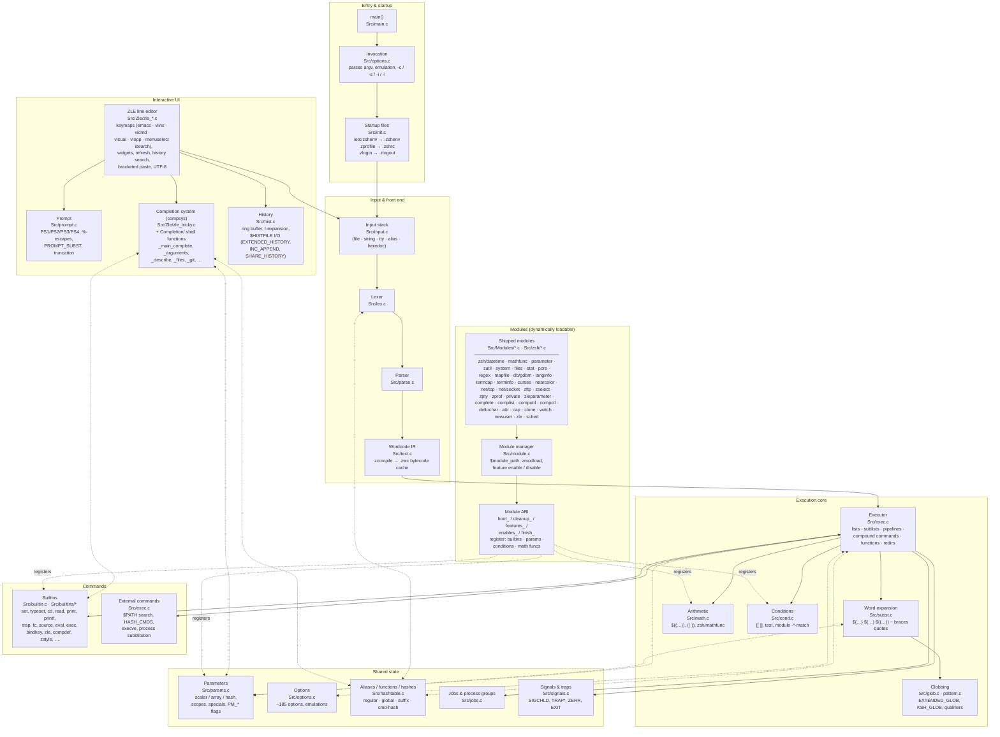

# zsh — architecture at a glance

High-level map of the upstream `zsh-users/zsh` codebase, drawn as the reference
jfsh is aiming to match. File names use zsh's own layout (`Src/*.c`,
`Src/Zle/*.c`, `Src/Modules/*.c`, `Completion/*`), not jfsh's.

## Reading the diagram

- **Solid arrows** (`-->`) are control flow / data flow: a command line goes
  from the input stack through the lexer, parser and wordcode into the
  executor; the executor delegates to expansion, globbing, builtins or
  external exec.
- **Dashed arrows** (`-.->`) are reads / writes to shared state (parameters,
  options, the alias table, the function table, the hashed command cache)
  or feature registration (modules register into the same tables the
  executor and the lexer read).
- **ZLE** (interactive) is the loop around the whole thing: it owns the
  terminal, draws the prompt, runs widgets, drives completion, pushes the
  finished line into the input stack and records it in the history file.
- **Modules** are not a layer but a **registration mechanism**: `zmodload`
  loads a `.so`, calls its `boot_` hook, and that hook adds entries to the
  builtin table, the parameter table, the condition table and the math-
  function registry. The executor only ever sees "another builtin" / "another
  parameter" / "another math func".

## The main subsystems in words

| Subsystem | Role | Files |
|---|---|---|
| Entry & startup | parse argv, decide login/interactive/emulation, read startup files in order | `main.c`, `init.c`, `options.c` |
| Input stack | pushdown stack of input sources (tty, file, `-c` string, alias body, heredoc body, `eval` text) | `input.c` |
| Lexer | produces `TK_*` tokens; tracks quote state, nested `$(…)`/`${…}`/`$((…))`; handles alias expansion in command position | `lex.c` |
| Parser | emits wordcode — a prefix bytecode with skip lengths — into a heap-allocated program | `parse.c` |
| Wordcode | IR shared with `zcompile`, `fc -l`, `functions` decompile, `.zwc` autoload cache | `text.c` |
| Executor | walks the wordcode: lists, sublists, pipelines, compound commands, functions, redirections, subshells, `( )` vs `{ }` | `exec.c` |
| Expansion | the full M3-style expander: quotes, parameters with every flag / modifier / subscript, command and arithmetic substitution, brace, tilde, `=cmd` | `subst.c` |
| Globbing | pattern compile, directory walk, qualifiers, extended-glob operators | `glob.c`, `pattern.c` |
| Math | precedence-climbing evaluator for `$((…))`, `(( ))`, `let`, `[[ -eq ]]`; integer and float | `math.c` |
| Conditions | `[[ ]]` tree + `test` / `[` parser; unary file tests, string ops, `=~`, module `-*-match` | `cond.c` |
| Parameters | the live parameter table — scalar / array / hash, scopes, PM_* attributes, specials with getters/setters | `params.c` |
| Options | ~185 named options with per-emulation defaults, letter forms for `set -e` | `options.c` |
| Aliases & functions | hash tables; aliases expanded by the lexer in command position, functions looked up by the executor | `hashtable.c` |
| Jobs | job table, process-group tracking, `jobs`/`fg`/`bg`/`wait` | `jobs.c` |
| Signals | trap table, self-pipe to the executor, SIGCHLD handling, child-side reset on fork | `signals.c` |
| Builtins | the ~70 shipped builtins (`set`, `cd`, `typeset`, `read`, `print`, `printf`, `trap`, `fc`, `source`, …) | `builtin.c`, `builtins/*.c` |
| External exec | `execve` with the environment from the parameter table, `$PATH` search with `HASH_CMDS` cache | `exec.c` |
| Prompt | `%`-escape expander for `PS1`/`PROMPT`/`PS2`/`PS3`/`PS4`, truncation, color groups, PROMPT_SUBST re-expansion | `prompt.c` |
| ZLE | the line editor: keymaps, widgets, refresh, history search, bracketed paste, UTF-8, menu selection, autosuggestions-shaped points | `Zle/zle_*.c` |
| Completion | compsys dispatcher in `zle_tricky.c` plus the shell-function library under `Completion/` | `Zle/zle_tricky.c`, `Completion/**` |
| History | ring buffer, `!`-expansion, `$HISTFILE` I/O with EXTENDED_HISTORY and locking | `hist.c` |
| Modules | `zmodload`, module path, feature tables, `.so` loader | `module.c`, `Src/Modules/*.c` |

## Why this shape

Three things keep zsh's design coherent across ~300 kLOC:

1. **Wordcode is the choke point.** Everything parseable turns into the same
   IR, so the executor, `functions`-decompile, `fc`-edit, `.zwc` cache and
   `zcompile` all agree on the shape of a command.
2. **Parameters are a live interface.** Every "special" (`$SECONDS`,
   `$RANDOM`, `$EPOCHREALTIME`, `$history`, `$functions`) is a parameter with
   a getter/setter, so modules extend the shell by adding rows to the
   parameter table — no new accessor code anywhere else.
3. **Modules register features; they don't live on the side.** A loaded
   module's builtins show up in `whence`, its parameters in `$parameters`,
   its conditions in `[[ ]]`, its math functions in `$((…))`. That's why the
   same framework scales from `zsh/datetime` (two parameters) to `zsh/pcre`
   (a builtin plus a condition plus state).

jfsh's own architecture (see `jfsh-architecture.md`) mirrors these three
choices.
